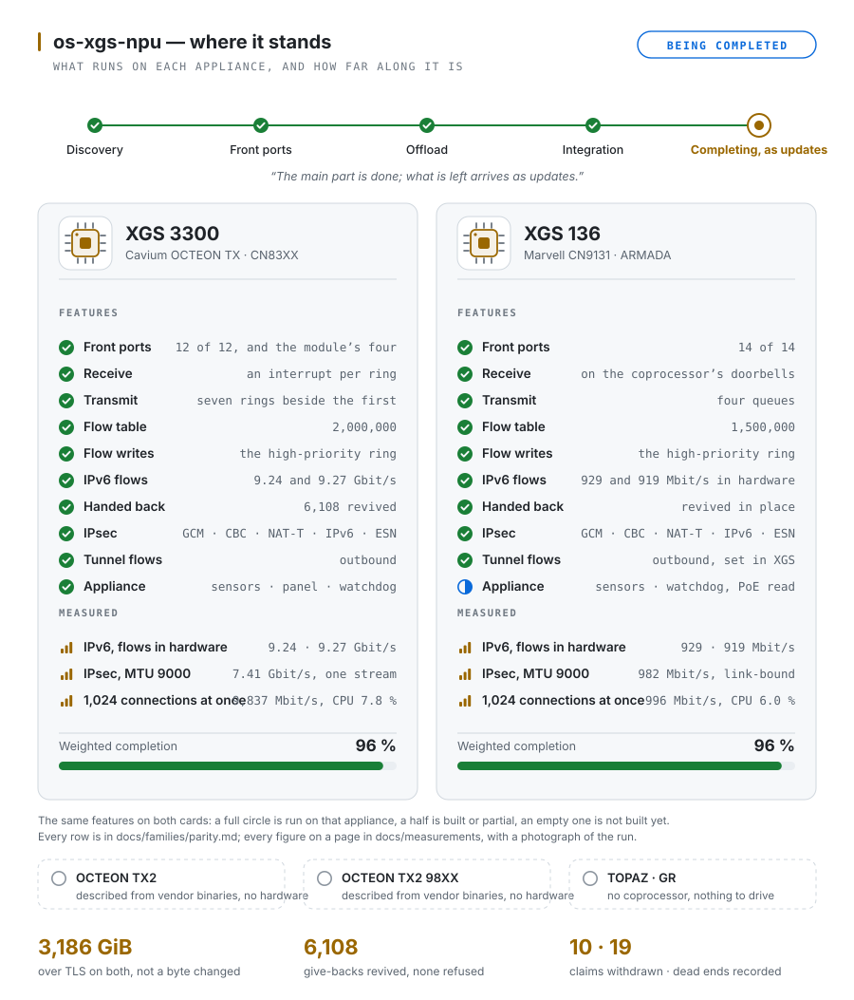

<picture>
  <source media="(prefers-color-scheme: dark)" srcset="docs/images/readme/banner-dark.svg">
  <source media="(prefers-color-scheme: light)" srcset="docs/images/readme/banner-light.svg">
  
</picture>

> **⚠ WORK IN PROGRESS, 2026-10-14: the XGS 136's driver, hooks and hardware support are being integrated into this repository and its plugins right now. Nothing here is advised for any use or any test on either appliance - the XGS 136 or the XGS 3300 - until the integration and its testing are finished and this notice is removed.**

<p align="center">
  <a href="https://github.com/AbdelmonemAwad/os-xgs-npu/actions/workflows/checks.yml"></a>
  <a href="https://github.com/AbdelmonemAwad/os-xgs-npu/actions/workflows/upstream.yml"></a>
  <a href="https://github.com/AbdelmonemAwad/os-xgs-npu/actions/workflows/docs-review.yml"></a>
  <br>
  <a href="https://github.com/AbdelmonemAwad/os-xgs-npu/releases"></a>
  <a href="CHANGELOG.md"></a>
  <a href="LICENSE"></a>
  <a href="#-experimental"></a>
  <a href="docs/guide/families-and-hardware.md#-families"></a>
  <a href="docs/families/README.md"></a>
  <a href="contrib/"></a>
  <a href="CONTRIBUTING.md"></a>
</p>

Install OPNsense on a Sophos XGS and it boots to a working firewall with **no network interfaces at
all**. The appliance looks like one computer and is two: an x86 host, and a coprocessor behind a PCIe
endpoint that owns every front port. Sophos ships drivers for its own operating system and for Linux
only, so when support lapses the usual verdict on the hardware is e-waste.

**os-xgs-npu** is a pair of FreeBSD kernel modules, written against registers no vendor documents, and
an OPNsense plugin around them. They hand the front ports back - and then hand the coprocessor the
firewall's own connections and IPsec associations, so its fast path forwards them without the host.
Two of the six coprocessor families answer now, on silicon that shares nothing.

<picture>
  <source media="(prefers-color-scheme: dark)" srcset="docs/images/readme/status-dark.svg">
  <source media="(prefers-color-scheme: light)" srcset="docs/images/readme/status-light.svg">
  
</picture>

## At a glance

- **Two families, every front port.** The XGS 3300 (OCTEON TX) has all twelve and its expansion
  module's; the XGS 136 (ARMADA) has all fourteen - each an ordinary FreeBSD interface, named as the
  chassis names it.
- **pf decides, the coprocessor forwards.** A connection the firewall has passed goes into the
  coprocessor's flow table, IPv4 with its translation and IPv6 as it is, and comes back out the
  moment pf lets go of it. Each driver sizes its table by what the board itself says it holds -
  2,000,000 connections on the XGS 3300, 1,500,000 on the XGS 136
  ([board-limits.md](docs/families/board-limits.md)).
- **IPsec in the coprocessor's engine.** An association strongSwan installs through OPNsense lands on
  the engine with nothing typed: AES-GCM, AES-CBC with an HMAC, NAT traversal, IPv6 inside and out.
- **It installs like part of OPNsense.** One section of the menu, every page in Arabic and English, the
  front ports assigned at the first boot, updates from this repository, and
  [xgs-image-builder](https://github.com/AbdelmonemAwad/xgs-image-builder) for an image with all of it
  inside.
- **Kept honest.** Every figure is on a page with how it was taken and a photograph of the run; a
  claim that turned out wrong stays on its page, struck through, beside what replaced it
  ([the-road.md](docs/the-road.md)).

## Measured

Every badge links to the page that holds its number, and the page names the module build.

<table>
<tr>
<th width="14%"></th>
<th width="43%">XGS 136 &nbsp;&middot;&nbsp; ARMADA CN913x &nbsp;&middot;&nbsp; <code>contrib/npuep</code></th>
<th width="43%">XGS 3300 &nbsp;&middot;&nbsp; OCTEON TX CN83xx &nbsp;&middot;&nbsp; <code>contrib/octep</code></th>
</tr>
<tr>
<td valign="top"><b>platform</b></td>
<td valign="top">

<a href="docs/guide/what-works.md"></a><br>
<a href="compat.json"></a><br>
<a href="compat.json"></a><br>
<a href="docs/families/armada.md#building-and-running-it"></a><br>
<a href="docs/families/armada.md#the-coprocessor-from-the-host"></a>

</td>
<td valign="top">

<a href="docs/families/octeon-tx.md"></a><br>
<a href="docs/measurements/xgs3300.md#the-machine"></a><br>
<a href="docs/measurements/xgs3300.md#the-machine"></a><br>
<a href="docs/measurements/xgs3300.md#a-kernel-update-must-not-cost-the-front-ports"></a>

</td>
</tr>
<tr>
<td valign="top"><b>data path</b></td>
<td valign="top">

<a href="docs/measurements/mtu-2026-10-17.md#the-xgs-136-over-the-gigabit-link"></a><br>
<a href="docs/findings/a-hundred-polls-a-second-on-the-armada.md"></a><br>
<a href="docs/findings/one-next-hop-for-many-flows-on-the-armada.md"></a><br>
<a href="docs/findings/the-revision-barrier-on-the-armada.md"></a><br>
<a href="docs/families/board-limits.md"></a><br>
<a href="docs/measurements/ipv6-and-queues-2026-10-18.md#the-xgs-136s-four-transmit-queues"></a><br>
<a href="docs/families/board-limits.md"></a>

</td>
<td valign="top">

<a href="docs/measurements/xgs3300.md#the-clear-text-path-at-a-gigabit-through-the-host-and-with-the-flow-table"></a><br>
<a href="docs/measurements/xgs3300.md#the-clear-text-path-at-a-gigabit-through-the-host-and-with-the-flow-table"></a><br>
<a href="docs/measurements/mtu-2026-10-17.md"></a><br>
<a href="docs/measurements/xgs3300.md#the-mtu-from-72-to-9000-on-the-spot"></a><br>
<a href="docs/findings/the-sensors-answer-on-the-host-bus.md"></a><br>
<a href="docs/measurements/ipv6-and-queues-2026-10-18.md#ipv6-through-the-xgs-3300"></a><br>
<a href="docs/families/board-limits.md"></a>

</td>
</tr>
<tr>
<td valign="top"><b>IPsec</b></td>
<td valign="top">

<a href="docs/findings/the-engine-encrypts-outbound-esp-on-the-armada.md"></a><br>
<a href="docs/findings/the-host-answers-through-the-tunnel-on-the-armada.md"></a><br>
<a href="docs/findings/fragmentation-before-the-envelope-on-the-armada.md"></a><br>
<a href="docs/findings/a-window-on-the-armada.md"></a><br>
<a href="docs/findings/esp-behind-udp-on-the-armada.md"></a><br>
<a href="docs/findings/a-block-cipher-on-the-armada.md"></a><br>
<a href="docs/findings/amd-ccp-breaks-ipsec-gcm-on-the-xgs-136-host.md#the-fix-2026-10-17"></a>

</td>
<td valign="top">

<a href="docs/measurements/mtu-2026-10-17.md"></a><br>
<a href="docs/measurements/xgs3300.md#a-ring-behind-the-block-build-by-build"></a><br>
<a href="docs/findings/the-flow-carries-the-association.md"></a><br>
<a href="docs/measurements/xgs3300.md#an-association-behind-nat-on-the-coprocessor"></a><br>
<a href="docs/measurements/xgs3300.md#aes-cbc-with-an-hmac-on-the-coprocessor"></a><br>
<a href="docs/measurements/xgs3300.md#an-ipv6-outer-header"></a><br>
<a href="docs/measurements/xgs3300.md#replay-windows-other-than-32"></a><br>
<a href="docs/measurements/xgs3300.md#an-association-with-extended-sequence-numbers"></a><br>
<a href="docs/findings/gcm-12-and-transport-are-not-ours.md"></a>

</td>
</tr>
<tr>
<td valign="top"><b>reliability</b></td>
<td valign="top">

<sub>no long soak under load on this board yet - <a href="docs/families/armada.md#where-this-stands">row 7</a></sub>

</td>
<td valign="top">

<a href="docs/measurements/xgs3300.md#two-hours-of-tls-on-the-failures-own-path-translated-through-the-host"></a><br>
<a href="docs/measurements/xgs3300.md#three-hours-of-tls-on-the-clear-text-path-with-the-trigger-on-and-then-off"></a><br>
<a href="https://github.com/AbdelmonemAwad/os-xgs-npu/issues/361"></a>

</td>
</tr>
</table>

<p align="center"><sub>colours: <strong>green</strong> measured and working &middot; <strong>yellow</strong> partial, the link says which half &middot; <strong>light grey</strong> not offloaded, by whose refusal the link says &middot; <strong>orange</strong> an open fault &middot; <strong>dark grey</strong> a fact about the repository &middot; the version badges in their projects' colours. A badge is corrected the day a measurement contradicts it, the old figure struck beside the new in the section it links to, like everything else here.</sub></p>

## Families

| family | coprocessor | boards | driver | hardware here | state |
|---|---|---|---|---|---|
| [ARMADA](docs/families/armada.md) | Marvell CN913x, `11ab:7080` | AMDA0200 XGS 87/107, AMDA0201 XGS 126/136, AMDA0208 XGS 116, AMDA0224 XGS 138 | `npuep` | **XGS 136** | all 14 front ports, flow and IPsec offload |
| [OCTEON TX](docs/families/octeon-tx.md) | Cavium CN83xx, `177d:a300` | AMDA0202 XGS 2100/2300/3100/3300 | `octep` | **XGS 3300** | all 12 front ports and the module's, flow and IPsec offload |
| [OCTEON TX2](docs/families/octeon-tx2.md) | `177d:b200` | the larger boards | none | no | described from the vendor's binaries |
| [OCTEON TX2 98XX](docs/families/octeon-tx2-98xx.md) | `177d:b100` | the largest boards | none | no | described from the vendor's binaries |
| [TOPAZ](docs/families/topaz.md), [GR](docs/families/gr.md) | none | Atom boards | not needed | no | no coprocessor exists |

What has run on which board, and why there are two drivers and not one with a switch in it, is in
[the families page](docs/guide/families-and-hardware.md). **What one appliance has and the other does
not** - the same features listed for both, so every gap shows - is [parity.md](docs/families/parity.md).

## ⚠ Experimental

<table>
<tr><td>

<p align="center">
  
  <br>
  <strong>EXPERIMENTAL &nbsp;&mdash;&nbsp; UNDER ACTIVE DEVELOPMENT &nbsp;&mdash;&nbsp; EXPERTS ONLY</strong>
</p>

This project drives an undocumented PCIe coprocessor by writing to its registers from a kernel
module of our own making. There is no vendor support for any of it, on any operating system.

It is not a product. It is not supported. It can wedge the appliance hard enough to need a
power cycle by hand &mdash; which has already happened here, more than once, during development.

<p align="center">
  
  <br>
  <strong>DO NOT RUN THIS ON ANYTHING YOU RELY ON.</strong>
</p>

Not on a firewall carrying real traffic. Not on hardware whose power switch you cannot reach.
Assume any commit can change behaviour, and assume the first thing you lose is the network you
manage it over.

You will need a serial console, the willingness to read the source before you load it, and a way
to reinstall if it goes wrong.

**USE IT AT YOUR OWN RISK AND ON YOUR OWN RESPONSIBILITY.** Nothing here carries a warranty of any
kind, and no one else is answerable for what it does to your hardware, your network or your data.
If you load it, that decision and its consequences are yours.

</td></tr>
</table>

## Installing

One installer reads the board's assembly number and installs only that board's pieces; any other
board gets nothing. The kernel module is built on the appliance against the running kernel's own
sources and stamped with it.

```sh
git clone https://github.com/AbdelmonemAwad/os-xgs-npu
cd os-xgs-npu
./install/install.sh
```

Then **XGS Coprocessor** in the menu: Overview, Settings, Ports, Transceivers, IPsec, Offloaded Flows,
Updates, Problem Reports and the log. Updates come from the [releases](https://github.com/AbdelmonemAwad/os-xgs-npu/releases),
not from every change merged. Everything about installing, the boot hooks, the pages, updating
and the first boot is in [docs/guide/installing.md](docs/guide/installing.md) - read its note on DNS
before blaming the driver for a network with no internet.

## Documentation

| | |
|---|---|
| [**docs/README.md**](docs/README.md) | **Start here**: the documentation by what you want to do, and every folder by what it holds |
| [docs/INDEX.md](docs/INDEX.md) | Every page, one line each, with the date it was last reviewed and when it is due again ([how pages are reviewed](docs/REVIEW.md)) |
| [docs/guide/](docs/guide/) | What used to be this file, at full length: [what works](docs/guide/what-works.md), [how it works](docs/guide/how-it-works.md), [what it cannot do](docs/guide/limitations.md), [families and hardware](docs/guide/families-and-hardware.md), [installing](docs/guide/installing.md), [background](docs/guide/background.md), [every badge](docs/guide/measured.md) |
| [DESIGN.md](DESIGN.md) | The contract: the stages, the limits that are properties of the hardware, and every claim that turned out to be wrong |
| [docs/measurements/](docs/measurements/) | The numbers, with how each was taken and a photograph of the run |
| [docs/findings/](docs/findings/) | What was found, dated, one page per fault or discovery |
| [CHANGELOG.md](CHANGELOG.md) | What changed in each release, written from the commits; [RELEASING.md](RELEASING.md) says when a release is made - at once for a fix, gathered for improvements |
| [CONTRIBUTING.md](CONTRIBUTING.md) | Building, testing on an appliance, and what a change has to carry |

## ⚖️ Licence

**BSD-2-Clause.** Every file carries the identifier; [LICENSE](LICENSE) is the whole of it.

The protocol it speaks was recovered from Marvell's GPL-2.0-only sources, published by Sophos in
its SFOS_OSS drop, and from binaries the appliance ships. **No vendor code is included or
redistributed here.** Facts — offsets, command numbers, field widths — are transcribed; expression
is not copied, and `contrib/npuep/npugiu.h` is where that decision is visible and argued.

[**docs/provenance.md**](docs/provenance.md) sets out exactly what was read, from where, which four
sentences are quoted verbatim and why, and what is deliberately absent. Read it before reusing
this, and form your own view.

### Copyright, trademarks and credit

Copyright &copy; 2026 Abdelmonem Awad. **OPNsense&reg;** is a registered trademark of Deciso B.V.;
**Sophos&reg;** and **XGS** are trademarks of Sophos Ltd. This project is independent: it is not
affiliated with, endorsed by or sponsored by either, and their names are used only to say what this
software runs on.

Each page the plugin adds ends with a one-line credit - the project, its author, its licence, and that
it is independent. OPNsense's own footer, with Deciso's copyright, is left exactly as it is.
