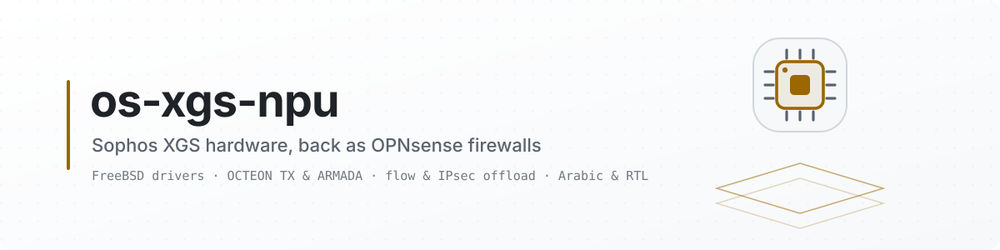
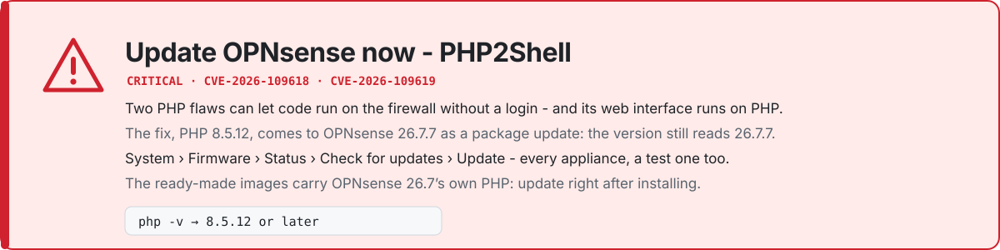
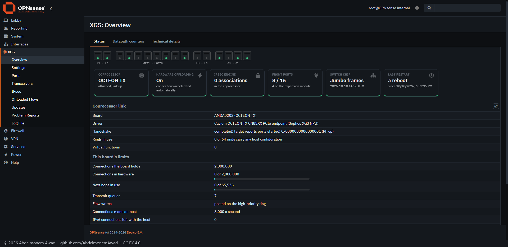

<picture>
  <source media="(prefers-color-scheme: dark)" srcset="docs/images/readme/banner-dark.svg">
  <source media="(prefers-color-scheme: light)" srcset="docs/images/readme/banner-light.svg">
  
</picture>

<picture>
  <source media="(prefers-color-scheme: dark)" srcset="docs/images/readme/notice-dark.svg">
  <source media="(prefers-color-scheme: light)" srcset="docs/images/readme/notice-light.svg">
  
</picture>

> [!CAUTION]
> **Update OPNsense now, on every appliance - a test one too. PHP2Shell, 2026-10-21.** PHP fixed two
> critical flaws, CVE-2026-109618 and CVE-2026-109619, which [php.net](https://www.php.net/archive/2026.php)
> says can allow remote code execution without a login, and OPNsense's web interface runs on PHP.
> OPNsense delivers the fix, **PHP 8.5.12**, to 26.7.7 as an out-of-band package update, so **the
> version still reads 26.7.7 afterwards** ([its announcement](https://forum.opnsense.org/index.php?topic=53191.0)):
> on 2026-10-25 one of this project's own test appliances still ran PHP 8.5.11 under "OPNsense 26.7.7".
>
> - **Update:** System: Firmware: Status - *Check for updates*, then *Update*.
> - **Check:** in a shell (the console's option 8, or SSH), `php -v` reads **8.5.12** or later.
> - **The captive portal**, if you run it: restart it after the update, as OPNsense advises.
> - **The [ready-made images](https://github.com/AbdelmonemAwad/xgs-image-builder/releases)** start from
>   OPNsense 26.7's own image and carry its older PHP: update right after installing, before the web
>   interface can be reached from a network you do not trust.

> [!NOTE]
> **Still being completed.** The main part of the work is done. Some functions are being improved, and
> the XGS-specific integration is being completed where something is still missing - each gap is on
> [docs/families/parity.md](docs/families/parity.md) - and it all arrives as updates, through the
> [releases](https://github.com/AbdelmonemAwad/os-xgs-npu/releases).

> [!IMPORTANT]
> **New discoveries, 2026-10-22 - and why the completion figures went down.** A sweep of the vendor's
> own sources and the coprocessor's own log found capabilities of this hardware that were not known: a
> deep packet inspection and threat detection engine on the XGS 3300's coprocessor, a transmit rate
> limit for each front port, the TCP window checked in hardware - which also showed that a connection
> in hardware has its TCP window checked nowhere ~~today~~ - and more. They matter a great deal, so the
> figures now count them: the XGS 3300 ~~97%~~ ~~89%~~ **90%**, the XGS 136 ~~96%~~ ~~91%~~ ~~92%~~ **93%** - up
> again the same evening, once the first of them was done: **the coprocessor checks the TCP window of a
> connection it holds** ([measured](docs/measurements/tcp-window-2026-10-22.md)) - and the second:
> **the host knows within 30 seconds when its fast path stops** - on the XGS 3300 by a heartbeat it
> answers every time, on the XGS 136 by the heartbeat taken off its queue - reports it, and restarts
> the appliance if its owner chose that
> ([measured](docs/measurements/heartbeat-2026-10-22.md)) - and on 2026-10-23 the third: **the XGS
> 3300's coprocessor is reached over its PCIe management link instead of its console**, one command
> in 0.77 seconds instead of 11 ([measured](docs/measurements/mgmt-link-2026-10-23.md)). **They will be
> worked on gradually and arrive as updates.** Every one of them, with a drawing of where it lives:
> [the discoveries of 2026-10-22](docs/findings/discoveries-2026-10-22.md), ticked off in
> [680](https://github.com/AbdelmonemAwad/os-xgs-npu/issues/680).

<p align="center">
  <a href="https://github.com/AbdelmonemAwad/os-xgs-npu/actions/workflows/checks.yml"></a>
  <a href="https://github.com/AbdelmonemAwad/os-xgs-npu/actions/workflows/upstream.yml"></a>
  <a href="https://github.com/AbdelmonemAwad/os-xgs-npu/actions/workflows/docs-review.yml"></a>
  <br>
  <a href="https://github.com/AbdelmonemAwad/os-xgs-npu/releases"></a>
  <a href="CHANGELOG.md"></a>
  <a href="LICENSE"></a>
  <a href="#getting-it-onto-an-appliance"></a>
  <a href="docs/guide/families-and-hardware.md#-families"></a>
  <a href="docs/families/README.md"></a>
  <a href="contrib/"></a>
  <a href="CONTRIBUTING.md"></a>
</p>

Install OPNsense on a Sophos XGS and it boots to a working firewall with **no network interfaces at
all**. The appliance looks like one computer and is two: an x86 host, and a coprocessor behind a PCIe
endpoint that owns every front port. Sophos ships drivers for its own operating system and for Linux
only, so when support lapses the usual verdict on the hardware is e-waste.

**os-xgs-npu** is a pair of FreeBSD kernel modules, written against registers no vendor documents, and
an OPNsense plugin around them. They hand the front ports back - and then hand the coprocessor the
firewall's own connections and IPsec associations, so its fast path forwards them without the host.
Two of the six coprocessor families answer now, on silicon that shares nothing.

<picture>
  <source media="(prefers-color-scheme: dark)" srcset="https://npuforge.org/readme/status-dark.svg">
  <source media="(prefers-color-scheme: light)" srcset="https://npuforge.org/readme/status-light.svg">
  
</picture>

<p align="center"><b>Contents:</b> <a href="#at-a-glance">At a glance</a> &middot; <a href="#the-pages">The pages</a> &middot; <a href="#measured">Measured</a> &middot; <a href="#families">Families</a> &middot; <a href="#getting-it-onto-an-appliance">Getting it onto an appliance</a> &middot; <a href="#documentation">Documentation</a> &middot; <a href="#licence">Licence</a><br>
<b>Also:</b> <a href="https://npuforge.org"><b>npuforge.org</b>, the site</a> &middot; <a href="docs/README.md">the documentation</a> &middot; <a href="docs/images/README.md">every image</a> &middot; <a href="https://github.com/AbdelmonemAwad/os-xgs-npu/wiki">the wiki</a> &middot; <a href="CHANGELOG.md">what changed</a></p>

## At a glance

- **Two families, every front port.** The XGS 3300 (OCTEON TX) has all twelve and its expansion
  module's; the XGS 136 (ARMADA) has all fourteen - each an ordinary FreeBSD interface, named as the
  chassis names it.
- **pf decides, the coprocessor forwards.** A connection the firewall has passed goes into the
  coprocessor's flow table, IPv4 with its translation and IPv6 as it is, and comes back out the
  moment pf lets go of it - or a block list gains its address, which cuts it
  ([measured](docs/measurements/lists-cut-2026-10-19.md)), or the Intrusion Detection logs it with a
  listed TLS fingerprint (JA4), which cuts it too ([measured](docs/measurements/ja4-cut-2026-10-19.md)) -
  dropped on the coprocessor itself first, by its verdict, and kept there while its sender goes on,
  so a cut flood never reaches the host ([measured](docs/measurements/verdict-2026-10-23.md)).
  Both coprocessors count each connection they forward, and the drivers read those counts:
  with pf's, they are what crossed the wire, and given to pf they put the whole connection in its
  state and on its rule, where OPNsense's own pages show it ([XGS 3300](docs/measurements/hw-counters-2026-10-19.md),
  [XGS 136](docs/measurements/xgs136-counts-2026-10-19.md#the-reader-measured)). Each driver sizes its table by what the board itself says it holds -
  2,000,000 connections on the XGS 3300, 1,500,000 on the XGS 136
  ([board-limits.md](docs/families/board-limits.md)). A DSCP a normalization rule sets goes into
  hardware with the connection: the coprocessor writes pf's mark into every frame
  ([measured on both](docs/measurements/flow-dscp-2026-10-24.md)). A connection a bridge carries
  between two of an appliance's ports goes into hardware as a bridged flow, its frames' MACs and TTL
  left as they are ([measured on both](docs/measurements/bridged-2026-10-24.md)). A connection routed
  by a VLAN subinterface goes into hardware too, the coprocessor writing its tag
  ([measured on both](docs/measurements/vlan-2026-10-24.md)).
- ~~**An IPS or the offload, for now.** Suricata sees how a connection in hardware starts and nothing
  after, so its inline IPS and the offload are one or the other until the two are measured together:
  what it must see in full goes in **Never offloaded** on XGS: Settings, or acceleration stays off.
  Whether they can work together is under research~~
  **An IPS and the offload together, as an experiment.** With **Inspect, then hardware** on XGS:
  Settings, OPNsense's Intrusion Detection in IPS mode sees every frame of a new connection the
  coprocessor carries until it has let its first megabyte through, drops what its rules drop, and the
  hardware carries the rest - 941 Mbit/s on the XGS 136, the link full, and 3.98 Gbit/s on the XGS
  3300 ([measured](docs/measurements/inspect-2026-10-23.md#the-setting-and-the-intrusion-detection-service)).
  Off by default; without it, what the IPS must see in full goes in **Never offloaded**, or
  acceleration stays off ([the FAQ](docs/guide/faq.md#what-runs-in-the-coprocessors-hardware)).
- **Captive Portal clients in hardware.** With the setting on XGS: Settings, each portal session is a
  live user of the coprocessor: its connections run in hardware, and a logout, a hard or an idle
  timeout takes them out at once. What the coprocessor carries is added to the portal's own counts,
  so its idle timeout and RADIUS accounting see it - by an overlay on one of the portal's files,
  changed only on the versions it knows ([measured on both](docs/measurements/cp-hardware-2026-10-24.md)).
  Off by default.
- **Nothing leaves an appliance unless its owner chooses.** Problem reports wait for their Send and
  the appliance is not counted until its owner says so - XGS: Overview asks once
  ([problem-reports.md](docs/problem-reports.md#the-owner-decides)).
- **IPsec in the coprocessor's engine.** An association strongSwan installs through OPNsense lands on
  the engine with nothing typed: AES-GCM, AES-CBC with an HMAC, NAT traversal, IPv6 inside and out.
- **It installs like part of OPNsense.** One section of the menu, every page in Arabic and English, the
  front ports assigned at the first boot, updates from this repository, and
  [xgs-image-builder](https://github.com/AbdelmonemAwad/xgs-image-builder) for an image with all of it
  inside.
- **Kept honest.** Every figure is on a page with how it was taken and a photograph of the run; a
  claim that turned out wrong stays on its page, struck through, beside what replaced it
  ([the-road.md](docs/the-road.md)).

## The pages

<a href="docs/guide/the-pages.md"></a>

**XGS: Overview** on the second XGS 3300, photographed on the appliance itself on 2026-10-19, full
screen in the dark theme. Every page - ~~the nine~~ the ten of the **XGS** section (**About** since
2026-10-20, with the project, its author, its addresses and the disclaimer; the plugins' updates a tab
of **Updates**), the dashboard and the four plugins' - is photographed the same way, each with what it
is for, in
**[docs/guide/the-pages.md](docs/guide/the-pages.md)**; every image in the repository, the appliances'
photographs and the measurements' among them, is indexed in
**[docs/images/README.md](docs/images/README.md)**.

## Measured

Every badge links to the page that holds its number, and the page names the module build. One row is one feature, the same on both appliances, so what one has and the other does not shows in the row - the rows follow [parity.md](docs/families/parity.md).

<table>
<tr>
<th width="14%"></th>
<th width="43%">XGS 136 &nbsp;&middot;&nbsp; ARMADA CN913x &nbsp;&middot;&nbsp; <code>contrib/npuep</code></th>
<th width="43%">XGS 3300 &nbsp;&middot;&nbsp; OCTEON TX CN83xx &nbsp;&middot;&nbsp; <code>contrib/octep</code></th>
</tr>
<tr>
<td rowspan="9" valign="top"><b>platform</b></td>
<td><a href="docs/guide/what-works.md"></a></td>
<td><a href="docs/families/octeon-tx.md"></a></td>
</tr>
<tr>
<td><a href="compat.json"></a></td>
<td><a href="docs/measurements/xgs3300.md#the-machine"></a></td>
</tr>
<tr>
<td><a href="compat.json"></a></td>
<td><a href="docs/measurements/xgs3300.md#the-machine"></a></td>
</tr>
<tr>
<td><a href="docs/families/armada.md#building-and-running-it"></a></td>
<td><a href="docs/measurements/xgs3300.md#a-kernel-update-must-not-cost-the-front-ports"></a></td>
</tr>
<tr>
<td><a href="docs/families/armada.md#the-coprocessor-from-the-host"></a></td>
<td><a href="docs/families/octeon-tx-peripherals.md#the-cpld-is-driven-now-and-it-was-holding-two-ports-dark"></a></td>
</tr>
<tr>
<td><a href="docs/families/parity.md#the-table"></a></td>
<td><a href="docs/families/parity.md#the-table"></a></td>
</tr>
<tr>
<td><a href="docs/guide/updating.md"></a></td>
<td><a href="docs/guide/updating.md"></a></td>
</tr>
<tr>
<td><a href="docs/problem-reports.md"></a></td>
<td><a href="docs/problem-reports.md"></a></td>
</tr>
<tr>
<td><a href="docs/measurements/image-136-2026-10-21.md"></a></td>
<td><a href="docs/families/parity.md#the-table"></a></td>
</tr>
<tr>
<td rowspan="4" valign="top"><b>ports</b></td>
<td><a href="docs/measurements/mtu-2026-10-17.md#the-xgs-136-over-the-gigabit-link"></a></td>
<td><a href="docs/measurements/xgs3300.md#the-mtu-from-72-to-9000-on-the-spot"></a><br><a href="docs/measurements/mtu-2026-10-17.md"></a></td>
</tr>
<tr>
<td><a href="docs/measurements/cage-medium-2026-10-19.md"></a></td>
<td><a href="docs/measurements/cage-medium-2026-10-19.md"></a></td>
</tr>
<tr>
<td><a href="docs/families/parity.md#the-table"></a></td>
<td><a href="docs/octep/expansion-modules.md"></a></td>
</tr>
<tr>
<td><a href="docs/families/parity.md#the-table"></a></td>
<td><a href="docs/families/parity.md#the-table"></a></td>
</tr>
<tr>
<td rowspan="4" valign="top"><b>data path</b></td>
<td><a href="docs/findings/a-hundred-polls-a-second-on-the-armada.md"></a></td>
<td><a href="docs/measurements/xgs3300.md#the-clear-text-path-at-a-gigabit-through-the-host-and-with-the-flow-table"></a></td>
</tr>
<tr>
<td><a href="docs/families/parity.md#the-table"></a></td>
<td><a href="docs/families/parity.md#the-table"></a></td>
</tr>
<tr>
<td><a href="docs/measurements/ipv6-and-queues-2026-10-18.md#the-xgs-136s-four-transmit-queues"></a></td>
<td><a href="docs/families/parity.md#the-table"></a></td>
</tr>
<tr>
<td><a href="docs/families/parity.md#the-table"></a></td>
<td><a href="docs/families/parity.md#the-table"></a></td>
</tr>
<tr>
<td rowspan="12" valign="top"><b>flow offload</b></td>
<td><a href="docs/measurements/xgs136-hardware-2026-10-18.md"></a></td>
<td><a href="docs/measurements/xgs3300.md#the-clear-text-path-at-a-gigabit-through-the-host-and-with-the-flow-table"></a></td>
</tr>
<tr>
<td><a href="docs/families/board-limits.md"></a></td>
<td><a href="docs/families/board-limits.md"></a></td>
</tr>
<tr>
<td><a href="docs/measurements/xgs136-hardware-2026-10-18.md#a-thousand-connections-at-once"></a></td>
<td><a href="docs/families/parity.md#the-table"></a></td>
</tr>
<tr>
<td><a href="docs/measurements/xgs136-hardware-2026-10-18.md#ipv6"></a></td>
<td><a href="docs/measurements/ipv6-and-queues-2026-10-18.md#ipv6-through-the-xgs-3300"></a></td>
</tr>
<tr>
<td><a href="docs/measurements/xgs136-giveback-2026-10-19.md"></a></td>
<td><a href="docs/measurements/xgs3300.md#three-hours-of-tls-on-the-clear-text-path-with-the-trigger-on-and-then-off"></a></td>
</tr>
<tr>
<td><a href="docs/findings/the-revision-barrier-on-the-armada.md"></a></td>
<td><a href="docs/octep/ruleset-reload.md"></a></td>
</tr>
<tr>
<td><a href="docs/measurements/xgs136-hardware-2026-10-18.md#a-thousand-connections-at-once"></a></td>
<td><a href="docs/measurements/xgs3300-many-2026-10-19.md"></a></td>
</tr>
<tr>
<td><a href="docs/measurements/xgs136-counts-2026-10-19.md#the-reader-measured"></a></td>
<td><a href="docs/measurements/hw-counters-2026-10-19.md"></a></td>
</tr>
<tr>
<td><a href="docs/measurements/xgs136-counts-2026-10-19.md#the-reader-measured"></a></td>
<td><a href="docs/measurements/hw-counters-2026-10-19.md#added-to-the-interfaces-counters"></a></td>
</tr>
<tr>
<td><a href="docs/measurements/flow-dscp-2026-10-24.md#on-the-xgs-136"></a></td>
<td><a href="docs/measurements/flow-dscp-2026-10-24.md"></a></td>
</tr>
<tr>
<td><a href="docs/measurements/bridged-2026-10-24.md#on-the-xgs-136"></a></td>
<td><a href="docs/measurements/bridged-2026-10-24.md"></a></td>
</tr>
<tr>
<td><a href="docs/measurements/vlan-2026-10-24.md#on-the-xgs-136"></a></td>
<td><a href="docs/measurements/vlan-2026-10-24.md"></a></td>
</tr>
<tr>
<td rowspan="6" valign="top"><b>security</b></td>
<td><a href="docs/measurements/lists-cut-2026-10-19.md"></a></td>
<td><a href="docs/measurements/lists-cut-2026-10-19.md"></a></td>
</tr>
<tr>
<td><a href="docs/measurements/ja4-cut-2026-10-19.md#on-the-xgs-136"></a></td>
<td><a href="docs/measurements/ja4-cut-2026-10-19.md"></a></td>
</tr>
<tr>
<td><a href="docs/measurements/anomaly-2026-10-19.md#on-the-xgs-136"></a></td>
<td><a href="docs/measurements/anomaly-2026-10-19.md"></a></td>
</tr>
<tr>
<td><a href="docs/measurements/dos-probe-2026-10-19.md#on-the-xgs-136"></a></td>
<td><a href="docs/measurements/dos-probe-2026-10-19.md"></a></td>
</tr>
<tr>
<td><a href="docs/measurements/policy-guard-136-2026-10-20.md"></a></td>
<td><a href="docs/measurements/policy-guard-136-2026-10-20.md#on-the-xgs-3300"></a></td>
</tr>
<tr>
<td><a href="docs/measurements/cp-hardware-2026-10-24.md#the-cases-on-the-xgs-136"></a></td>
<td><a href="docs/measurements/cp-hardware-2026-10-24.md"></a></td>
</tr>
<tr>
<td rowspan="9" valign="top"><b>IPsec</b></td>
<td><a href="docs/findings/the-engine-encrypts-outbound-esp-on-the-armada.md"></a><br><a href="docs/findings/the-host-answers-through-the-tunnel-on-the-armada.md"></a></td>
<td><a href="docs/measurements/mtu-2026-10-17.md"></a><br><a href="docs/measurements/xgs3300.md#a-ring-behind-the-block-build-by-build"></a></td>
</tr>
<tr>
<td><a href="docs/findings/a-block-cipher-on-the-armada.md"></a></td>
<td><a href="docs/measurements/xgs3300.md#aes-cbc-with-an-hmac-on-the-coprocessor"></a></td>
</tr>
<tr>
<td><a href="docs/findings/esp-behind-udp-on-the-armada.md"></a></td>
<td><a href="docs/measurements/xgs3300.md#an-association-behind-nat-on-the-coprocessor"></a></td>
</tr>
<tr>
<td><a href="docs/findings/a-window-on-the-armada.md"></a></td>
<td><a href="docs/measurements/xgs3300.md#replay-windows-other-than-32"></a></td>
</tr>
<tr>
<td><a href="docs/findings/fragmentation-before-the-envelope-on-the-armada.md"></a></td>
<td><a href="docs/families/parity.md#the-table"></a></td>
</tr>
<tr>
<td><a href="docs/measurements/ipv6-136-2026-10-20.md"></a></td>
<td><a href="docs/measurements/xgs3300.md#an-ipv6-outer-header"></a></td>
</tr>
<tr>
<td><a href="docs/measurements/esn-136-2026-10-20.md"></a></td>
<td><a href="docs/measurements/esn-3300-2026-10-20.md"></a></td>
</tr>
<tr>
<td><a href="docs/measurements/tunflows-136-2026-10-20.md"></a></td>
<td><a href="docs/findings/the-flow-carries-the-association.md"></a></td>
</tr>
<tr>
<td><a href="docs/findings/amd-ccp-breaks-ipsec-gcm-on-the-xgs-136-host.md#the-fix-2026-10-17"></a></td>
<td><a href="docs/findings/gcm-12-and-transport-are-not-ours.md"></a></td>
</tr>
<tr>
<td rowspan="5" valign="top"><b>the appliance</b></td>
<td><a href="docs/families/parity.md#the-table"></a><br><a href="docs/families/parity.md#the-table"></a></td>
<td><a href="docs/findings/the-sensors-answer-on-the-host-bus.md"></a><br><a href="docs/families/parity.md#the-table"></a></td>
</tr>
<tr>
<td><a href="docs/families/parity.md#the-table"></a></td>
<td><a href="docs/families/parity.md#the-table"></a></td>
</tr>
<tr>
<td><a href="docs/families/parity.md#the-table"></a></td>
<td><a href="docs/families/parity.md#the-table"></a></td>
</tr>
<tr>
<td><a href="docs/measurements/poe-136-2026-10-20.md"></a></td>
<td><a href="docs/families/parity.md#the-table"></a></td>
</tr>
<tr>
<td><a href="docs/families/parity.md#the-table"></a></td>
<td><a href="docs/families/parity.md#the-table"></a></td>
</tr>
<tr>
<td rowspan="3" valign="top"><b>reliability</b></td>
<td><a href="docs/measurements/xgs136-soak-2026-10-19.md"></a></td>
<td><a href="docs/measurements/xgs3300.md#two-hours-of-tls-on-the-failures-own-path-translated-through-the-host"></a></td>
</tr>
<tr>
<td><a href="docs/measurements/rpc-bounds-2026-10-19.md#xgs-136"></a></td>
<td><a href="docs/measurements/rpc-bounds-2026-10-19.md#xgs-3300"></a></td>
</tr>
<tr>
<td><a href="https://github.com/AbdelmonemAwad/os-xgs-npu/issues/531"></a></td>
<td><a href="https://github.com/AbdelmonemAwad/os-xgs-npu/issues/361"></a></td>
</tr>
</table>

<p align="center"><sub>colours: <strong>green</strong> measured and working &middot; <strong>yellow</strong> partial, the link says which half &middot; <strong>light grey</strong> not built yet, or not offloaded, by whose refusal the link says &middot; <strong>grey</strong> the hardware has none &middot; <strong>orange</strong> an open fault &middot; <strong>dark grey</strong> a fact about the repository &middot; the version badges in their projects' colours. A badge is corrected the day a measurement contradicts it, the old figure struck beside the new in the section it links to, like everything else here.</sub></p>

## Families

| family | coprocessor | boards | driver | hardware here | state |
|---|---|---|---|---|---|
| [ARMADA](docs/families/armada.md) | Marvell CN913x, `11ab:7080` | AMDA0200 XGS 87/107, AMDA0201 XGS 126/136, AMDA0208 XGS 116, AMDA0224 XGS 138 | `npuep` | **XGS 136** | all 14 front ports, flow and IPsec offload |
| [OCTEON TX](docs/families/octeon-tx.md) | Cavium CN83xx, `177d:a300` | AMDA0202 XGS 2100/2300/3100/3300 | `octep` | **XGS 3300** | all 12 front ports and the module's, flow and IPsec offload |
| [OCTEON TX2](docs/families/octeon-tx2.md) | `177d:b200` | the larger boards | none | no | described from the vendor's binaries |
| [OCTEON TX2 98XX](docs/families/octeon-tx2-98xx.md) | `177d:b100` | the largest boards | none | no | described from the vendor's binaries |
| [TOPAZ](docs/families/topaz.md), [GR](docs/families/gr.md) | none | Atom boards | not needed | no | no coprocessor exists |

<!-- devices: written by tools/devices-table.py -->

### Every model

The two families with a driver, model by model - the table the drivers and the first boot read ([`models.py`](src/opnsense/scripts/xgs/models.py), [front-ports-by-model.md](docs/families/front-ports-by-model.md)). **Run here** is an appliance this project has been run on; every other model is **added, untested** - from the vendor's board files and device trees, research and development, because there is no such appliance here to test on. It installs, its status page says so, and its first boot checks its ports against what its coprocessor reports ([portcheck.py](src/opnsense/scripts/xgs/portcheck.py)). **Each model has a page on the site** - its ports drawn where they sit, the board drawn, every port's path, the vendor's figures - [every model on npuforge.org](https://npuforge.org/devices/).

| model | family | board | coprocessor | front ports | state |
|---|---|---|---|---|---|
| [XGS 87, 87w](https://npuforge.org/devices/xgs-87/) | ARMADA | `AMDA0200-0001, 0002` | CN9130 | 5: 4 RJ45, 1 SFP | added, untested |
| [XGS 107, 107w](https://npuforge.org/devices/xgs-107/) | ARMADA | `AMDA0200-0003, 0004` | CN9130 | 9: 8 RJ45, 1 SFP | added, untested |
| [XGS 116, 116w](https://npuforge.org/devices/xgs-116/) | ARMADA | `AMDA0208-0001, 0002` | CN9131 | 9: 8 RJ45, 1 SFP | added, untested |
| [XGS 126, 126w](https://npuforge.org/devices/xgs-126/) | ARMADA | `AMDA0201-0001, 0002` | CN9131 | 14: 12 RJ45, 2 SFP | added, untested |
| [**XGS 136**, 136w](https://npuforge.org/devices/xgs-136/) | ARMADA | `AMDA0201-0003, 0004` | CN9131 | 14: 12 RJ45, 2 SFP | **run here** (136w: added, untested) |
| [XGS 138](https://npuforge.org/devices/xgs-138/) | ARMADA | `AMDA0224-0001` | CN9131 | 8: 6 RJ45, 2 SFP+ | added, untested |
| [XGS 2100](https://npuforge.org/devices/xgs-2100/) | OCTEON TX | `AMDA0202-0001` | CN8360 | 10: 8 RJ45, 2 SFP | added, untested |
| [XGS 2300](https://npuforge.org/devices/xgs-2300/) | OCTEON TX | `AMDA0202-0002` | CN8360 | 10: 8 RJ45, 2 SFP | added, untested |
| [XGS 3100](https://npuforge.org/devices/xgs-3100/) | OCTEON TX | `AMDA0202-0003` | CN8365 | 12: 8 RJ45, 2 SFP, 2 SFP+ | added, untested |
| [**XGS 3300**](https://npuforge.org/devices/xgs-3300/) | OCTEON TX | `AMDA0202-0004` | CN8365 | 12: 8 RJ45, 2 SFP, 2 SFP+ | **run here** |

> [!NOTE]
> **Appliances of these models will be bought to test on.** Until then, each model marked untested is confirmed or corrected by its first owner's report.

The families without a driver, from the vendor's board files:

| family | model | board | coprocessor | front ports | module bays |
|---|---|---|---|---|:-:|
| OCTEON TX2 | XGS 4300 | `AMDA0203-0001` | CN9265 | 8 RJ45, 4 SFP+ | A, B |
| OCTEON TX2 | XGS 4500 | `AMDA0203-0002` | CN9265 | 8 RJ45, 4 SFP+ | A, B |
| OCTEON TX2 | XGS 4310 | `AMDA0228` | CN9670 | 8 RJ45, 4 SFP28 | A, B |
| OCTEON TX2 | XGS 5500 | `AMDA0204-0001` | CN9670 | 8 RJ45, 8 SFP+ | A-D |
| OCTEON TX2 | XGS 6500 | `AMDA0204-0002` | CN9670 | 8 RJ45, 12 SFP+ | A-D |
| OCTEON TX2 | XGS 6580 | `AMDA0225-0001` | CN9670 | 4 RJ45, 6 SFP+, 4 SFP28 | A-D |
| OCTEON TX2 98XX | XGS 7500 | `AMDA0205-0001` | CN9880 | 8 RJ45, 12 SFP+, 2 QSFP28 | A-D |
| OCTEON TX2 98XX | XGS 8500 | `AMDA0205-0001` | CN9880 | 8 RJ45, 12 SFP+, 2 QSFP28 | A-D |
| OCTEON TX2 98XX | XGS 7580 | `AMDA0226-0001` | CN9880 | 6 RJ45, 4 SFP+, 8 SFP28, 2 QSFP28 | A-D |
| no coprocessor in the board file | XGS 88, 88w | `AMDA0220` | - | 4 RJ45 | - |
| no coprocessor in the board file | XGS 108, 108w | `AMDA0221` | - | 6 RJ45, 1 SFP | - |
| no coprocessor in the board file | XGS 118, 118w | `AMDA0222` | - | 9 RJ45, 1 SFP | - |
| no coprocessor in the board file | XGS 128, 128w | `AMDA0223` | - | 9 RJ45, 1 SFP | - |

<!-- /devices -->

What has run on which board, and why there are two drivers and not one with a switch in it, is in
[the families page](docs/guide/families-and-hardware.md). **What one appliance has and the other does
not** - the same features listed for both, so every gap shows - is [parity.md](docs/families/parity.md).

## Getting it onto an appliance

Two roads, for two kinds of reader. Most people want a firewall: take the image. Those who want to
read, build and change the drivers themselves take the files.

### 💿 The image - for most people

<table>
<tr>
<td width="62%" valign="top">

**[Download a ready image](https://build.npuforge.org/)** - four are published with ~~each release~~ each main release,
the console at 38400 baud (the Sophos firmware's speed) or 115200 (OPNsense's), each with the front
panel plugin and without it - or, on the same page, choose the OPNsense release, the image type and
the console speed, and the build hands you one of your own. Either is the official OPNsense image,
verified, with this project's **newest release**, its plugins, the Arabic translation and the
right-to-left layout already inside.

Write it to a USB stick, boot the appliance from it and install to the disk. At the first boot from
the disk a thirty-second countdown on the console assigns the front ports by the names on the chassis:
**WAN** on Port2 (XGS 3300) or Port1 (XGS 136), every other front port in one bridge as **LAN** on
192.168.1.1, and the management port, where there is one, as **MGMT** on 192.168.100.1.

From then on, **XGS - Updates** brings each new release.

**Never done this before?** [Installing, step by step](docs/guide/step-by-step.md) goes from nothing to
the first sign-in in order, with a picture for each step: the ready image, or the copy of the builder
and the build, then the USB stick, the console, the installer and the web interface.

</td>
<td width="38%" valign="top">

**The builder:** [xgs-image-builder](https://github.com/AbdelmonemAwad/xgs-image-builder) - its own
repository, its own [build page](https://build.npuforge.org/), its
[ready images](https://github.com/AbdelmonemAwad/xgs-image-builder/releases/latest), and the
install steps, one by one.

**Tested:** an image built there installed on an XGS 3300 on 2026-10-16, which assigned its own front
ports at its first boot; and on an XGS 136 on 2026-10-21, its front ports up at the first boot, then
updated to OPNsense 26.7.7 from the GUI and its earlier configuration restored
([measured](docs/measurements/image-136-2026-10-21.md)). Burn an image and boot it before you rely on it.

</td>
</tr>
</table>

<a name="-experimental"></a>

### 🛠 For experts - the files, directly

This road is for those who want to work on the drivers themselves. They are FreeBSD kernel modules
that drive an undocumented coprocessor, written from the outside with no vendor support on any
operating system, and a mistake in one can stop an appliance until it is power-cycled by hand - which
has happened here, more than once, during development. So it asks a little more than the image does:
**a serial console, an appliance you can reach, the source read before it is loaded, and a way to
reinstall.**

One installer reads the board's assembly number and installs only that board's pieces; any other
board gets nothing. The kernel module is built on the appliance against the running kernel's own
sources and stamped with it.

```sh
git clone https://github.com/AbdelmonemAwad/os-xgs-npu
cd os-xgs-npu
./install/install.sh
```

Then **XGS** in the menu: Overview, Settings, Ports, Transceivers, IPsec, Offloaded Flows,
Updates, Problem Reports and the log. Updates come from the [releases](https://github.com/AbdelmonemAwad/os-xgs-npu/releases),
not from every change merged. Everything about installing, the boot hooks, the pages, updating
and the first boot is in [docs/guide/installing.md](docs/guide/installing.md) - read its note on DNS
before blaming the driver for a network with no internet.

> [!IMPORTANT]
> **Your appliance, your decision.** Whichever road you take, nothing here carries a warranty of any
> kind, and no one else is answerable for what it does to your hardware, your network or your data.
> If you load it, that decision and its consequences are yours. Try a release on an appliance you can
> reach before you trust it with a network you depend on.

## Documentation

| | |
|---|---|
| [**docs/README.md**](docs/README.md) | **Start here**: the documentation by what you want to do, and every folder by what it holds |
| [docs/INDEX.md](docs/INDEX.md) | Every page, one line each, with the date it was last reviewed and when it is due again ([how pages are reviewed](docs/REVIEW.md)) |
| [docs/guide/the-pages.md](docs/guide/the-pages.md) | Every page of the web interface, photographed on an appliance in English and in Arabic, with what each one is for |
| [docs/images/README.md](docs/images/README.md) | Every image in the repository by kind - the appliances, the measurements, the web interface - with what it shows and the pages that use it |
| [The wiki](https://github.com/AbdelmonemAwad/os-xgs-npu/wiki) | How the project came to be, installing it step by step, and its photographs |
| [docs/guide/](docs/guide/) | What used to be this file, at full length: [what works](docs/guide/what-works.md), [how it works](docs/guide/how-it-works.md), [what it cannot do](docs/guide/limitations.md), [families and hardware](docs/guide/families-and-hardware.md), [installing](docs/guide/installing.md), [background](docs/guide/background.md), [every badge](docs/guide/measured.md) |
| [DESIGN.md](DESIGN.md) | The contract: the stages, the limits that are properties of the hardware, and every claim that turned out to be wrong |
| [docs/measurements/](docs/measurements/) | The numbers, with how each was taken and a photograph of the run |
| [docs/findings/](docs/findings/) | What was found, dated, one page per fault or discovery |
| [CHANGELOG.md](CHANGELOG.md) | What changed in each release, written from the commits; [RELEASING.md](RELEASING.md) says when a release is made - at once for a fix, gathered for improvements |
| [CONTRIBUTING.md](CONTRIBUTING.md) | Building, testing on an appliance, and what a change has to carry |

<a name="licence"></a>

## ⚖️ Licence

**BSD-2-Clause.** Every file carries the identifier; [LICENSE](LICENSE) is the whole of it.

The protocol it speaks was recovered from Marvell's GPL-2.0-only sources, published by Sophos in
its SFOS_OSS drop, and from binaries the appliance ships. **No vendor code is included or
redistributed here.** Facts — offsets, command numbers, field widths — are transcribed; expression
is not copied, and `contrib/npuep/npugiu.h` is where that decision is visible and argued.

[**docs/provenance.md**](docs/provenance.md) sets out exactly what was read, from where, which four
sentences are quoted verbatim and why, and what is deliberately absent. Read it before reusing
this, and form your own view.

### Copyright, trademarks and credit

Copyright &copy; 2026 Abdelmonem Awad. The photographs and screenshots in
[docs/images](docs/images/README.md) are under [CC BY 4.0](https://creativecommons.org/licenses/by/4.0/):
use them freely, naming the author and linking here; each carries that notice in a strip added below
it, never over the picture. **OPNsense&reg;** is a registered trademark of Deciso B.V.;
**Sophos&reg;** and **XGS** are trademarks of Sophos Ltd. This project is independent: it is not
affiliated with, endorsed by or sponsored by either, and their names are used only to say what this
software runs on.

No Sophos software or firmware is distributed here. The drivers are this project's own; where a
vendor's code was read to learn how the hardware behaves - Marvell's, published under the GPL - or a
fact was read from software on the appliance, [the provenance pages](docs/provenance.md) say what
was read and why. If you hold rights in anything here and think it should not be, write to
[contact@npuforge.org](mailto:contact@npuforge.org): it will be looked at promptly, and corrected or
taken down if it should be.

Each page the plugin adds ends with a one-line credit - the project, its author, its licence, and that
it is independent. OPNsense's own footer, with Deciso's copyright, is left exactly as it is.
