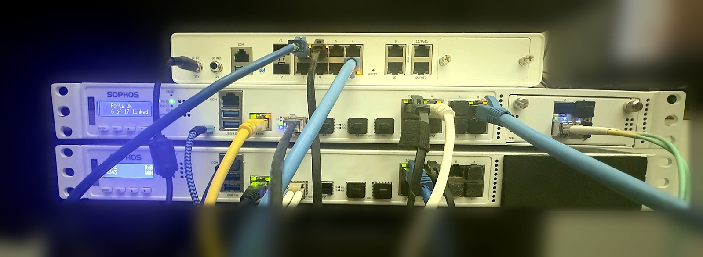
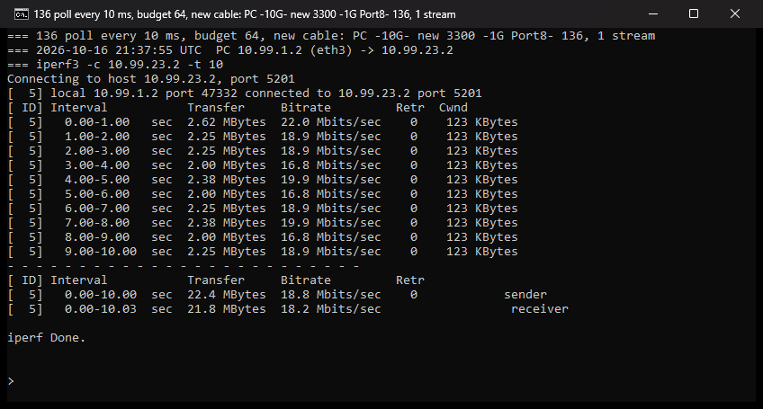
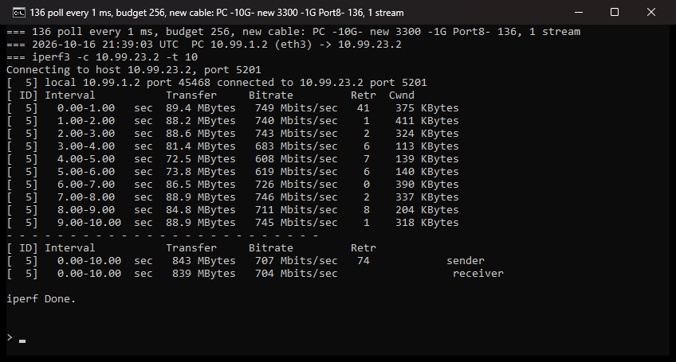
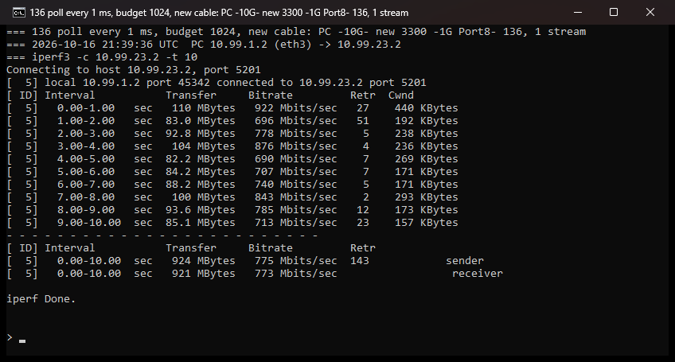
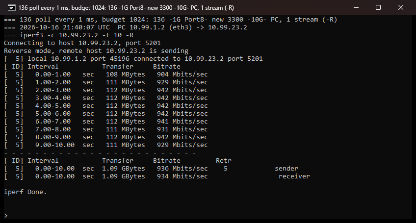

<!-- reviewed: 2026-10-17 -->
# A hundred polls a second

Measured on an XGS 136, 2026-10-17.
[Issue 415](https://github.com/AbdelmonemAwad/os-xgs-npu/issues/415): one TCP stream from a PC into
the 136's host ran at 18.3 Mbit/s over a gigabit link, and a ping across a direct cable took 3 to
10 ms.

## The bench

Three appliances on one shelf, routed to each other over links of their own: a PC on a 10 Gbit/s
copper link to the second XGS 3300, which reaches the first XGS 3300 over a 10 Gbit/s fibre (its
module's A1 to the other's F1) and the XGS 136 over a gigabit cable (Port8 to Port8). Each link is a
/30 out of the LAN bridge, with a pass rule and a static route back. iperf3 3.20 on the PC, under
WSL with mirrored networking, so its own NIC; iperf3 3.22 as the server on each appliance's host.

The XGS 136 at the top; the second XGS 3300 in the middle, its front panel reading "6 of 17
linked", the fibre in the module's first cage (A1); the first XGS 3300 at the bottom, the other end
of the fibre in F1. Taken the night of the measurements, the room around the shelf blurred.

Through the same router, one stream from the PC reaches the first XGS 3300's host at 1.85 Gbit/s
and comes back at 3.00. Into the 136 it was a hundredth of that.

## Why: the budget, divided

There is no receive interrupt on this channel - `vmstat -i` lists none for the driver. A callout
empties the receive rings: `npugiu_tick` re-armed itself every `hz / 100`, ten milliseconds, and
called `npugiu_rx` with a budget of 64 frames, which `npugiu_rx` shares evenly between the four
queues - 16 each. A TCP flow is hashed onto one queue. So a flow got 16 frames per poll and 100
polls a second:

    16 frames x 100 polls x 1448 bytes = 18.5 Mbit/s

which is the measurement. The poll interval is also the round trip: a frame that arrives just after
a poll waits for the next one.

## The change

`contrib/npuep/npugiu.c`: the interval and the budget are now `dev.npuep.0.giu.poll_ms` (1 to 100)
and `dev.npuep.0.giu.rx_budget` (4 to 4096), changeable while the driver runs, and loader tunables
`hw.npuep.giu.poll_ms` and `hw.npuep.giu.rx_budget`. Each was measured against the other without a
rebuild, one TCP stream for ten seconds, and the defaults are the last row: **one millisecond and
1024 frames**, 256 a queue - more than a receive ring holds, so one poll empties every ring.

| `poll_ms` | `rx_budget` | PC to the 136 | the 136 to the PC | ping, 20 |
|---|---|---|---|---|
| 10 (before) | 64 (before) | 18.2 Mbit/s | 347 Mbit/s | 5 ms on average, 10 at most |
| 1 | 64 | 185 Mbit/s | | under 1 ms |
| 1 | 256 | 704 Mbit/s | | under 1 ms |
| **1** | **1024** | **773 Mbit/s** | **934 Mbit/s** | under 1 ms |

The first row was measured after the gigabit cable had been replaced, on the suspicion that it was
the cause - it was not: 18.2 against 18.3 before. With a poll every millisecond the host was 99.7 %
idle. After the new defaults were built in and the 136 rebooted, the sysctls read 1 and 1024, all
fourteen front ports came up, and one stream ran at 862 Mbit/s for five seconds.

The windows the measurements ran in, photographed when each finished:

The addresses in them are the bench's own links, which exist nowhere else.

## The lesson

A polled receive path has a ceiling of budget times rate, and a budget shared between queues is
divided by the number of queues before a single flow sees any of it. Work the ceiling out from the
constants first: here it was the whole answer, to a tenth of a megabit.
