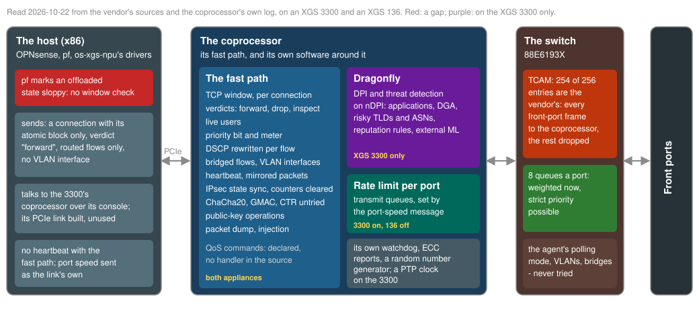
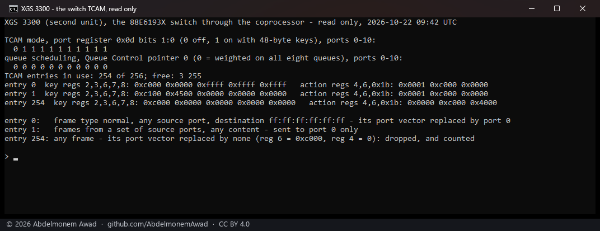
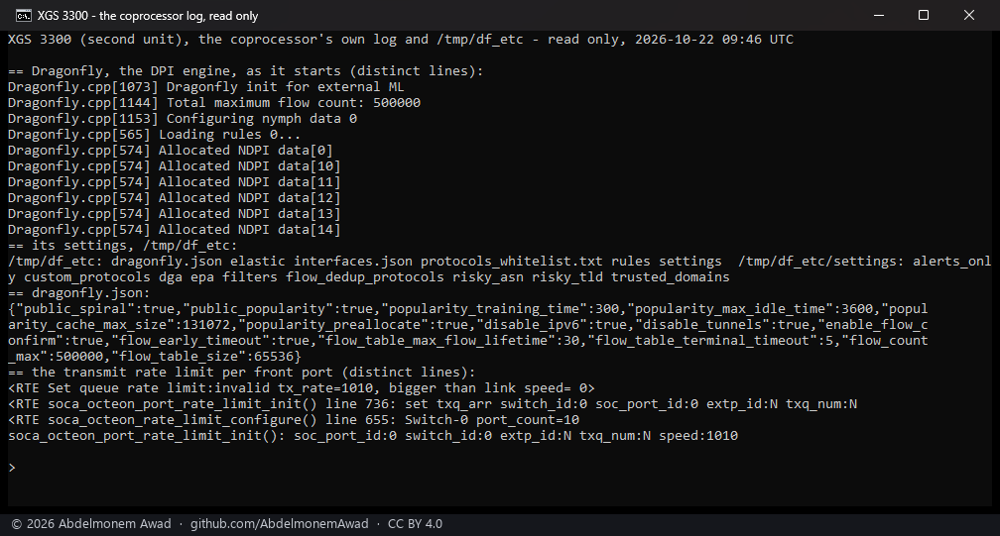
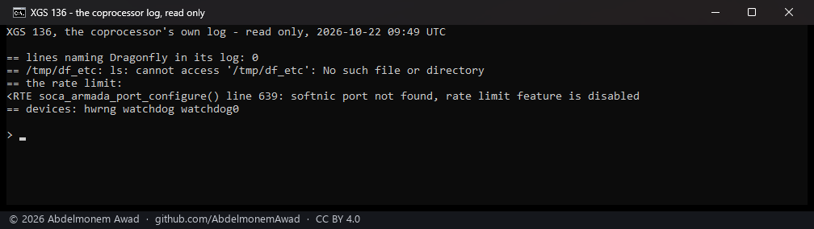

<!-- reviewed: 2026-10-22 -->
# What the hardware can do that was not known - the discoveries of 2026-10-22

> [!IMPORTANT]
> **These discoveries matter a great deal, and they lowered the completion figures on purpose.** A
> sweep of the vendor's own sources, its board package and the coprocessor's own log found
> capabilities of this hardware that this project had not known about - among them a deep packet
> inspection and threat detection engine running on the XGS 3300's coprocessor, a transmit rate limit
> for each front port, and the TCP window checked in hardware, which also showed that **a connection
> in hardware has its TCP window checked nowhere ~~today~~** - the first of them closed the same day:
> [the window is checked in hardware now](../measurements/tcp-window-2026-10-22.md). The family tables now count them: the XGS
> 3300 went from ~~97%~~ to **89%** ([its table](../families/octeon-tx-reference.md#where-this-stands))
> and the XGS 136 from ~~96%~~ to **91%** ([its table](../families/armada.md#where-this-stands)).
> **They will be worked on one at a time and arrive as updates**, ticked off in
> [680](https://github.com/AbdelmonemAwad/os-xgs-npu/issues/680); each section below says where it stands.

Every section is marked with how far it has been taken:

| mark | means |
|---|---|
| **source** | read in the vendor's own source or headers; not yet tried on an appliance |
| **read** | read on the appliance itself - its coprocessor's log, its files, its registers - and photographed |
| **measured** | tried on the appliance, with the result |

The sources are the vendor's GPL release of SFOS v22 (SDK 10.22.03): the fast path's headers and the
coprocessor side of its RPC, the vendor's own host module that drives them, the board package and
the network agent's host module. Only names and facts are taken from them here - which structure
field, which command, which message - and no code; the project's position on that is in
[the README's licence section](../../README.md#licence). The readings were taken on 2026-10-22 on the
second XGS 3300 and on the XGS 136, read only.

## Where each capability lives

## All of them, in one table

| | discovery | where | XGS 3300 | XGS 136 | os-xgs-npu today |
|---|---|---|---|---|---|
| 1 | [The TCP window, in hardware](#the-tcp-window-in-hardware) | fast path | ~~source~~ **measured** | ~~source~~ **measured** | ~~**a gap**: checked nowhere~~ **checked in hardware since 2026-10-22** |
| 2 | [The window handed back](#the-window-handed-back) | fast path | ~~source~~ **measured** | ~~source~~ **measured** | ~~the take-back's TCP state not used~~ **given to pf at a take-back since 2026-10-22** |
| 3 | [A connection dropped by its verdict](#a-connection-dropped-by-its-verdict) | fast path | source | source | verdict always "forward" |
| 4 | [Inspection, then hardware](#inspection-then-hardware) | fast path | source | source | none |
| 5 | [Live users](#live-users) | fast path | source | source | none |
| 6 | [A priority bit and a meter for each connection](#a-priority-bit-and-a-meter-for-each-connection) | fast path | source | source | zero |
| 7 | [The QoS commands](#the-qos-commands) | fast path | source | source | none; expected refused |
| 8 | [DSCP rewritten for each flow](#dscp-rewritten-for-each-flow) | fast path | source | source | zero |
| 9 | [Bridged flows](#bridged-flows) | fast path | source | source | routed flows only |
| 10 | [VLAN interfaces](#vlan-interfaces) | fast path | source | source | none made |
| 11 | [A heartbeat with the fast path](#a-heartbeat-with-the-fast-path) | fast path | ~~source~~ **measured** | ~~source~~ **measured**, dropped - the beat taken is its answer | ~~counted, not sent~~ **sent since 2026-10-22, answered on the XGS 3300; on the XGS 136 since 2026-10-23** |
| 12 | [Mirrored packets](#mirrored-packets) | fast path | source | source | counted only |
| 13 | [Counters cleared](#counters-cleared) | fast path | source | source | read only |
| 14 | [IPsec state kept in step](#ipsec-state-kept-in-step) | fast path | source | source | none |
| 15 | [Ciphers nobody has tried](#ciphers-nobody-has-tried) | IPsec engine | source | source | GCM and CBC with HMAC only |
| 16 | [Public-key operations](#public-key-operations) | coprocessor's engine | source | source | none |
| 17 | [A packet dump in the fast path](#a-packet-dump-in-the-fast-path) | fast path | source | source | named, not used |
| 18 | [Frames injected from the host](#frames-injected-from-the-host) | fast path | source | source | not used |
| 19 | [The TCAM: 254 of 256 entries are the vendor's](#the-tcam-254-of-256-entries-are-the-vendors) | switch | **read** | not read | - |
| 20 | [Queue scheduling up to strict priority](#queue-scheduling-up-to-strict-priority) | switch | **read** | not read | not used |
| 21 | [Two front ports never switch to each other in the chip](#two-front-ports-never-switch-to-each-other-in-the-chip) | switch | **read** | likely | - |
| 22 | [Dragonfly: deep packet inspection and threat detection](#dragonfly-deep-packet-inspection-and-threat-detection) | coprocessor | **read**, running | **read**, absent | not enabled |
| 23 | [A transmit rate limit for each front port](#a-transmit-rate-limit-for-each-front-port) | coprocessor | **read**, on | **read**, off | port speed sent as the link's |
| 24 | [The coprocessor's own watchdog, memory reports, clock and randomness](#the-coprocessors-own-watchdog-memory-reports-clock-and-randomness) | coprocessor | **read** | **read** | not used |
| 25 | [The network agent's polling mode](#the-network-agents-polling-mode) | network agent | source | source | never sent |
| 26 | [VLANs, bridges and address entries through the agent](#vlans-bridges-and-address-entries-through-the-agent) | network agent | source | source | never sent |
| 27 | [A logger for the coprocessor's console](#a-logger-for-the-coprocessors-console) | board package | source | source | none |
| 28 | [The XGS 3300's management link, built and not used](#the-xgs-3300s-management-link-built-and-not-used) | host | measured once | - (in use) | console used instead |
| 29 | [The fail-to-wire relay's watchdog](#the-fail-to-wire-relays-watchdog) | board | source | - | relay read, not driven |

## The fast path

The coprocessor's fast path understands 54 commands. Its RPC module dispatches every one of them
except the seven QoS commands and the three DoS ones - which is why the DoS commands answered "not
dispatched" when they were tried ([dos-probe-2026-10-19](../measurements/dos-probe-2026-10-19.md)).
os-xgs-npu sends about thirty; these are what the rest do, and what the fields it leaves at zero do.

### The TCP window, in hardware

**~~source - and a gap today~~ measured, and done the same day, on both families** - the
coprocessor now checks the window of a connection it holds, filled from pf's own numbers: segments
outside the window are dropped in hardware and counted, an ordinary stream loses none
([measured](../measurements/tcp-window-2026-10-22.md)). What it found on the way, and what it does not
cover yet, is on that page. As it was written that morning:

**source - and a gap today.** Every connection entry on the fast path carries the TCP state the
vendor's own conntrack keeps: for each direction the end, the maximum end, the maximum window and the
maximum acknowledgement, the window scales, and a switch, `seq_chk_on`, that makes the fast path check
every segment against them; the vendor's host module fills them from its conntrack when it hands a
connection over, and the fast path counts what fails the check
(`FPCNTR_FROM_WIRE_DROP_TCP_SEQ_CHK_INVALID`). os-xgs-npu sends a connection with its first word only
and the rest at zero (`contrib/octep/octep_rpc.c`), so the check is off - and because pf would drop a
connection's frames against a window it no longer sees move, it marks the connection's state sloppy
(`contrib/octep/octep_pf.c`, `contrib/npuep/npupf.c`; [why](the-outbound-half-was-untranslated.md)).
So today **an offloaded TCP connection's window is checked neither by pf nor by the coprocessor**
([679](https://github.com/AbdelmonemAwad/os-xgs-npu/issues/679)).
Filling that state from pf's own peers - `seqlo`, `seqhi`, `max_win`, `wscale` - would put pf's
window check into hardware. The global switch for it is already on (`OCTEP_FW_CFG_TCP_SEQ_CHK`).

### The window handed back

**~~source~~ measured, and used since the same day.** A take-back now gives pf the fast path's numbers
and clears the sloppy mark, and pf checks the connection again on the host - when the fast path still
held the connection up to the take-back; one it had given back already, its frames reaching the host
past those numbers, stays sloppy ([measured](../measurements/tcp-window-2026-10-22.md)). As it was
written that morning:

**source.** When a connection is taken back (`CONN_RECLAIM_FP`, which os-xgs-npu sends), the answer
carries the fast path's TCP state and both directions' counts; a separate command reads the state of
a connection still in hardware (`CONN_GET_FP_TCP_STATE`), and another tells the fast path about a
segment the host handled (`CONN_TRACK_FP`). With the section above, pf's state can be brought to
where the wire is when a connection comes back, and the sloppy marking is no longer needed.

### A connection dropped by its verdict

**source.** A connection's verdict has three values: forward (`OCTEP_CONN_VERDICT_CUT_THRU`, the only
one os-xgs-npu uses), drop, and send to inspection; `CONN_MODIFY_FP_VERDICT` changes it in place. A
block list or a JA4 fingerprint could stop a connection on the coprocessor itself, its frames dying
there, instead of taking it back to the host.

### Inspection, then hardware

**source.** The "send to inspection" verdict hands a connection to an inspector on a virtual function
(`ips_vf`), with a metadata block that lets the inspector rewrite the packet and ask for new
checksums, and a counter for frames forwarded once the verdict is in
(`FPCNTR_FROM_WIRE_TO_WIRE_VERDICT_CUT_THRU`). It is the shape an IDS such as Suricata needs: it sees
the start of a connection, and the rest runs in hardware.

### Live users

**source.** `ADD_LIVE_UID` and `DELETE_LIVE_UID` keep a table of logged-in users, and a connection
carries its user's number: when the user is gone, the fast path stops forwarding it
(`FPCNTR_FROM_WIRE_TO_KN_LIVE_UID_INVALID`). OPNsense's Captive Portal sessions could live in hardware
and end the moment a user logs out.

### A priority bit and a meter for each connection

**source.** Each direction of a connection has a QoS word - a priority bit, a valid bit and a meter
number - set by `CONN_MODIFY_FP`, whose handler is present. It is the hook for priority in hardware
([os-trafficpriority](https://github.com/AbdelmonemAwad/os-trafficpriority)).

### The QoS commands

**source.** Seven commands - add, remove and query a meter, set and read a shaper rate and a DWRR
weight - are declared with no handler in the coprocessor's RPC module, like the DoS ones; they are
expected to answer "not dispatched".

### DSCP rewritten for each flow

**source.** A flow can carry a DSCP value to write into every frame (`dscp_override_en`,
`dscp_override_val`). A mark pf or the shaper sets would survive the connection's move into hardware.

### Bridged flows

**source.** A flow's bridge control says separately whether to rewrite the source MAC, the
destination MAC and the VLAN, and whether to lower the TTL; os-xgs-npu writes "routed", all of them
(`OCTEP_BRCTL_ROUTED`). Without the rewrites it is a bridged flow - the XGS 136's thirteen-port LAN
bridge carrying LAN-to-LAN traffic in hardware.

### VLAN interfaces

**source.** A logical interface is a port and a VLAN together - 4,096 to a port - and a next hop
carries a VLAN; os-xgs-npu makes only each port's VLAN 0 (`contrib/octep/octep_dp.c`). VLAN
subinterfaces could be offloaded.

### A heartbeat with the fast path

**~~source~~ measured, and done the same day on the XGS 3300** - the host asks every five seconds and
the fast path answers every time, in about 130 microseconds; a fast path stopped for 45 seconds was
seen late, then taken as stopped at 30 seconds, then answering again, each said once in the system log.
**The XGS 136's fast path does not answer it**: it reads the message and drops it, measured with its own
counters, so ~~the heartbeat is off by default there~~ since 2026-10-23 its answer there is the beat
being taken off the host's queue by the fast path's own process ([measured](../measurements/heartbeat-2026-10-22.md#the-answer-on-this-family-the-beat-taken)). ~~It says so; it
does not act on it yet.~~ The same evening it was acted on: a problem report of its own, the Overview's
Fast path line, and - when the owner chooses so - the appliance restarted after 2, 5 or 10 minutes
without an answer ([measured](../measurements/heartbeat-2026-10-22.md#what-is-done-when-it-stops)). As it was written that morning:

**source.** The vendor's host module sends a heartbeat message to the fast path every five seconds
and expects it echoed; with none for 60 seconds it warns, at 120 it declares the fast path dead. os-xgs-npu
counts both message types and sends neither. A host that knew within seconds that the fast path had
stopped could say so and take its connections back - the questions of
[361](https://github.com/AbdelmonemAwad/os-xgs-npu/issues/361) and
[454](https://github.com/AbdelmonemAwad/os-xgs-npu/issues/454).

### Mirrored packets

**source.** A control message carries a copy of a packet from the fast path to the host - offloaded
traffic made visible for a capture or an IDS.

### Counters cleared

**source.** Four commands clear the fast path's counter tables, so a measurement can start from zero.

### IPsec state kept in step

**source.** `SA_SEQ_UPDATE`, `SA_REPLAY_UPDATE` and `SA_HOST_STAT_SYNC` move an association's sequence
number, its replay window and its counts between the host and the engine.

### Ciphers nobody has tried

**source.** The engine's cipher list names ChaCha20, AES with no encryption (GMAC), counter mode and
3DES besides what was measured; SHA-384 was not run. GCM with an 8- or 12-byte ICV and transport mode
are settled ([gcm-12-and-transport-are-not-ours](gcm-12-and-transport-are-not-ours.md)).

### Public-key operations

**source.** The fast path counts signing, algorithm and session errors of a public-key path
(`FPCNTR_CRYPTO_PKI_*`) - the coprocessor's engine doing RSA and ECDSA work, which the vendor uses for
TLS inspection.

### A packet dump in the fast path

**source.** A bit of the fast path's configuration word turns on a packet dump
(`OCTEP_FW_CFG_FP_PKT_DUMP`) - a flow in hardware made visible for diagnosis.

### Frames injected from the host

**source.** The host can inject a frame into the fast path with its connection's context and have it
sent on, encrypted where its connection is a tunnel's.

## The switch

### The TCAM: 254 of 256 entries are the vendor's

**read.** The 88E6193X has a TCAM of 256 rules that match a frame's first 48 bytes and can replace
where it goes, its queue or its DSCP. On the XGS 3300 it is on for the ten front ports and **254 of
its 256 entries are already the vendor's**: broadcast and multicast, each port's frames and each of
the appliance's own addresses sent to port 0 - the coprocessor - and a last entry that drops
whatever else arrives. Entries 3 and 255 are free. So the TCAM is not free to use for a plugin's own
rules.

### Queue scheduling up to strict priority

**read.** Each port has eight queues, scheduled anywhere from weighted on all eight to strict
priority on all of them; all eleven ports are weighted today. That is free to use, through
os-xgs-npu's switch tool.

### Two front ports never switch to each other in the chip

**read.** Because the vendor's TCAM sends every front port's frames to the coprocessor, two devices
on two front ports never reach each other inside the switch - their frames always pass the
coprocessor. Whether the host's rules then see them is to be measured.

## The coprocessor, read on the appliances

### Dragonfly: deep packet inspection and threat detection

**read: running on the XGS 3300, absent on the XGS 136.** The XGS 3300's coprocessor starts, at every
boot, a DPI and threat-detection engine inside its fast path: nDPI for the applications, settings for
DGA domains (the throwaway names malware makes up), risky top-level domains and autonomous systems, trusted
domains, block and allow lists, an "alerts only" mode, reputation rules, an export template, and "init
for external ML". Its flow table holds 500,000 flows. A logical interface turns it on
(`df_enabled`); os-xgs-npu never does. Where its alerts leave the coprocessor is the next question.

### A transmit rate limit for each front port

**read: on for the XGS 3300's ten switch ports, off on the XGS 136.** The XGS 3300's fast path gives
each front port behind the switch its own transmit queue with a rate limit, set from the host by the
port-speed message (`OCTEP_CMSG_TYPE_PORT_SPEED`), which os-xgs-npu sends as the link's own speed. A
lower figure is an egress shaper in hardware - the WAN held to the line's upload. On the XGS 136 its
log says the feature is off ("softnic port not found").

### The coprocessor's own watchdog, memory reports, clock and randomness

**read.** Both coprocessors have a watchdog of their own (`sbsa-gwdt`), memory error reporting (EDAC)
and a hardware random number generator; the XGS 3300's has a PTP clock too. Whether anything feeds
its watchdog is not known.

## The vendor's stack and board package

### The network agent's polling mode

**source.** The network agent takes a command to change how it polls (`SET_POLLING_MODE`) - documented
in [netagent.md](../npuep/netagent.md) and never sent. Its polling of the switch's bus is what spoils
os-xgs-npu's own reads there and made the XGS 136 report linked ports down
([639](https://github.com/AbdelmonemAwad/os-xgs-npu/issues/639)).

### VLANs, bridges and address entries through the agent

**source.** The agent's commands for VLANs, bridges and static address entries inside the switch, and
the port attributes for the frame types a port accepts, learning and flooding, are declared and never
sent.

### A logger for the coprocessor's console

**source.** The board package has a script that writes everything the coprocessor's console prints to
a file, "to catch NPU crashes". os-xgs-npu uses the console only for commands, so a crash's last words
are lost ([454](https://github.com/AbdelmonemAwad/os-xgs-npu/issues/454)).

### The XGS 3300's management link, built and not used

**measured once.** The XGS 3300's PCIe management link is built (`contrib/octep/octep_mgmt.c`) and
answered a ping once ([octeon-tx.md](../families/octeon-tx.md)), but the coprocessor is still reached
through its console - slow, and shared with its boot firmware's menus.

### The fail-to-wire relay's watchdog

**source.** The board's description names a watchdog and a trigger for the fail-to-wire relay - a
relay that closes by itself when the host stops. The relay is read and, by the owner's decision, not
driven.

## Beyond the scope

These are in the hardware and are not used by the vendor's own firmware on these appliances either,
so they are not counted in the completion figures - a row is added for one when the owner decides to
build it.

| | what | why it is beyond the scope |
|---|---|---|
| | VLANs, bridges and address entries inside the switch through the agent | the vendor's host module never sends them |
| | ciphers the engine names and nobody uses here | not what the vendor's firmware offers for these appliances |
| | the rate limit on the XGS 136 | off in the vendor's own configuration |
| | the PTP clock, the RNG, the eMMC's RPMB | no use in a firewall found |

The full working list, with every file and line read, is kept locally beside the sources it cites.
