<!-- reviewed: 2026-10-24 -->
# Installing, step by step

*For anyone with a Sophos XGS 136 or XGS 3300 who wants OPNsense on it with every port working,
and has never used FreeBSD, OPNsense or GitHub before: from nothing to the first sign-in, in order,
with a picture for each step. About an hour, half of it waiting.*

> [!NOTE]
> Already running OPNsense, and comfortable on a FreeBSD shell? The driver can be installed by hand
> on a system you have: [Installing the driver yourself](installing.md). This page is the other
> way, the whole appliance from one USB stick.

## What you need

| | |
|---|---|
| **The appliance** | An XGS 136 or an XGS 3300, the two the project runs on ([what works on each](what-works.md)). |
| **A computer** | Windows in the pictures. The three programs below exist for macOS and Linux as well. |
| **A USB stick** | 4 GB or more. Everything on it is erased. |
| **A console cable** | RJ45 to USB: the appliance's console port is an RJ45 socket. |
| **A network cable** | To reach the web interface at the end. |
| **A GitHub account** | ~~Free. The image is built in your own copy of the image builder, by GitHub.~~ Only to build an image of your own, and free. A ready image needs none. |

Everything used here is free: OPNsense, this project, GitHub's build, balenaEtcher and PuTTY.

> [!WARNING]
> **Installing erases the appliance's internal disk**, and with it the Sophos firmware and its
> settings. This guide does not go back the other way.

## The quickest way: a ready image

> [!CAUTION]
> **Update OPNsense right after the first boot, before anything else.** Every ready image starts from
> OPNsense 26.7's own image and carries its PHP, older than the fix for PHP2Shell (CVE-2026-109618,
> CVE-2026-109619, which can let code run without a login): System: Firmware: Status - *Check for
> updates*, then *Update*, and `php -v` should then read **8.5.12** or later. A test appliance too.
> The version still reads 26.7.7 after it: OPNsense sends the fix as an out-of-band package update
> ([its announcement](https://forum.opnsense.org/index.php?topic=53191.0)).

Since 2026-10-23 four images are published with ~~each release~~ each main release (since 2026-10-24; a small release updates an installed appliance from XGS: Updates), ready to download, so there is
nothing to build. Open [the image builder's page](https://build.npuforge.org/): **Download a ready
image** is at the top.

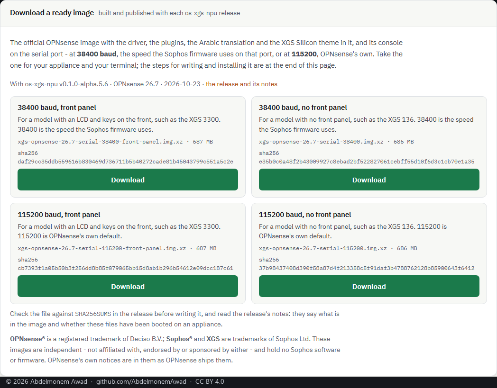

| Your appliance | Take |
|---|---|
| **XGS 2100, 2300, 3100, 3300** - the rack models, an LCD and keys on the front | **115200 baud, front panel** |
| **XGS 87, 107, 116, 126, 136, 138** and their w twins - the desktop models, no front panel | **115200 baud, no front panel** |

Each image carries both drivers and the kernel sources they are built from, and the appliance
installs the one its own board names at its first boot. The XGS 136 and the XGS 3300 are the two
this guide was written on; on the other models the image installs the same way and the driver is
untested ([what works on each](what-works.md)).

The pictures below use **115200**, OPNsense's own speed. The 38400 images are for a terminal still
set to the Sophos firmware's speed. The download is one `.img.xz` file, about 690 MB, and no GitHub
account is needed for it. Go straight to [4. Write it to the USB stick](#4-write-it-to-the-usb-stick);
sections 1 to 3 are the other way, an image built for you in a copy of your own.

## 1. Your own copy of the image builder

The image is built by GitHub, in the account that owns the builder, so it is built in a copy of
your own. This is done once.

1. Signed in to GitHub, open
    [github.com/AbdelmonemAwad/xgs-image-builder](https://github.com/AbdelmonemAwad/xgs-image-builder)
    and press **Fork**, top right.

    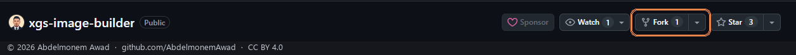

2. Keep the name and **Copy the `main` branch only**, and press **Create fork**.

    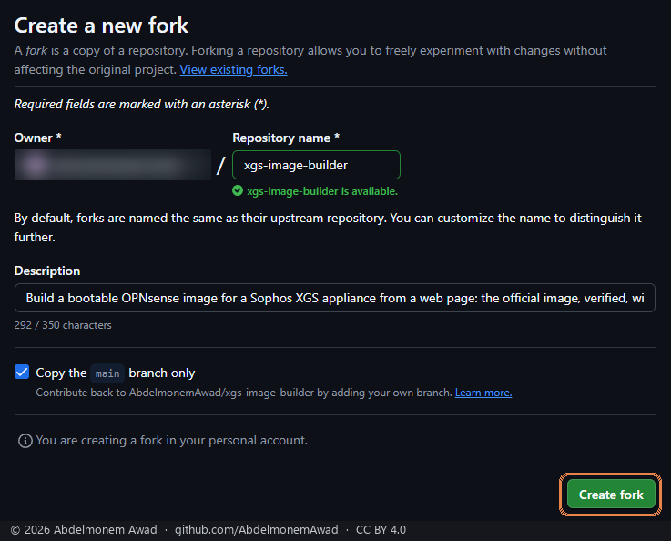

3. In your copy, open the **Actions** tab and press **I understand my workflows, go ahead and enable
    them**. A copy has its workflows switched off until you say so.

    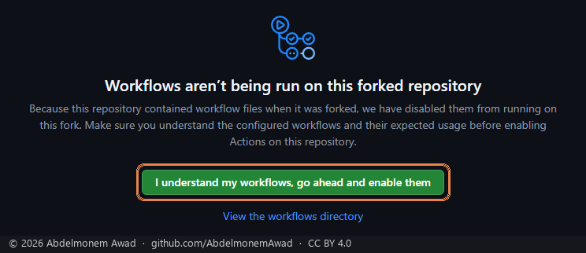

4. Still in your copy: **Settings → Pages**, branch **main**, folder **/docs**, **Save**. A minute
    later your copy has its own build page, at `https://<your-account>.github.io/xgs-image-builder/`.

    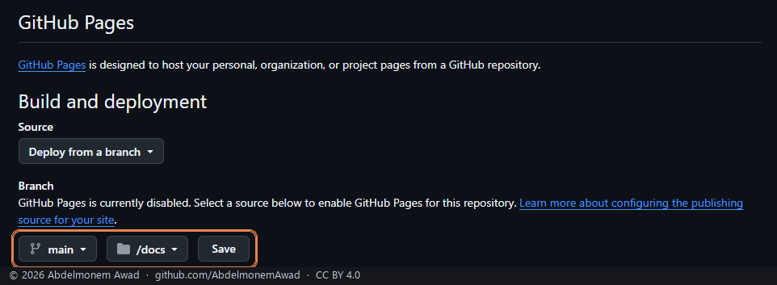

## 2. Build the image

Open **your** build page, the address from step 1.4. Its choices are already the right ones for an
XGS:

| Choice | What to pick |
|---|---|
| OPNsense release | **26.7** |
| Image type | **serial**, for an appliance with no screen |
| Serial console speed | **115200**, the default. Note the number: PuTTY needs the same one. |
| Where the console goes | **Serial port only** |
| Driver | **latest**, the newest release |

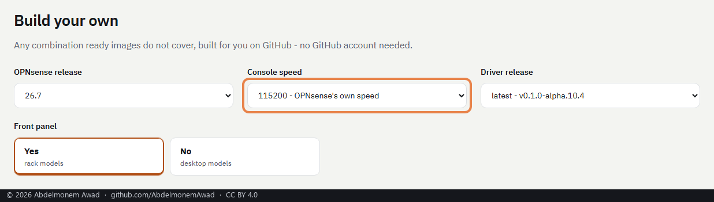

Press **Build it**. GitHub opens in a new tab with the request already written. Press **Submit new
issue** there, and come back to the page. That press is what tells GitHub it is you; it is why no
password or key is needed.

The page follows the build to the end, with a bar that moves with the build's own steps. It takes
about ten minutes.

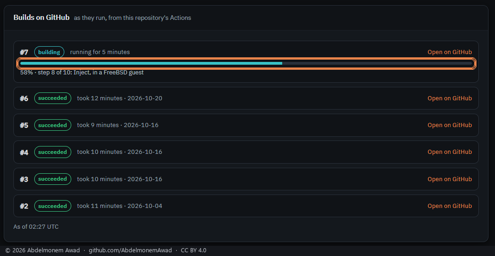

## 3. Download the image

When the build is done, the page offers the image for download. GitHub hands it over as a `.zip`,
and you have to be signed in to GitHub to download it.

On Windows: right-click the `.zip`, then **Extract All**. Inside is one file,
`xgs-image-based-on-opnsense-26.7-serial-115200.img.xz`. **Leave it as it is.** The next program reads the `.xz`
itself.

## 4. Write it to the USB stick

Download **balenaEtcher** from [etcher.balena.io](https://etcher.balena.io/) and start it.

1. **Flash from file**, then choose the `.img.xz`.

    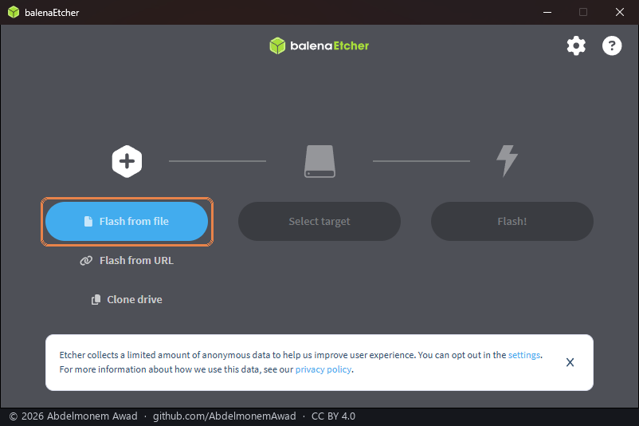

2. It shows the image by name and by its unpacked size, 3.68 GB. Press **Select target** and choose
    your USB stick. Recognise it by its size, and never choose a disk you do not know.

    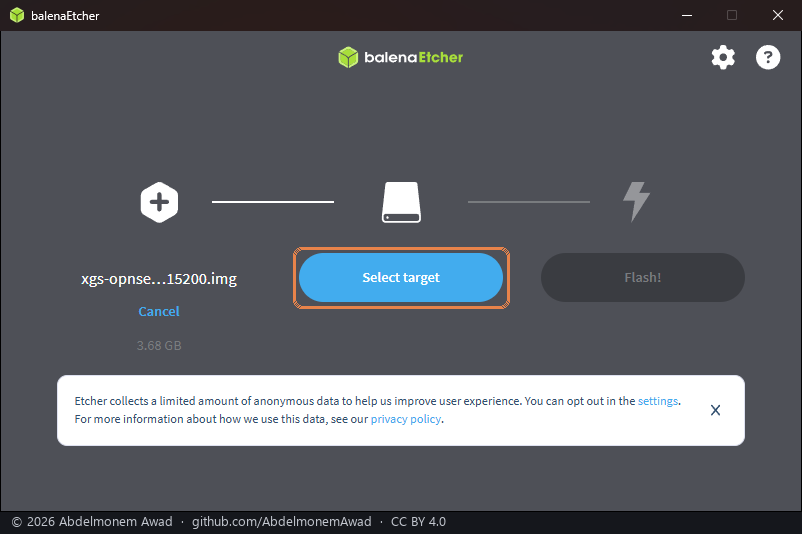

3. Press **Flash!**. Windows asks to let it change the stick: say yes. Wait for **Flash Complete**,
    then take the stick out.

Rufus ([rufus.ie](https://rufus.ie/)) is the other well-known writer on Windows. These pictures were
taken with balenaEtcher.

## 5. Connect the console

The console is how the appliance talks before it has a network.

1. Plug the cable's RJ45 end into the appliance's **Console** port, and its USB end into the
    computer.
2. Find the port Windows gave it: **Device Manager → Ports (COM & LPT)**, a line such as
    `USB Serial Port (COM3)`. Some cables need their maker's driver before a port appears.
3. Download **PuTTY** from
    [its author's page](https://www.chiark.greenend.org.uk/~sgtatham/putty/latest.html) (`putty.exe`,
    64-bit) and start it.
4. On the **Session** page: **Serial**, the port from step 2 as the **Serial line**, and **115200**
    as the **Speed**, the speed chosen in the build.

    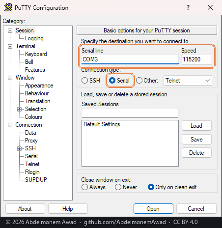

5. On **Connection → Serial**: 8 data bits, 1 stop bit, parity **None**, flow control **None**.
    Then **Open**.

    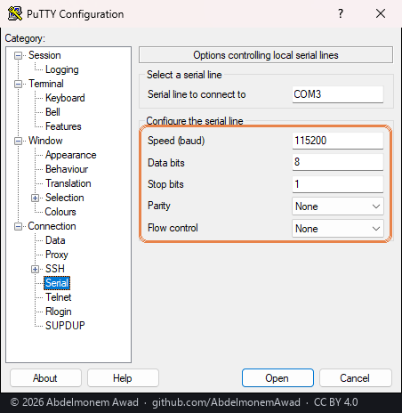

A black window opens. It stays black until the appliance says something.

## 6. Boot from the stick

Switch the appliance off, put the stick in one of its USB ports, and switch it on. **It boots from
the stick by itself.**

The boot menu appears in PuTTY, counts down, and goes on alone:

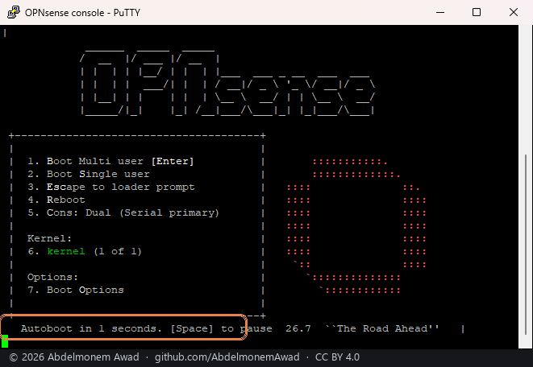

A few minutes later the system running from the stick asks you to sign in. This first boot also
puts the driver and the plugins in place.

> [!NOTE]
> **No front ports yet: do not assign interfaces from the stick.** The driver is built at the end of
> this boot and loaded from the next one on, so while the system runs from the stick the
> coprocessor's ports do not exist, and the console menu has none to offer. Install first (step 7),
> then boot from the disk: the ports are there from that boot on, and it assigns them (step 8).

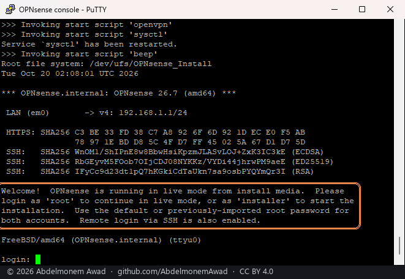

> [!TIP]
> **PuTTY stays black, or shows unreadable characters?** First check the COM port. Then try PuTTY
> at **38400**, the speed of the appliance's own firmware console. If the system speaks there,
> build the image again with the speed set to 38400.

## 7. Install to the internal disk

Sign in as **`installer`**, password **`opnsense`**. Then, with the arrow keys, Space and Enter:

1. **Continue with default keymap**.

    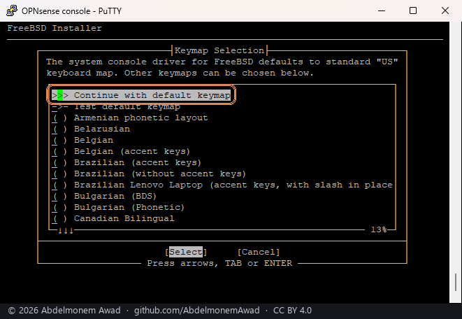

2. **Install (ZFS)**.

    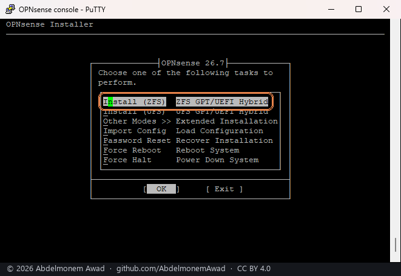

3. **stripe**. An XGS has one internal disk.

    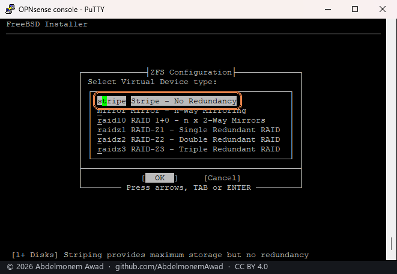

4. **Space** to tick **ada0**, then Enter. The internal disk is `ada0`, and the USB stick is not
    offered.

    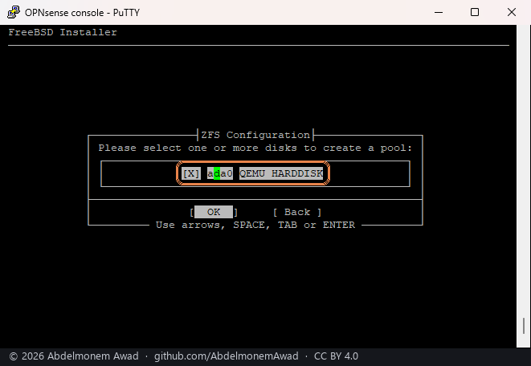

5. **Last Chance!** Left arrow to **YES**, then Enter. This is where the internal disk is erased.

    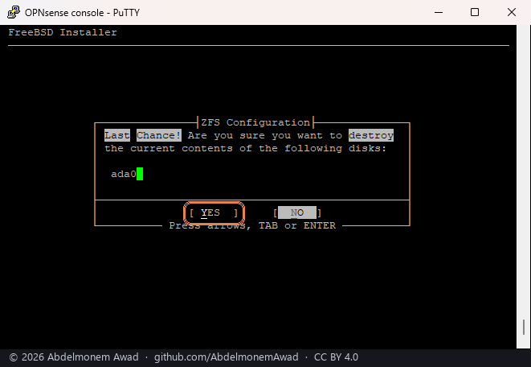

6. Wait for the copy: a few minutes.

    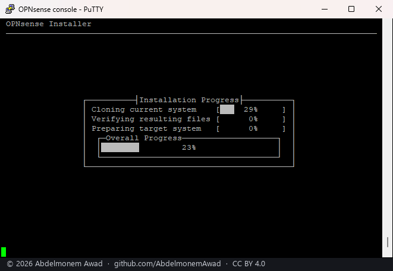

7. **Final Configuration**: **Root Password** sets the administrator's password now. Recommended;
    otherwise it stays `opnsense` until step 9. Then **Complete Install**.

    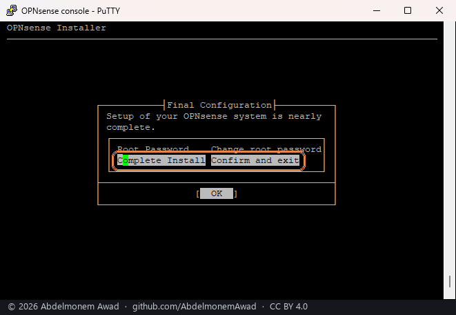

8. **Installation Complete**: **take the USB stick out first**, then **Reboot now**. Left in, the
    appliance boots from the stick again.

    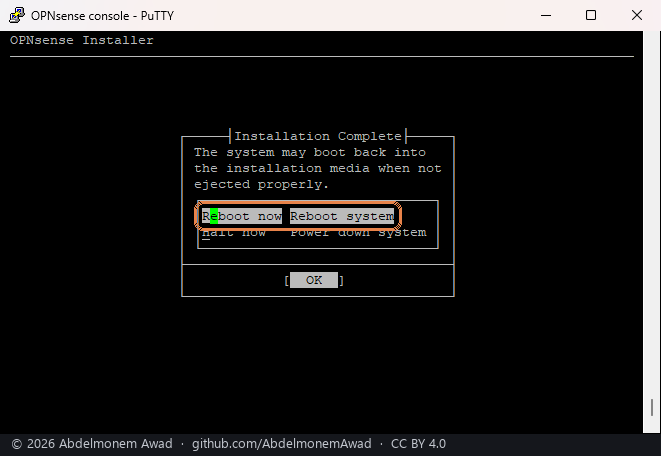

*The console pictures in steps 6 to 8 were taken in a virtual machine running the same image: its
disk is a `QEMU HARDDISK`, and its menus are the ones an appliance shows.*

## 8. The first boot from the disk

This is the boot that loads the driver, so the front ports appear now, by the names the driver gives
them: `npup1`, `npup2` and on - PortN is `npupN` - on the XGS 136 and its family, `oxp0` and on on
the XGS 3300 ([every model's ports](../families/front-ports-by-model.md)).

On an appliance, the first boot from the disk counts thirty seconds down on the console:

```
XGS: assigning the front ports by the names on the chassis
```

Let it run out. The ports are then assigned by the names printed on the chassis:

| Port | On an XGS 3300 | On an XGS 136 |
|---|---|---|
| **WAN**, from your internet connection, by DHCP | **Port2** | **Port1** |
| **LAN**, one bridge on **192.168.1.1**, handing out addresses | every other front port, a module's included | every other front port |
| **MGMT**, the management port, on **192.168.100.1** | the MGMT port | - |

> [!CAUTION]
> **Keep MGMT apart from the coprocessor's ports, always.** MGMT is the host's own port, wired to
> the host's CPU; every front port and cage belongs to the coprocessor and reaches the host only
> through it. Never give MGMT an address in a subnet the coprocessor's ports use - LAN's included -
> and never put it in a bridge with them: the host then has two ways into one network, keeps one
> route for it, and the interface set up last answers nothing, cable in or not
> ([measured](../measurements/subnets-check-2026-10-31.md)). Leave MGMT on a subnet of its own, its default 192.168.100.1/24, for
> reaching the appliance while the coprocessor restarts. XGS: Ports and `verify.sh` warn when it
> is mixed.

Pressing a key during the countdown assigns them by hand instead, from the console menu.

Then the sign-in appears on the console. Nothing more has to be done there:

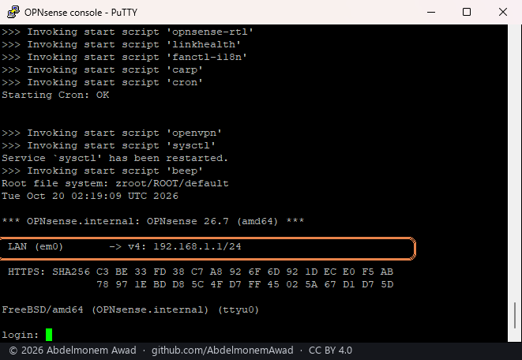

The console menu, after signing in as `root`, is where to come back to if the web interface cannot
be reached: **1** assigns the ports by hand, **2** sets an address.

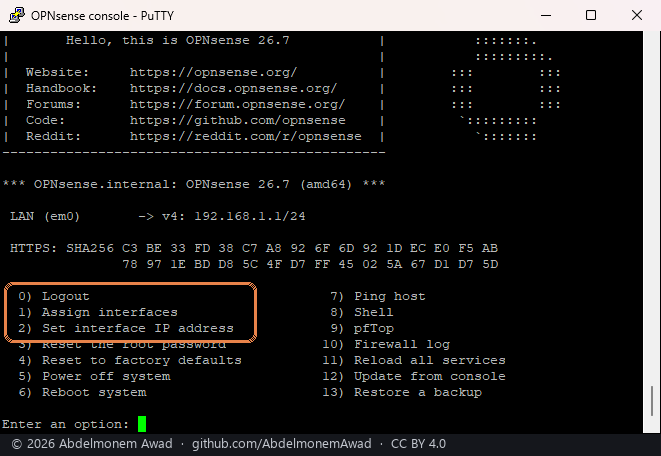

## 9. Sign in to the web interface

1. Connect the computer to a **LAN** port, any front port but WAN, or to **MGMT** on an XGS 3300. It
    gets an address by itself.
2. Open **https://192.168.1.1** in a browser, or **https://192.168.100.1** through MGMT.
3. The browser warns that the connection is not private. That warning is expected: the appliance
    made its own certificate. Choose **Advanced**, then continue to the address.
4. Sign in as **`root`**, with **`opnsense`** or the password set in step 7.

    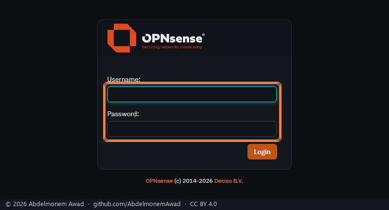

5. The setup wizard opens: **Next** through it, for the name, the DNS servers, WAN and LAN and the
    password. Or click the logo, top left, to leave it. The **XGS** menu holds this project's
    pages.

    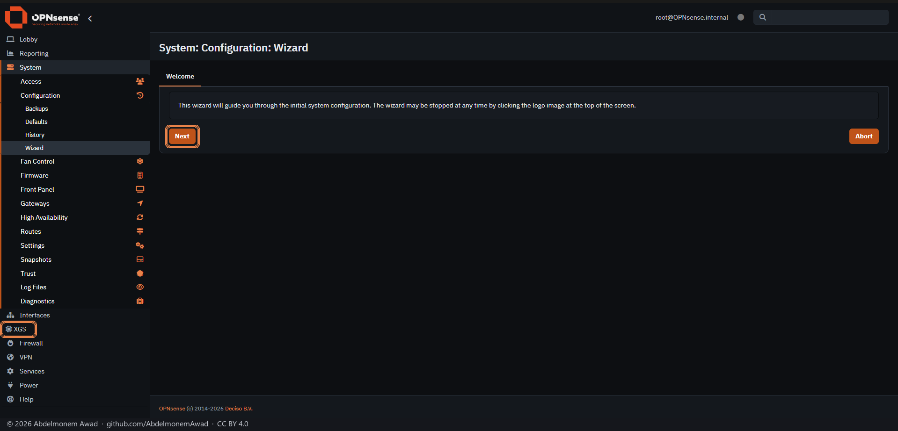

6. If the password is still `opnsense`: **Lobby → Password**, the old one, the new one twice, **Save**.

    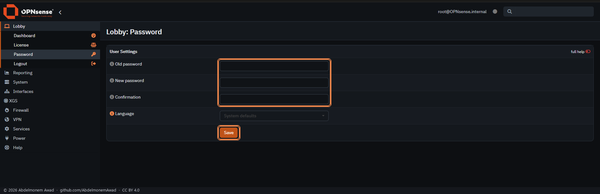

## 10. Check it, and keep it current

**Update OPNsense itself first** - System: Firmware: Status, *Check for updates*, then *Update* -
and check that `php -v` reads **8.5.12** or later: an image, and an appliance installed before
2026-10-21, carry a PHP that PHP2Shell reaches. Then:

**XGS → Overview** shows every front port and the coprocessor behind it:


**XGS → Updates** offers each new release of the driver; the plugins bring themselves up to date
once a day. [Updating](updating.md) shows an update from start to end.

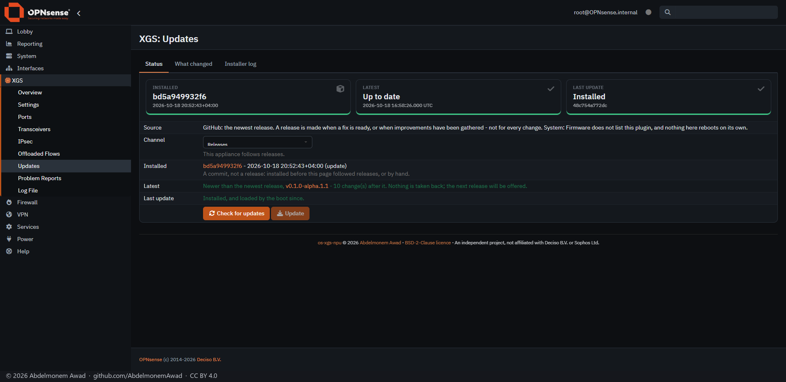

## If something goes wrong

| What you see | What to do |
|---|---|
| PuTTY stays black at power-on | Check the COM port, then try 38400 (the tip in step 6). |
| The appliance starts its Sophos firmware | The stick was not seen at power-on: write it again (step 4), put it in before switching on. |
| The installer comes back after **Reboot now** | The stick was still in. Switch off, take it out, switch on. |
| No page at https://192.168.1.1 | The cable may be in the WAN port: use another front port. The computer should have an address beginning 192.168.1. If not, use the console menu (step 8). |
| The ports' lights are on, but nothing gets through | On the console, option 8 (the shell), run `/usr/local/opnsense/scripts/npuctl/verify.sh` and paste everything it prints into an [issue](https://github.com/AbdelmonemAwad/os-xgs-npu/issues/new/choose). It names what failed and why, with the model and the board's revision, and holds no addresses or serial numbers - nothing more is needed to start. |
| An interface answers nothing on its address, or LAN comes back only after a cable goes into another port | Two interfaces in one subnet - LAN's 192.168.1.1/24 inside a home network an MGMT or WAN port is on, say - share one route, and the one applied last loses it, cable in or not ([measured](../measurements/subnets-check-2026-10-31.md)). XGS: Ports shows a warning naming them, and `verify.sh` has a section for it: give each interface a subnet of its own, or take the address off the one not in use. |
| Anything else | A [problem report](../problem-reports.md) or an [issue](https://github.com/AbdelmonemAwad/os-xgs-npu/issues/new/choose), or [write to the project](https://npuforge.org/contact/). |
