<!-- reviewed: 2026-11-08 -->
# The pages, one by one

Every page this project and its plugins add to OPNsense, photographed on 2026-11-08 on a real
appliance - the second XGS 3300, with its 4x10G expansion module and vendor version 22's software on
its coprocessor (build 22.0.2.546), running os-xgs-npu v0.1.0-alpha.15.2 on OPNsense 26.7 - full
screen, in the dark theme, in English and in Arabic. The English photographs come first; each page's
Arabic ones are under them. Nothing was staged: the figures are that appliance's at that moment.

Four older photographs were kept, each named where it is shown: the question a new install asks on
XGS: Overview, in English and in Arabic; the XGS 136's Power over Ethernet tab; and the Plugins tab
with a plugin removed.

Before each photograph, and only in it, a few values were masked: hardware addresses, serial
numbers, public addresses and IPv6 prefixes, and the owner's domain. Private lab addresses were left
as they are; they are the bench's, in [the measurements](../measurements/) as well.

How they were taken: the page opened in a browser window on the PC, the values masked in the page,
then the window photographed by `PrintWindow` and cut to the page - the way every measurement here is
photographed. All of them, with every other image in the repository, are listed in
[docs/images/README.md](../images/README.md).

| | page | where | what it is for |
|---|---|---|---|
| 0 | [Lobby: Dashboard](#lobby-dashboard) | OPNsense's own | the first page after logging in, with the appliance on it |
| 1 | [XGS: Overview](#xgs-overview) | XGS | the coprocessor, the front panel and the board's tables at a glance |
| 2 | [XGS: Settings](#xgs-settings) | XGS | every setting of the project, in four tabs |
| 3 | [XGS: Ports](#xgs-ports) | XGS | every front port: what it is assigned as, its link, its MTU |
| 4 | [XGS: Transceivers](#xgs-transceivers) | XGS | the modules in the cages and what they report |
| 5 | [XGS: IPsec](#xgs-ipsec) | XGS | the associations in the coprocessor's crypto engine |
| 6 | [XGS: Offloaded Flows](#xgs-offloaded-flows) | XGS | the connections the coprocessor forwards itself |
| 7 | [XGS: Updates](#xgs-updates) | XGS | the project's releases, installed from the page |
| 8 | [XGS: Problem Reports](#xgs-problem-reports) | XGS | what goes wrong, cleaned and filed as an issue |
| 9 | [XGS: Log File](#xgs-log-file) | XGS | the project's own log |
| 9a | [XGS: Coprocessor Console](#xgs-coprocessor-console) | XGS | what the coprocessor wrote on its console, kept from every boot |
| 9b | [XGS: Coprocessor Log](#xgs-coprocessor-log) | XGS | the coprocessor's own log, sent to the host as it is written |
| 9c | [XGS: About](#xgs-about) | XGS | the project, its author, its links and addresses, the disclaimer |
| 10 | [XGS: Network Report](#xgs-network-report) | os-netreport | a report of the network by mail, on a schedule |
| 11 | [XGS: Fan Control](#xgs-fan-control) | os-fanctl | temperatures and fans |
| 12 | [XGS: Front Panel](#xgs-front-panel) | os-frontpanel | the LCD and the keys beside it |
| 13 | [XGS: Link Health](#xgs-link-health) | os-linkhealth | a verdict on every port from its error counters |
| 14 | [XGS: Hardware Watchdog](#xgs-hardware-watchdog) | os-watchdog | the host's hardware watchdog, and why it last reset |
| 15 | [XGS: Kernel Follower](#xgs-kernel-follower) | os-kernelfollow | kernel modules rebuilt for the kernel the next boot takes |
| 16 | [XGS: Block Lists](#xgs-block-lists) | os-blocklists | address, DNS, country and JA4 block lists |
| 17 | [XGS: Port Guard](#xgs-port-guard) | os-portguard | devices blocked by their MAC address |
| 18 | [XGS: Fallback Crypto](#xgs-fallback-crypto) | os-fallbackcrypto | which crypto driver encrypts IPsec on the host |
| 20 | [The image builder](#the-image-builder) | its own site | where an install starts |

## Lobby: Dashboard

OPNsense's own dashboard, as the image leaves it. The drawing of the appliance - the XGS 3300 with its
expansion module here - is the theme's, [os-theme-xgs](https://github.com/AbdelmonemAwad/os-theme-xgs);
**Fan Control** is os-fanctl's widget, with the fans and every temperature the board gives, the
coprocessor's among them. The dashboard also takes **XGS Offloaded Flows**, a widget of this project,
from its widget list.

The same page in Arabic

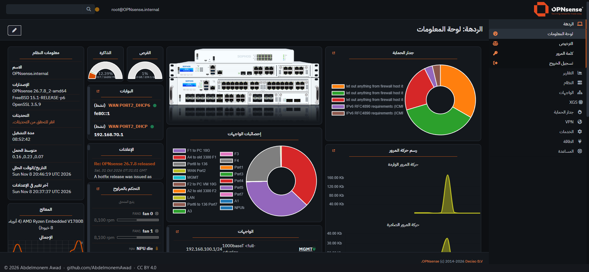

## XGS: Overview

The first page of the **XGS** section. At the top, the front panel drawn in the chassis's order - the
two cages, Port1 to Port8, two more cages, the expansion module's A4 to A1 - each with its link as a
light, and its name, assignment, medium and MAC address when the pointer rests on it. Then a card each for the coprocessor and its link, hardware offloading, the IPsec engine, the
front ports, the switch chip, and the cause of the last restart as the chipset recorded it. While
**Hardware offloading** or **Accelerate connections automatically** is off - both are, after an install -
a notice above the cards says that every connection runs on the firewall itself, and links to the
Acceleration tab of XGS: Settings, where the two are. Under them
**Coprocessor link** - with, since 2026-10-20, the coprocessor's own Linux: how long it has been up,
its load on its cores and its memory, read every five minutes by `scripts/xgs/health.py` (on the
second XGS 3300 that day: twenty cores at a load of 19, which its fast path keeps busy, and 163 of
3,165 MB available; on the XGS 136 four cores at 3.2 and 1,544 MB available) - **This board's limits** - the connections and next hops the board holds, with a
bar of how much of each is in use - and the control facility. **Datapath counters**, **Coprocessor**
and **Technical details** are its other tabs. In the photograph two associations are in the
engine, and fan 0 is under speed, which the Appliance health card shows in amber.

Since 2026-10-28 an **Appliance health** card, beside the coprocessor's, and rows of that name under
**Coprocessor link**: the board's own readings, which until then no XGS page showed. On the XGS 3300,
from its CPLD (`tools/sensors/xgs3300-sensors`): the coprocessor's and the inlet's temperatures, both
fans with their under-speed flags, both power supplies, the reset button and the CPLD's version, and
the coprocessor's memory where its module has a sensor; on board 201 (XGS 126, 136) the coprocessor
as its driver holds it, the fan as os-fanctl last read it, and the board controller's reset flag;
the host's processor on both. The card says Normal, or the first thing wrong - the internal supply
not good, in red; a fan under speed, in amber. Read on 2026-10-28: the first XGS 3300 at 28.0 C
inlet, fans at 7,200 rpm, internal supply good, external not good or absent (it has one supply);
the second with its memory module at 48.9 C; the XGS 136's fan at 5,192 rpm. Since the same evening, on
the XGS 3300, also the port chips: the switch, the SFP+ cages' PHY and the expansion module's PHY
where one is fitted ([the sensors' finding](../findings/the-sensors-answer-on-the-host-bus.md)).

Since 2026-10-25 a **Coprocessor** tab describes the coprocessor itself, read on it by
`scripts/xgs/coprocessor.py` when the tab's **Read now** is pressed and kept until the next read. At
its top, as on the Status tab, a card each for its vendor build, its chip, the copy of its system it runs
with what the other holds, its eMMC, its persistent partition and its boot firmware; under them:

- **its software**: the vendor build its system carries (`/etc/sfversion`: 21.0.0.169 on the XGS 136,
  22.0.2.546 on the second XGS 3300, 23.0.0.329 on the first), beside the generation the driver
  found from the command numbering; its Linux and its system; and its boot firmware - U-Boot, the
  ARM Trusted Firmware, the DDR PHY's - from its console at its last boot, which the XGS 3300's
  starts with the host before the console is kept, so there the ARM Trusted Firmware is read from
  its flash and U-Boot is not read; since 2026-10-28 also when U-Boot was built and, on the XGS
  3300, when its boot image was built (#859) - two appliances on one vendor version can carry
  different builds: the first XGS 3300's, U-Boot of 22 Nov 2024 and boot image of 2024-11-22;
  since 2026-10-29 the **fast path build**, the build the coprocessor's fast path carries - eight hex
  digits and a kind, read out of the running fast path through `/proc`: `1cacb7d1` on the XGS 136
  (vendor version 21), `51f76d3b` on the second XGS 3300 (22), `3f430ea4` on the first (23), each
  `PROD` - read again at every boot (start hook `73-xgs-coprocessor`), and carried by the problem
  reports; and **U-Boot and system SDK**: whether the U-Boot in the coprocessor's flash and each
  system copy come from one SDK - U-Boot's version ends in the SDK it was built from, and so does a
  copy's kernel, the running one's and the other's as its modules directory names it once the closed
  copies are read. All three appliances here: `10.22.03`, the same. A copy from another SDK is named,
  and the problem reports say so;
- **its chips**: this host's processor, the coprocessor with its cores and memory, and on the models
  run here the switch, the PHYs and the CPLD, each with where its name comes from;
- **its flash** - the boot firmware and the U-Boot environment - and **its eMMC**: the device, its
  maker, and each partition with what it is. Four on both families: a Linux of the board maker with
  no vendor build, two copies of the system - the one running, read-only, and the other, the one an
  update writes, which holds the build before it (the first XGS 3300 runs 23.0.0.329 from copy A
  while copy B still holds 22.0.2.546) - and a small persistent partition, read-write.
  **Look inside the closed partitions** opens each partition nothing has mounted, read-only and for
  a moment, for its build and what its `/boot` holds.

Nothing on the tab changes the coprocessor, and it says why: which copy it starts is set in its
U-Boot environment, which nothing in this project writes; restarting it on its own stops an XGS
3300's host ([768](https://github.com/AbdelmonemAwad/os-xgs-npu/issues/768)); and a write to its
flash or eMMC can leave it unable to start.

Also since 2026-10-25: two more cards on that tab, the coprocessor's own **Watchdog** (sbsa-gwdt on
both families, and how often it is fed) and its **Memory errors** - the corrected and uncorrected
counts of its EDAC controllers, nineteen on the XGS 3300 and none on the XGS 136 (discovery 24); the
**Datapath counters** tab has the coprocessor's **Fast-path counters** under the driver's, named for its
software, read when the tab opens, with a **Clear** behind the settings privilege that zeroes them
(discovery 13); and on an ARMADA board **Technical details** says whether the coprocessor's PCIe
relaxed ordering and no-snoop are off, as the driver leaves them (#748).

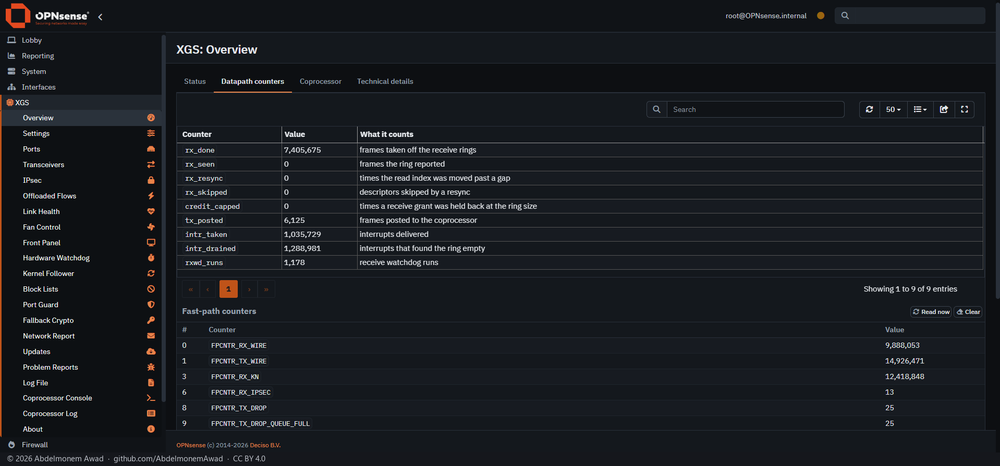

Since 2026-10-23 the page asks one question above the panel, once, until it is answered: nothing
leaves the appliance unless its owner chooses, so its problem reports wait for their Send and it is
not counted - **Send reports and count this appliance** or **Keep everything here**, with the
model's tested status beside it ([the problem reports](../problem-reports.md#the-owner-decides)).

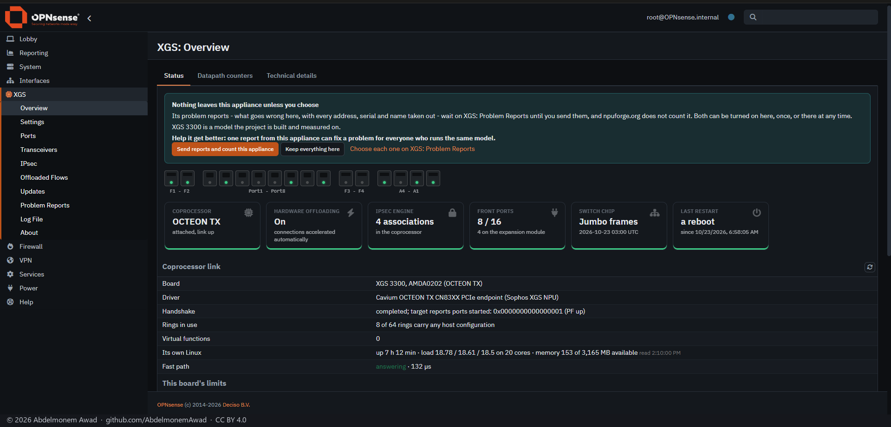

The question in Arabic

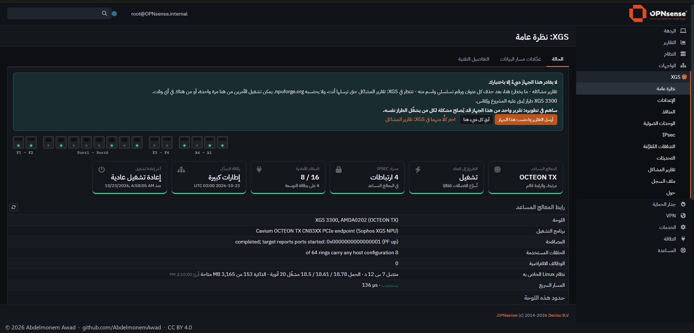

The same page in Arabic

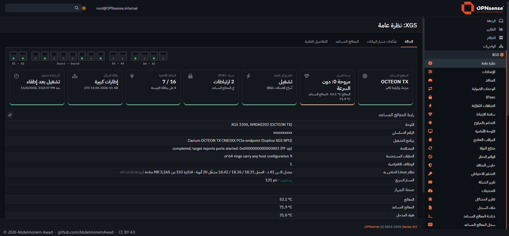

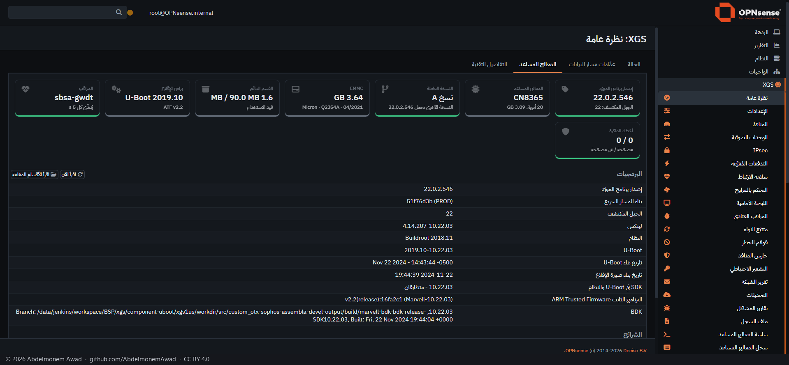

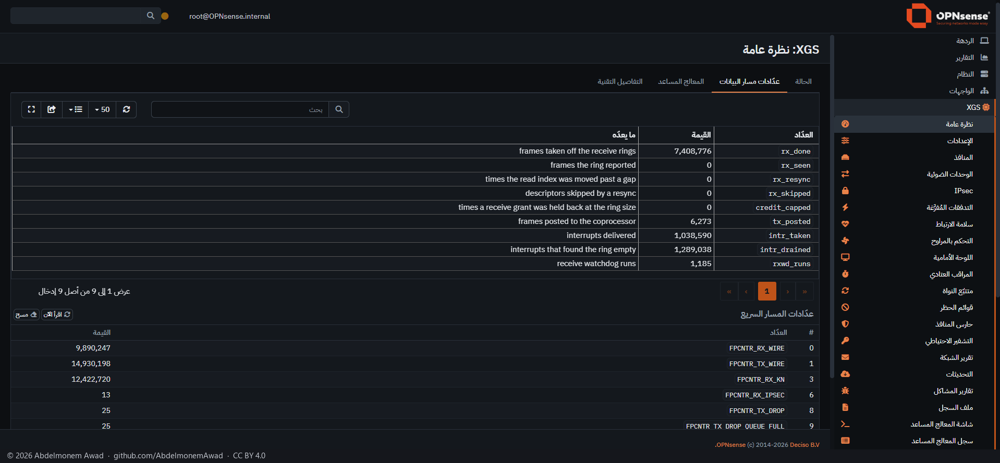

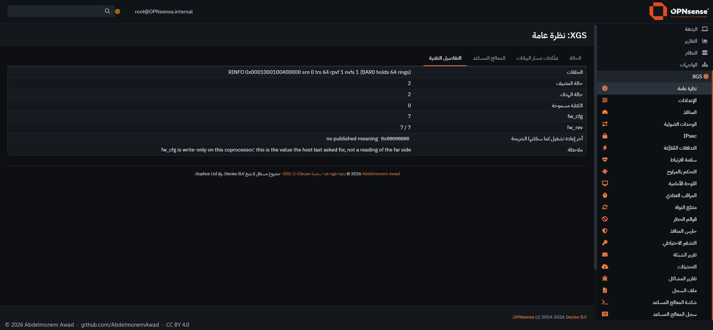

## XGS: Settings

Every setting the project has, and only those this appliance has, in four tabs since 2026-10-23 -
**Acceleration**, **Security**, **IPsec** and **Hardware** - as the page had grown long; **Apply** on
any of them saves them all, and a setting refused opens its tab. On **Acceleration**, **Status**
reads back what the coprocessor is doing now, which can differ from the page until the next boot;
then hardware offloading, the flow maker that hands settled connections to the coprocessor on its
own, and **Never offloaded** - addresses, networks and ports whose connections always stay with the
firewall. **IPsec** puts the associations in the coprocessor's engine. **Hardware** has the flow
table, the switch chip, the watchdog, what is done when the fast path stops, and assigning the ports
again; on the XGS 136, the receive path too. **Full help** shows the text under each setting, as on
the Security tab below; **advanced mode** shows the rest. Since 2026-10-23 **Cut in hardware**, on
by default, has both cuts on the **Security** tab drop a connection on the coprocessor itself first
and keep it there while its sender goes on ([measured](../measurements/verdict-2026-10-23.md)).
**Inspect, then hardware**, off by default, has OPNsense's Intrusion Detection in IPS mode inspect
each new connection in hardware until it has let its first megabyte through, and the coprocessor
carry the rest; it needs one reboot
([measured](../measurements/inspect-2026-10-23.md#the-setting-and-the-intrusion-detection-service)).
Since 2026-10-19 that tab has **Cut open connections when listed**: block lists whose additions cut
the connections already open ([measured](../measurements/lists-cut-2026-10-19.md)), and **Cut
connections by TLS fingerprint**: JA4 fingerprints whose connections are cut, read from the
Intrusion Detection's log ([measured](../measurements/ja4-cut-2026-10-19.md)). And on both
appliances, **Count hardware traffic in pf** and **Count hardware traffic on the interfaces**, on
**Acceleration** and on by default: what the coprocessor forwards, which pf and the interfaces never
see, added to pf's states and rules and to the interfaces' counters, so the Sessions page and the
traffic graphs show it ([measured](../measurements/hw-counters-2026-10-19.md); on the XGS 136,
[measured](../measurements/xgs136-counts-2026-10-19.md#the-reader-measured)). Since 2026-10-25 the same tab
has **Copies for packet capture**, off by default: the coprocessor sends a copy of every frame it
forwards, shown to the packet capture on the port it crossed, so a connection in hardware can be
watched with tcpdump or Interfaces: Diagnostics: Packet Capture
([measured](../measurements/mirror-2026-10-25.md)). Below the two cuts,
**Watch for unusual traffic** reports a scan, a sweep, or a host far beyond its own normal in the
XGS log, and blocks nothing ([measured](../measurements/anomaly-2026-10-19.md)).

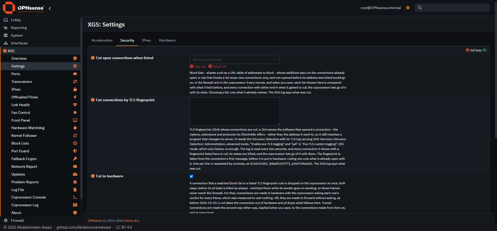

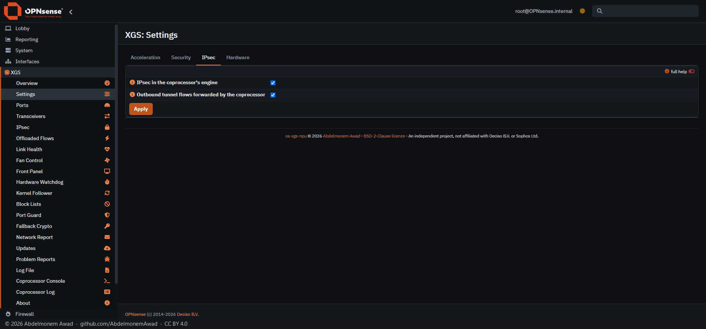

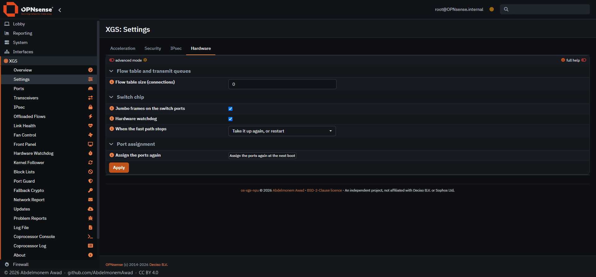

The same page in Arabic

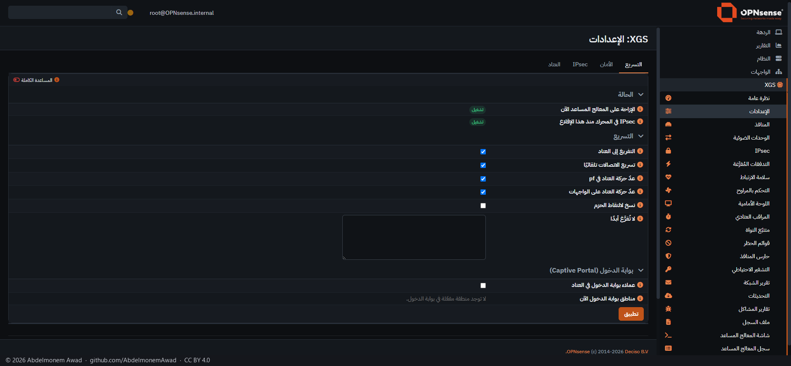

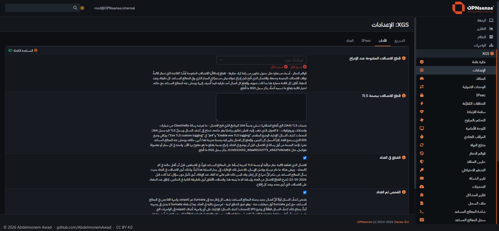

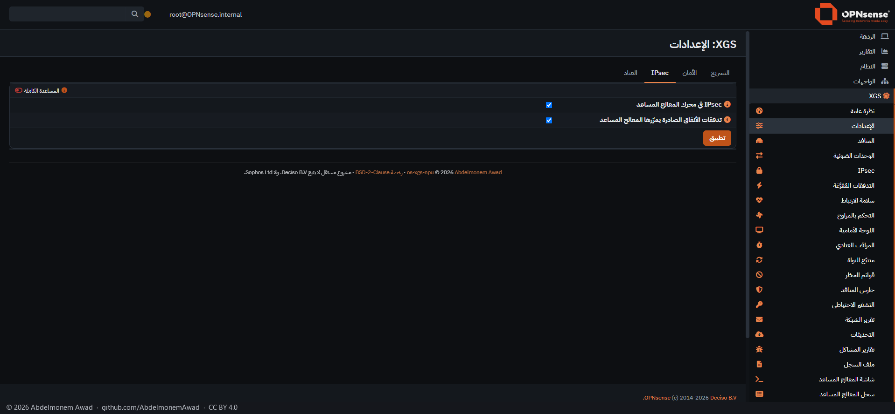

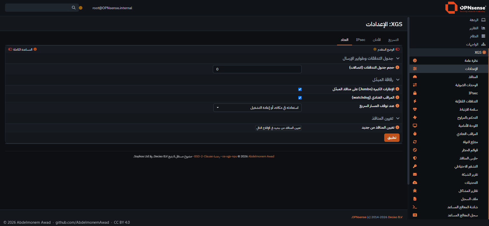

## XGS: Ports

Every front port by the name on the chassis, with its link, what OPNsense has it assigned as, its
address, its MAC address (since 2026-10-24), speed, media, MTU, the bridge
it is a member of and its device name. The cards count the
ports with a link and the ones assigned, name the expansion module in its bay, and say whether the
switch chip is in its jumbo-frame mode - on the XGS 136 since 2026-10-24, that its limit follows each
port's MTU. Since 2026-10-23 the page is in three tabs: **Ports**, **Power
over Ethernet** and **Counters**.

Since 2026-10-31, a warning above the ports when two interfaces share a subnet - a DHCP address
counts: which one holds the subnet's route, and which answers nothing from it. The one applied last
loses the route, cable in or not ([measured](../measurements/subnets-check-2026-10-31.md)); the fix is a
subnet of its own for each interface, or the address taken off the one not in use; several ports in one
network are made one bridge, the address on the bridge and none on its members, as LAN is
([OPNsense's LAN bridge how-to](https://docs.opnsense.org/manual/how-tos/lan_bridge.html)).

And in red, when the management port is mixed with the coprocessor's ports - in their bridge, or in
a subnet they use: MGMT reaches the host's CPU on its own, and the coprocessor's ports only through
the coprocessor, so it is kept on a subnet of its own.

On an appliance with Power over Ethernet - labels 11 and 12 of the XGS 136 - its tab shows each PoE
port as its controller reads it when the page opens, with **Switch off**, **Switch
on** and **Power cycle**. A port switched off stays off after a reboot; switching needs the XGS:
Settings privilege ([measured](../measurements/poe-136-2026-10-20.md)). Since 2026-10-29 each port also
has **Limit to 15.4 W** (IEEE 802.3af) or **Allow 30 W** (802.3at); the limit stays after a reboot,
and a device on the port restarts when it changes, the page reading the port again once it has
([measured](../measurements/poe-136-2026-10-29.md#the-power-limit)). Elsewhere the tab says it is not
available.

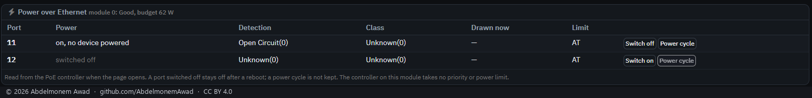

**Errors and drops on the ports**, on the **Counters** tab: for Port1 to Port8 and the two cages beside them, what
the switch chip itself counted - frames received and sent, frames received with a bad checksum, too
short or too long, frames dropped on arrival, errors sending - with what moved since the reading
before; on an XGS 3300 also F1, F2 and the module's ports, from the coprocessor's own MACs. None of
those frames reaches the host, so no other counter has them. Read every five minutes, and with **Read
now** ([measured](../measurements/port-errors-136-2026-10-20.md)). **Not on the
XGS 136** since 2026-10-20: reading its switch made the coprocessor's network agent report linked
ports down ([#639](https://github.com/AbdelmonemAwad/os-xgs-npu/issues/639)), so the section says it is
not available there.

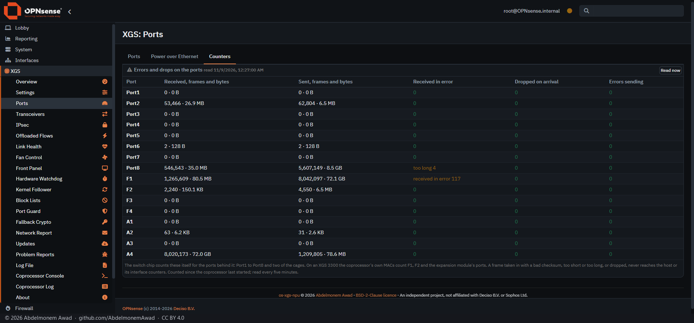

The same page in Arabic

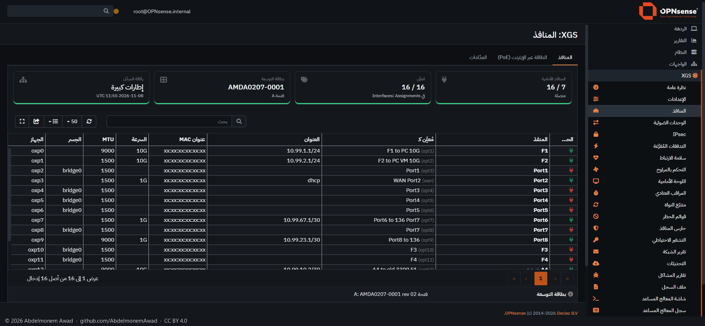

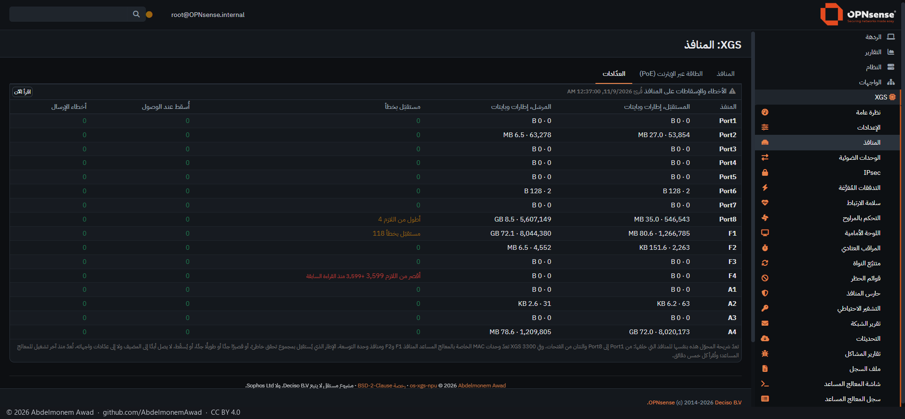

## XGS: Transceivers

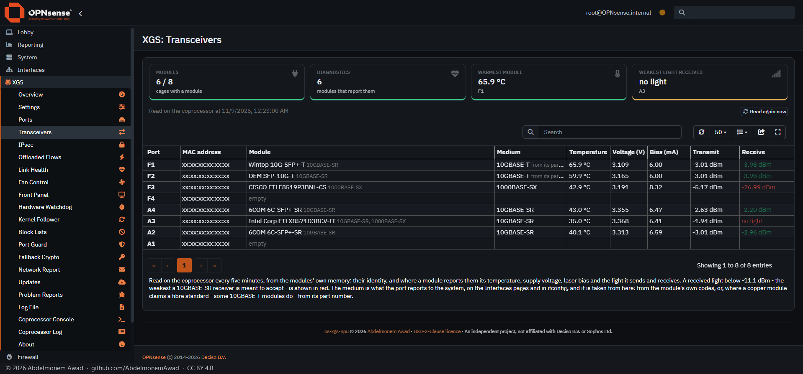

The module in each cage, beside the cage's port MAC address (since 2026-10-24), read on the
coprocessor every five minutes from the module's own memory - and, since 2026-10-31, within a minute
of a cage's link changing, so a far end that restarted no longer leaves "no light" there for five
minutes after its light is back: what it is, and where it reports them
its temperature, supply voltage, laser bias and the light it
sends and receives. A received light below -11.1 dBm, the weakest a 10GBASE-SR receiver is meant to
accept, is red - A3 here receives none. The cards name the warmest module and the
weakest light. The MAC addresses are masked in this photograph.

The same page in Arabic

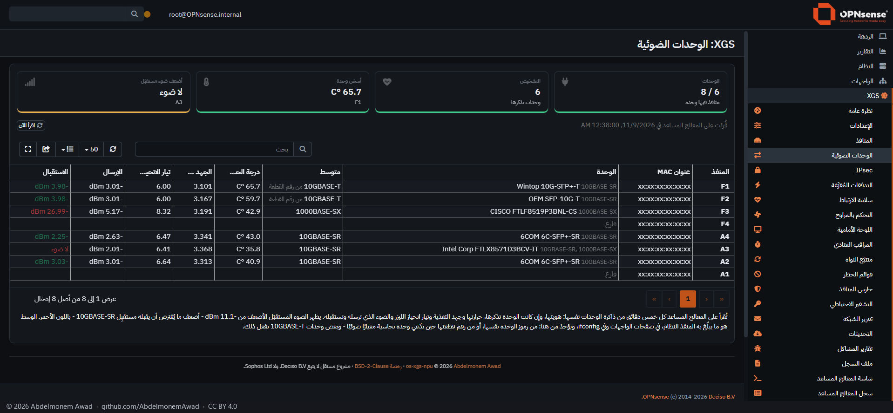

## XGS: IPsec

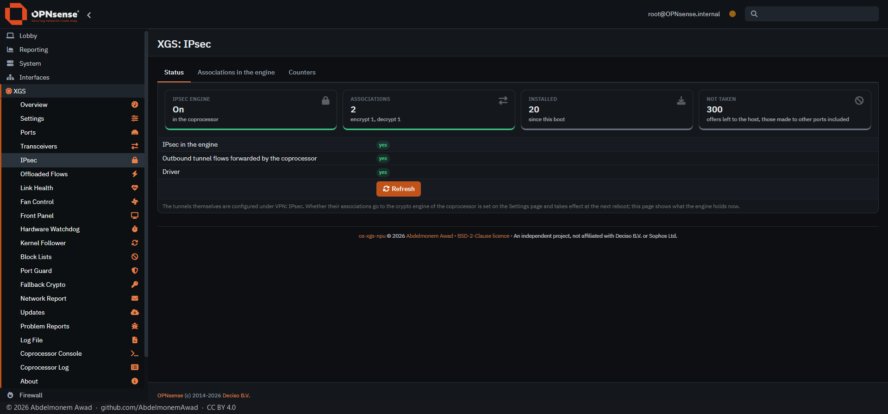

What the coprocessor's crypto engine holds now: whether the engine is in use, the associations in it,
those installed since the boot and the offers it declined. The tunnels themselves are configured
where they always are, under **VPN: IPsec**; whether their associations go to the engine is set on
**Settings**. Photographed with the tunnel to the XGS 136 up: the engine on, an association each
way. **Associations in the engine** lists them - direction, SPI,
the tunnel's two ends, the port, the replay window and the handle - and **Counters** shows the
engine's work: frames decrypted on arrival (`rx_done`), frames encrypted on the way out
(`tx_encrypt`), and the connections made through the tunnel. Since 2026-10-25 a **Counted** column
gives each association's counts as the kernel keeps them - what its byte and packet lifetimes run
on - and, in grey, the packets of them the coprocessor carried and the driver reported (#761, #774).

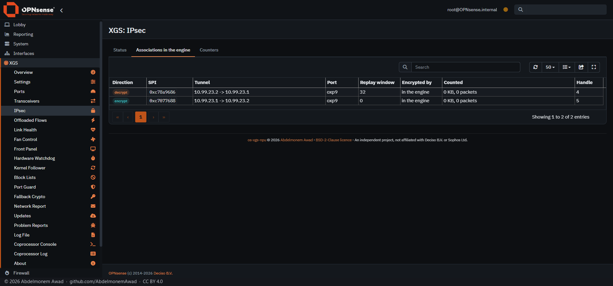

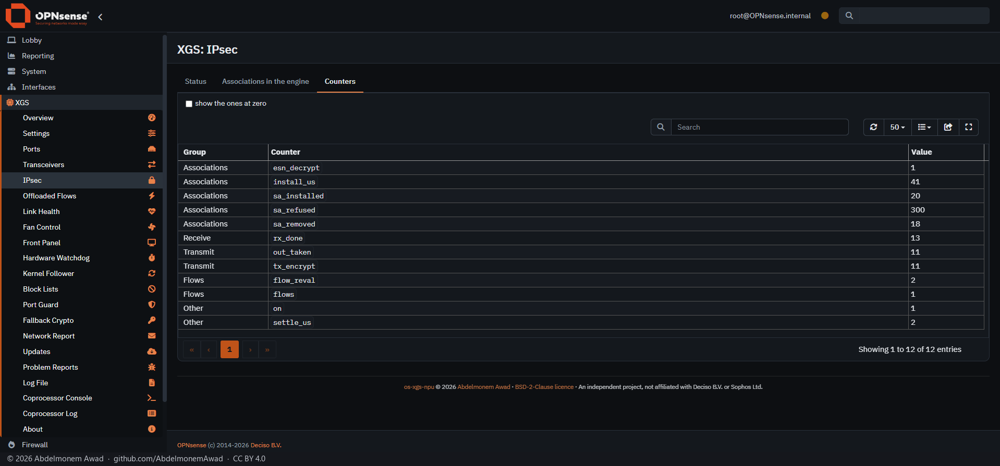

The same page in Arabic

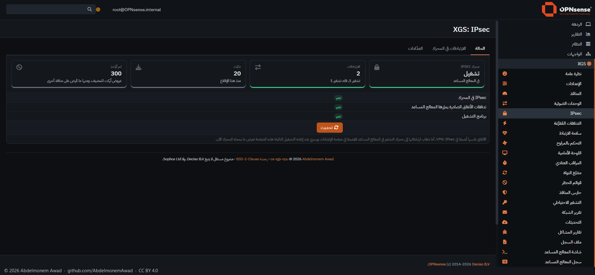

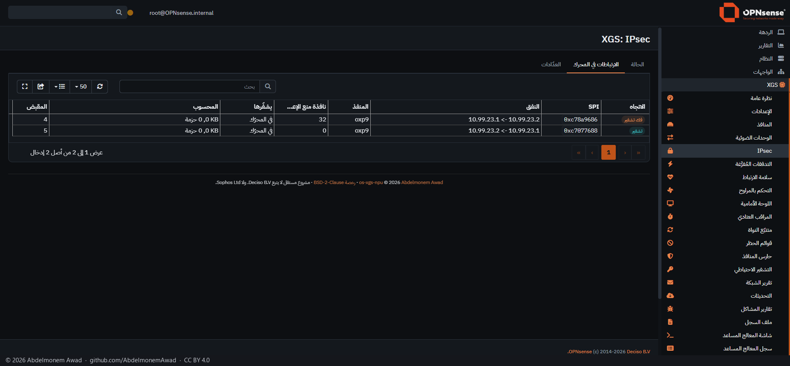

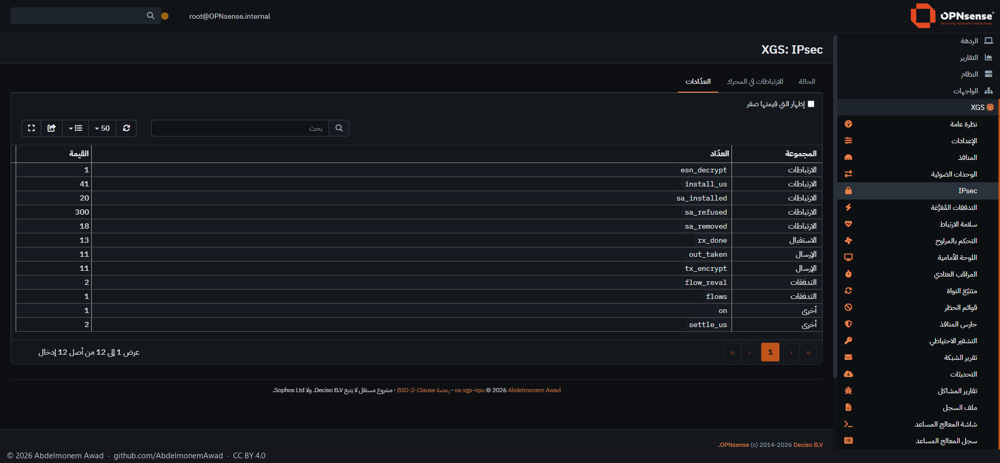

## XGS: Offloaded Flows

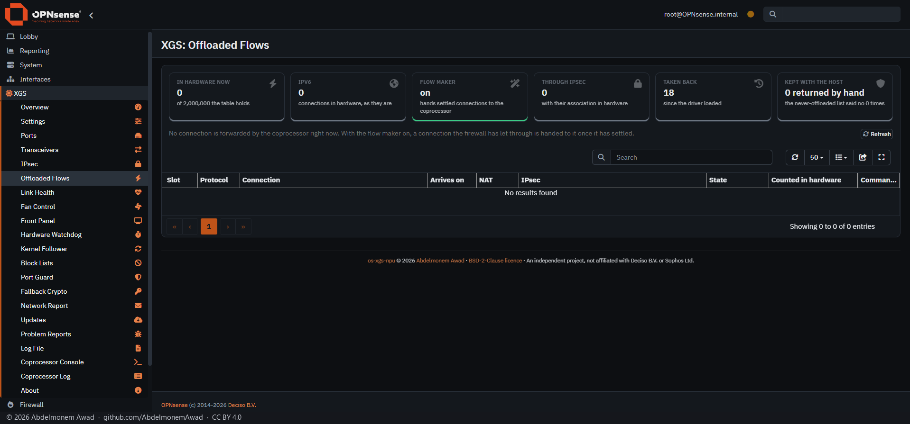

The connections the coprocessor forwards itself, one row each, with **Return to host** on every row
to hand one back to the firewall. The cards count the table against the board's size, the IPv6 ones,
those with their IPsec association in hardware, those taken back, and those kept with the host - by
hand or by the never-offloaded list. Photographed with no connection in hardware, so the table is
empty and the page says so. Since 2026-10-19 the XGS 3300's rows also have **Counted
in hardware** - the bytes the coprocessor counted each way, from the opener and back to it, with
**Packets in hardware** among the hidden columns - read from the counts the coprocessor sends about
once a second ([measured](../measurements/hw-counters-2026-10-19.md)); a connection the coprocessor has not yet named in a
message says **not counted yet**.

The same page in Arabic

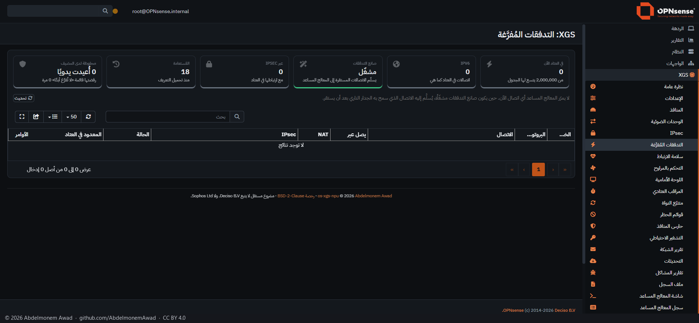

## XGS: Updates

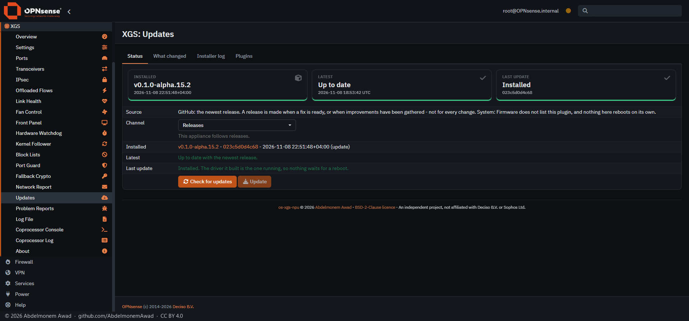

The project's own updates, which OPNsense's firmware page does not list: **Check for updates** asks
GitHub for the newest release, the **What changed** tab lists the releases since the one installed -
or, with nothing newer, what the installed one carries - and **Update** installs it with a progress
bar, the **Installer log** tab showing what the installer wrote; the new driver loads at the next
boot. **Channel** is **Releases** for an appliance in service, or **Test** for every change merged.
This appliance follows releases, and is up to date with the newest.

Step by step, each step photographed on the three appliances: [Updating an appliance](updating.md).

**Plugins** is the appliance plugins' own updates - Arabic, right-to-left, fan control, the front panel, link
health, the network report, the hardware watchdog, the kernel follower, block lists, port guard and
fallback crypto, those installed: what each has installed, its latest
release, and an **Update** for each, which runs the plugin's own updater. Nothing is installed on its
own: until 2026-10-20 each plugin took its new releases by itself once a day; since then a release is
installed from here, by hand - and since 0.1.0-alpha.8.2 an update of the project brings each plugin
to its latest release too. Since 2026-10-23 an update shows its progress as the project's own does:
a bar and its steps - queued, ask GitHub, download, unpack, install, updated - with a clock and the
installer's last line, read from what the plugin's updater leaves while it works; **Update all** takes
every release the last check offered, one plugin after the other, on one more bar; and the page follows
an update through the web GUI restart its installer makes. Once it ends the row shows the release now
installed, by name, and offers it no more - until then a plugin just updated stayed offered until the
next check. Since 2026-10-28 a finished update's bar goes ten seconds after it ends, and a failed
one's is drawn ten minutes, with its reason; until then every bar stayed ten minutes, and on a page
left open it never went.

**Where the checks ask.** GitHub's API answers sixty requests an hour from one address without a
token, and checking costs three for the project and three for each plugin: on 2026-10-20 the three
appliances of the lab, behind one address, used the hour up, and the page said "GitHub refused the
request (403): the hourly allowance for this address is used up". Since then the Status and Plugins tabs ask
npuforge.org's copy of the API first, which asks GitHub once every two minutes for every appliance,
and GitHub itself only when the site cannot answer. What is installed is still GitHub's word: an
update confirms the release's commit with GitHub's git endpoint - the list `git ls-remote` reads,
which is not the API - before it downloads anything. The project's update has done so since
2026-10-20; a plugin's update since 0.1.0-alpha.8.4, and until then it asked GitHub's API itself, two
or three requests a plugin at every update - since the project's update took the plugins along, a
few updates of one appliance in an hour used the allowance up (2026-10-25). The site keeps nothing
of these requests ([privacy](https://npuforge.org/privacy/)).

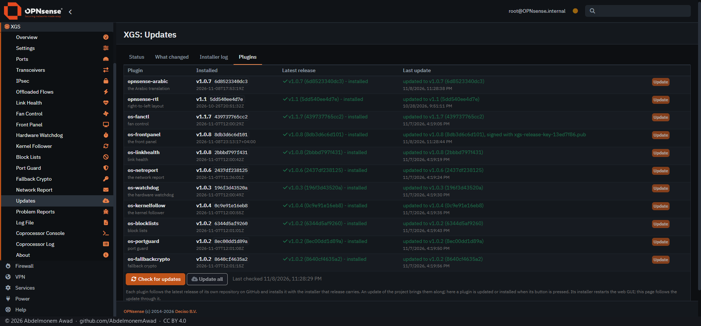

Since 2026-10-25 a plugin of the family that is not installed is listed too, **not installed**, with
its latest release and an **Install**: the plugin's own self-update of that release, taken from GitHub
and run as an update is - so a plugin added to the family after an appliance was installed is
installed from here, not from a shell. **Update all** installs nothing new.

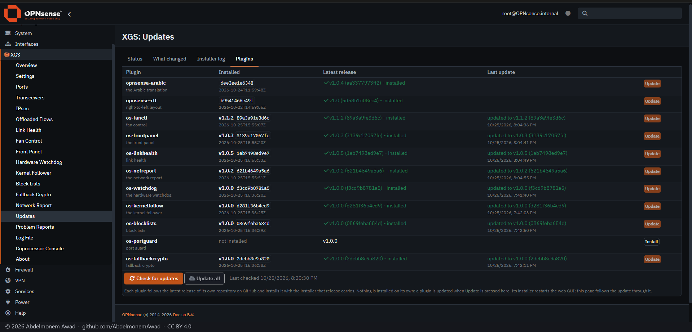

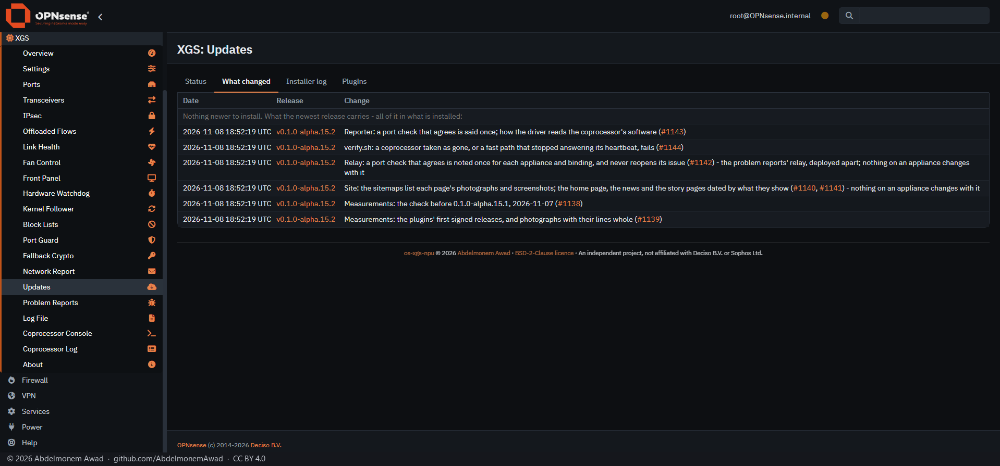

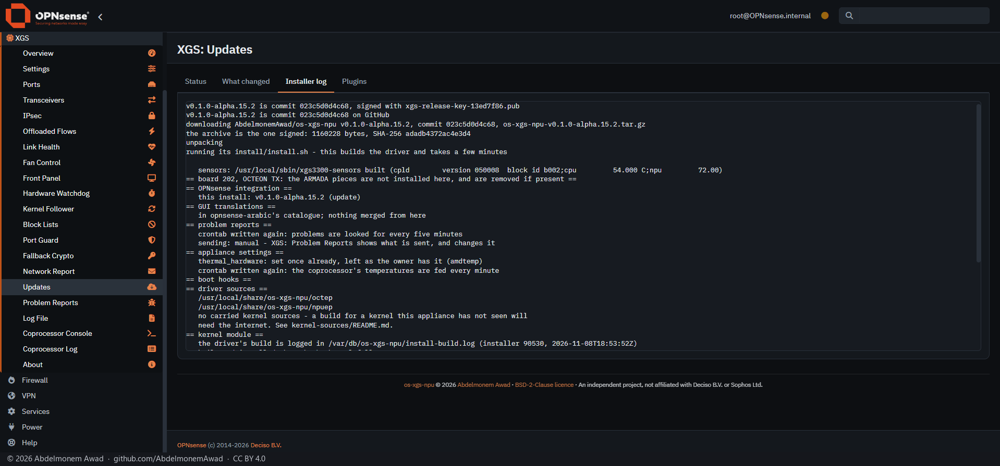

The same page in Arabic

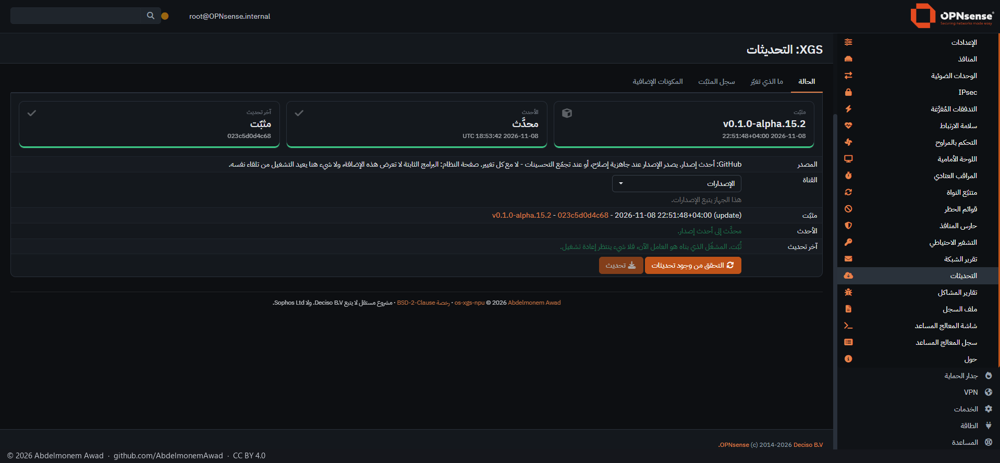

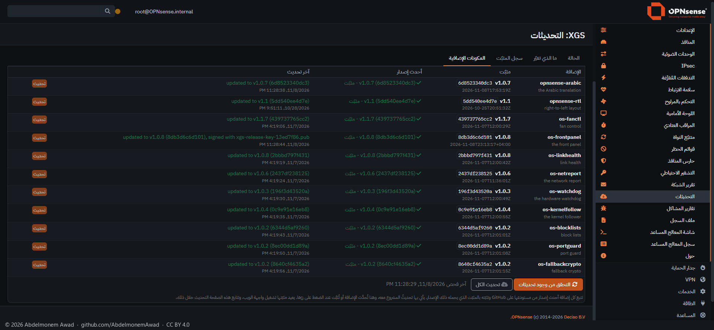

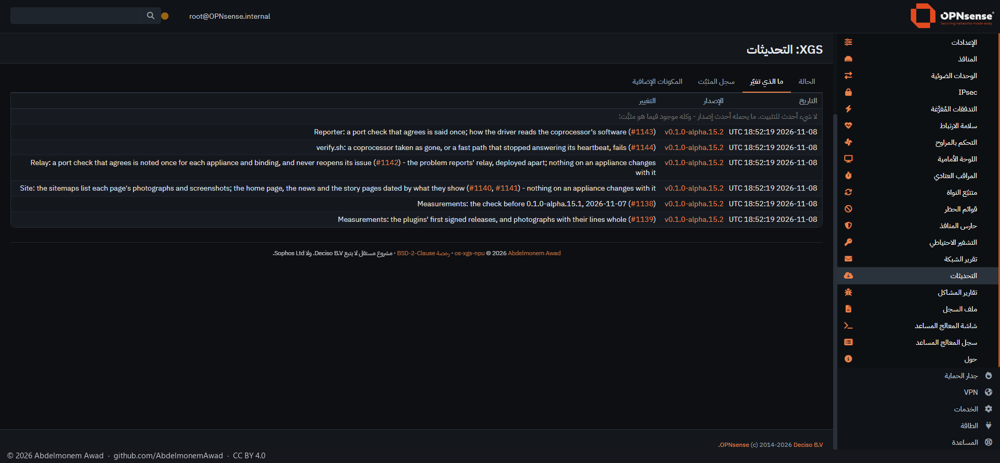

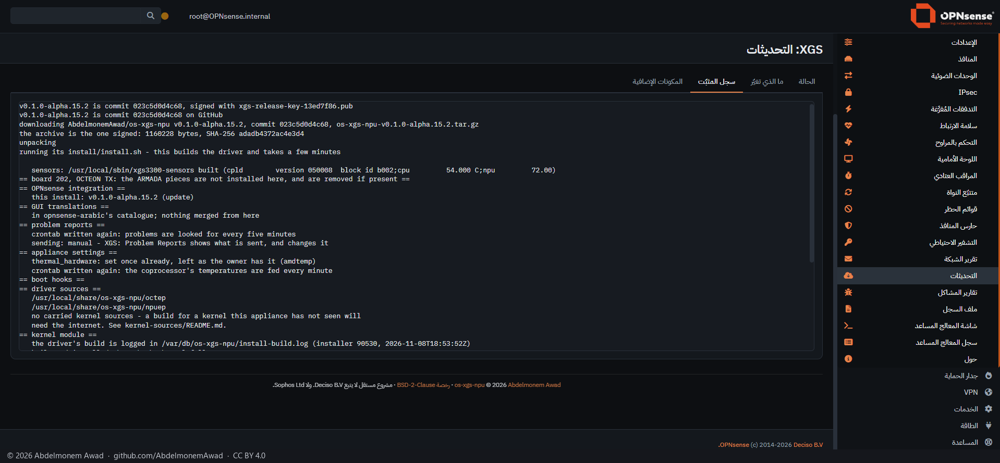

## XGS: Problem Reports

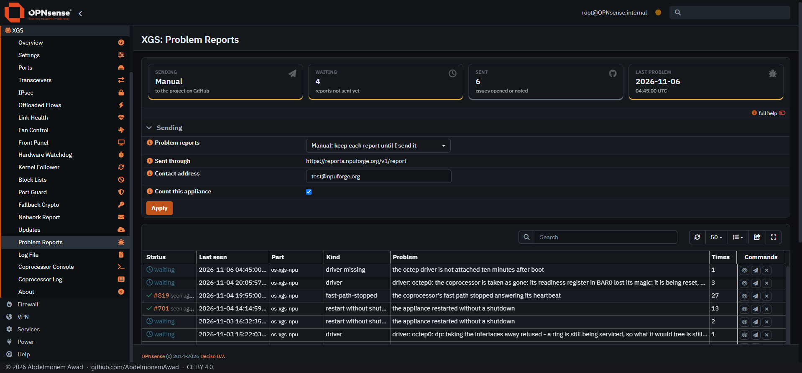

When something goes wrong in the drivers, an update or one of the appliance plugins, the appliance
writes a report, takes every address, serial and name out of it, and files it as an issue in the
repository it belongs to, through the project's relay - so nobody needs a GitHub account.
**Automatic**, **Manual** or **Off** - manual by default since 2026-10-23, and **Count this
appliance** off until it is turned on; the table shows exactly what each report sent, and links to its
issue. See [docs/problem-reports.md](../problem-reports.md).

The same page in Arabic

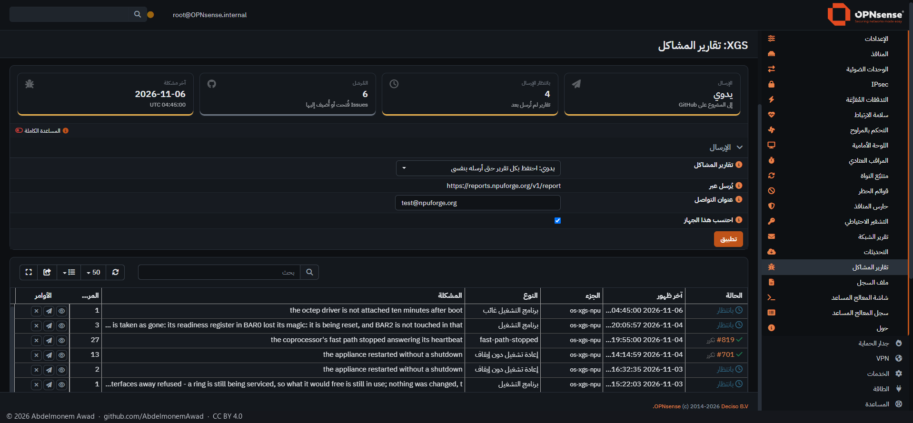

## XGS: Log File

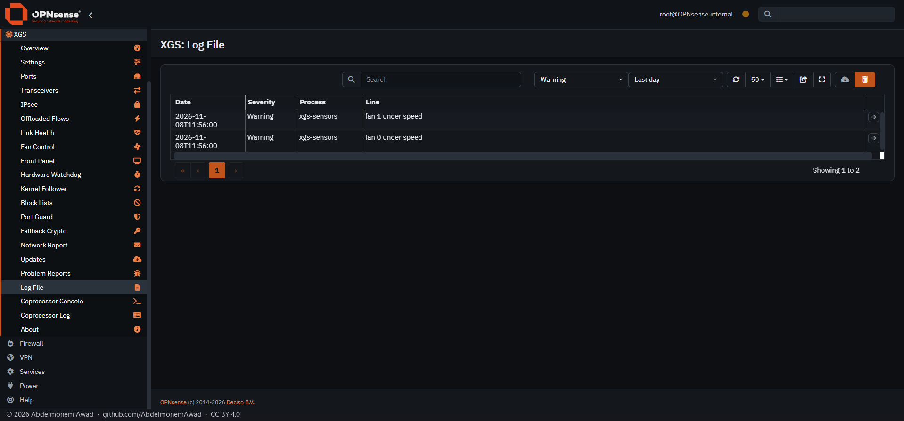

The project's log in OPNsense's own log viewer: the boot hooks, the kernel follower that keeps the
driver built for the running kernel, the updates and the plugins - here, at the viewer's Warning
filter, the day's two warnings: fan 0 and fan 1 under speed. Since 2026-10-28 the kernel follower
says that once a boot, and again only when what it says changes: it runs every five minutes, and
its six lines each time made 960 in a day.

The same page in Arabic

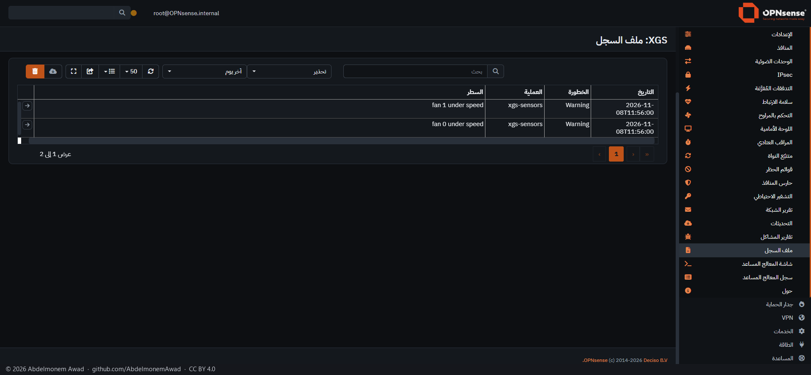

## XGS: Coprocessor Console

Since 2026-10-25: what the coprocessor wrote on its own console, which `scripts/xgs/console_log.py`
keeps from every boot (`/var/log/xgs/npu-console.log`, discovery 27), in OPNsense's own log viewer,
newest first - its boot firmware's banners, its kernel's messages, its last words before a restart.

Since 2026-10-28 each line carries the host's time when it came and who wrote it - `coprocessor`,
or `console_log` for the logger's own lines - so the viewer fills its Date and Process columns,
where a line before filled only Line. Severity stays empty: the console carries none, and a line
without one shows under every severity filter. Lines written before that date keep their old form.

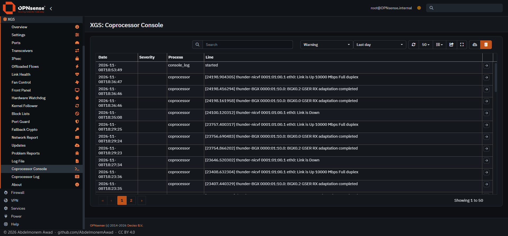

The same page in Arabic

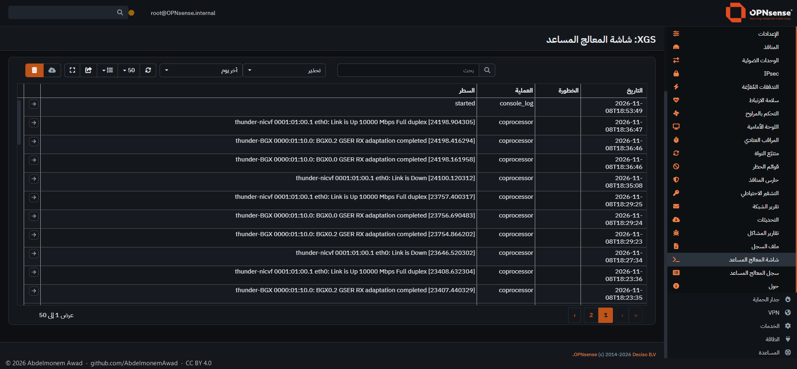

## XGS: Coprocessor Log

Since 2026-10-28: the coprocessor's own log - its kernel, its daemons, the tools on it - sent to the
host line by line over the management link as it is written, and kept under
`/var/log/xgs/coprocessor`, a file a day, in OPNsense's own log viewer
([how](../npuep/mvmgmt-in-opnsense.md#the-coprocessors-log-since-2026-10-28)). Until then that log
lived in the coprocessor's RAM and was lost at each of its resets. Each line carries the time the
host received it, its severity and the program that wrote it. Most are informational, so the
viewer's default filter, Warning, shows few of them - 35 in the last day here, all the kernel's:
Informational shows them all.

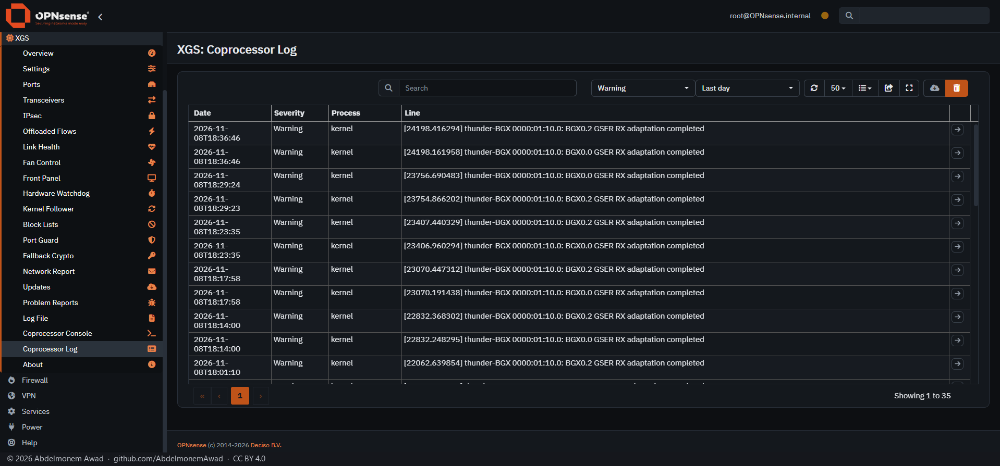

The same page in Arabic

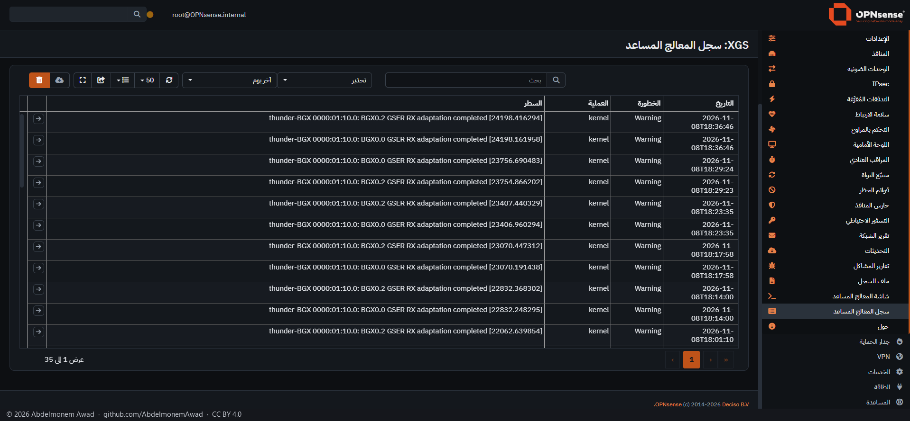

## XGS: About

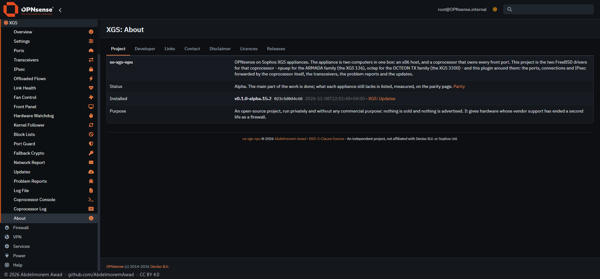

The project in tabs: **Project** - what it is, its status and the release installed here;
**Developer**; **Links** - the site, the source, the releases, the documentation, the installation
image, the issues and the plugins' repositories; **Contact** - contact@npuforge.org, XGS: Problem
Reports for something wrong on the appliance, security@npuforge.org or a private GitHub report for a
vulnerability; **Disclaimer** - no warranty, what the measurements say and do not, the trademarks and
that no Sophos software is distributed; **Licences**; **Releases** - every release's changes as
CHANGELOG.md has them, from the newest, each change linked to its pull request and the release
installed here marked. The same facts as the README, the site's Legal and Contact pages, the security
policy and the changelog, nothing more.

Contact and Disclaimer

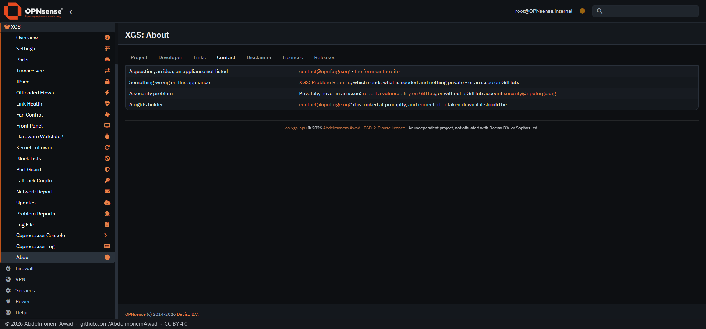

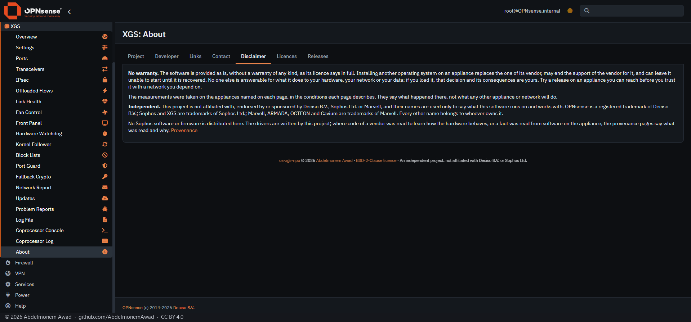

The same page in Arabic

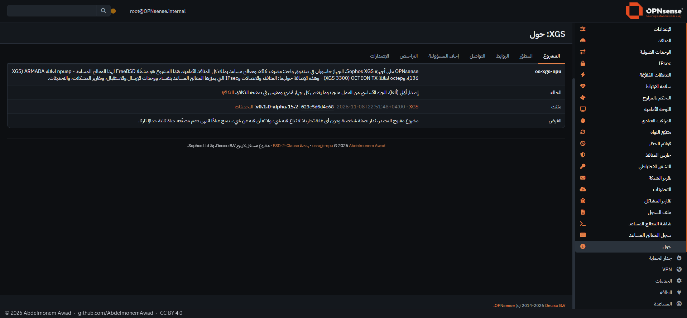

## XGS: Network Report

In the XGS section since 2026-10-25 when os-xgs-npu is installed; under Reporting: Network Report without it.

[os-netreport](https://github.com/AbdelmonemAwad/os-netreport): a report of the network sent by mail
on a schedule, in English or Arabic, through the mail settings OPNsense already has for Monit. The eye
button previews a schedule's report and the plane sends it now. **Settings** and **History** are its
other tabs. No schedule is set on this appliance.

The same page in Arabic

## XGS: Fan Control

In the XGS section since 2026-10-25 when os-xgs-npu is installed; under System: Fan Control without it.

[os-fanctl](https://github.com/AbdelmonemAwad/os-fanctl): every temperature the board gives - the
coprocessor's die, the processor cores, the inlet air - with its lowest, mean and highest over the
chosen time, and the fans with their speed. On the XGS 3300 the fans are read and left to the
hardware, which the cards say: the board gives the host no register to set them. **Settings** and
**Hardware** are its other tabs.

The same page in Arabic

## XGS: Front Panel

In the XGS section since 2026-10-25 when os-xgs-npu is installed; under System: Front Panel without it.

[os-frontpanel](https://github.com/AbdelmonemAwad/os-frontpanel): the LCD on the front of an appliance
that has one, through LCDproc - the panel, its serial port, the screens it rotates through and the
keys beside it. **Buttons**, **Preview** and **Diagnostics** are its other tabs. For an appliance
without a panel, like the XGS 136, the image builder's **No front panel** leaves the plugin out.

The same page in Arabic

## XGS: Link Health

In the XGS section since 2026-10-25 when os-xgs-npu is installed; under Interfaces: Link Health without it.

[os-linkhealth](https://github.com/AbdelmonemAwad/os-linkhealth): a verdict on every port from its
error counters over a window, with the transceiver it holds - and "not enough traffic" until a port
has carried the frames a verdict needs. **Front panel**, **Port detail** and **Settings** are its
other tabs.

The same page in Arabic

## XGS: Hardware Watchdog

[os-watchdog](https://github.com/AbdelmonemAwad/os-watchdog), since 2026-10-25: arms the host's hardware
watchdog so a host that stops is reset by its own hardware, and reads from the chipset why it last
reset. On an XGS appliance os-xgs-npu arms the timer itself, so the plugin stands aside and only shows
it, which the line under the cards says. **Last restart** is its other tab. Under System: Hardware
Watchdog without os-xgs-npu.

The same page in Arabic

## XGS: Kernel Follower

[os-kernelfollow](https://github.com/AbdelmonemAwad/os-kernelfollow), since 2026-10-25: rebuilds the
out-of-tree kernel modules registered with it for the kernel the next boot takes. os-xgs-npu's own
modules are left to os-xgs-npu's follower and only shown. **Settings** and **Follow now** are its
other tabs. Under System: Kernel Follower without os-xgs-npu.

The same page in Arabic

## XGS: Block Lists

[os-blocklists](https://github.com/AbdelmonemAwad/os-blocklists), since 2026-10-25: address, DNS,
country and JA4 block lists in one page. On a Sophos XGS a connection to an address that becomes
listed is cut, and taken out of the coprocessor with its state. **DNS**, **JA4** and **Settings** are
its other tabs. Under Firewall: Block Lists without os-xgs-npu.

The same page in Arabic

## XGS: Port Guard

[os-portguard](https://github.com/AbdelmonemAwad/os-portguard), since 2026-10-25: devices blocked at the
firewall by their MAC address, and the devices it has seen to choose from (**Devices seen**, not
photographed: it lists their hardware addresses); **Settings** is its third tab. Under Firewall: Port
Guard without os-xgs-npu.

The same page in Arabic

## XGS: Fallback Crypto

[os-fallbackcrypto](https://github.com/AbdelmonemAwad/os-fallbackcrypto), since 2026-10-25: which of
the kernel's crypto drivers encrypts IPsec on the host - AES-NI, OpenSSL's, or both. On a Sophos XGS
the coprocessor encrypts the associations it has taken, whatever is chosen here, and the page says so.
Under VPN: IPsec: Fallback Crypto without os-xgs-npu.

The same page in Arabic

## The image builder

Where an install starts:
[npuforge.org's build page](https://npuforge.org/build/),
since 2026-11-01. Choose the OPNsense release, the serial console's speed, the
driver and the front panel, and press **Build the image**
after Cloudflare's check; the page starts the build itself, with no GitHub account, and follows it
to the download. The page is in English and Arabic.
