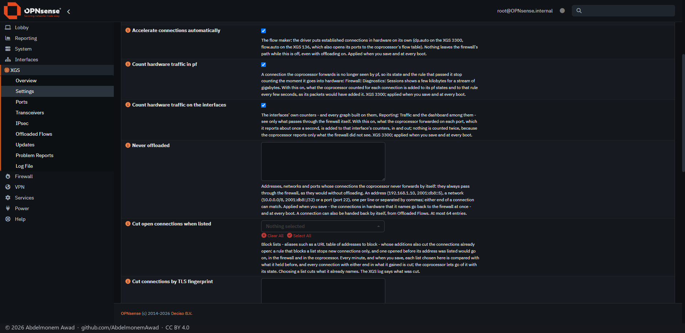
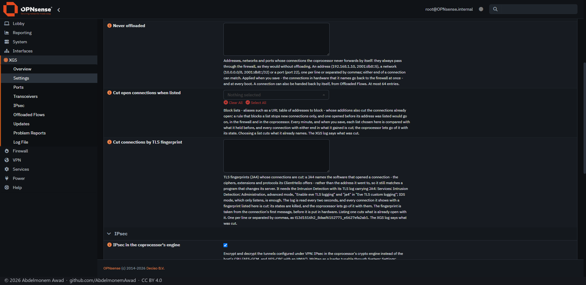
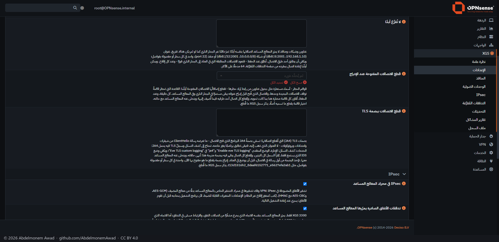
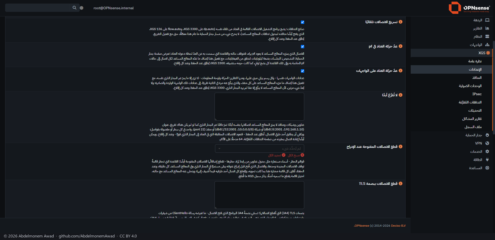

<!-- reviewed: 2026-10-20 -->
# The pages, one by one

Every page this project and its plugins add to OPNsense, photographed on 2026-10-19 on a real appliance - the second
XGS 3300, with its 4x10G expansion module, running this project's `main` - full screen, in the dark
theme, in English and in Arabic. The English photographs come first; each page's Arabic one is under
it. Nothing was staged: the figures are that appliance's at that moment.

Before each photograph, and only in it, a few values were masked: hardware addresses (MACs, and the
IPv6 addresses built from them), public addresses, the module serial numbers, the owner's domain, and
a server's name in two port descriptions, which reads "server". Private lab addresses were left as
they are; they are the bench's, in [the measurements](../measurements/) as well.

How they were taken: the page opened in a browser window on the PC, the values masked in the page,
then the window photographed by `PrintWindow` and cut to the page - the way every measurement here is
photographed. All of them, with every other image in the repository, are listed in
[docs/images/README.md](../images/README.md).

| | page | where | what it is for |
|---|---|---|---|
| 0 | [Lobby: Dashboard](#lobby-dashboard) | OPNsense's own | the first page after logging in, with the appliance on it |
| 1 | [XGS: Overview](#xgs-overview) | XGS | the coprocessor, the front panel and the board's tables at a glance |
| 2 | [XGS: Settings](#xgs-settings) | XGS | every setting of the project, in one page |
| 3 | [XGS: Ports](#xgs-ports) | XGS | every front port: what it is assigned as, its link, its MTU |
| 4 | [XGS: Transceivers](#xgs-transceivers) | XGS | the modules in the cages and what they report |
| 5 | [XGS: IPsec](#xgs-ipsec) | XGS | the associations in the coprocessor's crypto engine |
| 6 | [XGS: Offloaded Flows](#xgs-offloaded-flows) | XGS | the connections the coprocessor forwards itself |
| 7 | [XGS: Updates](#xgs-updates) | XGS | the project's releases, installed from the page |
| 8 | [XGS: Problem Reports](#xgs-problem-reports) | XGS | what goes wrong, cleaned and filed as an issue |
| 9 | [XGS: Log File](#xgs-log-file) | XGS | the project's own log |
| 9b | [XGS: About](#xgs-about) | XGS | the project, its author, its links and addresses, the disclaimer |
| 10 | [Reporting: Network Report](#reporting-network-report) | os-netreport | a report of the network by mail, on a schedule |
| 11 | [System: Fan Control](#system-fan-control) | os-fanctl | temperatures and fans |
| 12 | [System: Front Panel](#system-front-panel) | os-frontpanel | the LCD and the keys beside it |
| 13 | [Interfaces: Link Health](#interfaces-link-health) | os-linkhealth | a verdict on every port from its error counters |
| 20 | [The image builder](#the-image-builder) | its own site | where an install starts |

## Lobby: Dashboard

OPNsense's own dashboard, as the image leaves it. The drawing of the appliance - the XGS 3300 with its
expansion module here - is the theme's, [os-theme-xgs](https://github.com/AbdelmonemAwad/os-theme-xgs);
**Fan Control** is os-fanctl's widget, with the fans and every temperature the board gives, the
coprocessor's among them. The dashboard also takes **XGS Offloaded Flows**, a widget of this project,
from its widget list.

The same page in Arabic

## XGS: Overview

The first page of the **XGS** section. At the top, the front panel drawn in the chassis's order - the
two cages, Port1 to Port8, two more cages, the expansion module's A4 to A1 - each with its link as a
light. Then a card each for the coprocessor and its link, hardware offloading, the IPsec engine, the
front ports, the switch chip, and the cause of the last restart as the chipset recorded it. Under them
**Coprocessor link** - with, since 2026-10-20, the coprocessor's own Linux: how long it has been up,
its load on its cores and its memory, read every five minutes by `scripts/xgs/health.py` (on the
second XGS 3300 that day: twenty cores at a load of 19, which its fast path keeps busy, and 163 of
3,165 MB available; on the XGS 136 four cores at 3.2 and 1,544 MB available) - **This board's limits** - the connections and next hops the board holds, with a
bar of how much of each is in use - and the control facility. **Datapath counters** and **Technical
details** are its other tabs. Photographed again on 2026-10-19 while two streams crossed the appliance
in hardware and a third went through the IPsec tunnel to the XGS 136: four connections in hardware,
two associations in the engine.

The same page in Arabic

## XGS: Settings

Every setting the project has, and only those this appliance has. **Status** reads back what the
coprocessor is doing now, which can differ from the page until the next boot. **Acceleration** is
hardware offloading, the flow maker that hands settled connections to the coprocessor on its own, and
**Never offloaded** - addresses, networks and ports whose connections always stay with the firewall.
**IPsec** puts the associations in the coprocessor's engine. **Full help** shows the text under each
setting, as here; **advanced mode** shows the rest. Since 2026-10-19 **Acceleration** also has **Cut
open connections when listed**: block lists whose additions cut the connections already open
([measured](../measurements/lists-cut-2026-10-19.md)), and **Cut connections by TLS fingerprint**:
JA4 fingerprints whose connections are cut, read from the Intrusion Detection's log
([measured](../measurements/ja4-cut-2026-10-19.md)) - both below, further down the same page. And on
both appliances, **Count hardware traffic in pf** and **Count hardware traffic on the interfaces**, on by
default: what the coprocessor forwards, which pf and the interfaces never see, added to pf's states and
rules and to the interfaces' counters, so the Sessions page and the traffic graphs show it
([measured](../measurements/hw-counters-2026-10-19.md); on the XGS 136,
[measured](../measurements/xgs136-counts-2026-10-19.md#the-reader-measured)). Below the two cuts, **Watch for unusual
traffic** reports a scan, a sweep, or a host far beyond its own normal in the XGS log, and blocks
nothing ([measured](../measurements/anomaly-2026-10-19.md)).

The same page in Arabic

## XGS: Ports

Every front port by the name on the chassis, with its link, what OPNsense has it assigned as, its
address, speed, media, MTU, the bridge it is a member of and its device name. The cards count the
ports with a link and the ones assigned, name the expansion module in its bay, and say whether the
switch chip is in its jumbo-frame mode.

On an appliance with Power over Ethernet - labels 11 and 12 of the XGS 136 - a table under the ports
shows each PoE port as its controller reads it when the page opens, with **Switch off**, **Switch
on** and **Power cycle**. A port switched off stays off after a reboot; switching needs the XGS:
Settings privilege ([measured](../measurements/poe-136-2026-10-20.md)).

**Errors and drops on the switch**, under them: for Port1 to Port8 and the two cages beside them, what
the switch chip itself counted - frames received and sent, frames received with a bad checksum, too
short or too long, frames dropped on arrival, errors sending - with what moved since the reading
before. None of those frames reaches the host, so no other counter has them. Read every five minutes,
and with **Read now** ([measured](../measurements/port-errors-136-2026-10-20.md)).

The same page in Arabic

## XGS: Transceivers

The module in each cage, read on the coprocessor every five minutes from the module's own memory:
what it is, and where it reports them its temperature, supply voltage, laser bias and the light it
sends and receives. A received light below -11.1 dBm, the weakest a 10GBASE-SR receiver is meant to
accept, is red - A3 here receives none. The cards name the warmest module and the
weakest light. The serial numbers are masked in this photograph.

The same page in Arabic

## XGS: IPsec

What the coprocessor's crypto engine holds now: whether the engine is in use, the associations in it,
those installed since the boot and the offers it declined. The tunnels themselves are configured
where they always are, under **VPN: IPsec**; whether their associations go to the engine is set on
**Settings**. Photographed on 2026-10-19 with the tunnel to the XGS 136 carrying a stream of fetches:
the engine on, an association each way. **Associations in the engine** lists them - direction, SPI,
the tunnel's two ends, the port, the replay window and the handle - and **Counters** shows the
engine's work: frames decrypted on arrival (`rx_done`), frames encrypted on the way out
(`tx_encrypt`), and the connections made through the tunnel.

The same page in Arabic

## XGS: Offloaded Flows

The connections the coprocessor forwards itself, one row each, with **Return to host** on every row
to hand one back to the firewall. The cards count the table against the board's size, the IPv6 ones,
those with their IPsec association in hardware, those taken back, and those kept with the host - by
hand or by the never-offloaded list. ~~No connection crossed this appliance at the moment of the
photograph, so the table is empty~~ Photographed again on 2026-10-19 with traffic: two streams in
hardware, a third connection open beside them, and one through the IPsec tunnel - encrypted on the way
out and decrypted on the way in by the engine. Since that day the XGS 3300's rows also have **Counted
in hardware** - the bytes the coprocessor counted each way, from the opener and back to it, with
**Packets in hardware** among the hidden columns - read from the counts the coprocessor sends about
once a second ([measured](../measurements/hw-counters-2026-10-19.md)); a connection the coprocessor has not yet named in a
message says **not counted yet**.

The same page in Arabic

## XGS: Updates

The project's own updates, which OPNsense's firmware page does not list: **Check for updates** asks
GitHub for the newest release, **What changed** lists the releases since the one installed, and
**Update** installs it with a progress bar; the new driver loads at the next boot. **Channel** is
**Releases** for an appliance in service, or **Test** for every change merged. This appliance was
updated by hand from `main` for the work of 2026-10-18, so the page says so: a commit, not a release,
newer than the newest release - the next release will be offered to it.

Step by step, each step photographed on the three appliances: [Updating an appliance](updating.md).

**Plugins** is the appliance plugins' own updates - Arabic, right-to-left, fan control, the front
panel, link health and the network report, those installed: what each has installed, its latest
release, and an **Update** for each, which runs the plugin's own updater. Nothing is installed on its
own: until 2026-10-20 each plugin took its new releases by itself once a day; since then a release is
installed from here, by hand.

The same page in Arabic

## XGS: Problem Reports

When something goes wrong in the drivers, an update or one of the appliance plugins, the appliance
writes a report, takes every address, serial and name out of it, and files it as an issue in the
repository it belongs to, through the project's relay - so nobody needs a GitHub account.
**Automatic**, **Manual** or **Off**; the table shows exactly what each report sent, and links to its
issue. See [docs/problem-reports.md](../problem-reports.md).

The same page in Arabic

## XGS: Log File

The project's log in OPNsense's own log viewer: the boot hooks, the kernel follower that keeps the
driver built for the running kernel - here, every five minutes, finding nothing to do - the updates
and the plugins.

The same page in Arabic

## XGS: About

The project in tabs: **Project** - what it is, its status and the release installed here;
**Developer**; **Links** - the site, the source, the releases, the documentation, the installation
image, the issues and the plugins' repositories; **Contact** - contact@npuforge.org, XGS: Problem
Reports for something wrong on the appliance, security@npuforge.org or a private GitHub report for a
vulnerability; **Disclaimer** - no warranty, what the measurements say and do not, the trademarks and
that no Sophos software is distributed; **Licences**; **Releases** - every release's changes as
CHANGELOG.md has them, from the newest, each change linked to its pull request and the release
installed here marked. The same facts as the README, the site's Legal and Contact pages, the security
policy and the changelog, nothing more.

Contact and Disclaimer

## Reporting: Network Report

[os-netreport](https://github.com/AbdelmonemAwad/os-netreport): a report of the network sent by mail
on a schedule, in English or Arabic, through the mail settings OPNsense already has for Monit. The eye
button previews a schedule's report and the plane sends it now. No schedule is set on this appliance.

The same page in Arabic

## System: Fan Control

[os-fanctl](https://github.com/AbdelmonemAwad/os-fanctl): every temperature the board gives - the
coprocessor's die, the processor cores, the inlet air - with its lowest, mean and highest over the
chosen time, and the fans with their speed. On the XGS 3300 the fans are read and left to the
hardware, which the cards say: the board gives the host no register to set them.

The same page in Arabic

## System: Front Panel

[os-frontpanel](https://github.com/AbdelmonemAwad/os-frontpanel): the LCD on the front of an appliance
that has one, through LCDproc - the panel, its serial port, the screens it rotates through and the
keys beside it. **Buttons**, **Preview** and **Diagnostics** are its other tabs. For an appliance
without a panel, like the XGS 136, the image builder's **No front panel** leaves the plugin out.

The same page in Arabic

## Interfaces: Link Health

[os-linkhealth](https://github.com/AbdelmonemAwad/os-linkhealth): a verdict on every port from its
error counters over a window, with the transceiver it holds - and "not enough traffic" until a port
has carried the frames a verdict needs. **Front panel**, **Port detail** and **Settings** are its
other tabs.

The same page in Arabic

## The image builder

Where an install starts:
[xgs-image-builder's build page](https://build.npuforge.org/). Choose the
OPNsense release, the image type and the serial console's speed, and press **Build it**; the page
follows the build to the download. The page is in English only.
