# The hardware

Measured on a Sophos XGS 136. Where a fact is known to generalise across the range it says so;
where it is not, assume it does not.

## What FreeBSD sees on the host

Working with no driver work at all:

```
CPU    AMD Ryzen Embedded R1606G, 4 CPUs (1 package x 2 cores x 2 threads)
RAM    8192 MB
Disk   ahci0 -> ada0, SATA 3.x
USB    xhci0, USB 3.0
SMBus  intsmb0 -> smbus0 (AMD FCH)      the I2C path to the SFP cages and the PoE controller
HID    Microchip MCP2210 USB to SPI Master -> usbhid0 -> hidbus0
serial uart0 0x3f8 (console) and uart2 0x3e8 (the NPU's console, needs a hint)
```

Not working, and it is the whole reason this repository exists:

```
pci1: <network, ethernet> at device 0.0 (no driver attached)
```

There is also no `superio`, so the NCT6779D hardware monitor - which the BIOS reads perfectly
well - is invisible to a stock FreeBSD. That is a separate piece of work.

## The endpoint

```
pci0:1:0:0   vendor=0x11ab device=0x7080   class=network/ethernet
  bar[10]  1 MB    64-bit
  bar[18]  16 MB   64-bit
  bar[20]  16 MB   32-bit
  PCIe     x4 @ 8.0 GT/s (Gen3)
  MSI      32 messages;  MSI-X 16 messages, table in BAR0 @0x1000, PBA @0x1800
  SR-IOV   VF device ID 0x7081, 6 VFs supported
  ARI, AER, LTR, TPH Requester, Resizable BAR, L1 PM Substates
```

The link is Gen3 x4, about 32 Gbit/s. All fourteen front ports together are about 17 Gbit/s at
most - eight switch ports and labels 9 and 10 at 1G, labels 11 and 12 at 2.5G, and the two SFP
cages at 1G - so the roughly 936 Mbps single-port ceiling reported by other projects on this
hardware is **not** a PCIe bandwidth limit, and neither is an MTU of 1500. Whatever causes them is
above the bus.

The SR-IOV capability reports 6 VFs where the vendor's Linux exposes 8 in sysfs. Unresolved, and
recorded because it is the sort of discrepancy that wastes a day later.

## Identifying the board from software

Two independent sources, and the second is the more useful one.

**SMBIOS** is awkward. `smbios.planar.product` is the generic string `XGS` across the whole
range and `smbios.planar.version` is not the model either. The assembly number is buried inside
`smbios.planar.serial`, in the form:

```
NEAAMDA0201-00xxxxxxxxxx
   ^^^^^^^^^^^^
   AMDA0201-0003 = Desktop XGS 136
```

So anything keying a chassis table off SMBIOS has to match on the serial, not on product or
version - and the serial also carries the unit's own identity, which is worth remembering before
putting it in a log.

**The MCP2210's EEPROM** is better for this purpose. Bytes 0 and 1 hold the assembly number as
`(byte0 << 8) | byte1`, so `0x00, 0xC9` is 201, which is AMDA0201. It is on the host side, needs
no I2C, and answers while the coprocessor is held in reset.

## The coprocessor

```
SoC       Marvell CN9131  (AP807 + two CP115)
storage   its own eMMC, 7.28 GiB, four partitions, root on p3
firmware  U-Boot 2019.10-10.22.03, Linux 4.14.207-10.22.03
model     the kernel reports "Sophos XGS126/136" - one board for both
cmdline   console=ttyS0,115200n8 root=/dev/mmcblk0p3 cpuidle.off=1
          isolcpus=1-3 nohz_full=1-3 rcu_nocbs=1-3
```

The CN9131's second CP115 is what lets this board drive fourteen ports where the nine-port model
in the same family uses a CN9130.

Three cores are isolated from the scheduler and run the dataplane; that is what `isolcpus=1-3`
is for.

The coprocessor boots from **its own storage**, not from the host's disk. Replacing the host SSD
- which is what running OPNsense on one of these means - does not touch its firmware at all,
and that is what makes the whole exercise reversible.

## The port map

Fourteen ports, all behind the coprocessor. The switch is an 88E6193X LinkStreet; the multi-gig
ports are on an AQR412C quad PHY.

```
labels 1-8   ->  switch ports 1-8      (88E6193X, CPU port is port 0)
label 9      ->  CN9131 COMPHY 2       (AQR412C address 0, 1G)
label 10     ->  CN9131 COMPHY 4       (AQR412C address 1, 1G)
label 11     ->  CN9131 COMPHY 5       (AQR412C address 2, 2.5G + PoE)
label 12     ->  CN9131 COMPHY 3       (AQR412C address 3, 2.5G + PoE)
F1, F2       ->  switch ports 9, 10    (SFP)
```

Each port takes one offset from the board's base MAC, in that order.

The device tree is **not** where this map lives, which is worth knowing before going looking for
it there. Neither the 9130 nor the 9131 device tree contains a switch node, a DSA node, an
AQR412C node or any PHY child: both MDIO controllers per CP are declared empty and handed to
userspace. The map comes from a platform text file in the coprocessor's firmware plus the
bootloader environment.

## The board, photographed

Photographed on 2026-10-11, the XGS 136 out of its case. Everything above was read over a wire
or out of a file; this is the same board, and the pictures put a part under each of those
readings. Serial numbers, barcodes and the storage's label are pixelated with
`tools/blur-labels.py`; part markings and reference designators are left, because they describe
the design and not this unit. The private-data checker cannot read a photograph, so that tool is
the only gate. The photographs of each appliance are in a folder of their own under
`docs/images/`.

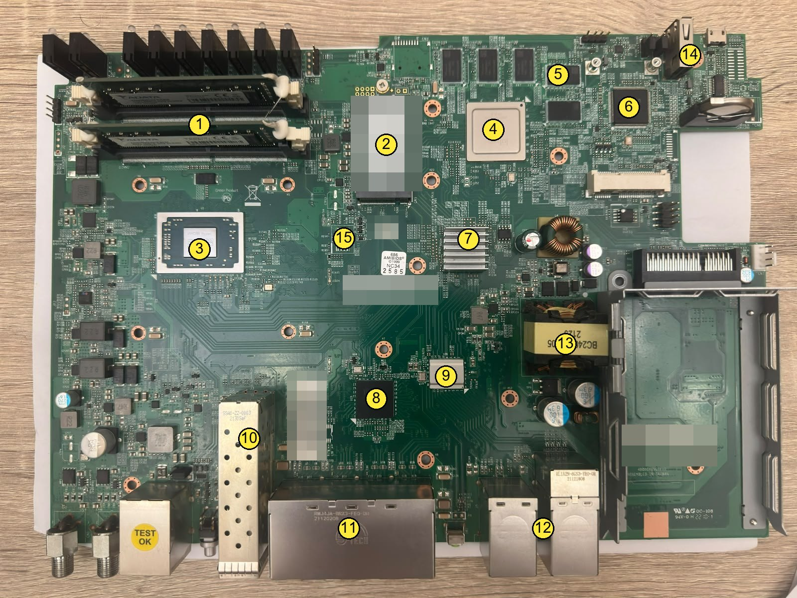

| | | | |
|---|---|---|---|
| 1 | the host's two SO-DIMMs | 9 | AQR412C, the PHY behind labels 9 to 12 |
| 2 | the host's M.2 SATA drive | 10 | the SFP cages, F1 and F2 |
| 3 | AMD Ryzen, the host | 11 | the eight copper ports, labels 1 to 8 |
| 4 | CN9130, the coprocessor, under its lid | 12 | labels 9 to 12, two of them with PoE |
| 5 | the coprocessor's four DDR4 chips | 13 | the PoE transformer |
| 6 | NCT6779D, the Super I/O | 14 | the console and USB at the back |
| 7 | the coprocessor's heatsink | 15 | the BIOS flash, under the AMIBIOS sticker |
| 8 | 88E6193X, the switch behind labels 1 to 8 and the cages | | |

The numbers are placed by eye on the photograph; each part is named from its marking in the
close-ups below, and tied to what software sees where the pages above say so.

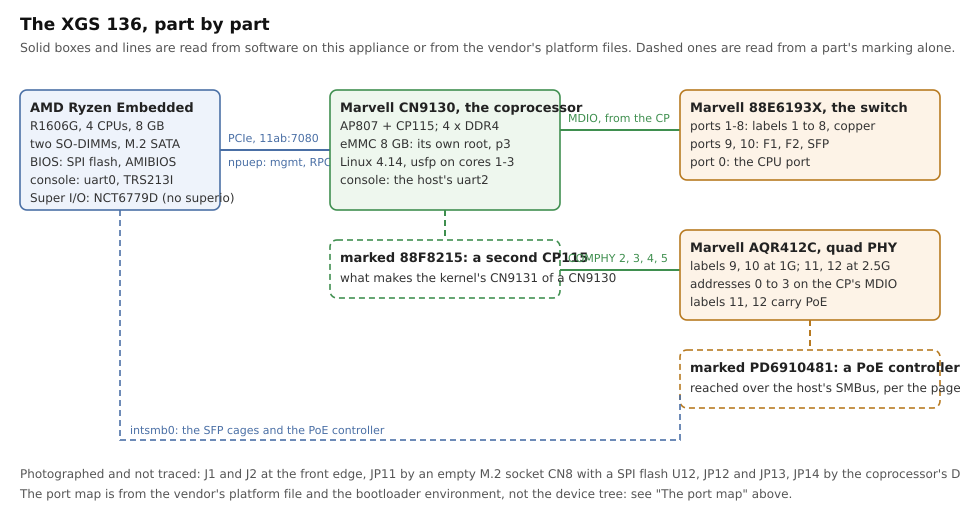


The same board unmarked. The assembly's label is at the bottom right; `AMDA0201` is what the
EEPROM says and what the pages above read.

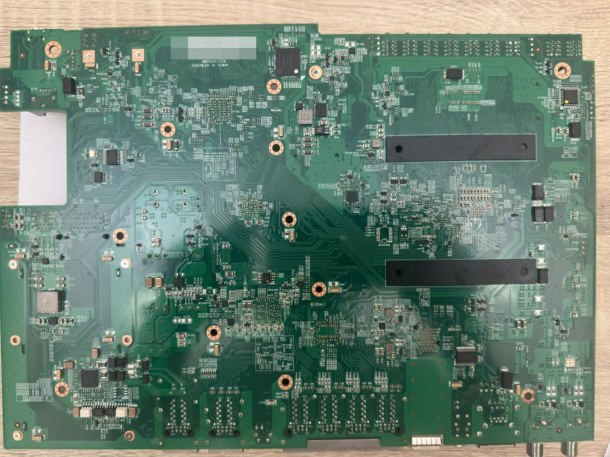

From below: no active part of note - the two black bars are the DIMM and M.2 retainers' backs -
and the assembly barcode at the top left, pixelated.

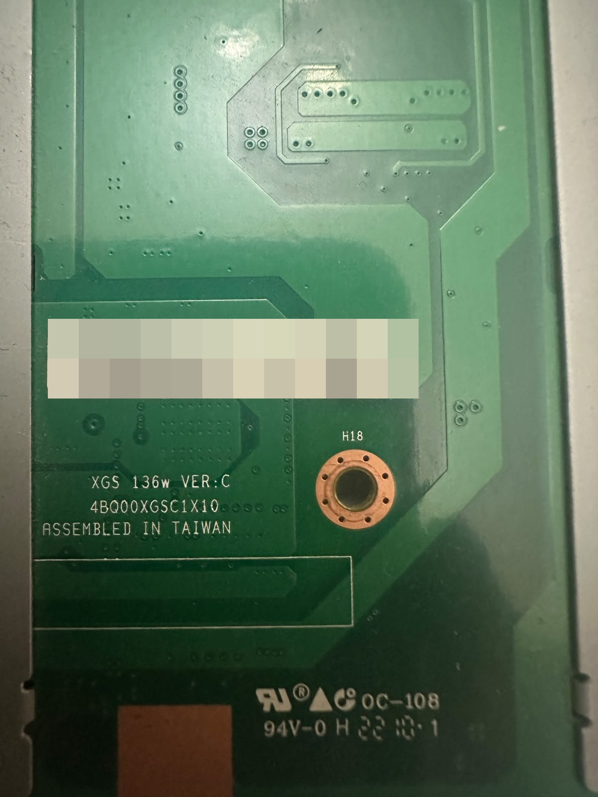

The label and the silkscreen beside it: `XGS 136w VER:C`, assembled in Taiwan.


The coprocessor: **Marvell CN9130-2200**, with four SK hynix H5AN8G6NCJ DDR4 chips around it.
The kernel on it reports a CN9131, which is a CN9130 with a second CP115 - and that second part is
the next photograph.

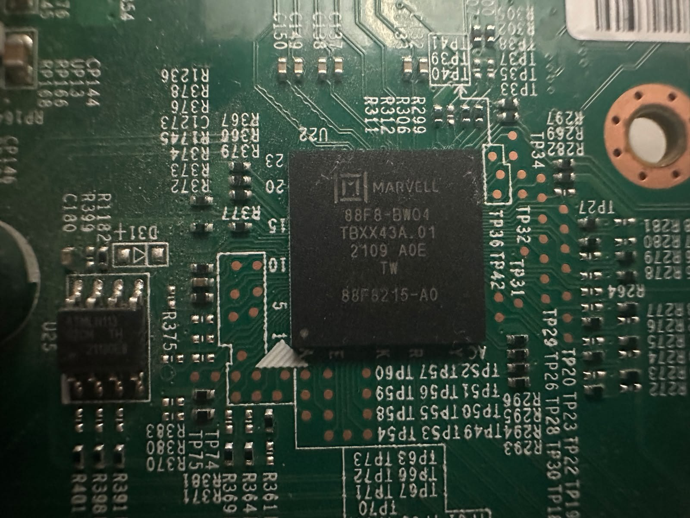

Marked **88F8215-A0**, beside an 8-pin Atmel part (`U25`, an EEPROM by its package and marking).
The port map above puts labels 9 to 12 on CN9131 COMPHY lanes that a bare CN9130 does not have;
this is the part that has them. Read from the marking and the port map, not from a datasheet.


**Marvell AQrate AQR412C-B0-C**: the quad multi-gig PHY behind labels 9 to 12, two of them at
2.5G with PoE. The crystal beside it is `U19`.

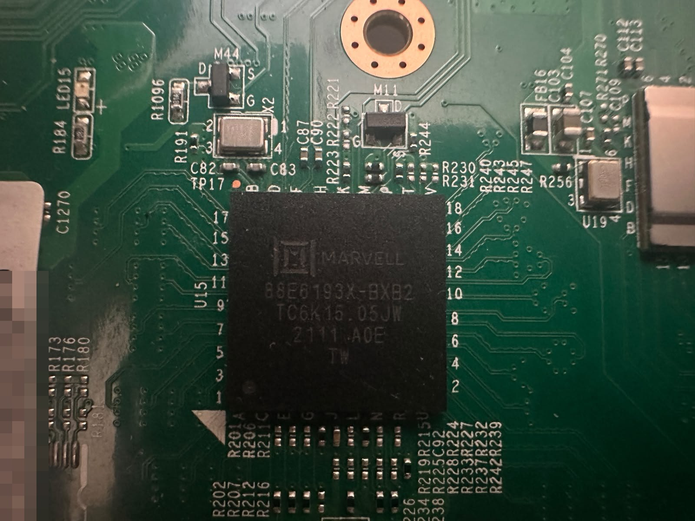

**Marvell 88E6193X-BXB2**, the LinkStreet switch behind labels 1 to 8 and the two SFP cages
(ports 9 and 10 on the switch). The same part as the XGS 3300's, reached there over the
coprocessor's MDIO - see [the OCTEON TX peripherals](families/octeon-tx-peripherals.md).

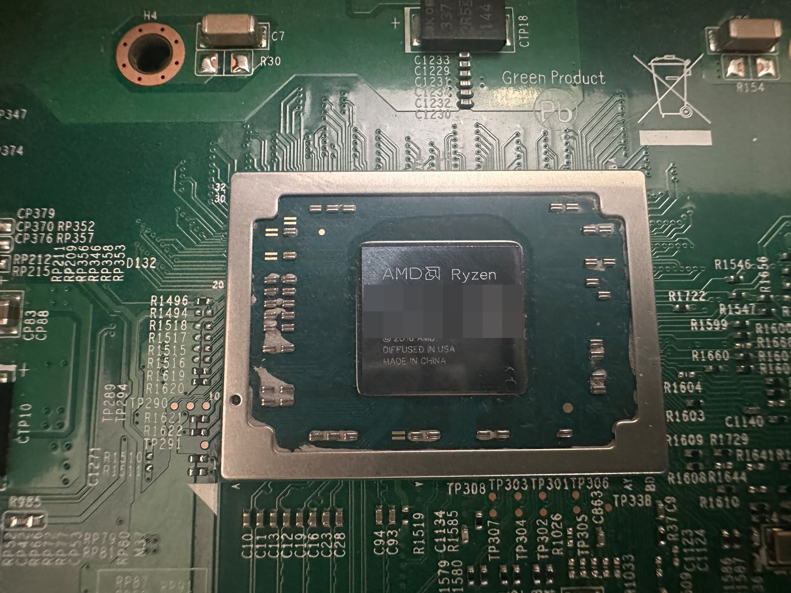

The host: **AMD Ryzen Embedded**, which FreeBSD reports as an R1606G. Its lot code and matrix are
pixelated.

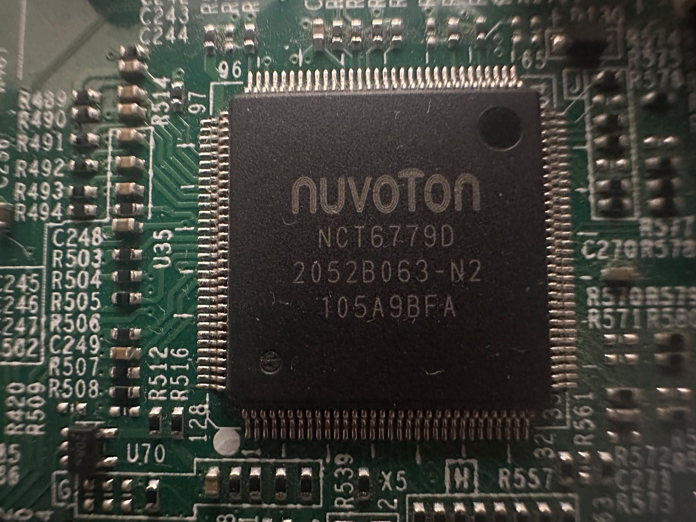

**Nuvoton NCT6779D**, `U35`: the Super I/O whose hardware monitor the BIOS reads and a stock
FreeBSD does not, as the first section says. It is the chip `os-fanctl` knows a table for and
could not find on this board for want of `superio(4)` - which this photograph settles: it is
there.

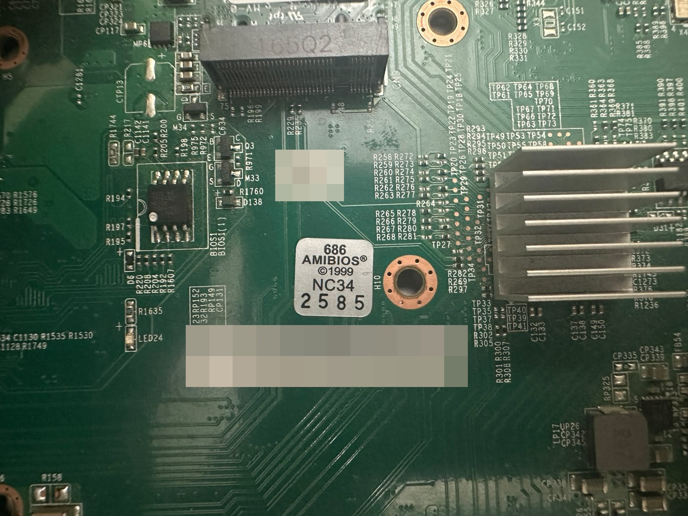

`BIOS1`, an 8-pin SPI flash beside a second footprint `BIOS1(1)` that is not fitted; the AMIBIOS
sticker; the assembly's serial barcode, pixelated; and the host's M.2 socket above with its screw
post, its designator cut by the photograph's edge. The heatsink at the right is the coprocessor's.


**TI TRS213I**, `U65`: the RS-232 transceiver on the host's console. The coprocessor's own console
is the host's third UART, at 115200, and needs a hint; see the first section.

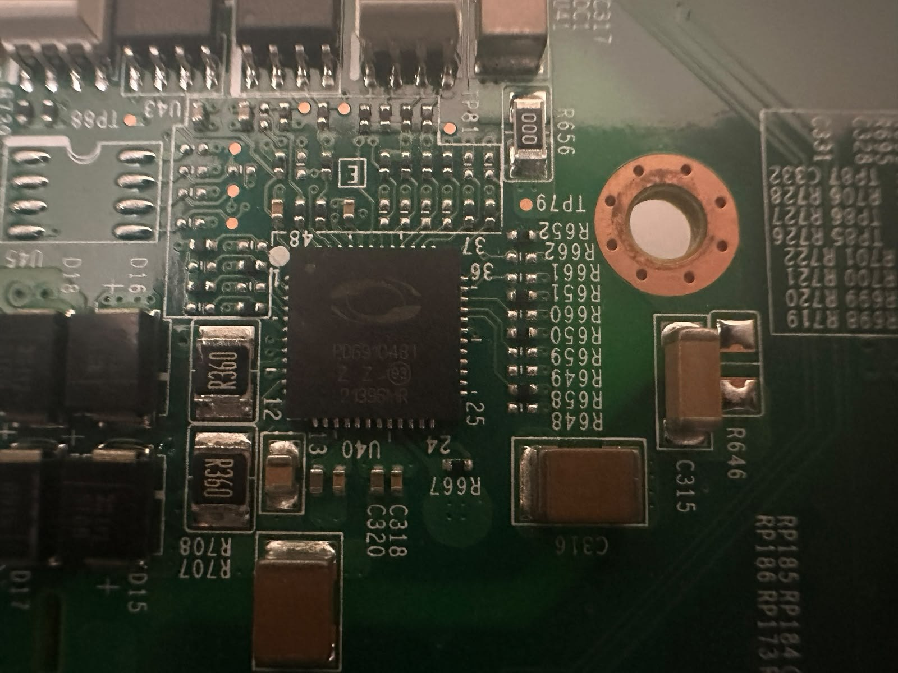

`U40`, marked **PD6910481**: by that marking a Microchip PD69104, a four-port PoE controller - the
part behind the "2.5G + PoE" of labels 11 and 12, and what the SMBus path to the PoE controller
in the first section reaches. Identified from the marking only.


**SanDisk SDINBDG4-8G**, `U53`: an 8 GB eMMC. The coprocessor boots from its own storage - 7.28 GiB
in four partitions, as above - and this is the part of that size on the board.

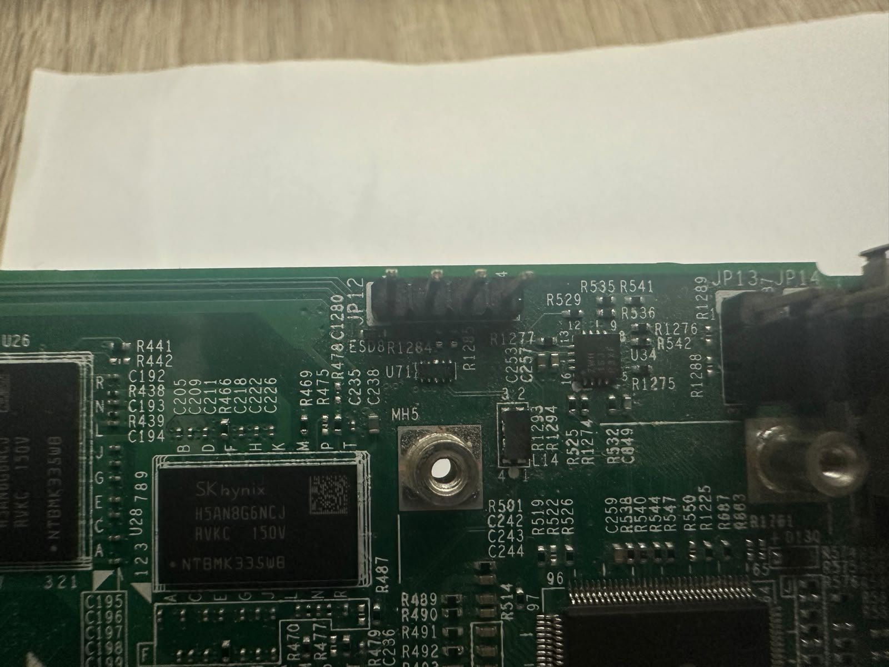

One of the coprocessor's DRAMs, with `JP12`, a four-pin header, and `JP13` and `JP14` at the board's
edge. Which of them is the coprocessor's console header was not traced; the XGS 3300 has the same
question answered on its page.

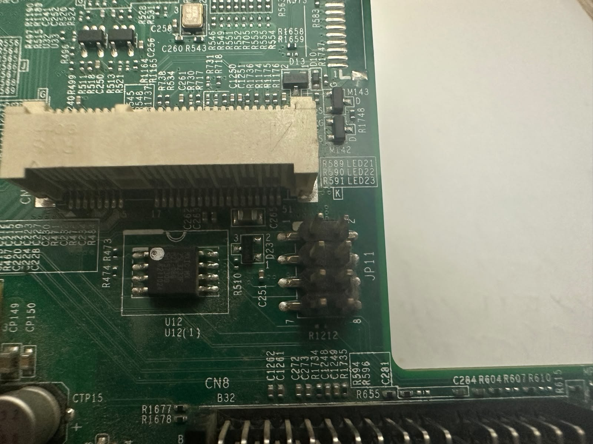

`CN8`, an M.2 socket with nothing in it; `JP11`, a two-by-four header; and `U12`, an 8-pin SPI flash
(Macronix by its marking). Not traced.

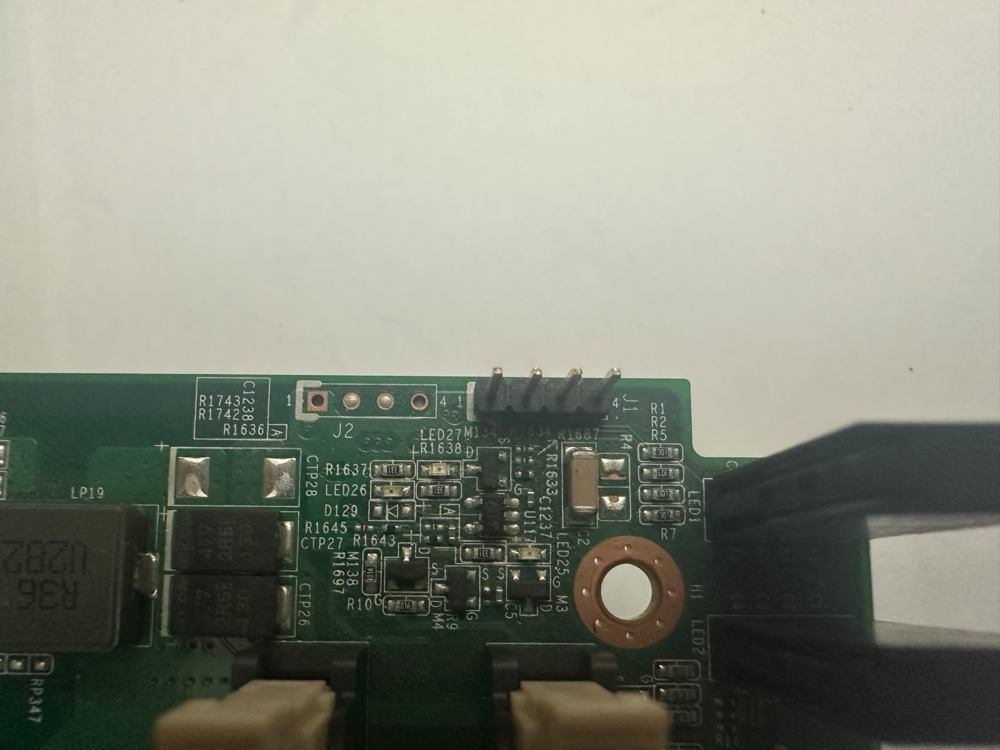

At the front edge: `J1`, a four-pin header, `J2`, a four-pad footprint, and the front LEDs
`LED25` to `LED27` with their drivers. Not traced.

## What the vendor's own tools tell you

Useful mostly as a map of what is reachable and from where. Roughly half of the `xgs-*` tools on
the host are seven-line shell wrappers that ssh to the coprocessor over the management link -
which this repository's driver now brings up, so what limits them is the SFOS userland they expect
on the far side, not the link. The rest run on the host.

Two are worth naming:

- The USB-SPI flash tool is the one this repository's reset path is derived from. It also reads
  and writes the coprocessor's boot flash from the host, which means a bricked bootloader is
  recoverable without opening the case.
- The platform-init tool is **not** a bring-up tool despite the name. It probes I2C busses 0-7 at
  address `0x57` for the baseboard VPD EEPROM and builds a key-value database that everything
  else reads. FreeBSD has `smbus0` on this board, so that database can be rebuilt natively - it
  is where the per-port MAC addresses, PHY labels and transceiver configuration come from.
