# The XGS 3300

Measured on a Sophos XGS 3300, board revision 1 - the string `XGS 17` the firmware carries is the
board's revision, not a model. This page is the appliance as an object: what it is, where each
part of it is written up, the board photographed part by part, and the one reading of it that was
on no page until now. The long pages are under [families/](../families/), because the coprocessor
family, not the chassis, is what the driver is written against.

## What it is

Two computers in one box, like the rest of the range:

```
host         AMD Ryzen Embedded V1780B (x86), 8 threads, 16 GB, its own disk, OPNsense on it
coprocessor  Cavium OCTEON TX CN8365 (CN83XX, ARM), 20 cores, its own Linux, its own storage
link         PCIe, 177d:a300 with eight VFs at 177d:a303: an SDP endpoint - the host sees
             rings, not a NIC
front        twelve ports: Port1 to Port8 and PortF3/PortF4 behind an 88E6193X switch,
             PortF1/PortF2 at 10G direct to the coprocessor's BGX2 through an 88X5113 PHY
assembly     AMDA0202-0004, platform xgs1us
```

The coprocessor owns every front port. The host reaches them only through the SDP rings and
the control channel, which is what [families/octeon-tx.md](../families/octeon-tx.md) describes
end to end: the handshake, the ring, the port tags, and the order bring-up has to happen in.

## Where each part is written up

| part | page |
|---|---|
| the carrier board's name; the CPLD and what it holds; the front panel and its protocol; the bypass relays; the service headers; the management NIC; the sensors, and how far the host gets toward them | [families/octeon-tx-peripherals.md](../families/octeon-tx-peripherals.md) |
| the three parts the work is about, on their photographs: the CN8365 at `U11`, the 88X5113 at `U42`, the V1780B | [the-road.md](../the-road.md#the-three-parts-this-is-all-about) |
| the two channels that opened it: the CPLD on the coprocessor's SPI, and the three UARTs | [the-road.md](../the-road.md#two-thin-channels-carried-all-of-it) |
| the port tags, the NetAgent operations, the datapath frame, the output queue, what does not work | [families/octeon-tx-reference.md](../families/octeon-tx-reference.md) |
| the control channel and the LIF gate behind the return direction | [families/octeon-tx-rpc.md](../families/octeon-tx-rpc.md) |
| the crypto path, and why a host frame is refused | [families/octeon-tx-crypto-path.md](../families/octeon-tx-crypto-path.md) |
| every number taken on it, with how and what it does not mean | [measurements/xgs3300.md](../measurements/xgs3300.md) |
| the USB-to-SPI bridge: fitted here, and it holds nothing | [npuep/npu-bring-up.md](../npuep/npu-bring-up.md#the-bridge) |
| capturing it under its own firmware before switching back | [octeontx/sfos-capture-plan.md](../octeontx/sfos-capture-plan.md) |
| where the OCTEON TX knowledge came from | [octeontx/provenance.md](../octeontx/provenance.md) |

## The board, photographed

Opened and photographed on 2026-10-01, with a second set taken later in better light. Everything
in the pages above was read over a wire or out of a file; these are the same board, and three of
the pictures settled questions that reading could not. Serial numbers and barcodes are blurred by
hand - the private-data checker reads text and skips `.jpg` by design - and part markings are
left, because they describe the design and not this unit.

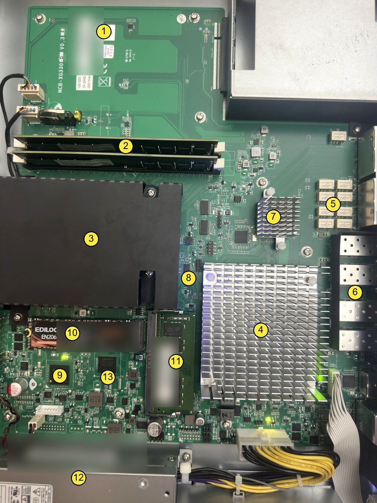

| | | | |
|---|---|---|---|
| 1 | the coprocessor's carrier, `NCB-XG330D` on its silkscreen | 8 | the one blue indicator the board shows without software |
| 2 | two SO-DIMMs beside the host's cooler: the host's, by position | 9 | the Lattice part the board file calls the CPLD |
| 3 | the host, under its cooler, by position | 10 | the host's M.2 drive, marked `EDILOC EN206` |
| 4 | the coprocessor's heatsink, the larger of the two | 11 | a third SO-DIMM, beside the coprocessor's heatsink; whose it is, no page says |
| 5 | the relay bank, nine relays | 12 | the power supply |
| 6 | the four SFP cages down the right edge | 13 | the coprocessor's eMMC, the BGA beside the CPLD; its marking is not legible here |
| 7 | a third, smaller heatsink; what it covers, no page says | | |

The numbers are placed by eye on the photograph. Where a row says "by position" or "no page says",
that is all the evidence there is; the rest is named from the close-ups below and the pages above.

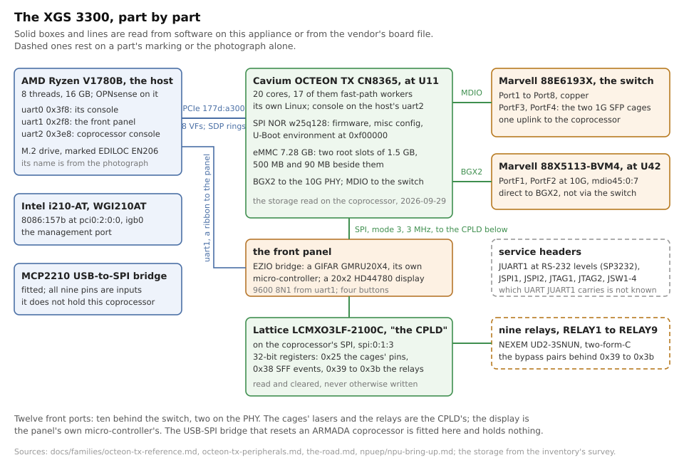

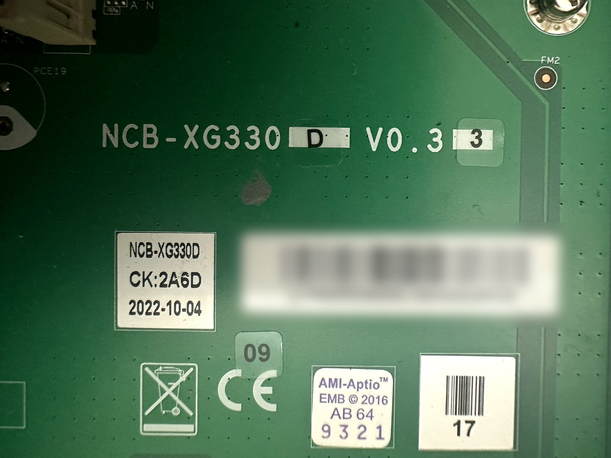

**`NCB-XG330D V0.3`**, dated 2022-10-04: the daughterboard at the top of the chassis is the
coprocessor's carrier, and it carries its own name. Its barcode is the assembly this project
quotes from the firmware, `AMDA0202-0004`, revision 17 - so the carrier board of an XGS 3300 is an
engineering part named for the XG 330. The name on the silkscreen is not the name in the sales
catalogue, and anyone matching boards to models should know it.

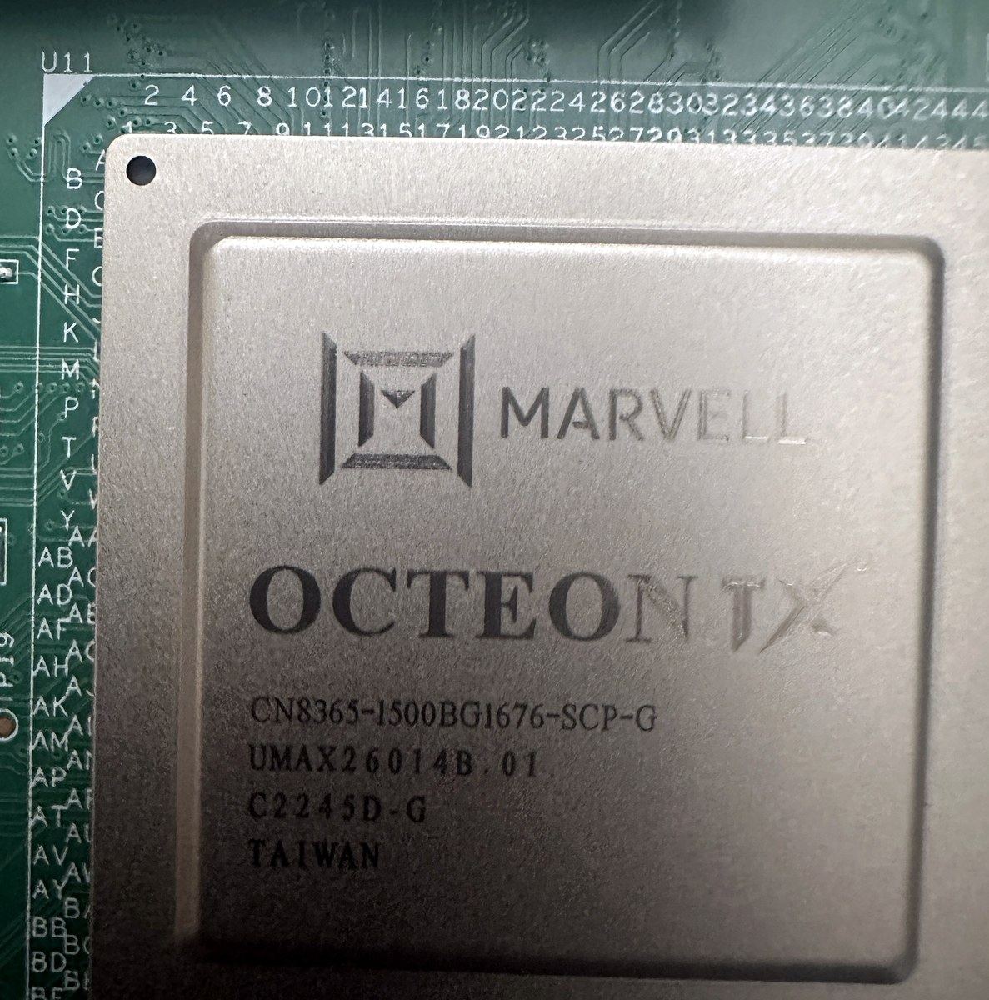

**`MARVELL OCTEON TX`**, `CN8365-1500BG1676-SCP-G`, at `U11`: the coprocessor that owns the twelve
front ports, and everything in this repository is about reaching it. The platform database named
it; this is the die cap saying the same thing.

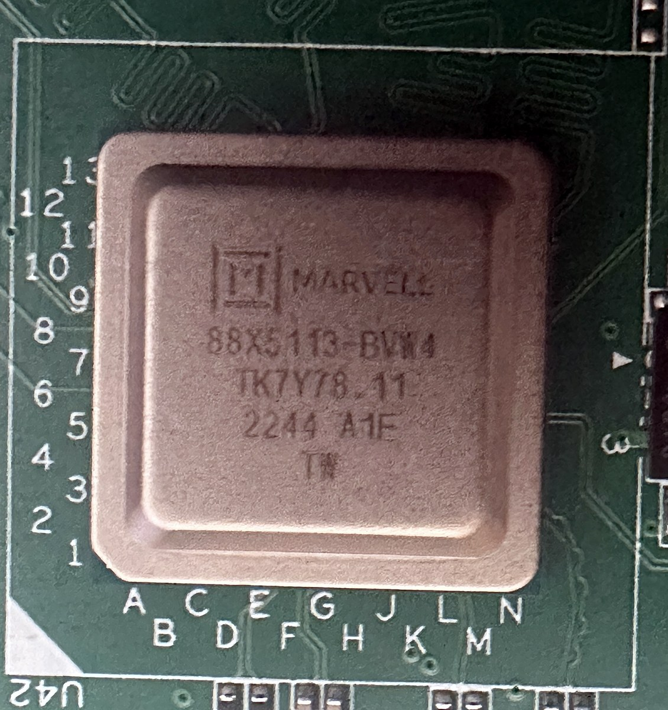

**`88X5113-BVM4`**, `2244 A1F`, at `U42`: the 10G PHY behind PortF1 and PortF2, which the board
file reaches at `mdio45:0:7`. A claim about this part was withdrawn once in this project, over a
register that was never the indicator it was taken for; the part itself was never in doubt, and
now it is on a photograph.

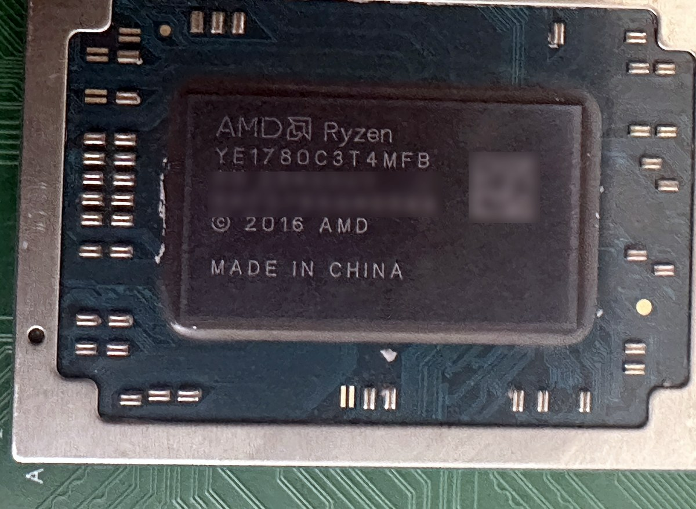

**`AMD Ryzen YE1780C3T4MFB`**: the V1780B, the x86 host, and the other end of the PCIe link. Its
unit codes and data matrix are blurred; the model number is the evidence and stays.

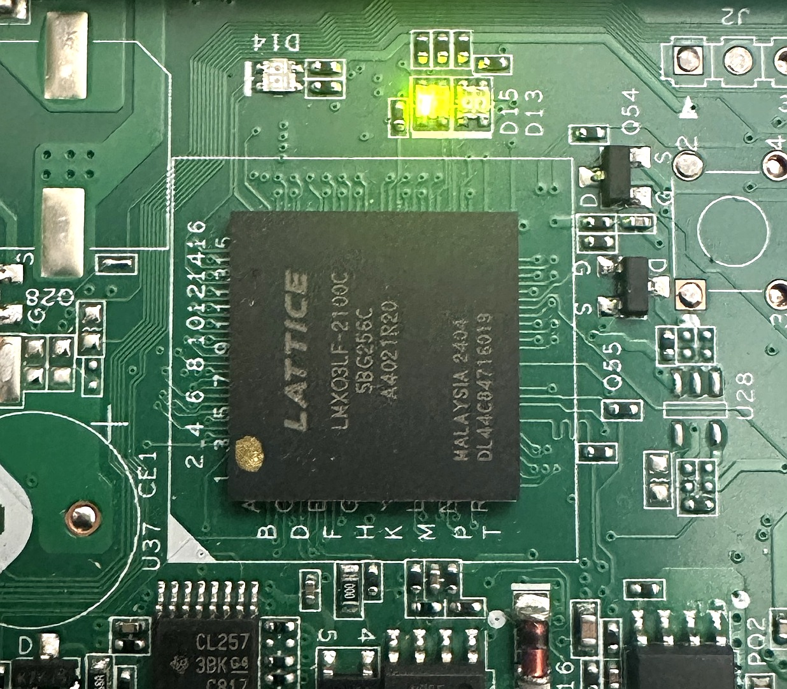

    LATTICE
    LCMXO3LF-2100C
    5BG256C
    MALAYSIA 2404

A **MachXO3LF with 2,100 logic cells in a 256-ball BGA**: an FPGA with its configuration flash on
board rather than a CPLD in the old sense, which is why it answers a protocol of its own design
over SPI with 32-bit registers. The vendor ships its image - `amda0202-0004r03_0x05000008.vme`,
Lattice's own deployment format, and `0x05000008` is exactly what register `0x01` reports on this
appliance - so the part, the toolchain, the image and a live register all agree. None of which is
a reason to write it: the device holds the SFP cage pins, the fail-to-wire relays and the board's
housekeeping, and reprogramming it is how an appliance stops being one.

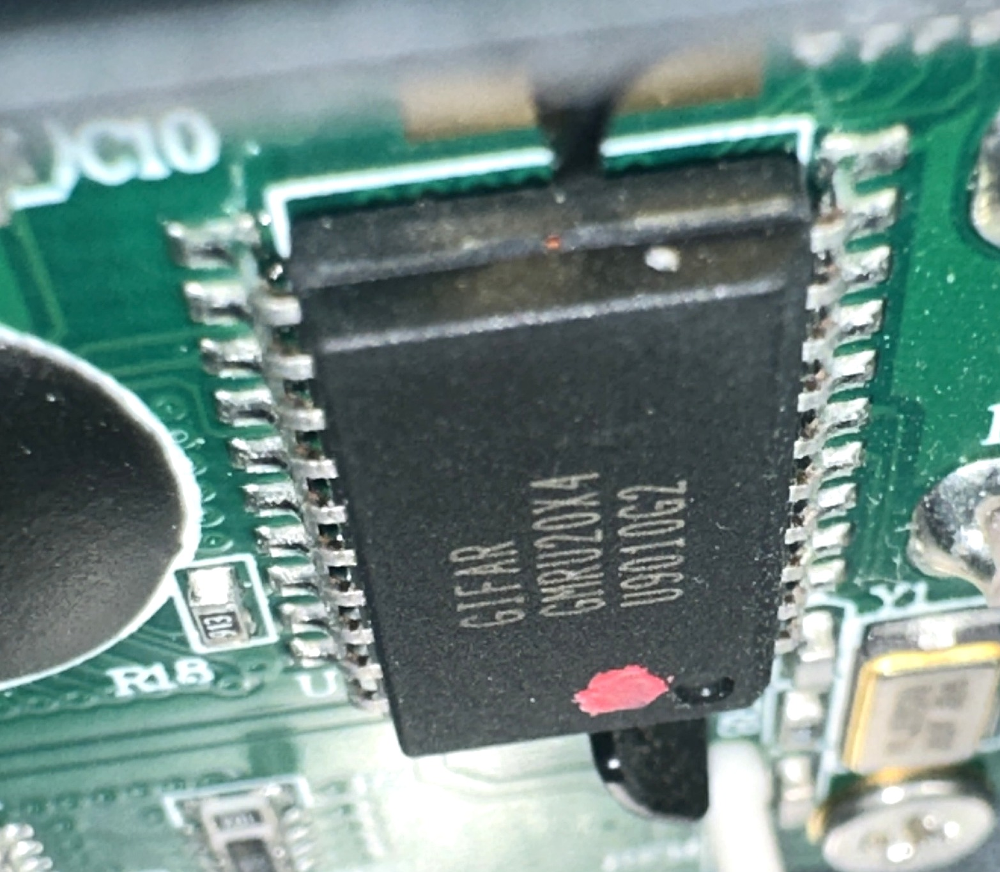

    GIFAR
    GMRU20X4
    U9010G2

On the front panel board, beside its own crystal: the EZIO interface itself, a serial-to-HD44780
bridge implemented in a programmable micro-controller. The LCD is not on the other end of the
host's `uart1`; this micro-controller is, and the protocol is its own. The vendor's daemon sends
`0xFE` and then an HD44780 instruction to this very panel and it works, which is what an EZIO
device accepts. The panel runs at 9600, not the 2400 the vendor's script appears to set - the
script sets the input speed only, on a UART with a single divisor - and the display is 20 columns
by 2 lines, read off the panel on 2026-10-02.


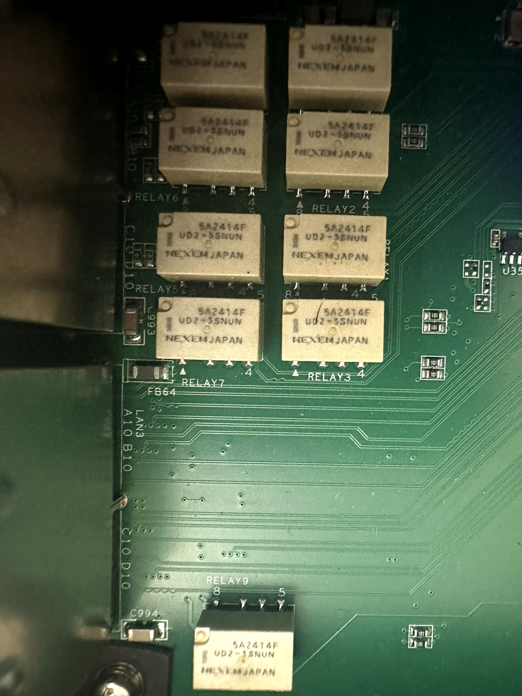

Nine of them, `RELAY1` to `RELAY9`, each a **NEXEM JAPAN `UD2-3SNUN`, `5A2414F`**, a two-form-C
signal relay. The silkscreen beside them names pairs - `LAN3`, `A10 B10`, `C10 D10` - which is what
a bypass pair looks like laid out: one relay per differential pair, two pairs per port. This is
the hardware behind CPLD registers `0x39`, `0x3a` and `0x3b`, which this project reads and has
decided not to write.

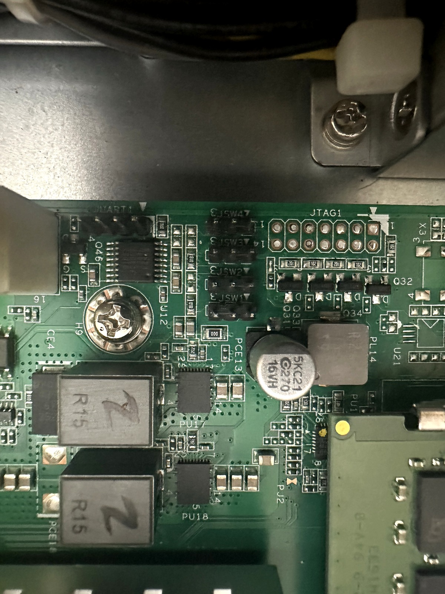

The board brings out more than the console: `JUART1`, `JTAG1` and `JTAG2`, `JSPI1` and `JSPI2`,
four selection jumpers `JSW1` to `JSW4`, and one labelled `PASS_CLEAR`. Pin counts and pin-1 marks
are read off the board; what each pin carries is not established and is not guessed.

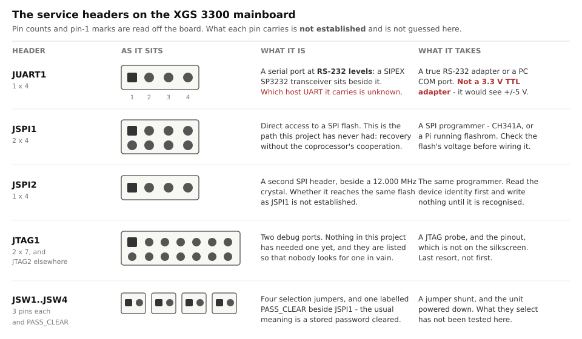

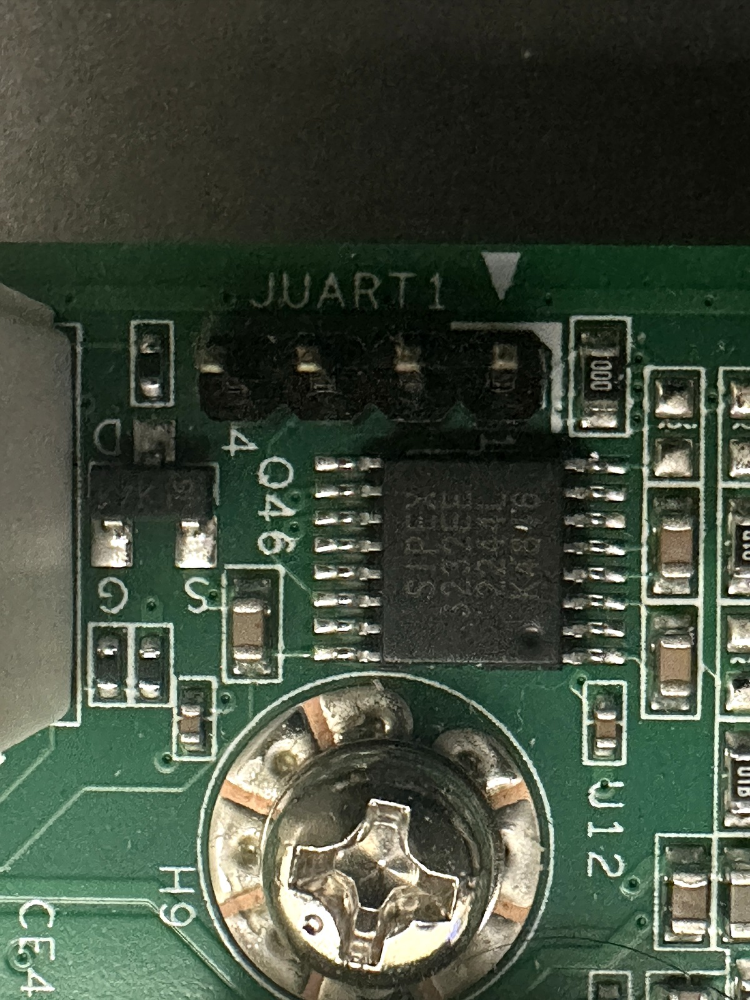

**`JUART1` is at RS-232 levels, not logic levels**: a SIPEX SP3232 transceiver sits immediately
beside the header, so a 3.3 V adapter on it would see several volts. Which of the three host
UARTs it carries - `0x3f8`, `0x2f8` or `0x3e8` - is not established; the way to find out needs no
soldering, a known pattern written to each in turn and the pins watched.

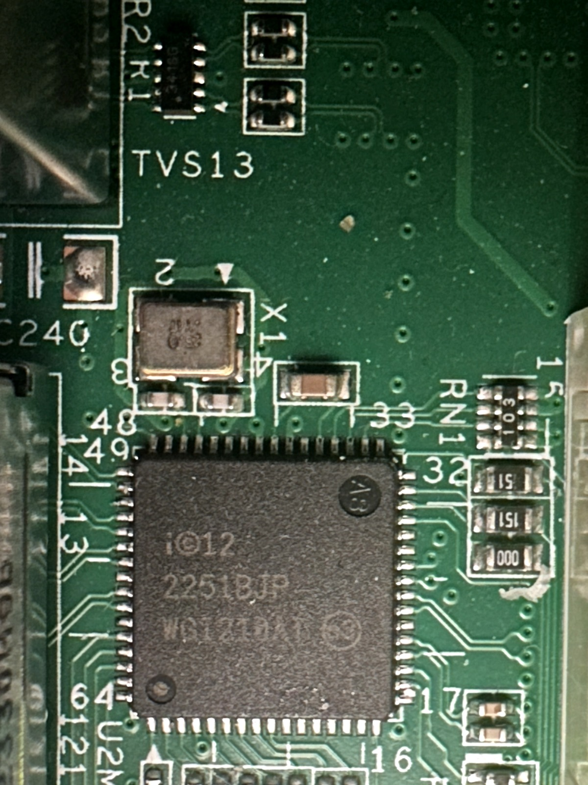

**`WGI210AT`**, the Intel i210-AT: `8086:157b` at `pci0:2:0:0`, `igb0` under FreeBSD, the
management port. It is the only Intel part on the board.

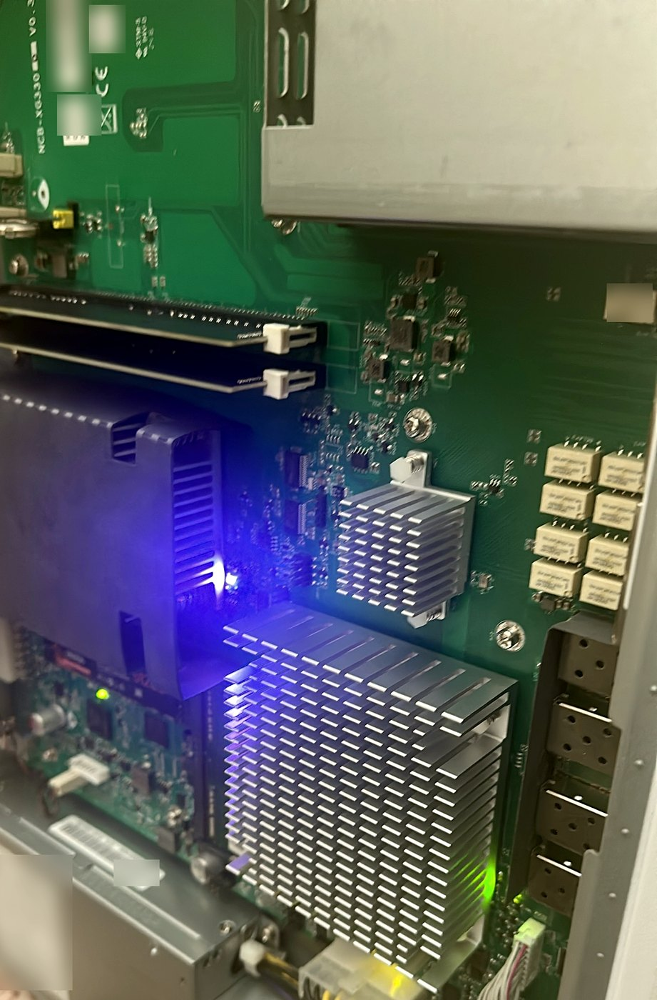

The first photograph, with the lid off: the two heatsinks, the SFP cages down the right edge, the
relay bank beside them, and the single blue indicator that is the only light this board shows
without software.

### The markings, in one table

| part | marking as photographed | designator | what it is | read from |
|---|---|---|---|---|
| the carrier board | `NCB-XG330D V0.3`, 2022-10-04 | - | the coprocessor's carrier, an engineering part named for the XG 330 | silkscreen; the barcode matches the firmware's assembly number |
| the coprocessor | `MARVELL OCTEON TX CN8365-1500BG1676-SCP-G` | `U11` | the OCTEON TX, owner of the twelve front ports | the platform database, confirmed by the marking |
| the 10G PHY | `88X5113-BVM4`, `2244 A1F` | `U42` | behind PortF1 and PortF2 | the board file, `mdio45:0:7`, confirmed by the marking |
| the host | `AMD Ryzen YE1780C3T4MFB` | - | the V1780B, the x86 host | software, confirmed by the marking |
| the CPLD | `LATTICE LCMXO3LF-2100C 5BG256C` | - | a MachXO3LF FPGA holding the cages' pins and the relays | marking; the vendor's `.vme` image and register `0x01` agree |
| the front panel's controller | `GIFAR GMRU20X4 U9010G2` | - | the EZIO bridge, a micro-controller driving a 20x2 HD44780 display | marking; the rate and the width measured on the panel |
| the relays | `NEXEM JAPAN UD2-3SNUN 5A2414F` | `RELAY1` to `RELAY9` | two-form-C signal relays, the fail-to-wire pairs | marking; the registers behind them from the board file |
| the console transceiver | SIPEX `SP3232` | beside `JUART1` | RS-232 levels on the header | marking |
| the management NIC | `WGI210AT` | - | Intel i210-AT, `igb0` | software, confirmed by the marking |
| the host's drive | `EDILOC EN206` | - | the host's M.2 drive | the photograph only |
| the coprocessor's eMMC | not legible | - | `mmcblk1` on the coprocessor | read on the coprocessor; the package by eye |

## The coprocessor's storage, read on the coprocessor

Read on 2026-09-29 from the coprocessor's own Linux, under the vendor's firmware, and on no page
until now; the survey it comes from is in the inventory, which stays local.

The coprocessor boots from a **SPI NOR flash, a Winbond `w25q128` at `spi0.0`** - the CPLD is
`spi0.1` on the same bus, which is the `spi:0:1:3` of the board file seen from the other side -
in three MTD partitions:

| device | size | offset | name |
|---|---|---|---|
| `mtd0` | 15,663,104 | 0 | Firmware |
| `mtd1` | 65,536 | `0xef0000` | Misc config |
| `mtd2` | 32,768 | `0xf00000` | U-Boot env |

The erase size is 4,096 bytes, not 64 KB. Nothing in this repository writes any of the three,
and the U-Boot environment least of all: it is what the coprocessor boots by.

Its root is on the **eMMC, `mmcblk1`**, 7,634,944 KB (7.28 GB), with `mmcblk1boot0` and
`mmcblk1boot1` of 4 MB each beside it, in four partitions:

| partition | blocks | size | what |
|---|---|---|---|
| `p1` | 512,000 | 500 MB | |
| `p2` | 1,572,864 | 1.5 GB | root, slot A |
| `p3` | 1,572,864 | 1.5 GB | root, slot B |
| `p4` | 92,158 | 90 MB | |

Two root slots, so an upgrade writes the one not running. What `p1` and `p4` hold was not read.

The same reading took the fans: raising eight ports changed nothing measurable - the host's CPU
49 to 48 C, the coprocessor 64 C flat, the inlet 28 C, the two fans 6,900 and 7,200 rpm before and
6,900 and 6,900 after, against a 600 rpm minimum, with no under-speed flag. All eight switch PHYs
share one die sensor, at 44 C; the two 10G PHYs read 49 C. The fans do not follow load.

The XGS 136, the other appliance here, has its own page: [xgs136.md](xgs136.md).
