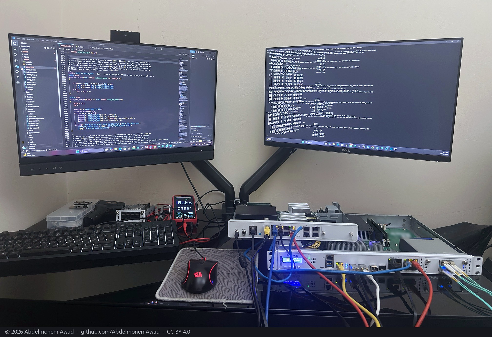

<!-- reviewed: 2026-10-24 -->
# Measurements, by appliance

*The bench where they are taken, the evening the TCP window was measured: the driver's code on one
screen, a run of the series on the other, the XGS 136 and the XGS 3300 below them.*

One page per machine, because a measurement belongs to a board rather than to a family. A second
appliance of the same model with a different kernel, a different cable or a different neighbour will
produce different figures, and anything that generalises belongs in the family page instead.

Each page says **how** every number was taken and **what it does not mean**, because a figure
without its method is not evidence of anything, and the ones that look best are usually the ones
measuring something other than what they claim.

What every page has in common - the bench, where a figure is read, the tools, the arithmetic behind
each kind of figure and the rules, each with its reason - is [how the measurements are taken](methods.md).

| appliance | what has been measured |
|---|---|
| [XGS 3300](xgs3300.md) | round trip and loss, the transmit ceiling and where it is spent, two interface counters that the measuring found to be wrong, the receive path, a kernel update, a bridged port, ten hours at light load, the candidate table with more than one user, and a receive ring behind the block build by build |
| [The three-appliance bench, 2026-10-17](bench-2026-10-17.md) | the two XGS 3300s and the XGS 136 routed to each other, a PC at 10 Gbit/s: clear text and IPsec (AES-GCM-256) with a hardware peer at both ends, every run photographed |
| [Two hours of TLS through the XGS 136, every byte checked, 2026-10-19](xgs136-soak-2026-10-19.md) | XGS 136: 795 passes of a 1 GiB file over HTTPS in three loops, none failed and none changed, 945 Mbit/s on average with the CPUs 2.5 % busy |
| [Does the coprocessor drop an address it is given?, 2026-10-19](dos-probe-2026-10-19.md) | XGS 3300 and XGS 136: no - the vendor's three DoS commands answered "not dispatched" in every form on both, and a stream from the listed address ran on; one connection can be dropped |
| [Unusual traffic, reported, 2026-10-19](anomaly-2026-10-19.md) | XGS 3300: a port scan of 200 ports, a sweep of 312 addresses (missed by the first version, which read pf only twice a window) and a host sending 5 GB where it sent bytes, each reported in the XGS log within its minute; nothing blocked |
| [A thousand connections at once through the XGS 3300, 2026-10-19](xgs3300-many-2026-10-19.md) | XGS 3300: 1,024 streams from the PC, 1,032 connections in hardware, the 10 Gbit/s link full at 9,837 Mbit/s, the CPUs 7.8 % busy; each connection made five or six times and revived twenty in 30 s |
| [Tunnel connections in the XGS 136's flow table, 2026-10-20](tunflows-136-2026-10-20.md) | XGS 136: a tunnel connection's encrypting direction forwarded and encrypted by the fast path - the host handing it no frame, its CPUs 11 % busy against 23 %, 916 Mbit/s, none of it in the clear, a rekey handled; set in XGS: Settings |
| [An image from the builder on the XGS 136: installed, updated, its configuration restored, 2026-10-21](image-136-2026-10-21.md) | XGS 136: the front ports up at the first boot of a clean install, the driver built from the sources the image carries; updated to OPNsense 26.7.7 from the GUI, the reboot held 54 seconds until the driver was built for the new kernel; the earlier configuration restored, the driver's loader settings taken at the second boot |
| [Live users: a user's logout takes their connections out of hardware, 2026-10-23](luid-2026-10-23.md) | both appliances: a connection whose user is not in the coprocessor's table is given back at once - a logout sent up to 81,076 frames to the host on the XGS 3300 and 62,629 on the XGS 136 before the driver made the connection again; user 0 is not checked; ~~not used yet~~ used by the Captive Portal since 2026-10-24 (below) |
| [Where a connection sent to inspection goes - and then the inspector made, 2026-10-23](inspect-2026-10-23.md) | both appliances: the "send to inspection" verdict hands every frame to the inspector's PCIe virtual function, which OPNsense did not make - 167,677 frames in six seconds on the XGS 3300, 151,867 on the XGS 136, nothing received; then, on the XGS 3300, the function made: Suricata in IPS mode on oxips0 blocks a connection in hardware, passes another at 3.2 Gbit/s, and inspects a new one for its first megabyte before the hardware carries the rest at 3.8 Gbit/s; the same on the XGS 136 the same evening, the gigabit link full; and the setting, "Inspect, then hardware", with OPNsense's own Intrusion Detection reading oxips0 on both |
| [What the Intrusion Detection sees of a connection in hardware - and the pages that say so, 2026-10-24](ids-note-2026-10-24.md) | both appliances: Suricata in IDS mode captured 63 packets of a 10-second stream in hardware on the XGS 3300 and 92,123 - the first second - on the XGS 136, against 2,148,522 and 1,613,702 with the flow maker off; XGS: Overview and XGS: Settings now say so while it is the case |
| [A connection cut on the coprocessor itself, by its verdict, 2026-10-23](verdict-2026-10-23.md) | both appliances: a block list's cut drops the connection in hardware first and keeps it there - a UDP flood cut, 10 frames to the XGS 3300's host in ten seconds against 610,533 without "Cut in hardware", 36 against 280,202 on the XGS 136; a thousand connections the same with it as without |
| [A port's rate, a connection's priority and the QoS commands, 2026-10-24](port-qos-2026-10-24.md) | XGS 3300: none usable from the host with this firmware - the port-speed message taken and going no further (each queue's limit refused at the coprocessor's boot), a stream through Port8 at 1,005 Mbit/s with the port at 100; a connection's priority bit held and read back, two connections' shares of a congested port unchanged by it; the seven QoS commands not dispatched |
| [Bridged connections in hardware, 2026-10-24](bridged-2026-10-24.md) | both appliances: a connection a bridge carries made a bridged flow, its frames' MACs and TTL left as they are, IPv4 and IPv6; before, the XGS 3300 made it as routed - out of the WAN port when the bridge had no address, 0 MB delivered, and from the bridge's MAC with the TTL lowered when it had one - and the XGS 136's bridge carried every frame itself (1,933,880 in 12 seconds; 145,973 since); a connection routed through the same ports still routed, one half bridged and half routed left to the host, a killed state taken out |
| [VLAN connections in hardware, 2026-10-24](vlan-2026-10-24.md) | both appliances: a connection routed by a VLAN subinterface made in hardware, the coprocessor writing its tag - added, or taken off - where every VLAN's frames had crossed the host; the XGS 136's processors 0.9 % busy where they had been 33.1 % (31.6 to 39.2), no reply reaching its host where 235,024 did in three seconds; the XGS 3300's interrupts 0.0 % where 2.9; the switch at 0 leaving the VLAN to the host, not cutting it off - as the first build did, by `admin_disabled`; the VLAN's own counts given to its interface |
| [An interface entry removed, on the XGS 136, 2026-10-24](lif-delete-2026-10-24.md) | issue 725's "there is no command that removes an entry", checked and struck: `LIF_DELETE` (4) takes the index, the entry reads back with its forwarding mode 0, a second delete is refused (rc 0x9), a create over it is taken; run on an entry nothing uses. What a removed entry does with its frames is not measured |
| [A connection given back, revived every time on the XGS 136, 2026-10-24](revive-hold-136-2026-10-24.md) | issue 717: the XGS 136 took a connection given back four times in four seconds out of hardware and held it, which kept a stream from the far side with the host in 8 of 16 runs; revived every time now, as the XGS 3300 is (`flow.revive_hold` 0): 3 of 16, the host's frames halved on the mean (931,000 to 447,000) and its processors 14.9 % to 9.5 %; what remains, the reordering at each re-entry |
| [A blind reset into a connection in hardware, judged by pf again, 2026-10-24](closing-check-2026-10-24.md) | issue 679: a FIN or RST of a connection in hardware reached a sloppy pf state, which took a blind reset at its word - `TIME_WAIT`, and an idle connection dead a hundred seconds later, on both appliances; now held until pf has the fast path's numbers (`CONN_GET_FP_TCP_STATE`) and judged by it: the reset refused (`state-mismatch` +1), the connection alive; twenty connections ending at once, 897 and 39 FINs and RSTs judged and none refused that should pass |
| [The switch's frame limit set by the network agent on the XGS 136, 2026-10-24](switch-frame-limit-2026-10-24.md) | issue 706: the boot hook's reads and writes of the switch over the bus the coprocessor's network agent follows the links on made the agent report ports down - shown with reads alone, Port7 down a second after one; now the driver gives each port's MTU to the agent, which sets the limit itself (1,522 bytes at MTU 1,500, 10,240 at 9,000), and the host touches the bus no more; a clean boot with no carrier change after the first minute, 8,000 bytes across Port8 |
| [pf's DSCP mark kept in hardware, 2026-10-24](flow-dscp-2026-10-24.md) | both appliances: a normalization rule's TOS / DSCP lost by a connection in hardware until today - its frames 0x0 where pf wrote 0xb8 - and kept since, EF, AF41 and CS1 both ways on the XGS 3300 and the original direction read on the XGS 136, ECN bits as they came; a mark that sets the ECN bits itself kept with the host |
| [pf's DSCP mark on IPv6, 2026-10-24](flow-dscp6-2026-10-24.md) | both appliances: an IPv6 connection with a mark was kept with the host for want of a measurement; measured now, neither fast path writes an IPv6 traffic class - the XGS 3300's override by hand gave 0xb8 on IPv4 and 0x00 on IPv6 on one path and one build, the XGS 136's connections made with the mark arrived unmarked - so it stays with the host, where pf writes it |
| [The front ports' own addresses on the XGS 136, 2026-10-24](ports-own-addresses-2026-10-24.md) | issue 730: every ARMADA appliance gave its fourteen front ports the same addresses, from a placeholder the coprocessor advertises; now each port takes the one the network agent holds for it, of the appliance's own range, as the vendor's software gives it - the switch and the fastpath's interface table told, the boot hook waiting for it, OPNsense's hardware address the same; and a port given an address by hand, which before received broadcast only, is followed |
| [Why the interface table is not confirmed, said by the driver, 2026-10-24](iftable-why-2026-10-24.md) | issue 736: an XGS 126 of board revision 07 carried nothing and verify.sh named the fault but not its reason; now the driver keeps the reason in one line without addresses (`dev.npuep.0.iftable`) - the channel not opened, stalled, or the first port whose entry did not read back and what the coprocessor answered - and verify.sh prints it with the model, assembly and board revision, so the first paste is enough; the XGS 136 confirmed, its traffic unchanged |
| [The command channel waited for, not looked at once, 2026-10-24](channel-claim-wait-2026-10-24.md) | issue 736, found: the driver looked once for the coprocessor's claim on its command channel and, on an XGS 126 where it had not come by second 15, left it alone - no front port carried a frame; now it waits up to two minutes and opens the channel when it comes. Not reproduced on the XGS 136 (its channel attaches after the claim); the wait run there with an instrument: 20 s waited, opened, confirmed, a ping across; 200 s given up at 120, said why, the ping lost |
| [Captive Portal clients in hardware, 2026-10-24](cp-hardware-2026-10-24.md) | both appliances: each portal session a live user, a zone in hardware with its idle timeout, hard timeout and RADIUS accounting kept - a logout out of hardware within two seconds of the portal's table, a session kept through 100 s of traffic ipfw never saw and ended a minute after it stopped, a RADIUS stop of 38.3 GB of which ipfw alone counted 87 KB; the overlay on the portal's file refused on a version it was not written for, the zone back to the host |
| [The coprocessor's vendor version found by the drivers, 2026-10-25](sfos-versions-2026-10-25.md) | all three boards: vendor version 21's software on the XGS 136's coprocessor, 22's on the second XGS 3300's, 23's on the first's, each found by where and how its platform block answers and its commands numbered to match; hardware flow offload measured over vendor version 23's software (issue 736) |
| [Copies for a packet capture, 2026-10-25](mirror-2026-10-25.md) | all three boards: the fast path's copy of every frame it forwards, shown to the packet capture on the port it crossed - every frame on the XGS 136 and the first XGS 3300, part of them on the second; XGS: Settings "Copies for packet capture" (discoveries 12 and 17) |
| [The coprocessor's counters cleared, 2026-10-25](counters-clear-2026-10-25.md) | all three boards: the four counter clears sent by both drivers and the counter tools' `-z` - the fast-path counters from sums of thousands to what the next two seconds brought; their numbers the version's, and vendor version 21 and 22 found to number every command from 46 on differently (discovery 13) |
| [IPsec associations on vendor version 23's coprocessor software: refused, then taken, 2026-10-25](sa23-2026-10-25.md) | the first XGS 3300: vendor version 23 lengthened `SA_ADD` to 200 bytes and refused every 192-byte one, so no association had been offloaded on it; both drivers now lay it out by the version - the engine decrypting and encrypting the tunnel's traffic, the kernel none |
| [An offloaded association's state kept in step: the three commands measured, 2026-10-25](ipsec-step-2026-10-25.md) | all three boards: `SA_SEQ_UPDATE` exact on every version and free, `SA_REPLAY_UPDATE` taking the association out of the fast path, `SA_HOST_STAT_SYNC` rc 0 - none needed by the design; `SA_GET_STATS` reading 0 on vendor version 23 and on the XGS 136 (discovery 14) |
| [The ciphers nobody had tried: SHA-384 taken, ChaCha20 refused, 2026-10-25](cipher-2026-10-25.md) | all three boards, each engine against a kernel: AES-CBC with HMAC-SHA-384 through on every version; ChaCha20-Poly1305 taken by `SA_ADD` and dropped by every datapath; GMAC and counter mode not offered by OPNsense's page (discovery 15) |
| [Dragonfly turned on: it inspects, its exports reach nothing seen, and it loses a tunnel's traffic, 2026-10-25](dragonfly-2026-10-25.md) | both XGS 3300s, vendor version 22 and 23: the coprocessor's DPI engine turned on for a port by one `LIF_ADD_UPDATE` - 1.6 million packets inspected, flows exported, the traffic not slowed; its exports counted sent and found on none of the host's interfaces or rings, the coprocessor's own, the other board's or the PC's; a tunnel's traffic on that port lost after it, plain traffic passing - so it stays off. XGS 136, vendor version 21: none (discovery 22) |
| [The switch's queue scheduling: every frame from the coprocessor waits in queue 0, 2026-10-25](qsched-2026-10-25.md) | the second XGS 3300: a gigabit front port loaded past its rate by connections in hardware and by the host's own streams, marked EF or not - every frame in its egress queue 0, none in the other seven, so strict priority orders nothing and the connection's priority bit moves nothing; the three versions' firmwares leave the switch alike (discovery 20) |
| [Two front ports: nothing crosses in the switch, and the host's rules decide, 2026-10-25](frontports-2026-10-25.md) | the second XGS 3300 and the XGS 136: a frame for the other switch port's device carried across none of ten times; routed between two switch ports, a block rule refusing every new connection while a running one went on on its pf state, and killing the state stopping it and taking it out of hardware; the TCAM on for the front ports on all three versions (discovery 21) |
| [The coprocessor's own watchdog and memory error reports, 2026-10-25](copro-health-2026-10-25.md) | all three coprocessors: an sbsa-gwdt fed every 5 s by busybox and set to 60 s; on the XGS 3300s EDAC for the memory and caches, 0 errors, none on the XGS 136; the first XGS 3300's left unfed three times - at 60 s its host froze, and its own watchdog restarted the appliance 220 s after (discovery 24, issue 768) |
| [The network agent's polling mode: refused by all three, and not about the switch's bus, 2026-10-25](pollmode-2026-10-25.md) | all three coprocessors: `SET_POLLING_MODE` refused with status 1 by every agent, payload 0 or 1, beside a link query answered; its name belongs to the mailbox's polling flag, not the agent's reading of the switch - no cure for issue 639 (discovery 25) |
| [A logger for the coprocessor's console, built and measured, 2026-10-25](console-logger-2026-10-25.md) | all three boards: `console_log.py` keeping the coprocessor's console from every boot, only reading it and standing aside for `npu-run.sh`; its port messages kept across a reboot; through a coprocessor reset that freezes the XGS 3300's host, the start of its boot kept in two runs of five, the vendor's dd way in three of four (discovery 27) |
| [The coprocessor's PCIe relaxed ordering and no-snoop, cleared by the driver, 2026-10-25](pcie-order-2026-10-25.md) | the XGS 136, vendor version 21: the ARMADA firmware leaves both on, and an XGS 107 counted 202,606 of 2,971,077 received frames malformed until its owner cleared them by hand (issue 748); npuep now clears them at every attach - 0x2850 to 0x2040 - and the 136 received 1 GB at 990-991 Mbit/s in ten runs with them cleared against 943-991 with them on, no frame malformed either way; the 107's unknown-port loss is a second fault |
| [The coprocessor taken up again in place, on both families, 2026-10-26](coprocessor-recovery-2026-10-26.md) | the first XGS 3300 (vendor version 23) and the XGS 136 (vendor version 21), 0.1.0-alpha.8.7 from cron: the 3300's coprocessor asked by its console to reboot, the fast path back 250 s into the recovery; the 136's reset from the host before its driver was unloaded, back in 86 s; neither host restarted; with IPsec associations on an OCTEON TX coprocessor, its device detached and attached again with the module loaded - both XGS 3300s back in place in 279 s and 202 s, where the module before had restarted them (issue 768) |
| [The thousand-connection run's lost clients: the bench, not the appliance, 2026-10-27](many-connections-time-wait-2026-10-27.md) | through the second XGS 3300 to the first: every SYN of a lost connection left the PC and reached the servers' host, which answered none - its four-tuple was still in TIME_WAIT there from the run before, and FreeBSD drops such a SYN unanswered when it carries no timestamp and a lower sequence number, as the PC's Windows TCP sends them; three of three lost connections had met one, none other; fifteen runs started after that TIME_WAIT drained lost nothing (issue 695) |
| [The coprocessor's watchdog feeder, looked after from the host, 2026-10-27](coprocessor-feeder-2026-10-27.md) | the first XGS 3300, vendor version 23: the minute before its host freezes in the coprocessor's reset - no interrupt storm, the host idle, everything stopping within half a second; and with `feeder.py` the feeder stopped and killed with no reset at all, put right within 23 s and 18 s |
| [The coprocessor's state kept the moment its fast path stops, and a recovery that waits for the new boot, 2026-10-31](coprocessor-stop-capture-2026-10-31.md) | the first XGS 3300, vendor version 23, an IPsec pair on its coprocessor: SysRq l, w, p kept 20 s after the stop and the recovery begun with it; the device detached four seconds after this boot's line, not the last boot's; taken up in place in 279 and 281 s, the second with the heartbeat read ten times a second through the detach |
| [The XGS 126 and 136's status light, lit once the appliance is up, 2026-10-27](status-light-2026-10-27.md) | the XGS 136, vendor version 21: the light the board's start left blinking (0x29), read and lit green through its board controller on the host's SMBus, and lit again by a start hook after a restart; the first XGS 3300 refused, nothing written |
| [Reviving at the end of a receive pass, on the XGS 136: no difference, 2026-10-27](revive-after-136-2026-10-27.md) | the XGS 136, vendor version 21: a stream from the far side, 32 runs with the kick from inside the receive pass and at its end in turn - 234,415 and 239,122 frames to the host on the mean; the heavy runs were the ones held after a give-back under a new identity |
| [HTTP through the XGS 136 the datasheet's way - 512 KiB a response, a thousand connections, 2026-10-29](xgs136-http-2026-10-29.md) | the XGS 136, vendor version 21: 1,024 connections from the PC on its LAN to a server behind its Port8, kept open and a new one for each response, by the coprocessor and by the host - the link full every time; kept open, all 1,024 in hardware at 1.0 % CPU; a new connection for each response leaves three quarters of the frames to the host |
| [Power over Ethernet with a device on each port of the XGS 136, 2026-10-29](poe-136-2026-10-29.md) | the XGS 136: a device on Port11 and on Port12, both powered and shown on XGS: Ports; one cut while its device drew 5 to 7 mA, both kept once it drew 30; the controller, a PD69104 in its own auto mode, read at its registers; the front lights as the vendor documents them; the limit taken as AT or AF |
| [A second look at a receive slot that cannot be a frame, on the XGS 136 first, 2026-10-31](npuep-second-look-2026-10-31.md) | the XGS 136, vendor version 21: npuep built on it and loaded in place, /boot/modules untouched; 584,006 frames over its LAN and its WAN, and no second look of either kind - the probe is for the XGS 107w of #890, whose driver refuses or drops one received frame in five |
| [Front ports that say their link state is real, on both families, 2026-10-31](ports-linkstate-2026-10-31.md) | the first XGS 3300 (vendor version 23) and the XGS 136 (vendor version 21): IFCAP_LINKSTATE on the front ports, and a bridge over them goes down with no cabled member and up with one - OPNsense still does not act on a bridge's link (#911) |
| [Interfaces sharing a subnet: what it does, and a warning that names it, 2026-10-31](subnets-check-2026-10-31.md) | both XGS 3300s: with two interfaces in one subnet the one applied last loses the route, cable in or not - saving MGMT or plugging its cable silenced it while the LAN bridge, uncabled, held an address in its subnet; a DHCP gateway answers anyway through reply-to. verify.sh, XGS: Ports and the support bundle now say so (#911) |
| [A third look at the XGS 107w's zero headers, on the XGS 136 first, 2026-10-31](npuep-third-look-2026-10-31.md) | the XGS 136, vendor version 21: npuep built on it and loaded in place, /boot/modules untouched; 296,619 frames over its LAN and its WAN, every descriptor naming its cookie's buffer, and 105 buffers held back a pass by rx_late_test and given back - the probe is for the zero headers the XGS 107w of #890 loses its downloads to |
| [An offloaded tunnel's counts, from the connections' statistics messages, 2026-10-25](sa-counts-2026-10-25.md) | both XGS 3300s: vendor version 23 answers `SA_GET_STATS` with 0, so octep now takes a tunnel's counts in hardware from the coprocessor's statistics messages (issue 761); on vendor version 22 the two sources agree to two bytes a packet (8,938 and 8,936) - 9,890,905,575 bytes told to the kernel for a 9.17 GByte stream, no command asked; on vendor version 23 the messages count connections in hardware (163 to 325); the appliance's own traffic into a tunnel counted by neither driver (issue 774) |
| [The appliance's own traffic into an offloaded tunnel, in the association's lifetime, 2026-10-25](own-traffic-2026-10-25.md) | all three boards: what an appliance itself sends into an offloaded tunnel takes the kernel's own offload path and was in no count the association's lifetime keeps (issue 774); both drivers now report it - the XGS 136's 2,000 pings 2,856,000 bytes and 2,000 packets to the byte, the XGS 3300s' 8.69 and 3.35 GBytes each matched by the other board's inbound count to the byte |
| [The datapath's goodbye at unload, answered once it is said first, 2026-10-25](giu-goodbye-2026-10-25.md) | the XGS 136, vendor version 21: npuep's `PF_DISABLE` at unload went unanswered in five reloads of six, the device's management side silent - not a keep-alive - after the channel's withdrawal and the ports' downs (issues 741, 742); said first, with the host's datapath stopped and no `PF_CLOSE`, answered in five of five |
| [The XGS 3300's coprocessor reached over its management link, 2026-10-23](mgmt-link-2026-10-23.md) | XGS 3300: one command on the coprocessor in 0.73-0.77 s over its PCIe link instead of 11.01 s over its console, the Transceivers page's read in 1.80 s instead of 36.19; the link started, addressed and answering at every boot, three in a row, every interface kept; XGS 136 unchanged, 0.49-0.53 s |
| [The heartbeat with the fast path, 2026-10-22](heartbeat-2026-10-22.md) | XGS 3300: asked every 5 seconds and answered every time, about 130 µs idle and 20-131 µs under 6.13 Gbit/s, nothing lost to it (5.90 Gbit/s with it off); its fast path stopped for 45 seconds - late after 19 s, taken as stopped at 30 s, answering again after 48 s, the data path back with it. XGS 136: its fast path drops the heartbeat message unanswered, ~~so it is off by default there~~ so since 2026-10-23 its answer is the beat taken off the host's queue - a stop of 40 seconds seen late, taken as stopped, back; its RPC channel answers with the fast path stopped, so it could not stand in. Beats sent before the coprocessor's handshake were followed by a boot on which the fast path sent nothing |
| [The TCP window of a connection in hardware, checked there, 2026-10-22](tcp-window-2026-10-22.md) | both appliances: segments outside the window dropped by the coprocessor, 5 of 5 and 5 of 5 on each, none with the check off; a take-back giving pf the fast path's numbers, state-mismatch +0; four streams with no ordinary segment dropped, 9.91 Gbit/s and 941 Mbit/s; a connection the fast path gave back goes back unchecked, and the two ways tried to keep it checked dropped ordinary segments |
| [Power over Ethernet switched from XGS: Ports on the XGS 136, 2026-10-20](poe-136-2026-10-20.md) | XGS 136: labels 11 and 12 read through the coprocessor and switched off, on, or off and on again from the Ports page; a port switched off is switched off again by the start hook; measured with nothing plugged in, by what the PoE controller reports |
| [A reload of the module puts OPNsense's interfaces back, XGS 136, 2026-10-20](reload-136-2026-10-20.md) | XGS 136: 16 reloads, the bridge, every address and the management link back in the 7 checked; one reload stopped the host (603) |
| [Six IPsec tunnels at once through the XGS 136, 2026-10-20](many-tunnels-136-2026-10-20.md) | XGS 136: 6 of 6 tunnels, 12 associations on its engine, 915 Mbit/s together, every frame of the stream encrypted on the engine |
| [The XGS 136's receive rings on the coprocessor's doorbells, 2026-10-20](rx-msix-136-2026-10-20.md) | XGS 136: with the doorbells the stream into the host held 948 Mbit/s and a 0 ms ping at a poll ten times slower, where the poll alone fell to 270 and 5 ms |
| [An error only the switch sees, counted on XGS: Ports, 2026-10-20](port-errors-136-2026-10-20.md) | XGS 136: ten frames too long for port 8's limit, made on purpose - none reached the host, the switch counted all ten; every port of both read, every error at 0 |
| [Sixteen IPsec tunnels at once between the two XGS 3300s, 2026-10-20](many-tunnels-3300-2026-10-20.md) | XGS 3300: 16 of 16 tunnels, 34 and 32 associations in the engines, 9,019 Mbit/s together from one 10G port, 36 % CPU |
| [An hour of TLS through the XGS 136's IPsec engine, 2026-10-20](soak-ipsec-136-2026-10-20.md) | XGS 136: 378 passes of a 1 GiB file through the lab tunnel, none failed and none changed, 895 Mbit/s for the hour; 303 million frames decrypted on its engine, none bad; then two hours, 756 passes, none failed and none changed, 899 Mbit/s, 605 million frames decrypted, none bad |
| [The Traffic Shaper and a connection in hardware, 2026-10-20](shaper-3300-2026-10-20.md) | XGS 3300: a 100 Mbit/s shaper did nothing to a connection in hardware - 8,816 Mbit/s; with what the shaper and the Captive Portal name kept with the host, 99.5 Mbit/s and never in hardware, the list made again every minute |
| [A tunnel brought up over a connection in the XGS 136's hardware, 2026-10-20](policy-guard-136-2026-10-20.md) | XGS 136: a connection in hardware stayed there when a tunnel came to cover it and its frames left unencrypted (issue 575); with the policy guard it is taken out within the sweep and goes on through the tunnel at 916 Mbit/s; the XGS 3300's own sweep measured the same way, none in the clear after |
| [IPsec over IPv6 on the XGS 136's engine, 2026-10-20](ipv6-136-2026-10-20.md) | XGS 136: an IPv6 tunnel and IPv6 inside it, both on the engine both ways - 951 to 982 Mbit/s with IPv4 inside, 962 to 979 with IPv6 inside, GCM and CBC, none refused |
| [Extended sequence numbers on the XGS 136's engine, 2026-10-20](esn-136-2026-10-20.md) | XGS 136: both ways on the engine at the link's 984 Mbit/s - 4,305,432 frames decrypted on one association, none failed; 5,796,289 encrypted, every one taken by the peer's kernel with no authentication failure and no replay |
| [What a cage carries, read from its module, 2026-10-19](cage-medium-2026-10-19.md) | both appliances: each cage's port reports its module's medium - copper, SX, SR - and not the one the driver assumed; two copper 10GBASE-T modules that claim 10GBASE-SR, told by their part numbers |
| [Slow minutes on the XGS 136, looked for, 2026-10-19](xgs136-after-boot-2026-10-19.md) | XGS 136: a stream from the PC ran at a quarter of its speed four times; not the links, not the boot's logs, not seen again in 28 minutes of watching and a boot watched; both cages found to hold copper modules |
| [A connection given back by the XGS 136's fast path, and made again at once, 2026-10-19](xgs136-giveback-2026-10-19.md) | XGS 136: the fast path's own rule gave a connection back, and making it again at once made it give it back again - 29 times in 15 seconds, the XGS 3300's way slower in hardware than through the host; with a wait before the remake, level with the host and a quarter of the retransmissions |
| [What the XGS 136's coprocessor says about the traffic it forwards, 2026-10-19](xgs136-counts-2026-10-19.md) | XGS 136: the same messages as the XGS 3300's, read; given to pf, a connection's state came to what crossed the wire, 0 packets apart in 1.37 million either way, and the interfaces to the frame - after two faults found and fixed on the way: arriving bytes counted with their FCS, and counts lost when a connection was made again |
| [What the coprocessor counts of a connection, 2026-10-19](hw-counters-2026-10-19.md) | XGS 3300: the coprocessor's count of a connection and pf's together came to what crossed the wire, to 14 packets in 2.74 million; read from messages the driver had dropped unread |
| [Connections cut by their TLS fingerprint (JA4), 2026-10-19](ja4-cut-2026-10-19.md) | XGS 3300: Suricata fingerprints a connection before it goes into hardware; of two streams from the same program, the one whose JA4 was listed stopped - at once, or within its first two seconds - and the other ran on |
| [A block list that cuts the connections already open, 2026-10-19](lists-cut-2026-10-19.md) | both appliances: a stream in hardware stopped within two seconds of its address being listed, at once or by the minute's cron (60 s and 34 s) |
| [The MTU from 576 to 9000, 2026-10-17](mtu-2026-10-17.md) | the same bench at eight MTUs, clear text and IPsec both ways: 757 Mbit/s to 7.41 Gbit/s into an XGS 3300, the XGS 136's gigabit link full from 1000; 52 runs photographed, in `images/measurements/mtu-2026-10-17/` |

~~Nothing from the XGS 136 is here yet.~~ Its first numbers are on the bench page below.
