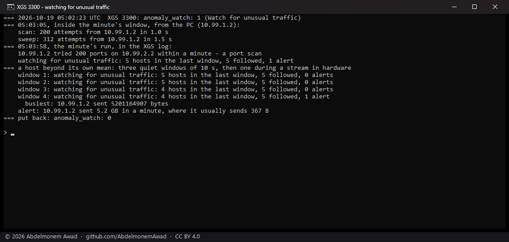
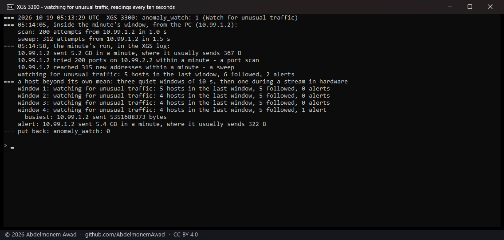
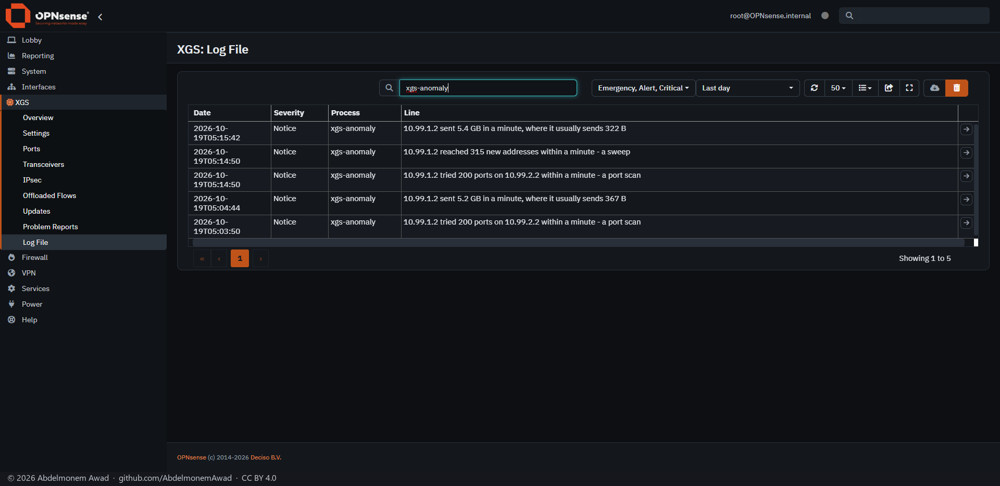
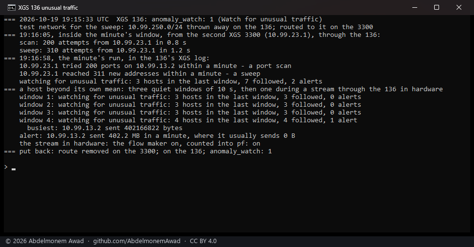

<!-- reviewed: 2026-10-19 -->
# Unusual traffic, reported, measured, 2026-10-19

**XGS: Settings - Watch for unusual traffic.** Off until it is turned on, and it never blocks: it
says, in the XGS log, what no normal day looks like. Every minute `scripts/xgs/anomaly.py` (cron)
reads pf's state table every ten seconds through a window of fifty, keeps every connection any reading
saw, and for each host that opened connections works out what it did in the window - bytes sent and
received, connections opened, new addresses reached, and the most ports it tried on any one address.
Then:

- **a port scan** - one host trying 100 ports or more on one address within the window - and **a
  sweep** - one host reaching 256 new addresses or more - are reported at once: no host has a normal
  for them;
- **a host far beyond its own normal** in bytes sent, bytes received or connections opened - six
  spreads above its own moving mean, and above a floor of 200 MB, 1 GB and 500 a window - is reported
  once the host has an hour of history.

A connection is read once, by its inbound state, so a routed connection's two states do not count it
twice. On the XGS 3300 the volumes include what the coprocessor forwarded, with **Count hardware
traffic in pf** on ([hw-counters-2026-10-19.md](hw-counters-2026-10-19.md)); ~~on the XGS 136 a
connection in hardware stops adding to pf's counts, so there the patterns are what is complete~~ on
the XGS 136 too since the same day ([xgs136-counts-2026-10-19.md](xgs136-counts-2026-10-19.md)),
[measured below](#on-the-xgs-136). The same host is reported for the same thing at most once in ten minutes.

## How it was measured

On the second XGS 3300 (`images/deploy/lab-anomaly.sh`, each run in a window of its own,
photographed). The setting turned on for the run and put back afterwards. Within one minute's
window, from the bench PC on F1 (`hw-anomaly-gen.py`): 200 connection attempts to ports 1 to 200 of
the bench VM, and 312 to port 445 of 312 addresses - 252 on the VM's network, 60 beyond it, none of
them answering. The minute's own run, from cron, then had to report them. Then the detector run by
hand with a history of its own (`--dir`) and a warm-up of two windows of ten seconds: three quiet
windows, and a fourth during a stream in hardware from the same PC.

## Results

| | run 1, start and end of the window | run 2, every ten seconds |
|---|---|---|
| port scan, 200 ports | **reported**: tried 200 ports on the VM | **reported** |
| sweep, 312 addresses | **missed** | **reported**: reached 315 new addresses |
| a stream after three quiet windows | **reported**: sent 5.2 GB where it usually sends 367 B | **reported**: 5.4 GB where 322 B |

- **The first version missed the sweep**, and the run says why: it read pf at the start of the window
  and at its end, fifty seconds on, and an attempt nobody answers stays in pf for about thirty
  (`tcp.opening`) - read twenty-five seconds after it was made, each of the 312 states was due to
  expire eight seconds later. The detector now reads every ten seconds and keeps every state any
  reading saw; the second run reported the sweep, 315 new addresses - the 312 and three of the PC's
  own.
- The port scan's states, refused by the VM, stay ninety seconds (`tcp.closed`) and were seen by
  both versions.
- The volume: a host whose history is a few hundred bytes a window, sending 5.2 and 5.4 GB in one -
  far beyond six spreads and the 200 MB floor.
- **What it costs**: six readings of the whole state table a minute. On this bench that is a few
  hundred states; on a firewall holding hundreds of thousands it is work, which is why the setting
  is off until it is turned on, and its help says so.
- **The alerts in OPNsense**: XGS: Log File, filtered on `xgs-anomaly`, with both runs' lines.

## On the XGS 136

The same three, on the XGS 136 (v0.1.0-alpha.2, npuep 9619e07c; `images/deploy/lab-136-anomaly.sh`).
From the PC only four addresses route through the 136, so the scan and the sweep were sent by the
second XGS 3300, which reaches the 136's F1 network through the 136's Port8. The sweep's
addresses beyond that network were a test network routed to the 136 for the run and thrown away
there (a blackhole route), so nothing left the bench. Both routes were runtime only and removed
after; the setting was already on and stayed on.

| | |
|---|---|
| port scan, 200 ports on one address | **reported**: tried 200 ports within a minute |
| sweep, 310 addresses | **reported**: reached 311 new addresses |
| a stream in hardware, after three quiet windows | **reported**: sent 402.2 MB in a minute where it usually sends 0 B |

The stream ran through the 136 in hardware, the flow maker on, with **Count hardware traffic in pf**
on: the volume the detector saw is the coprocessor's, given to pf.

## Not measured

- ~~**Not measured**: the XGS 136; and~~ A host beyond its own normal with the real warm-up of an hour,
  which the lab shortened to two windows. Nothing here blocks: what to do with a report - a block
  list, a cut - is the owner's.
