<!-- reviewed: 2026-10-17 -->
# Three appliances on one bench, 2026-10-17

The first measurements with a hardware peer at both ends of every tunnel: until this night the far end
of a measured tunnel was a firewall doing ESP in software, so a figure could be that firewall's rather
than the appliance's. Every window a number came from was photographed when the run finished, and the
pictures are below each table.

The same bench at eight MTUs, from 576 to 9000, is [a page of its own](mtu-2026-10-17.md).

## The bench

| link | from | to | medium |
|---|---|---|---|
| the PC | the PC's 10GBASE-T NIC | the second XGS 3300's F1 | copper, 10 Gbit/s |
| the fibre | the second XGS 3300's module port A1 | the first XGS 3300's F1 | fibre, 10 Gbit/s |
| the gigabit link | the second XGS 3300's Port8 | the XGS 136's Port8 | copper, 1 Gbit/s |

The second XGS 3300 is the router in the middle. Each link is a /30 (the PC's a /24) taken out of the
LAN bridge, with a pass rule; the two outer appliances have a static route back to the PC's network
through it, on a gateway that is never a default and is not monitored. The PC routes the lab's
networks through the second 3300.

- **Load:** iperf3 3.20 on the PC, under WSL with mirrored networking, so on the PC's own NIC. iperf3
  3.22 (OPNsense's package) as the server on the first XGS 3300's host and on the XGS 136's host.
- **Runs:** one TCP stream, or four, for ten seconds; MTU 1500 everywhere. The figure given is the
  receiver's.
- **Software:** os-xgs-npu main on all three - the XGS 136 with the receive poll of
  [a hundred polls a second](../findings/a-hundred-polls-a-second-on-the-armada.md) from its second
  half onwards, as each table says.

**What these numbers are not.** Every stream ends on an appliance's own host, so each figure is the
smallest of the PC, the second 3300's forwarding (and encryption), the link, and the far host's
receive path. They are not the forwarding ceiling of a tunnel: that needs a machine behind the far
appliance, and the PC is one machine - Windows delivers a packet between two of its own NICs
internally, without putting it on a wire.

## Clear text

| path | one stream | four streams |
|---|---|---|
| PC to the first XGS 3300, over the fibre | 1.85 Gbit/s | 2.68 Gbit/s |
| the first XGS 3300 to the PC | 3.00 Gbit/s | 4.60 Gbit/s |
| PC to the XGS 136, over the gigabit link | ~~18.3 Mbit/s~~ 773 Mbit/s | |
| the XGS 136 to the PC | ~~347 Mbit/s~~ 934 Mbit/s | |

The struck figures were the 136's receive poll before
[issue 415](https://github.com/AbdelmonemAwad/os-xgs-npu/issues/415); the ones after them were
measured with the change, and their windows are on
[that finding's page](../findings/a-hundred-polls-a-second-on-the-armada.md).

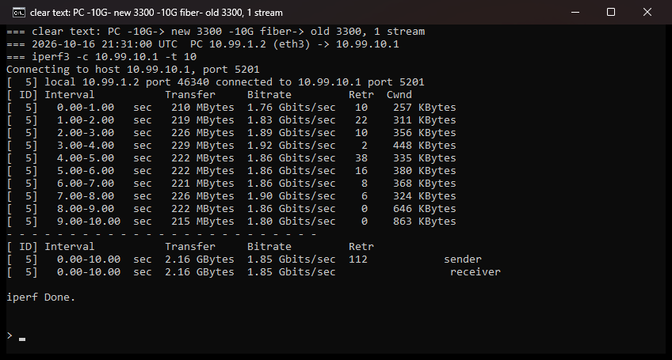
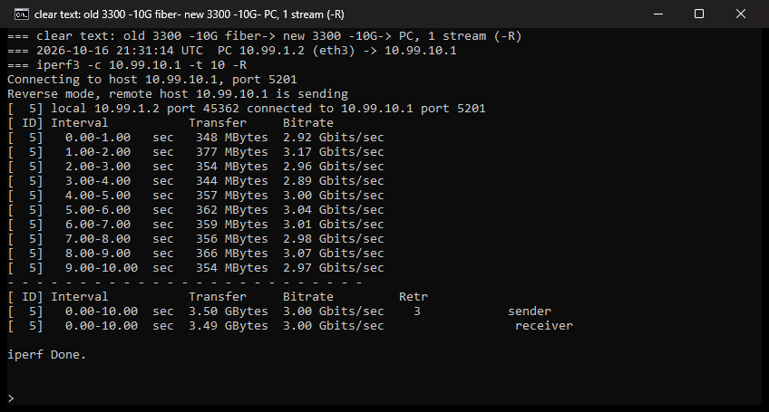
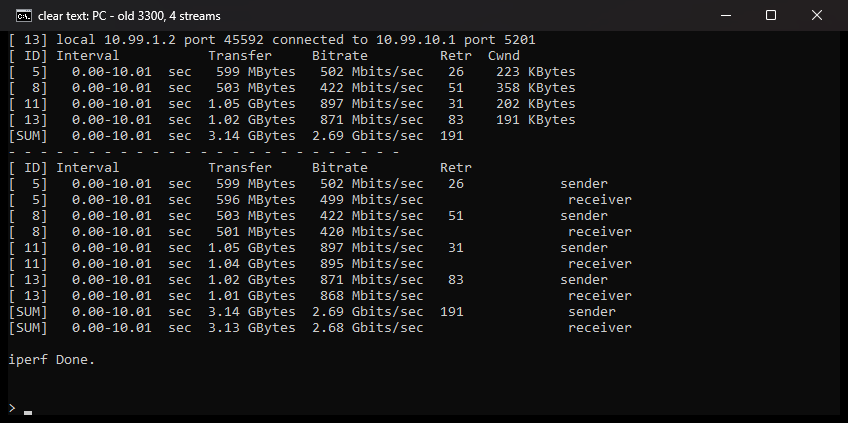
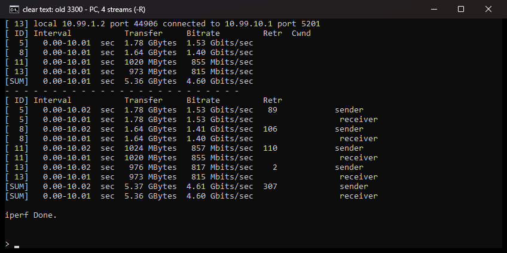
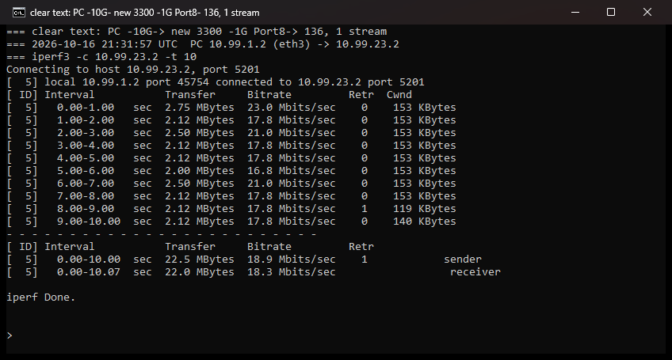
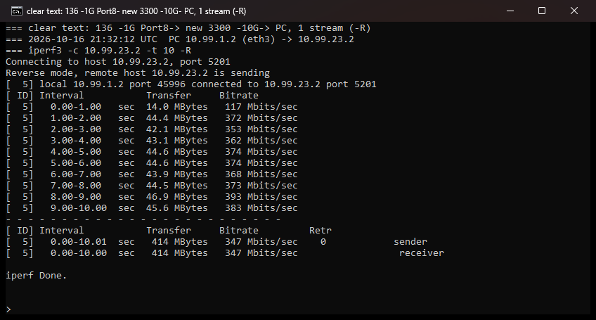

## IPsec

Two tunnels, IKEv2 with pre-shared keys, AES-GCM-256 for ESP (`aes256gcm16`), made through OPNsense's
own IPsec model - the connection, its two authentications, one child and the key - so strongSwan ran
the configuration the GUI writes. The second 3300 initiates both; the protected networks are the PC's
on one side and the far appliance's link address on the other.

- **The XGS 3300s:** the offload is the loader tunable `hw.octep.ipsec_on`, written through OPNsense's
  tunables into `/boot/loader.conf` and read when the driver attaches, before strongSwan installs its
  associations. The first 3300 had it already; the second was given it and rebooted, and came up with
  `dev.octep.0.ipsec.on: 1` and both tunnels' associations in the engine's table.
- **The XGS 136:** set by hand, see [below](#set-by-hand-on-the-xgs-136).

| path | clear text | the second 3300 in software | both ends in hardware |
|---|---|---|---|
| PC to the first XGS 3300, one stream | 1.85 Gbit/s | 1.25 Gbit/s | **1.85 Gbit/s** |
| the first XGS 3300 to the PC, one stream | 3.00 Gbit/s | 2.73 Gbit/s | 2.42 Gbit/s |
| PC to the first XGS 3300, four streams | 2.68 Gbit/s | | 2.01 Gbit/s |
| the first XGS 3300 to the PC, four streams | 4.60 Gbit/s | | 2.58 Gbit/s |
| PC to the XGS 136, one stream | 773 Mbit/s | 668 Mbit/s (the 136 in hardware) | **902 Mbit/s** |
| the XGS 136 to the PC, one stream | 934 Mbit/s | 893 Mbit/s (the 136 in hardware) | 893 Mbit/s |

What the engines counted, read after the runs: on the second XGS 3300, four associations in the
engine's table (two per tunnel) and `tx_encrypt` 4,595,312; on the first, `tx_encrypt` 12,014,911;
on the XGS 136, during the run with the second 3300 in software, `receive: done 58263` and
`transmit: generated 1415770`, and `accepted 1` each way.

The second 3300 in software:

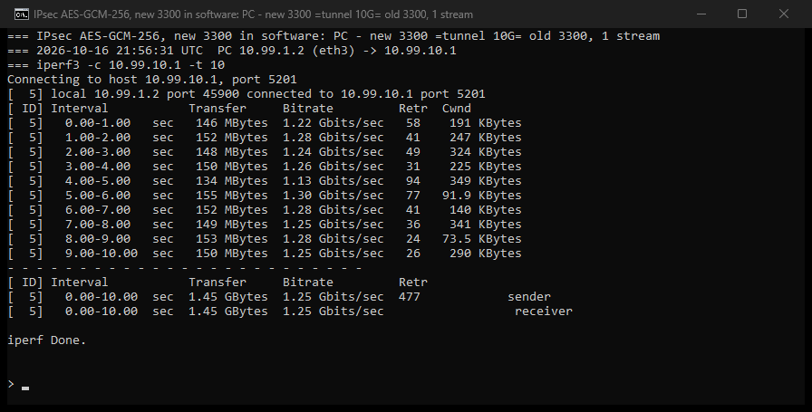
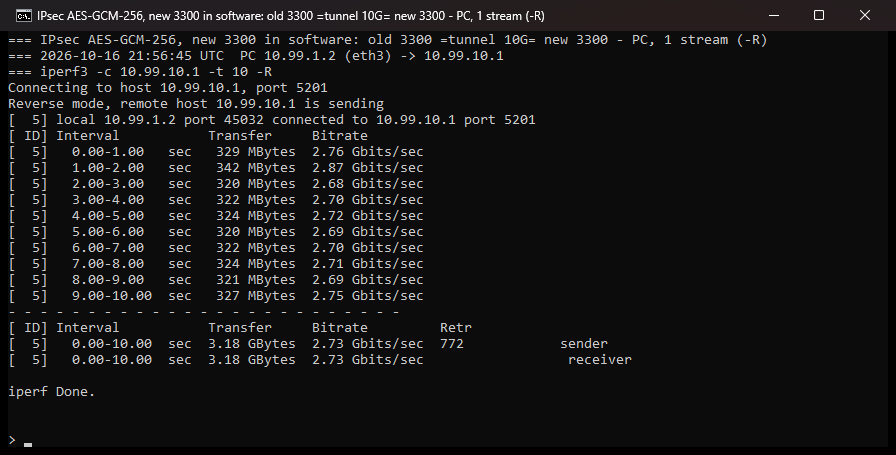
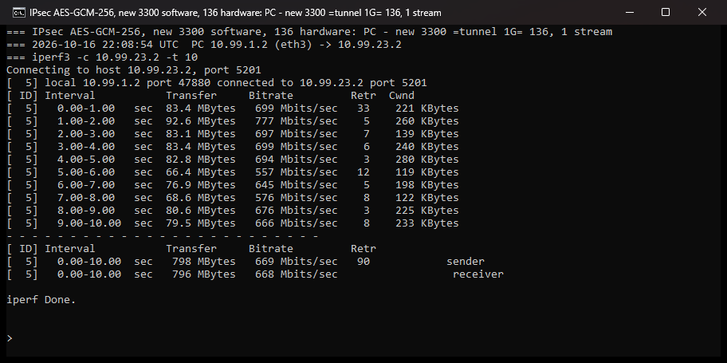
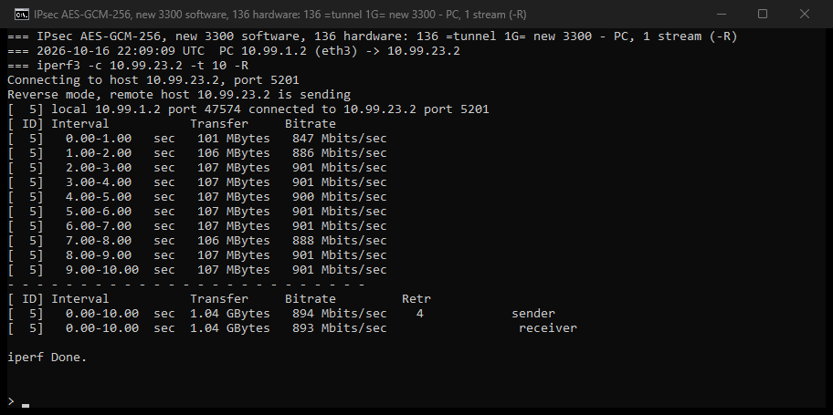

Both ends in hardware:

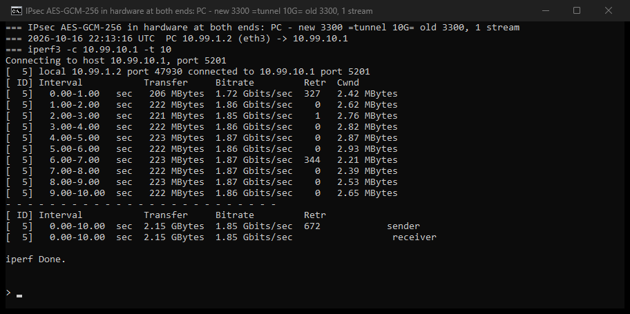

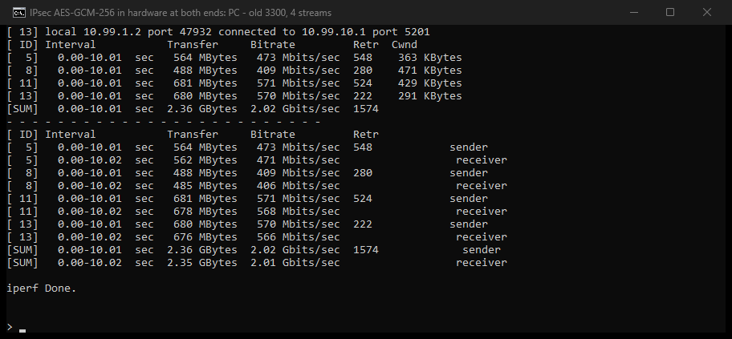
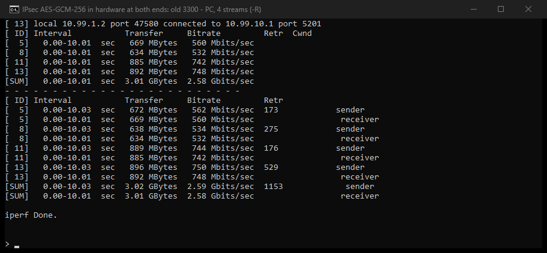
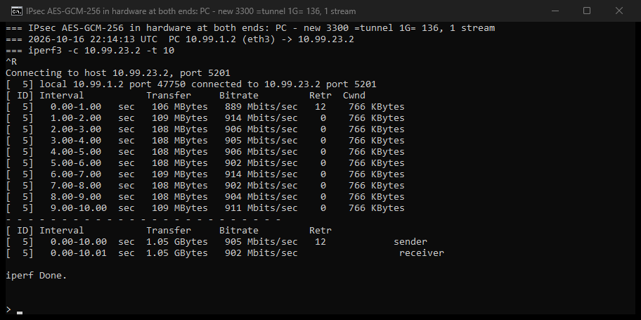
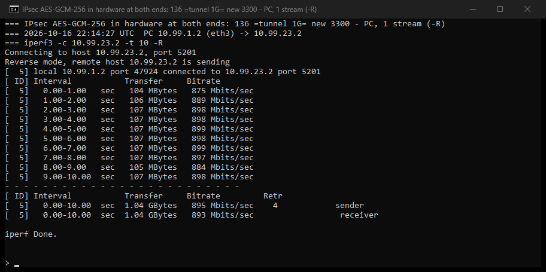

## What the tables say, and what they do not yet explain

- **Into a 3300's host, the tunnel in hardware costs nothing:** 1.85 Gbit/s encrypted, as in clear
  text, where software on the second 3300 gave 1.25. The ceiling of that row is the first 3300's
  host receiving one stream, the same with and without the tunnel.
- **Into the XGS 136 the tunnel is faster than clear text,** 902 against 773 Mbit/s. A decrypted frame
  reaches the 136's host by the engine's receive termination rather than the ring a clear frame
  comes up, so the two rows measure two receive paths. Not yet taken apart.
- **Out of the first 3300's host the hardware rows are lower** - 2.42 one stream and 2.58 four,
  against 2.73 with the second 3300 decrypting in software and 3.00 and 4.60 in clear text. Not yet
  explained.

## Set by hand on the XGS 136

Three things the 136 needed for its tunnel that a boot ~~does not give~~ did not give it; the first
two were issues, both fixed the same night - after a boot with nothing set by hand the tunnel ran at
898 Mbit/s in and 890 out in the engine, and at 903 and 893 in software with `ccp` loaded.

1. **`ccp` unloaded** - [issue 399](https://github.com/AbdelmonemAwad/os-xgs-npu/issues/399). It is
   loaded at every boot from `/boot/loader.conf.local`, and with it the kernel's software ESP dropped
   every packet as `no transform`. Unloading it hung in `cryunreg` until the tunnel's associations
   were taken down and released the sessions it held. **Fixed:** the boot hook holds IPsec's sessions
   to software providers, and `ccp` stays loaded ([the fix](../findings/amd-ccp-breaks-ipsec-gcm-on-the-xgs-136-host.md#the-fix-2026-10-17)).
2. **`dev.npuep.0.ipsec.accept_decrypt` and `accept_encrypt` set to 1** -
   [issue 418](https://github.com/AbdelmonemAwad/os-xgs-npu/issues/418). Without them the driver
   declines the associations the kernel offers, and ~~nothing makes them survive a boot~~ **fixed:**
   the loader tunable `hw.npuep.ipsec_on`, a row in System > Settings > Tunables, sets both when the
   driver loads.
3. **The IPsec interface registered** (`enc0` in `config.xml`), and a pass rule on it from the PC's
   network: with no rule there, the firewall refused every decrypted packet (`receive: blocked`).
   The registration was missing because the interfaces had been restored from a file older than
   the 136's IPsec configuration for the [first-boot test](../octep/interface-assignment.md#on-the-appliances);
   OPNsense registers it itself at boot.
