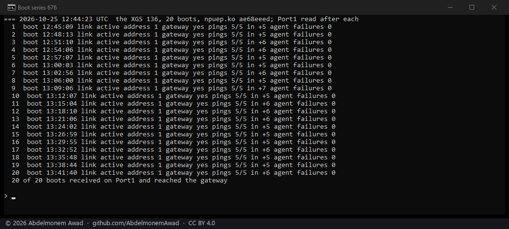
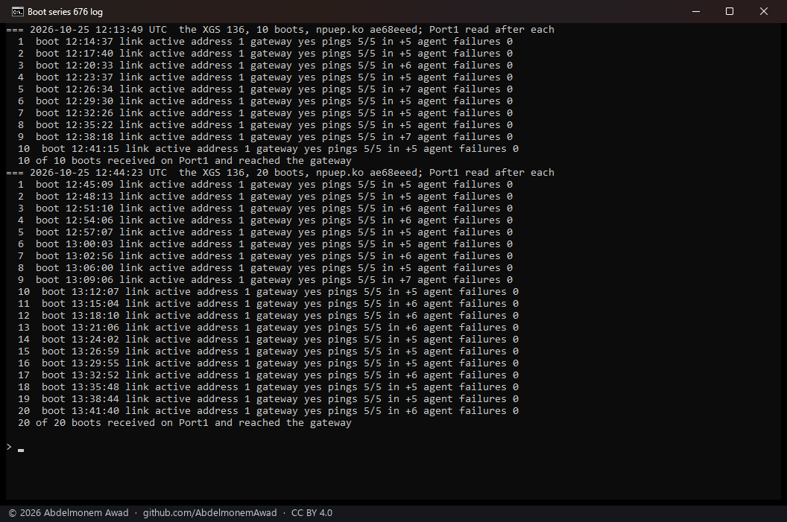

<!-- reviewed: 2026-10-25 -->
# Thirty boots of the XGS 136, Port1 receiving after every one, 2026-10-25

[676](https://github.com/AbdelmonemAwad/os-xgs-npu/issues/676): on 2026-10-21 one boot of the XGS 136 in
eight left Port1 (`npup1`, the WAN) up, with its DHCP address, and receiving nothing - its frames sent,
none taken in, the driver reporting nothing wrong, a reboot curing it. That was before
[731](https://github.com/AbdelmonemAwad/os-xgs-npu/pull/731) (#706), after which the host no longer writes
to the switch's bus at boot: the network agent sets each port's frame limit itself.

Measured on the XGS 136 on vendor version 21, npuep.ko `ae68eeed` (main at
[785](https://github.com/AbdelmonemAwad/os-xgs-npu/pull/785)), by `images/deploy/lab-676-series.sh`
(photographed by `lab-676-series.ps1`). Each boot: the board restarted, then a wait until its network
agent was ready, then a minute for DHCP and the switch's frame limit, then Port1 read - its link, its
address, its default route, and its inbound frame count around five pings to the gateway. The text is in
`measurements/boot-series-676-2026-10-25.log`.

## Thirty of thirty

| | boots | Port1 received and reached the gateway |
|---|---|---|
| 2026-10-21, before #731 | 8 | 7 |
| 2026-10-24, after #731 | 1 | 1 |
| 2026-10-25, this page | 30 | 30 |

The first ten ran before the photographed twenty, as one series with the same script; their lines were
not photographed while they ran, and the second picture is of the log they and the twenty were written
to.

## What it settles, and what not

- **It no longer happens at the rate it did.** At one boot in eight, thirty-one boots in a row receiving
  would come about one time in sixty ((7/8)^31 = 0.016).
- **The cause is not shown.** #731 changed what the host does at boot (it no longer touches the switch's
  bus), and the fault has not been seen since; that the one cured the other is the likeliest reading, not a
  measured one - the failing boot of 2026-10-21 was never caught with the switch's state read.
- **A boot still does not check its own WAN.** A port whose link is up and whose inbound count does not
  move is a fault the driver does not see; the issue's lesson stands for the problem reporter.
