<!-- reviewed: 2026-10-24 -->
# Bridged connections in hardware, measured on the XGS 3300 and the XGS 136, 2026-10-24

Discovery 9 of [the discoveries](../findings/discoveries-2026-10-22.md#bridged-flows), taken from the
source to a product - and a fault found on the way ([723](https://github.com/AbdelmonemAwad/os-xgs-npu/issues/723)).
A connection a bridge carries - two machines on two ports of one bridge, talking to each other - was
made into a flow as if the appliance routed it: its next hop came from the routing table, and the
microflows rewrote both MACs and lowered the TTL. **On the XGS 3300 that sent such a connection's
frames out of the WAN port when the bridge had no address**, and rewrote every frame when it had one;
on the XGS 136 it was not made at all, and the host's bridge carried every frame. Both drivers now
make it a bridged flow: each direction leaves by the port the other direction comes in on, and the
fast path's bridge control rewrites nothing (`USFP_BRCTL_*`: `OCTEP_BRCTL_BRIDGED`,
`NPURPC_BRCTL_BRIDGED`, where routed connections keep `..._ROUTED`).

The MACs in the photographs are named, not printed: a MAC identifies one unit, so the lab's tools
print whose it is (`the first XGS 3300`, `the WAN's gateway`, ...).

## On the XGS 3300

Its A4 and Port8 made members of one bridge, `bridge1`, at run time. The first XGS 3300 and the XGS
136, each given an address of one subnet, IPv4 and IPv6, on one segment through it. A 15-second TCP
stream from the first to the second, read on the second XGS 3300 - pf's connection, the driver's
entry for it and the next hop each direction names - and at both ends with tcpdump: whose MAC each
frame arrives from, and its TTL, which a bridge changes neither of. Before the change with octep.ko
`0fec828d`; after it with `0db1fe23` (`images/deploy/lab-bridged.sh`).

| | before: made as routed | after: made bridged |
|---|---|---|
| the bridge with no address | **both directions' next hop the WAN's gateway, out of the WAN port; 0 MB reached the XGS 136 in 15 seconds** | made bridged: each direction out of the other's port, the frames from the sender's own MAC with TTL 64 both ways; 997 Mbit/s, the host's bridge taking 142 frames |
| the bridge with an address | 997 Mbit/s, but **every frame from the bridge's MAC with its TTL lowered** (63 for 64), both ways | the same: bridged, nothing rewritten, 997 Mbit/s; 6,788 frames through the host's bridge |
| IPv6 | - | bridged, the hop limit 64 both ways; 975 Mbit/s, 811 frames through the host's bridge |
| a connection the XGS 3300 ROUTES through the same two ports | - | still routed, as it must be: the frames from the second XGS 3300's ports with the TTL lowered; 997 Mbit/s, none through the bridge |
| `dp.bridge_flows 0` | - | left to the host's bridge, which takes 414,953 frames in the 15 seconds |

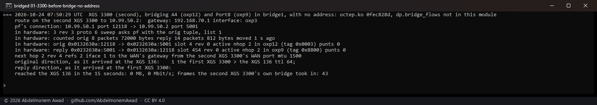

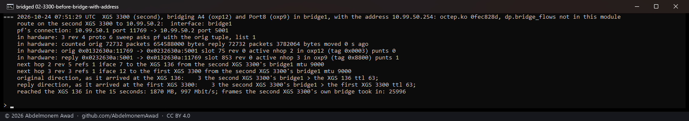

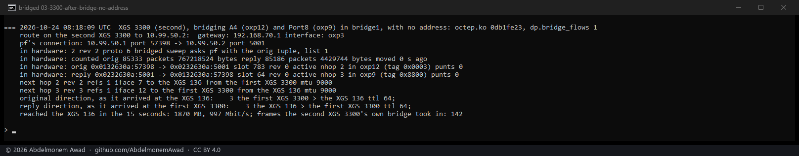

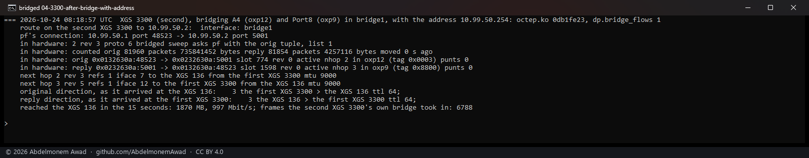

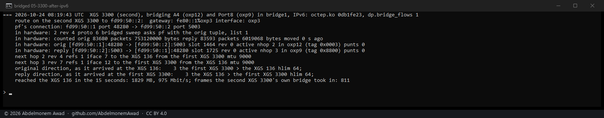

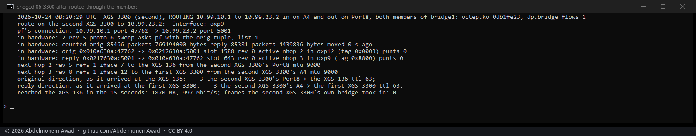

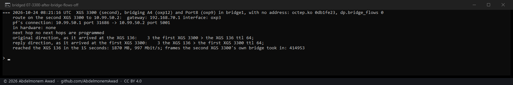

## On the XGS 136

Its LAN bridge, `bridge0`: the bench PC on Port3, and the second XGS 3300 on Port8, which joined the
bridge at run time, its Port8 given 192.168.1.250 and its route to the PC put over Port8. An iperf3
stream from the PC, read at the second XGS 3300 - the original direction only; the reply arrives at
the PC, which has no capture here. Before the change with npuep.ko `a7b6b451`; after it with
`4efe09fb` (`images/deploy/lab-bridged-136.sh`). The bridge's MTU is 1500, so these are 1,500-byte
frames.

| | in hardware | frames the 136's own bridge took in, 12 seconds | at the second XGS 3300 |
|---|---|---|---|
| before | **none** | **1,933,880** | 938 Mbit/s, the PC's MAC, TTL 128 |
| after | **both of iperf3's connections, bridged** - 337,463 and 337,526 frames counted in the first five seconds | 145,973 | 938 Mbit/s, the PC's MAC, TTL 128 |
| after, `flow.bridge_flows 0` | none | 1,928,065 | 934 Mbit/s |

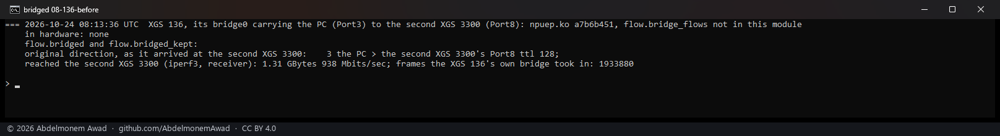

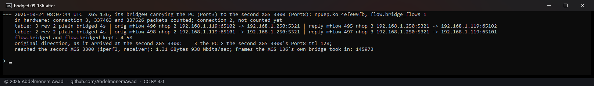

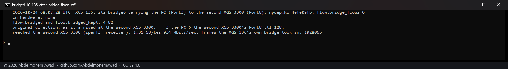

## How a bridged connection is told from a routed one

By the frame itself: the punted frame's destination MAC, which the receive path now keeps with each
candidate. A frame for the host carries one of the host's own MACs - an interface's, a bridge's, or
a CARP or VRRP group's - and the host routes it; a frame a bridge carries past the host carries the
other machine's. A connection is made bridged when the frame in hand is the second kind and arrives
on a member of a bridge, and the other direction's frame is the second kind too and arrives on
another member of the same bridge (`octep_dp_frame_bridged`, `octep_ports_one_bridge`, and the XGS
136 driver's `npuep_*` of the same names). Its next hop is the port the other direction comes in on -
where the bridge has learned the far end is - named with the frame's own two MACs, which the bridge
control then leaves alone (`octep_nhop_bridged`, `npuep_nhop_bridged`). The route plays no part. A
connection routed through the same two member ports is still routed, its MACs rewritten and its TTL
lowered, as a router must.

A port's `if_bridge` is the port's own entry in its bridge, one for each member, not the bridge -
two members of one bridge never compared equal by it, and the first build refused every bridged
connection for that. The bridge is the entry's `bif_sc`; the entry's layout is `if_bridge.c`'s own
and in no header, so its head is restated in each driver and checked at every use (its `bif_ifp`
must be the port), and a layout that does not match makes the answer "no bridge" - the connection
stays with the host's bridge.

## What stays with the host's bridge

A connection whose two directions do not both cross the bridge: measured on the XGS 136 with the
second XGS 3300 answering by its old route, through the XGS 136 itself - the PC's frames bridged,
the replies addressed to the XGS 136 and routed by it. The driver says so and leaves it to the host.

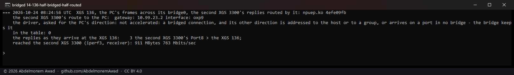

Also one whose frames go to a group - a broadcast or a multicast, which the bridge sends to every
port; one pf translates or an IPsec policy covers; one whose other direction has not been seen yet,
since nothing else says which port the far end is on; and every one while `dp.bridge_flows` or
`flow.bridge_flows` is 0. Each refusal is counted (`dp.flow_bridged_kept`, `flow.bridged_kept`), an
attempt each.

## Taken out when pf lets go

A bridged connection in hardware whose pf states are killed is taken out within the sweep, and pf
then drops what still comes, as for any connection. The states were killed one by one by their id:
`pfctl -k <host> -k <host>` killed none of these states on OPNsense 26.7, while `pfctl -k <host>`
alone did.

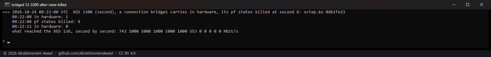

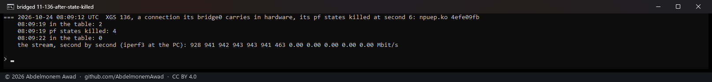

## Given back at small frames

At 1,500-byte frames - about 82,000 a second at a gigabit - the fast path gives a connection back
to the host now and then, and the driver revives it in place; until it does, the frames cross the
host. That is the fast path's, not the bridge's: with the sender's MTU at 1500, a bridged stream and
a routed one through the same ports were each revived 22 times in ten seconds, on the XGS 3300. The
runs above with 9,000-byte frames saw almost none, which is why their host bridge took a few hundred
frames; on the XGS 136, whose bridge has an MTU of 1500, its 145,973 frames are the same give-backs.

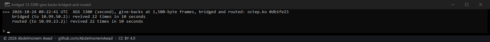

## On the page

XGS: Flows marks such a connection **bridged** in its Connection column, its tooltip saying its
frames keep their own MACs and TTL. `flows.py` reads the mark from both drivers' tables; on the XGS
136 the word sits inside the one line its pattern matches, which is given room for it. Read on the XGS
136 through the configd action the page uses: both connections, `bridged`.

## The instruments

- `dev.octep.0.dp.bridge_flows` and `dev.npuep.0.flow.bridge_flows`: 1, the default, makes bridged
  connections bridged flows; 0 leaves every one to the host's bridge.
- `dev.octep.0.dp.flow_bridged` and `dev.npuep.0.flow.bridged`: connections made bridged;
  `dp.flow_bridged_kept` and `flow.bridged_kept`: attempts refused. Why one is refused, asked by hand
  (`dp.accelerate`, `flow.accelerate`), names the check: one port, the other direction addressed to
  the host or a group, two bridges.
- The driver's tables (`dp.flow_table`, `flow.flows`) mark a bridged connection `bridged`.
