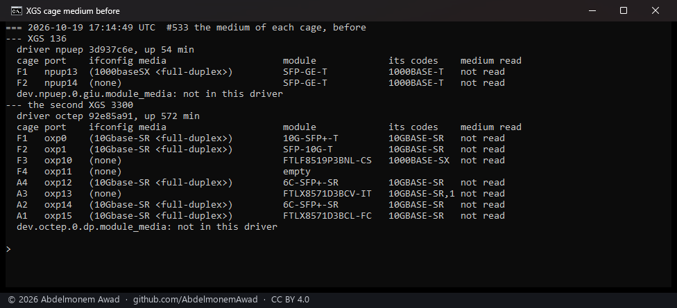
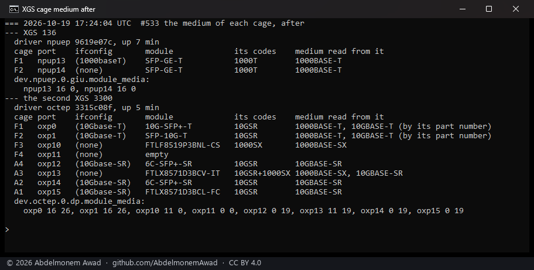
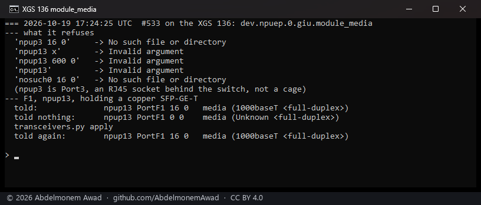

<!-- reviewed: 2026-10-19 -->
# What a cage carries, read from its module, measured, 2026-10-19

A port in a cage reported a medium that nobody had read
([#533](https://github.com/AbdelmonemAwad/os-xgs-npu/issues/533)):

- **On the XGS 136**, `npuep` took both cages to be fibre. F1 said `1000baseSX` with a copper
  SFP-GE-T in it.
- **On the second XGS 3300**, `octep` said `10Gbase-SR` for every port at 10 Gbit/s and `1000baseT`
  for every one at a gigabit. Its F1 and F2 hold copper 10GBASE-T modules. Its F3 holds a
  1000BASE-SX module, which would have been called copper.

Neither driver can read a module. The modules' memory is on the coprocessor's I2C, which the host
does not reach. Now the Transceivers page's script, which reads every cage on the coprocessor, also
tells the driver what each module is. A cage's port reports that medium, and `unknown` until it has
been told.

## How

- **The drivers.** Each gained one sysctl, `dev.npuep.0.giu.module_media` on the XGS 136 and
  `dev.octep.0.dp.module_media` on the XGS 3300.
  - A write is `"<interface> <at 1G> <at 10G>"`, each an Ethernet media subtype as
    `net/if_media.h` numbers it, 0 where nothing was read.
  - The port reports the one for the speed it is running at.
  - The switch's RJ45 sockets are not cages and keep `1000baseT`.
  - On the XGS 136 the speed the kernel is told, `if_baudrate`, now comes from the port's speed and
    not from the medium, so an unread cage still has its speed.
- **The script**, `scripts/xgs/transceivers.py`, reads more of each module than before: its
  connector (byte 2) and its compliance codes (bytes 3, 6, 8 and 36). From those it takes the
  medium at a gigabit and at ten, with two exceptions:
  - a module with an RJ45 connector is copper whatever its codes say;
  - some copper 10GBASE-T modules claim 10GBASE-SR and an LC connector outright. The two in the
    XGS 3300's F1 and F2 do, and the owner confirmed both are copper. So a part number with a `T` of
    its own (`SFP-10G-T`, `10G-SFP+-T`, `SFP-GE-T`) is taken as copper, and the page says that is
    where it came from.
- **When the script writes it**: at every read, every five minutes from the cron and on **Read
  again now**. Also at boot, from a new start hook, `64-xgs-transceivers`:
  - at once from what was read before the boot;
  - then from the modules themselves, asking again every 20 seconds for up to three minutes. On the
    XGS 3300 the console the script reads through was busy at boot with another plugin's first read,
    and one refusal left every cage `unknown` until the cron came round.
- **The Transceivers page** has a **Medium** column, with "from its part number" where that is where
  it came from.

## Measured

The builds: `npuep` 9619e07c on the XGS 136, `octep` 3315c08f on the second XGS 3300. Each was
installed by hand with the plugin's changed files, and each appliance rebooted onto it.

**Before**, the modules as the page read them, and what the ports said:

**After** the reboots: F1 on the XGS 136 says `1000baseT`. F1 and F2 on the XGS 3300 say
`10Gbase-T`, from their part numbers. A1, A2 and A4 say `10Gbase-SR`, from their codes. F3, its
SX module without a link, is told `1000BASE-SX` for when it has one.

**The driver's side**, on the XGS 136:

- `module_media` refuses a port that is not a cage, an interface that does not exist, a subtype that
  is not a number or out of range, and a line without both subtypes.
- A cage told nothing reports `Unknown`. That is what F1 said in the seconds after the boot, before
  the start hook had written it.
- `transceivers.py apply` puts the medium back from what was read last.

**At boot:**

- **XGS 136:** the start hook ran 70 seconds after the boot and wrote both cages at its first read.
- **XGS 3300:** its first read was refused, the console busy, and every cage stayed `Unknown`; that
  was the build without the retry.
- **The retry**, then added, was tried with the console held for 25 seconds by another command: the
  read went through on a later attempt, 64 seconds after it started, and every cage was written.
  It has not been through a boot yet.

## Not measured

- **The Transceivers page itself**, its new column, in the browser: the GUI's login is the owner's.
  The page reads the same file the script writes, as before.
- **A 1000BASE-SX module with a link.** F3 on the XGS 3300 has none; it is told, and has not shown
  it.
- **A copper expansion module** (RJ45 in the bay). Its ports would be written as copper from the
  coprocessor's "not an SFF port".
