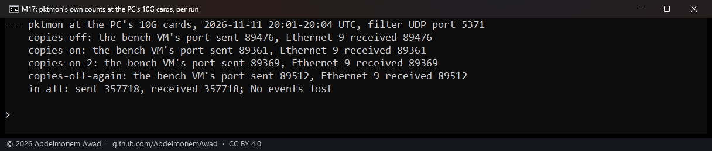
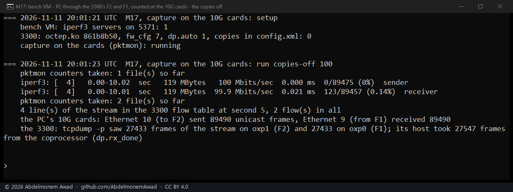
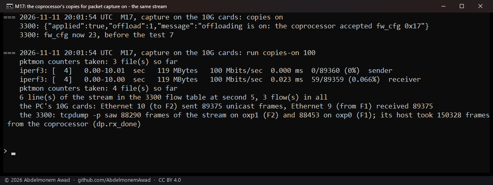
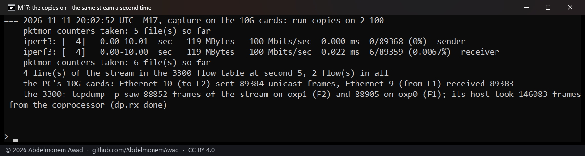
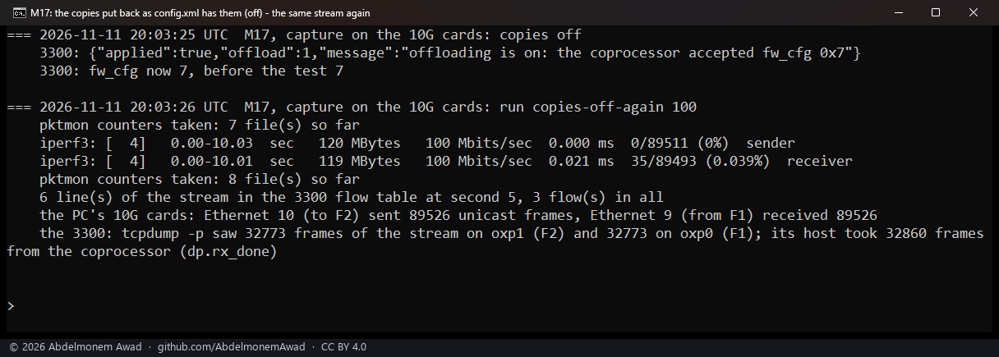
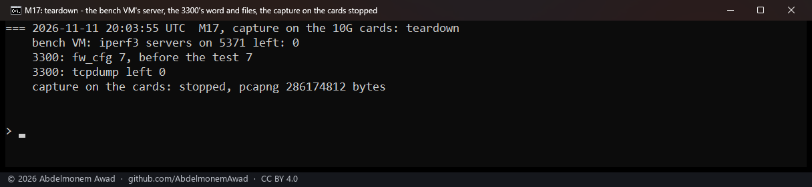
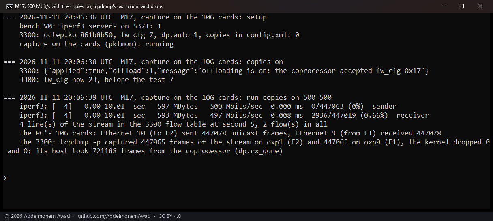
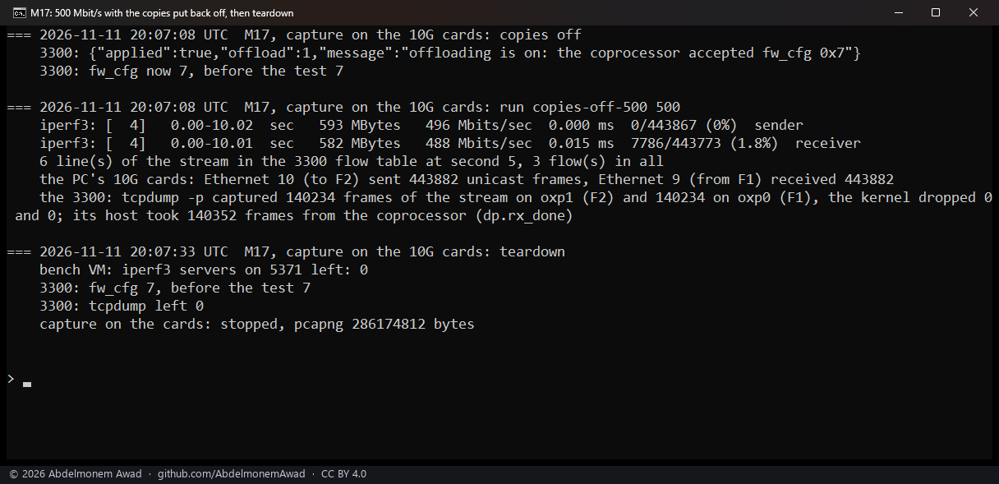

<!-- reviewed: 2026-11-11 -->
# Copies for a packet capture on the second XGS 3300: every frame to 500 Mbit/s on one boot, checked at the PC's 10G cards, 2026-11-11

A packet capture on the appliance - tcpdump, or Interfaces: Diagnostics: Packet Capture - sees a
connection only until the coprocessor forwards it; after that its frames no longer cross the host.
XGS: Settings **Copies for packet capture** has the fast path send the host two copies of every frame
it forwards, one for each port the frame crosses, and the driver shows each copy to that port's
capture ([discoveries 12 and 17](../findings/discoveries-2026-10-22.md#mirrored-packets)). On
2026-10-25 the second XGS 3300, over vendor version 22, copied every frame of a 200 Mbit/s stream
before one of its boots, and after it only the stream's first 1,556 to 1,560 data frames
([the measurement](mirror-2026-10-25.md#the-second-xgs-3300-vendor-version-22)). Whoever reads such a
capture needs to know whether it holds every frame. So on this board's boot of 2026-11-11 one stream
in hardware was counted at both of its ends, on the PC's two 10 Gbit/s cards, and by a capture on the
3300, with the copies off and on.

The two cards are cabled to the 3300's F1 and F2. Those two are not ports of its switch: one 88X5113
PHY sits between them and the coprocessor ([the board](../hardware/xgs3300.md#what-it-is)). So the
switch's mirror cannot be sent to them, and the cards themselves are the complete count.

## How it was measured

The second XGS 3300 (vendor version 22), 2026-11-11, 20:01-20:08 UTC: `octep.ko` in `/boot/modules`
(md5 `861b8b50`), automatic acceleration on (`dp.auto` 1), the copies off in the saved settings and
the coprocessor's configuration word `fw_cfg` at 7. It was driven over its MGMT port, so nothing sent
to it crossed F1 or F2.

- **The stream**: one UDP flow of 1,400-byte datagrams for 10 seconds, sent by the bench VM
  (10.99.2.x) to the PC (10.99.1.x) with iperf3 `-R`. The VM runs on the PC, on a virtual switch that
  uses the card Ethernet 10, cabled to F2. The 3300 routed the stream out of F1 to the PC's other
  card, Ethernet 9. Its flow table held entries on the stream's port at second 5 of every run.
- **The runs**: 100 Mbit/s with the copies off, on, on and off; then 500 Mbit/s with them on and off.
- **The copies**: turned on by the plugin's own script, `XGS_COPIES=1 offload.sh on` - the
  coprocessor accepted the word `0x17` (23), which the setting writes when it is saved on - and put
  back by `offload.sh` alone, which writes what the saved settings hold: `0x7` (7).
- **Counted at the PC**: iperf3's datagrams sent and lost; the two cards' own unicast frame counters
  (`Get-NetAdapterStatistics`) before and after each run, what Ethernet 10 sent and what Ethernet 9
  received; and pktmon, Windows' packet monitor, on the PC's network adapters with one filter, UDP
  port 5371, through the four 100 Mbit/s runs (20:01-20:04 UTC), its counters read before and after
  each run.
- **Counted on the 3300**: `tcpdump -p` with the filter `udp port 5371` on `oxp1` (F2) and `oxp0`
  (F1), and `dev.octep.0.dp.rx_done`, the frames its host took from the coprocessor. In the
  100 Mbit/s runs the lines tcpdump printed were counted. In the 500 Mbit/s runs tcpdump wrote to
  `/dev/null` and its own count was read at its end - frames captured, and dropped by the kernel - so
  that a frame lost to a full capture buffer counts as a drop, not as a missing copy.

## Results

### At the PC's cards: no frame of the stream lost

| Run (UTC) | Mbit/s | Copies | iperf3 sent | Ethernet 10 sent (to F2) | Ethernet 9 received (from F1) | pktmon, UDP 5371: the VM's port sent / Ethernet 9 received | iperf3 lost at the receiver |
|---|---|---|---|---|---|---|---|
| 20:01:23 | 100 | off | 89,475 | 89,490 | 89,490 | 89,476 / 89,476 | 123 (0.14 %) |
| 20:01:54 | 100 | on | 89,360 | 89,375 | 89,375 | 89,361 / 89,361 | 59 (0.066 %) |
| 20:02:52 | 100 | on | 89,368 | 89,384 | 89,383 | 89,369 / 89,369 | 6 (0.0067 %) |
| 20:03:26 | 100 | off | 89,511 | 89,526 | 89,526 | 89,512 / 89,512 | 35 (0.039 %) |
| 20:06:39 | 500 | on | 447,063 | 447,078 | 447,078 | not running | 2,936 (0.66 %) |
| 20:07:08 | 500 | off | 443,867 | 443,882 | 443,882 | not running | 7,786 (1.8 %) |

- **Every datagram iperf3 sent reached Ethernet 9** in the four runs pktmon counted. In each, the VM's
  port sent and Ethernet 9 received the same number of frames on UDP port 5371, and their byte counts
  come to iperf3's datagrams as 1,442-byte frames and one small frame besides. 357,718 sent and
  357,718 received in all; pktmon lost no event.
- **The cards' own counters agree in five runs of six.** They count every unicast frame, not the
  stream's alone: 15 more than iperf3's datagrams in every run, except Ethernet 10 in the third, 16.
  That is one frame sent and not received (89,384 and 89,383), while pktmon's count of the stream in
  that run matched (89,369 and 89,369). What that one frame was, and where it went, was not read.
- **What iperf3 counted lost, 0.0067 % to 1.8 %, was lost inside the PC**, after Ethernet 9 had
  received it.
- **pktmon reported four drops, none of the stream**: one 60-byte frame a run, the other way, arriving
  at Ethernet 10. The VM's port counted one 60-byte frame received each run as well.

### On the 3300: with the copies on at 500 Mbit/s, every frame on both ports

| Run (UTC) | Mbit/s | Copies, the word | iperf3 sent | tcpdump on F2 (`oxp1`) | tcpdump on F1 (`oxp0`) | Dropped by the kernel | The host took from the coprocessor (`dp.rx_done`) |
|---|---|---|---|---|---|---|---|
| 20:01:23 | 100 | off, 7 | 89,475 | 27,433 | 27,433 | not read | 27,547 |
| 20:01:54 | 100 | on, 23 | 89,360 | 88,290 | 88,453 | not read | 150,328 |
| 20:02:52 | 100 | on, 23 | 89,368 | 88,852 | 88,905 | not read | 146,083 |
| 20:03:26 | 100 | off, 7 | 89,511 | 32,773 | 32,773 | not read | 32,860 |
| 20:06:39 | 500 | on, 23 | 447,063 | **447,065** | **447,065** | 0 and 0 | 721,188 |
| 20:07:08 | 500 | off, 7 | 443,867 | 140,234 | 140,234 | 0 and 0 | 140,352 |

At 100 Mbit/s the tcpdump columns are the lines it printed; at 500 Mbit/s, its own count of frames
captured.

- **With the copies on, at 500 Mbit/s, the capture held every frame on both ports.** tcpdump captured
  447,065 frames on F2 and 447,065 on F1, and the kernel dropped none, where iperf3 sent 447,063
  datagrams. The filter takes every UDP frame on port 5371, not the stream's alone: in each 100 Mbit/s
  run pktmon saw one small frame each way on that port besides the stream.
- **With the copies off, the capture saw only the stream's start**: 27,433 and 32,773 frames on each
  port at 100 Mbit/s, 140,234 at 500. These are the frames the host forwarded itself before the flow
  was in hardware, and the host took about as many from the coprocessor. At the rate iperf3 sent, they
  are the stream's first 3.1 and 3.7 seconds at 100 Mbit/s and 3.2 at 500: about the same time at five
  times the rate.
- **The 100 Mbit/s runs with the copies on do not settle the question.** tcpdump printed 88,290 to
  88,905 lines on a port, of about 89,360 frames sent (98.8 to 99.5 %), and the two ports differed, by
  163 and by 53. Its drop count was not read in those runs, so they do not tell copies not sent from
  frames the capture dropped. The 500 Mbit/s runs read tcpdump's own count for that reason.
- **The copies reach the host as frames from the coprocessor**: with them on, the host took 150,328 and
  146,083 at 100 Mbit/s, against 27,547 and 32,860 with them off, and 721,188 against 140,352 at 500.
- **The partial copies of 2026-10-25 did not show on this boot.** Here the capture held every frame of
  the 500 Mbit/s stream; then, after a boot, this board copied only a 200 Mbit/s stream's first 1,556
  to 1,560 data frames.

pktmon did not run for the two 500 Mbit/s runs: it had stopped at 20:04 UTC. The setup line in the
next picture that says it was running is wrong, and the teardown in the last one names the earlier
capture's file. Those two runs were counted by the cards' counters, iperf3 and tcpdump alone.

## What it does not mean

- **It is one boot of the second XGS 3300.** On 2026-10-25 which frames this board copied changed at
  a boot. No boot was made here, so whether the copies stay complete after the next one was not
  measured. The XGS 136 and the first XGS 3300 were not measured here.
- **It is not the full rate.** 500 Mbit/s was the highest rate here. On 2026-10-25, on a boot when this
  board copied every frame of a 200 Mbit/s stream, a stream at 3.64 Gbit/s got 108,783 copies a
  direction in ten seconds where it carried some 474,000 data frames
  ([the measurement](mirror-2026-10-25.md#the-second-xgs-3300-vendor-version-22)).
- **It is one UDP stream, one way, in 1,400-byte datagrams.** TCP, both directions, other frame sizes
  and many flows at once were not measured here.
- **The host's cost was not read.** The 3300's CPUs with the copies on were not measured, and iperf3
  set the rate, so forwarding speed was not measured either.
- **Why a UDP flow stays with the host for about 3 seconds was not read.** On 2026-10-24 a TCP stream
  through an XGS 3300 was in hardware after its first few dozen packets
  ([the measurement](ids-note-2026-10-24.md)).
- **A capture of the switch's mirror on a computer was not measured.** F1 and F2 cannot receive the
  mirror, and no computer was on a free port of the switch.

To capture a connection in hardware: XGS: Settings, the Acceleration tab, **Copies for packet
capture** on, then tcpdump or Interfaces: Diagnostics: Packet Capture on the port, and the setting off
after. The runs above wrote the same word from the command line; the page's save writes it too
([measured](mirror-2026-10-25.md#the-setting-saved-and-booted)).
