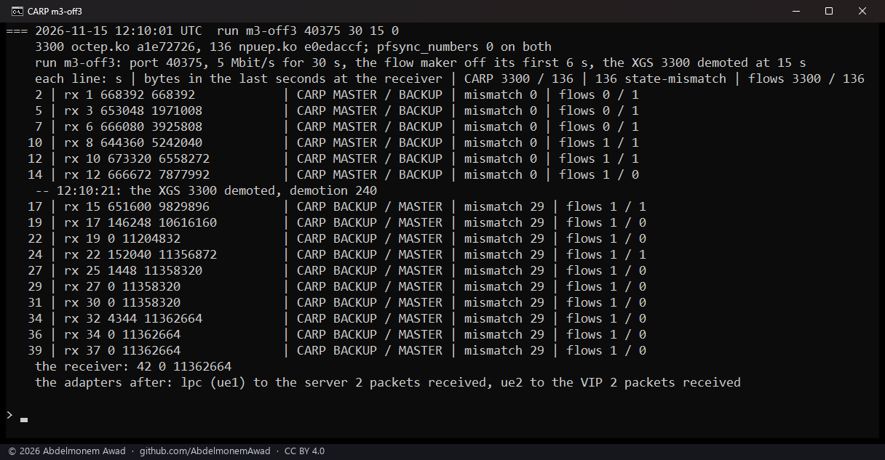
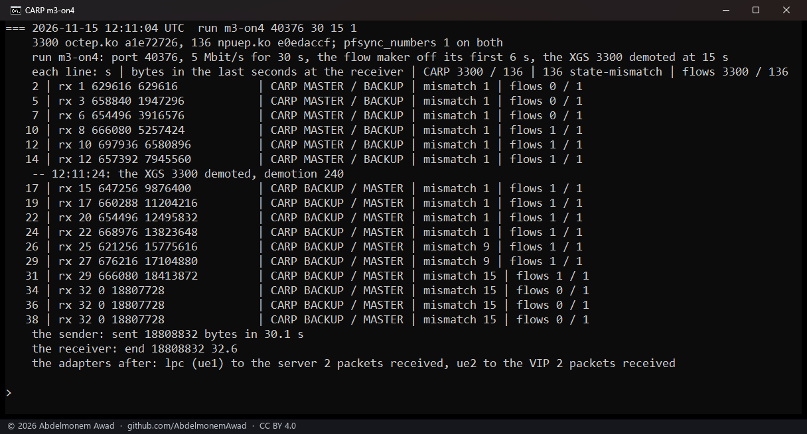
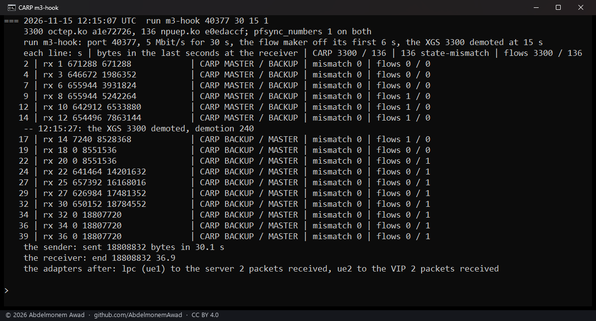

<!-- reviewed: 2026-11-15 -->
# A CARP failover with a TCP connection in hardware: it dies without the numbers for pfsync and goes on with them, 2026-11-15

A planned failover between the second XGS 3300 and the XGS 136, with a TCP stream through them that the master
carries in hardware and that began with the host, so that the backup's pfsync copy of it is strict. Before
[the numbers written for pfsync](pfsync-numbers-2026-11-15.md), the new master refused the connection and it died;
with them it went on. A carp hook that empties the old master's hardware when it is master of nothing any more
was measured too, and is a setting, off by default.

## How it was measured

2026-11-15 from 12:00 to 12:17 UTC: the second XGS 3300 (vendor version 22) master, the XGS 136 (vendor version 21)
backup; octep.ko `a1e72726` and npuep.ko `e0edaccf`, which carry the numbers for pfsync.

- **Two shared segments, made at run time**: the lab has no switch, so each is a bridge on the XGS 3300 that joins
  one of the test machine's adapters with the cable to the XGS 136 - Port4 with Port6 (to the XGS 136's Port7),
  Port3 with Port8 (to its Port8). The bridges were not filtered for the runs, so pf on the XGS 3300 judged only
  what it routed. Nothing was written to `config.xml`; everything was put back after, `config.xml` unchanged.
- **CARP**: a virtual address on each segment, the XGS 3300 at advskew 0 and the XGS 136 at 100, preemption on
  both; pfsync over the second segment.
- **The connection**: TCP at 5 Mbit/s for 30 seconds from a jail on the first segment to the test machine on the
  second, through the virtual addresses; the flow maker off for its first 6 seconds, so the connection began
  with the host and the copy was strict.
- **The failover**: 15 seconds in, the XGS 3300 demoted (`net.inet.carp.demotion` +240), alive and still
  bridging both segments; the XGS 136 took both addresses.
- **Read every 2 seconds**: what reached the receiver, CARP on each, the XGS 136's `state-mismatch`, and the
  connections each one carried in hardware.
- **The runs**: the numbers for pfsync off on both (`dp.pfsync_numbers` and `flow.pfsync_numbers` 0), then on
  (the default), then on with the carp hook, a copy of `rc.syshook.d/carp/20-xgs-flows` with its setting forced
  on, on both appliances.

## Results

| | After the failover | Delivered | The XGS 136's state-mismatch | The XGS 3300's hardware after it |
|---|---|---|---|---|
| Numbers off | the connection died | 11.4 of 18.8 MB | 29 | kept the connection |
| Numbers on | went on at the same rate, closed cleanly | 18.8 of 18.8 MB | 15 | kept it for about 16 s |
| Numbers on, the hook | stood still about 5 s, then went on, closed cleanly | 18.8 of 18.8 MB | 0 | emptied in 2 to 4 s |

- **Without the numbers** the XGS 136's strict copy refused the connection's segments as soon as they reached
  it, 29 of them, and nothing more of the stream arrived but a few kilobytes.
- **With them** the stream crossed the failover at the rate it had, and the XGS 136 took the connection into its
  own hardware.
- **The old master kept the connection in hardware** after it was demoted - about 16 seconds in the second run -
  and here it carried part of the stream: in this lab it is also the bridge of both segments, so its ports
  see every frame. Behind a switch, frames for the virtual address go to the new master alone.
- **With the hook**, the XGS 3300 logged `92@bridge8 BACKUP: master of nothing here, the flow maker stopped and
  the hardware emptied`, and the XGS 136, taking master, `the flow maker back to 1`. The stream stood still for
  about 5 seconds, TCP resending what had gone to the old master, and then went on through the new master,
  without one segment refused. Off by default: XGS: Settings, "Hardware follows the CARP master".
- **Runs at 20 Mbit/s** were stopped by the test machine's USB adapters, which stall now and then, and are left
  out; their logs are kept with the lab's.

The pictures show the runs as their log has them (`lab-carp.sh`), not a run done again for the camera.

### What these figures do not mean

- **A master that dies** - power, a crash - rather than one demoted: not measured.
- **A switch between the appliances**: the segments here are bridges on the XGS 3300, which is also one of the
  pair.
- **One connection at 5 Mbit/s.** Many connections, faster ones, and one that moves more than a gigabyte past its
  last numbers (see [the numbers for pfsync](pfsync-numbers-2026-11-15.md)) were not measured across a failover.
- **The setting**: the failover was not run from XGS: Settings' new field, but with the hook's copy forced on.
