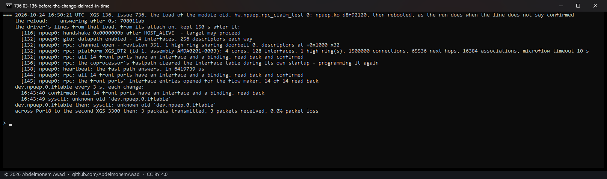
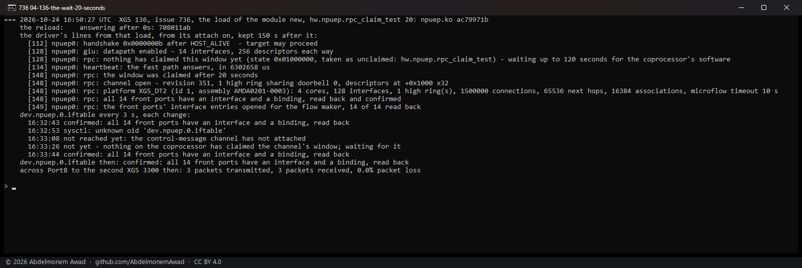
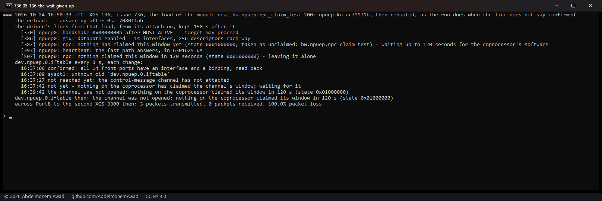

<!-- reviewed: 2026-10-24 -->
# The command channel waited for, not looked at once, 2026-10-24

Issue [736](https://github.com/AbdelmonemAwad/os-xgs-npu/issues/736): the second XGS 126 run by its
owner had its fourteen ports up and carried nothing, and `verify.sh` said the interface table was
never confirmed. The owner's boot messages said why:

    [4] npuep0: handshake 0x0000000b after HOST_ALIVE  - target may proceed
    [15] npuep0: giu: datapath enabled - 14 interfaces, 256 descriptors each way
    [15] npuep0: rpc: nothing has claimed this window (...) - leaving it alone
    [15] npuep0: the control-message channel did not attach
    [21] npuep0: heartbeat: the fast path answers, in 6503639 us

The control-message channel is how the driver writes the coprocessor's interface table; without it
the fast path has no interface for any port and drops every frame before it is counted. Its window
is claimed by the coprocessor's own software, which starts at the host's handshake, and the driver
looked at it once, at attach, and left it alone if it was not claimed yet. On the first XGS 126 run
by its owner the same look, at the same second 15, on two boots, found it claimed; on this one it had
not been. **A race, not the board** - and not one a later boot is sure to win.

**The driver now waits for the claim** - a second at a time, up to two minutes, on its programming
thread, so nothing in the boot waits with it - and opens the channel when it comes. While it waits,
`dev.npuep.0.iftable` ([the reason line](iftable-why-2026-10-24.md)) says so, and `verify.sh` calls
that worth a look, not a failure; if two minutes pass, the line says the channel was not opened and
the state the window was left in. A weak spot beside it closed too: a port's address changing while
the channel had not opened asked a programming thread that did not exist to run.

## Not reproduced on the XGS 136, and why

The XGS 136 attaches the channel after the claim: on a boot its data path comes up at second 37 and
the channel at second 45, after the heartbeat's first answer. Bringing up its inspection function is
what delays it, and the XGS 126s run without one - so the coprocessor was reset under the running
system (`contrib/npuep/reload.sh`, the module loaded the moment the coprocessor answers) with the
inspection function off for that load, and the module from before this change (npuep.ko `d8f92120`)
loaded. It attached the channel one second after the data path, and the window was claimed already:
channel open, table confirmed, a ping across Port8. The race did not come. (That run rebooted
afterwards because the module before this change has no reason line, which the run reads.)

So the wait was reached the one way left: `hw.npuep.rpc_claim_test`, a loader setting that takes the
window as unclaimed for that many seconds after attach, whatever it reads; its line in the boot
messages says so. 0, the default, reads the window and nothing else.

## The wait, on the XGS 136

npuep.ko `ac79971b`, reloaded the same way, the window taken as unclaimed for 20 seconds: the driver
said it was waiting, the line said `not yet` for those seconds, the window was taken as claimed at
second 148, the channel opened, the table was confirmed at once - the coprocessor's own startup was
long over, so nothing cleared it - and a ping crossed Port8.

Taken as unclaimed for 200 seconds - past the two minutes - the driver gave up at second 507, 120
seconds after attach, and said so in the boot messages and in the line, with the state the window
was in; and Port8 carried nothing, three pings lost - what the owner of #736 saw on every port.

The XGS 136's own boot with this module: the channel open at second 45 as before, the table
confirmed, `hw.npuep.rpc_claim_test` unset.

- `sysctl dev.npuep.0.iftable`: the line, live.
- `hw.npuep.rpc_claim_test` (loader): seconds to take the window as unclaimed - an instrument.
- `images/deploy/lab-736-claim.sh run|report old|new [seconds]`; `lab-736-claim-series.ps1`
  photographed the reports.
