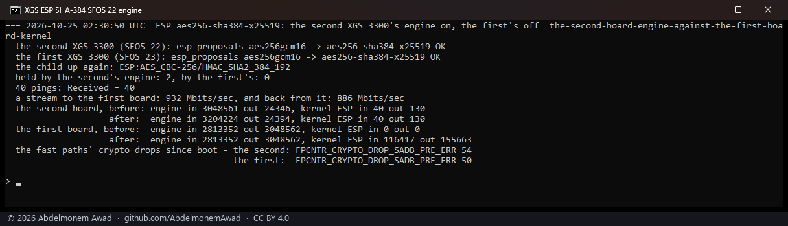
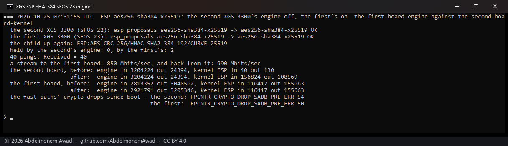
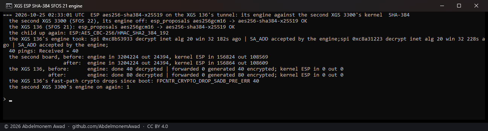
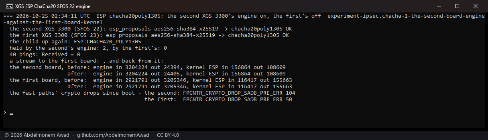
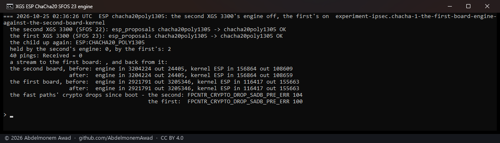
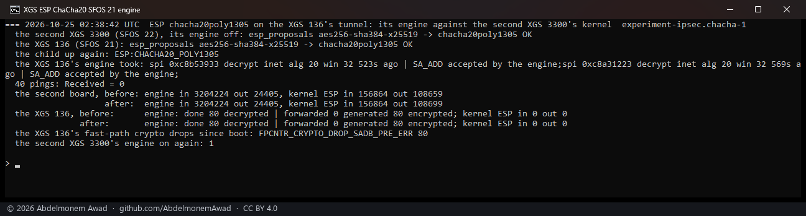

<!-- reviewed: 2026-10-25 -->
# The ciphers nobody had tried: SHA-384 taken, ChaCha20 refused, 2026-10-25

Discovery 15 of [the discoveries](../findings/discoveries-2026-10-22.md#ciphers-nobody-has-tried).
The engine's cipher list names ChaCha20, AES with no encryption (GMAC), counter mode and 3DES besides
what had been measured, and SHA-384 had not been run. What decided which to try: OPNsense's IPsec
page offers ESP proposals with SHA-384 and ChaCha20-Poly1305, and none with GMAC or AES-CTR - so an
owner can choose the first two and not the others - and the vendor's own host
(`generate_usfp_control`) offloads AES-CBC with an HMAC, AES-GCM and AES-GMAC, never ChaCha20, CTR
or 3DES.

Each was run on a lab tunnel with one end's engine against the other end's kernel - FreeBSD's own
cipher, the reference - so a packet that arrives proves the engine did the standard thing: the
tunnel between the two XGS 3300s, each end's engine in turn (`dev.octep.0.ipsec.on` choosing which
takes the associations), and the XGS 136's tunnel to the second XGS 3300 with the XGS 136's engine.
The child's proposal was set on both ends as the IPsec Connections page saves it, the child brought
up again, and 40 pings and a stream each way sent through it (`images/deploy/lab-cipher.sh`,
`lab-cipher-136.sh`). The first runs, in the tables, with octep.ko `e9241bfd` and npuep.ko
`590205fb`, main's after #762; the pictures with `1f069cf7` and `23d1c2dc`, main of that hour with
the ChaCha20 experiment below added - off unless asked for, and not kept.

## SHA-384: taken, on all three versions

Both drivers already offered an AES-CBC association with HMAC-SHA-384 to the engine - the vendor's
`CRYPTO_HASH_SHA384_192`, a 24-byte ICV - and it had never run.

| the engine | against | 40 pings | the engine decrypted / encrypted, the kernel the other side of each | streams |
|---|---|---|---|---|
| second XGS 3300, vendor version 22 | the first's kernel | 40 | 154,606 in, the stream to the first board in its fast path | 932 / 886 Mbit/s |
| first XGS 3300, vendor version 23 | the second's kernel | 40 | 110,873 / 159,166, the kernel's counts the same | 850 / 990 Mbit/s |
| XGS 136, vendor version 21 | the second XGS 3300's kernel | 40 | 40 / 40, the kernel's the same | - |

The streams are the kernel's rate, which does the other end in software; with both XGS 3300s'
engines, an earlier run of the same proposal carried 9.80 Gbit/s one way and 3.13 the other, the
kernels idle. The figures in the table are from the runs before the pictures; the pictures' own
agree.

## ChaCha20-Poly1305: refused by the datapath, on all three versions

Neither driver offered it. As an experiment, both were given it behind a switch, off by default
(`ipsec.chacha`): laid out as AES-GCM is - a 32-byte key with the salt after it, an 8-byte IV, a
16-byte ICV, the trailer padded to 4, RFC 7634's sizes - with the engine's `CRYPTO_CIPHER_CHACHA20`
and `CRYPTO_HASH_POLY1305_128`. Every engine took the association (`SA_ADD` answered 0), and every
engine then dropped every frame of it.

| the engine | sending | receiving |
|---|---|---|
| second XGS 3300, vendor version 22 | 4 pings, 4 dropped (`TX_DROP`, `CRYPTO_DROP_SADB_PRE_ERR`), nothing on the wire | - |
| first XGS 3300, vendor version 23 | - | 50 frames from the kernel, 50 dropped (`CRYPTO_DROP_SADB_PRE_ERR`, index 127 on vendor version 23's list) |
| XGS 136, vendor version 21 | - | 40 frames from the kernel, 40 dropped (`CRYPTO_DROP_SADB_PRE_ERR`) |

The same proposal between the two kernels, both drivers declining it, ran at 1.72 and 2.06 Gbit/s.
So the cipher's name is in the list and the request is accepted, but the datapath refuses an
association with it before any crypto - whether for want of the cipher or of some other field the
layout does not set was not found. The experiment's code was not kept: ChaCha20-Poly1305 stays with
the kernel, as before.

By the way: the counter at 127 is the first of vendor version 23's derived names past its second inserted
counter seen to move, and it moved as vendor version 22's 125 does
([rpc-numbering.md](../families/rpc-numbering.md)).

## Not tried

- **AES-GMAC and AES-CTR**: OPNsense's page offers no proposal with either, so no owner's tunnel can
  ask for them. The vendor's host offloads GMAC; neither driver does.
- **3DES**: not offered with a modern proposal set, and never offloaded by the vendor's host.

## What it does not say

- The streams into the first XGS 3300 right after its tunnel's child was brought up were slow -
  325 Mbit/s in one run here - and every later one ran at 9.73 to 9.82 Gbit/s, as on
  [sa23-2026-10-25](sa23-2026-10-25.md): the first minute or so after an association is made is not
  yet understood.
