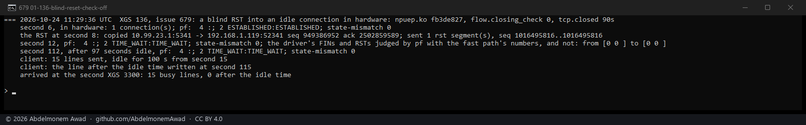
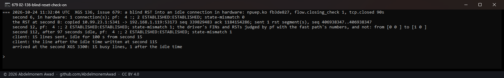
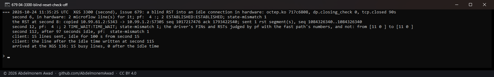
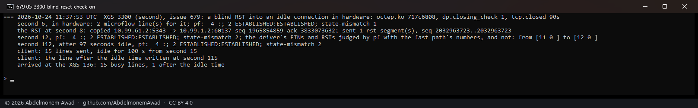
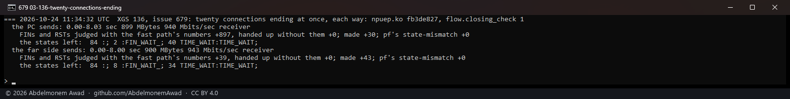

<!-- reviewed: 2026-10-24 -->
# A blind reset into a connection in hardware, judged by pf again, measured, 2026-10-24

Issue [679](https://github.com/AbdelmonemAwad/os-xgs-npu/issues/679), the part still open: a FIN or a
RST of a connection in hardware. The fast path hands every one to the host
(`TO_KN_TCP_FIN_SYN_RST`), and pf's state for a connection in hardware is sloppy - it no longer sees
the connection's segments, so it cannot judge their numbers - and a sloppy state takes a reset at its
word. **Measured on both appliances: a reset with its sequence number 64 MiB outside the window - what a
blind reset looks like - turned the connection's pf states to `TIME_WAIT`, and an idle connection was
dead a hundred seconds later**, its next line never arriving: a state in `TIME_WAIT` expires at
`tcp.closed`, 90 seconds after the connection's last frame, where an established one lasts a day.

Both drivers now hold such a frame, for a connection whose window the fast path checks, read the
connection's numbers from the fast path - `CONN_GET_FP_TCP_STATE`, which leaves it where it is, in
hardware or given back - give them to pf and clear the sloppy mark, as a take-back does
(`octep_pf_handback`, `npuep_pf_handback`), and hand the frame up: pf judges it as it judges any frame
of a connection it follows, and refuses a blind reset. Then the mark goes back on.
`dp.closing_check` and `flow.closing_check`, 1 by default; 0 hands the frame up at once, as before.

## A blind reset into an idle connection

One TCP connection, a line every second for 15 seconds - made in hardware - with a RST injected at
second 8 from the far end, as that end would send it but with the sequence 64 MiB ahead
(`images/deploy/tcp-inject.py`, by BPF, past its own pf); then 100 seconds idle; then one line more.
Read on the appliance in the middle: pf's states for the connection and its `state-mismatch` count; at
the far end, the lines that arrived.

- **XGS 136** (npuep.ko `fb3de827`): the bench PC through it to the second XGS 3300 behind its Port8
  (`images/deploy/lab-679-idle.sh`).
- **XGS 3300** (octep.ko `717c6808`): the PC on its F1 through it to the XGS 136, by VLAN 60 on its
  Port8 - the way to the XGS 136's own Port8 address is inside the lab's IPsec tunnel, whose
  connections are not checked by window (`images/deploy/lab-679-idle-3300.sh`). A VLAN connection in
  hardware, then (discovery 10).

| | the check | pf's states after the RST | `state-mismatch` | after 97 seconds idle | the line after the idle time |
|---|---|---|---|---|---|
| XGS 136 | 0, as before | `TIME_WAIT` | +0 | `TIME_WAIT`, expiring | **never arrived** |
| XGS 136 | 1 | `ESTABLISHED` | **+1**, the RST refused | `ESTABLISHED` | arrived |
| XGS 3300 | 0, as before | `TIME_WAIT` | +0 | **gone** | **never arrived** |
| XGS 3300 | 1 | `ESTABLISHED` | **+1**, the RST refused | `ESTABLISHED` | arrived |

With a stream running instead of an idle connection (`images/deploy/lab-679-rst.sh`, npuep.ko
`4ee1d061`, before the change): the same `TIME_WAIT` after the RST, and the stream went on for its 130
seconds - the driver gives pf what the coprocessor carried, which keeps a state from expiring while the
connection moves. It is the connection that goes quiet that ends.

## Twenty connections ending at once

FINs and RSTs come in bursts: twenty iperf3 connections through the XGS 136 ending together sent the
host 919 of them in the first build, most of them resets answering data still on its way, and its
queue of 64 handed 411 up unjudged. The build measured reads the numbers once for each connection in
what is waiting and holds 256 (`images/deploy/lab-679-burst.sh`, npuep.ko `fb3de827`):

| | FINs and RSTs judged with the fast path's numbers | handed up without them | pf's `state-mismatch` | the streams |
|---|---|---|---|---|
| the PC sends | 897 | 0 | +0 | 940 Mbit/s, ended, the states closing |
| the far side sends | 39 | 0 | +0 | 943 Mbit/s, ended, the states closing |

No legitimate FIN or RST was refused: `state-mismatch` did not move, and every connection's states went
to `FIN_WAIT` and `TIME_WAIT` as they end.

## What it does not cover

- **A connection the fast path has given back and the driver revived** goes back unchecked
  (`tcp_revive` 0, as [tcp-window-2026-10-22.md](tcp-window-2026-10-22.md) says), and the hold is for a
  connection whose window is checked - so its FINs and RSTs go up as before, to a sloppy state. On a
  busy link that is much of a long connection's life. Whether the fast path's numbers for such a
  connection are good enough for pf to judge by is not measured; it stays open in 679.
- **A tunnel's connection** is not checked by window, and is not held.
- A frame that cannot wait - the queue full, the numbers not had - goes up as before and is counted
  (`dp.closing_passed`, `flow.closing_passed`).

## The instruments

- `dev.octep.0.dp.closing_check` and `dev.npuep.0.flow.closing_check`: 1, the default, holds a FIN or
  a RST of a connection in hardware whose window is checked until pf has the fast path's numbers; 0
  hands it up at once.
- `dp.closing_checked`, `flow.closing_checked`: FINs and RSTs pf judged with the fast path's numbers;
  `dp.closing_passed`, `flow.closing_passed`: those handed up without them.
- pf's own `state-mismatch` (`pfctl -si`) counts the ones it refused.
