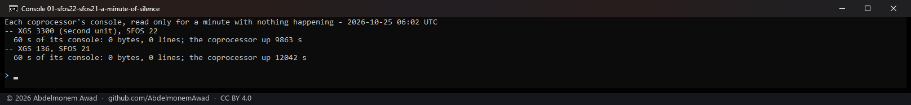
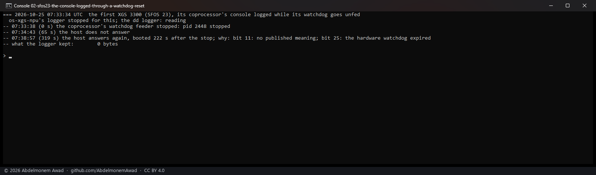
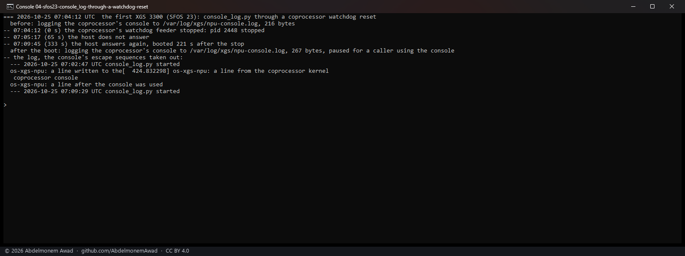
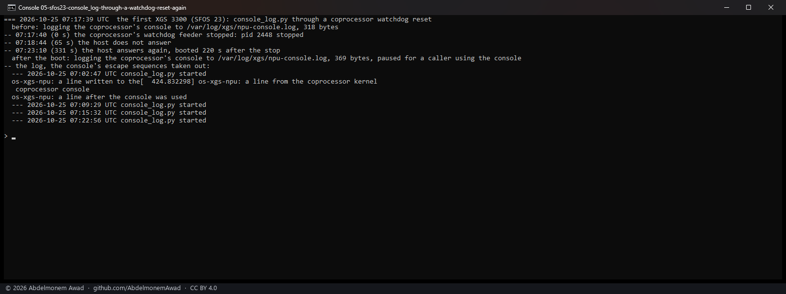
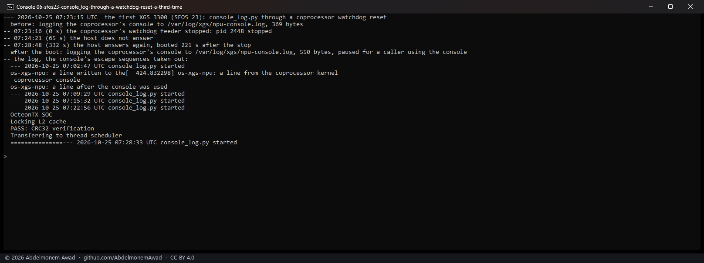

<!-- reviewed: 2026-10-27 -->
# A logger for the coprocessor's console, built and measured, 2026-10-25

Discovery 27 of [the discoveries](../findings/discoveries-2026-10-22.md#a-logger-for-the-coprocessors-console).
The vendor's board package keeps everything the coprocessor prints on its console in a file, "to
catch NPU crashes" (`xgs-npu-serial-logger.sh`: it reads the console's serial port and appends each
line). os-xgs-npu used the console only to send commands, so what the coprocessor said when it failed
was lost ([454](https://github.com/AbdelmonemAwad/os-xgs-npu/issues/454),
[768](https://github.com/AbdelmonemAwad/os-xgs-npu/issues/768)). Measured on the second XGS 3300 (vendor version
22's coprocessor software), the first (vendor version 23) and the XGS 136 (vendor version 21), with octep.ko
`6cde3fde`, npuep.ko `590205fb` and the scripts of this change
(`images/deploy/lab-console-idle.sh`, `lab-console-wdt.sh`, `lab-console-log-test.sh`,
`lab-console-log-wdt.sh`).

## What the console says

Nothing, while nothing happens: a minute of each console, read only, was 0 bytes. What it prints
comes when something does - the coprocessor's kernel messages, and its boot when it restarts.

## The logger: console_log.py

`scripts/xgs/console_log.py`, started by a start hook at every boot (`68-xgs-console-log`) and stopped
at an orderly shutdown (`06-xgs-console-log`), keeps the console in `/var/log/xgs/npu-console.log`
(the older half in `.1` past 1 MB). It never writes to the port: a byte sent there is a keystroke for
the coprocessor's boot firmware, whose menus and countdown take one. It holds the port under the lock
`npu-run.sh` already takes for the console, and gives both up within half a second when a caller
needs the console - `npu-run.sh` when the management link does not answer, `switch-jumbo.sh` at boot
- which leaves a pause file for the time it uses it. Each read is written at once with `O_SYNC`, and
the support bundle carries the last 256 KB of the file (`coprocessor-console.txt`,
[problem-reports.md](../problem-reports.md)).

**Corrected 2026-10-27:** neither installer named the script or its two hooks until
[#847](https://github.com/AbdelmonemAwad/os-xgs-npu/pull/847), so no update and no ready-made image set the
logger up: the three boards measured here had the files by hand, and a support bundle from any other
appliance carried no `coprocessor-console.txt`. Since #847 `install.sh` installs and starts it.

On all three it started, kept a line written to the coprocessor's `/dev/console` and a line from its
kernel, stood aside for `npu-run.sh` over the console - answered in 26 to 27 s, as the console always
takes - and read again after it. Its start hook started it at the boot of each board, and on the
second XGS 3300 and the XGS 136 the switch's frame limit was set at the same boot as before, beside it.

## Across the second XGS 3300's own reboot

In forty minutes it kept what nothing else on the host had: the coprocessor's kernel reporting one of
its 10 Gbit/s ports down and up - five times, each at a time the first XGS 3300 at the other end of a
cable restarted - and it went on doing so after the board's own reboot.

## Through a coprocessor reset

When the first XGS 3300's coprocessor is reset by its own watchdog, its host freezes and is restarted
by its own watchdog 220 s later ([copro-health-2026-10-25](copro-health-2026-10-25.md)). Whatever a
logger has on the disk by the freeze is all that is left; so the reset was made ten times, with three
loggers.

| the logger | runs | what was on the disk after the freeze |
|---|---|---|
| dd reading the port, `oflag=sync` - the vendor's way, done to the disk at once | 4 | 512, 512, 512 and 0 bytes of the coprocessor's boot stub |
| `cat` into `dd` - the first version of this logger | 1 | 0: `dd` waits for a whole block from a pipe, and a frozen host never ends it |
| `console_log.py` | 5 | about 700 bytes - up to "Press 'B' within 5 seconds for boot menu" - then 0, 0, 0 and 130 |

What it kept, when it kept anything, was the coprocessor's boot stub beginning again - `OcteonTX SOC`,
`OcteonTX Boot Stub`, its firmware's version and board - so the coprocessor itself had reset at 60 s,
and printed nothing before it. The host froze within tens of milliseconds of that: a logger keeps the
first lines of such a reset in about half the runs, and what the coprocessor prints while the host
stands - as the port messages above - in full.

## What it does not say

- The XGS 136's coprocessor reset was not tried: its host is reached only through the coprocessor's
  own ports on this bench, so a frozen one could not be reached ([copro-health-2026-10-25](copro-health-2026-10-25.md)).
- The coprocessor's boot at a cold start of the appliance is over before the logger starts with the
  host's start hooks; it is the restarts on its own that the logger sees.
