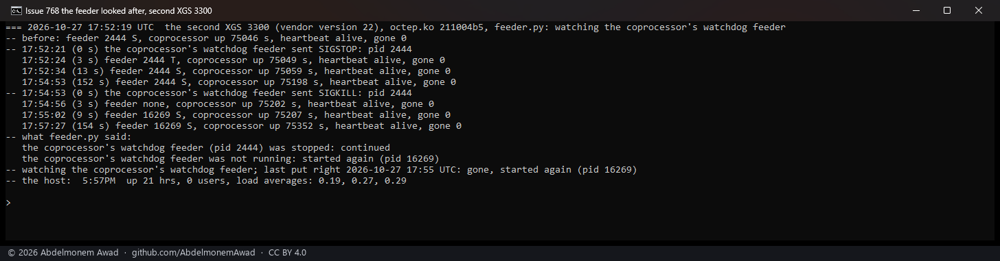

<!-- reviewed: 2026-10-27 -->
# The coprocessor's watchdog feeder, looked after from the host, 2026-10-27

[768](https://github.com/AbdelmonemAwad/os-xgs-npu/issues/768): the coprocessor feeds its own hardware
watchdog from busybox's `watchdog -t 5 /dev/watchdog`, which its init script `S15watchdog` starts - the
same on vendor versions 21, 22 and 23, read on all three boards. Stopping that one process while
everything else on the coprocessor ran made the first XGS 3300's host freeze in the coprocessor's reset
a minute later, every time, until the host's own watchdog restarted the appliance. Two runs on the first
XGS 3300 (vendor version 23): what its host did in the minute before it froze, and the same stop with
`scripts/xgs/feeder.py` running.

## What the host does before it freezes

`images/deploy/lab-768-storm.sh`, the driver as the appliance runs it (octep.ko `54a32be8`): the feeder
stopped with SIGSTOP, as in every run before, and a logger on the host writing a line every half second,
synced to the disk so that it outlives a freeze - the octep vectors' interrupts in that half second, where
the processors' time went, and the driver's heartbeat and gone latch, both held in memory and read without
touching the device.

The host was idle to the end: 0 to 4 octep interrupts a half second, its processors 97 to 100 % idle but
for one half second at 42 %, the heartbeat alive and the latch never set. Its last line was written 57 s
after the stop, about when the coprocessor's watchdog reset the coprocessor; the PC had its last answer at
56 s and none at 62 s. The host booted again at 17:05:43, 217 s after the stop, and its chipset recorded the
reset as the hardware watchdog expiring (FCH `S5_RESET_STATUS` bit 25), as in every run before.

So it is not an interrupt storm, and not a host the reset made busy: everything stopped within half a second.
That fits one access of the device that never completes. With the driver unloaded the host had not frozen
at all ([2026-10-26](https://github.com/AbdelmonemAwad/os-xgs-npu/issues/768)), and the root port above the
coprocessor has its completion timeout on, at 260 to 900 ms (Device Control 2 `0x29`) - the host still did
not come back.

## The same stop, with the feeder looked after

`scripts/xgs/feeder.py` asks the coprocessor every 20 s, through `npu-run.sh`, for its uptime and its
feeder's state. A stopped feeder is sent SIGCONT; a missing one, or a zombie, is started again by the
coprocessor's own `/etc/init.d/S15watchdog start`; each is said in the system log (`xgs-feeder`). A
coprocessor up for less than two minutes is left to its init, and one that does not answer at all is left
to its own watchdog. `images/deploy/lab-768-feeder.sh`, the same appliance with this change installed by
`install.sh`, the driver as its 17:05 boot loaded it (the photograph's header reads `211004b5`, the
module the install put in place for the next boot, built from the same source): the feeder stopped with SIGSTOP and, once it was running again, killed with SIGKILL; every 3 s
the feeder's state on the coprocessor, the coprocessor's uptime - a reset would start it from nought - and
the host's heartbeat.

- **Stopped.** The feeder was in state T 3 s after the SIGSTOP and running again at 23 s, `feeder.py`
  having sent it SIGCONT. The coprocessor's uptime went on from 1,825 s to 1,976 s over the next 150 s:
  no reset, where every run before reset it at about 60 s. The heartbeat stayed alive and the host answered
  throughout.
- **Killed.** No feeder 3 s after the SIGKILL; `feeder.py` had started a new one (pid 4968) by 18 s.
  The coprocessor's uptime went on from 1,980 s to 2,128 s: no reset again. The host was never restarted:
  it had been up 35 minutes at the end, since the reset of the run above.

## On vendor versions 22 and 21

The same run on the second XGS 3300 (vendor version 22) and on the XGS 136 (vendor version 21), each with
this change installed by `install.sh` (`images/deploy/lab-768-feeder-new.sh`, `lab-768-feeder-136.sh`). The
XGS 136 reports its heartbeat's deaths where the XGS 3300 has its gone latch.

- **The second XGS 3300:** stopped, running again at 13 s; killed, a new one running at 9 s; the
  coprocessor's uptime from 75,046 s to 75,352 s - no reset - and the host up throughout.
- **The XGS 136:** stopped, running again at 16 s; killed, a new one running at 12 s. The coprocessor's
  uptime ran from 584 s to 885 s - no reset - and its heartbeat never died. From 15 s to 82 s after the kill
  the PC's looks went unanswered at times: the PC reaches the XGS 136 through its Port3, and the XGS 136's
  log has that port's carrier going down at 18:04:15 and again at 18:04:59, and coming back each time - the
  bench's own link, which has also come down to 100 Mbit/s since 2026-10-24, not the coprocessor. Those
  lines filled the photograph's window, so its first half - the stop - is in the run's log only.

## What remains

A coprocessor reset the host does not see coming still freezes an XGS 3300's host: a coprocessor whose
Linux panics and restarts at once, or hangs so that neither its management link nor its console answers -
its own watchdog then resets it, rightly, and `feeder.py` leaves it alone. On the XGS 136 the PCIe link
goes down with its coprocessor, every read answers all ones at once, and the driver takes the coprocessor up
again. [768](https://github.com/AbdelmonemAwad/os-xgs-npu/issues/768) stays open for the XGS 3300's.
