<!-- reviewed: 2026-11-02 -->
# A coprocessor's reset seen coming, or slowed down, 2026-11-02

[768](https://github.com/AbdelmonemAwad/os-xgs-npu/issues/768): an XGS 3300's host does not come back
when its coprocessor is reset under the loaded driver. Since [2026-10-27](coprocessor-feeder-2026-10-27.md)
`feeder.py` keeps the coprocessor's watchdog fed; what was left is a coprocessor whose Linux stops some
other way. The runs below, on the lab's two XGS 3300s (vendor versions 23 and 22) and its XGS 136 (vendor
version 21), all on 2026-11-02 (UTC): what does not keep the host up; a watch in `feeder.py` that sees a
hanging Linux coming and has octep stop touching the coprocessor first (`dev.octep.0.quiesce`), and the
false alarm its first form raised; and a coprocessor's panic, whose restart froze the host until
`feeder.py` had the coprocessor wait 60 s after it.

## What does not keep the host up

The coprocessor's watchdog feeder stopped on purpose (SIGSTOP), so that its own watchdog resets it about
a minute later, as in #768's first runs - and two changes on the host's side that might have carried the
host across that reset. Each was measured first on the first XGS 3300 (16:56 and 17:03-17:08 UTC, from Git
Bash, not photographed) and then photographed on the second; `feeder.py` was stopped for them, and the
host's logger ran as below (`images/deploy/lab-768-cto.sh`, `lab-768-busmaster2.sh`).

- **The root port's completion timeout at 1 to 10 ms**, from the 260 to 900 ms it is set to (Device
  Control 2 of the port above the coprocessor, 0x0029 to 0x0022), and its CRS Software Visibility on (Root
  Control 0x0010). The host still froze when the coprocessor reset: on the second XGS 3300 its logger's
  last line 61.2 s after the stop, on the first the host gone between 58 and 64 s; the hardware watchdog
  restarted it (bit 25 of the reset record), and the port's registers were back to 0x0029 after the boot.
- **The coprocessor's bus mastering off** 45 to 47 s after the stop (its Command register 0x0406 to 0x0402), so
  that nothing it writes reaches the host's memory across the reset. The host still froze - at the reset,
  not at the write: on the first XGS 3300 its logger's last line at 58.9 s, as the coprocessor's console
  began its boot; on the second at 62.8 s, the console's log growing in that last half second. The second
  is reached by the PC through its coprocessor, so the write's own answer could not come back: the PC lost
  the host within seconds of it, while its logger ran on for 15 s.

So what keeps the host up is the driver not touching the coprocessor across the reset at all - the gone
latch set before it. The sections below are about setting it in time.

## A Linux that hangs, seen coming

When the coprocessor's Linux hangs, its watchdog resets it about a minute later - with the PCIe link up,
the reset that freezes the host. Before that, its end of the management link and its console go silent
while its fast path still answers. So `feeder.py` sends one echo request every two seconds to the
coprocessor's end of the management link (`169.254.254.2`). Once that has been silent for 30 s - after it
had answered for two minutes without a gap, no recovery running (`recover.sh`'s lock), the fast path's
heartbeat alive and the driver not yet gone - the console is asked alone. A console that answers means the
link alone is down, and nothing is done; one held by another caller is asked again at the next look; one
that is silent too means the Linux has stopped, and octep is told through `dev.octep.0.quiesce` to set its
gone latch: nothing more is read from the coprocessor or written to it. The stop that follows is taken up
again in place by `fastpath.py`, as any other is. The test (`images/deploy/lab-768-silent.sh`) stops the
coprocessor's getty and its watchdog feeder and takes its end of the management link down, its fast path
running on; a logger on the host writes a line synced to the disk every half second.

- **The first XGS 3300** (vendor version 23): octep told 46 s after the stop, the coprocessor's own
  watchdog resetting it, taken up again in place in 145 s; the host up throughout - its logger's 773
  lines over 421 s, no gap over 3.7 s. Two runs before it, not photographed (they ran from Git Bash):
  17:39, octep told by 40 s, and 18:21, at 36 s and taken up in place in 155 s.
- **The second XGS 3300** (vendor version 22): octep told 38 s after the stop, taken up again in place in
  236 s, the host up throughout - 777 lines over 423 s. Its logger's lines came 3.4 to 3.8 s apart for a
  minute, 114 to 173 s in, while the driver attached the device again; every half second otherwise. The PC
  reaches this appliance through its coprocessor, so it had no answer while that was down.

The coprocessor resets about a minute after its Linux stops: octep was told 34 to 46 s after the stop in
every run.

## Its false alarm, and two minutes of steady link

The watch's first form acted on the first silence after any answer. On the second XGS 3300 at 17:53 UTC
the stop was seen and taken up in place by 17:56:31 - and then, right after the recovery, the link answered
once (17:56:32) and went quiet while OPNsense set its interfaces up again, and the console, which drops
characters in the first minutes of a boot, did not answer either: at 17:57:10 a healthy coprocessor was
taken as stopped. Its driver let go of it while OPNsense was still configuring its ports, configd then
stalled two minutes a port ([984](https://github.com/AbdelmonemAwad/os-xgs-npu/issues/984)), `recover.sh` -
its lines lost ([985](https://github.com/AbdelmonemAwad/os-xgs-npu/issues/985)) - was stopped at
`fastpath.py`'s 900 s, and the appliance was restarted (the postmortem:
[986](https://github.com/AbdelmonemAwad/os-xgs-npu/issues/986)). So the watch acts only on a link that had
answered for two minutes without a gap, never while `recover.sh` runs, and asks a busy console again. With
that, the runs above: one alarm each, none after the recovery.

The other side of the two minutes, measured by mistake
([987](https://github.com/AbdelmonemAwad/os-xgs-npu/issues/987)): the second XGS 3300's coprocessor stopped
42 s after `feeder.py` was restarted, so the watch did nothing, as built - and the host froze, its logger's
last line 60.9 s after the stop, its hardware watchdog restarting it. A Linux that stops in the watch's
first two minutes - after a boot, a recovery, or a restart of `feeder.py` - is not seen coming.

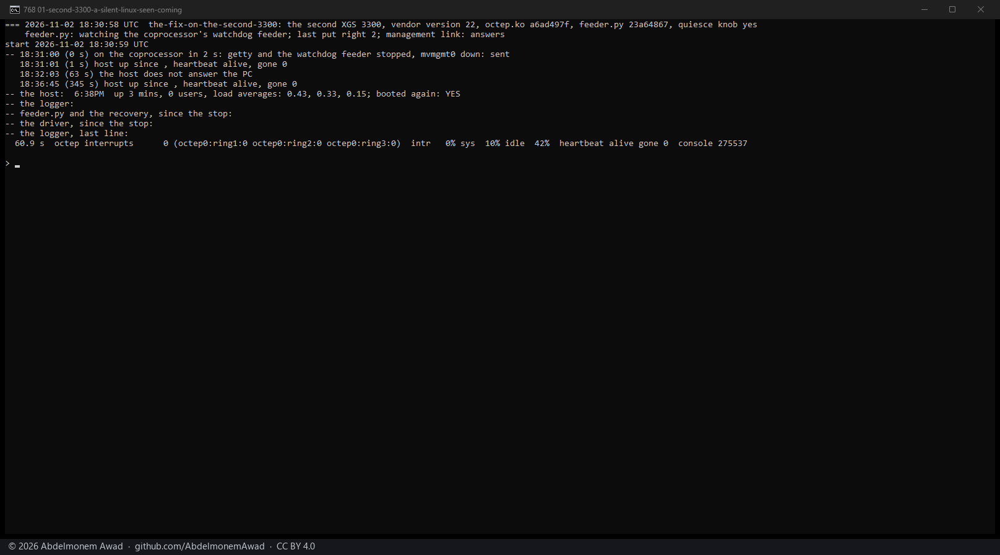

## On the XGS 136

The XGS 136's link goes down with its coprocessor, and its driver has no `quiesce`: the watch leaves it
alone, and its own way takes over - the driver taking the coprocessor as gone once its reads stop making
sense (19:13:27: "the notification producer read out of range"), and `recover.sh` taking it up again in place, 87 s and 88 s in two runs.

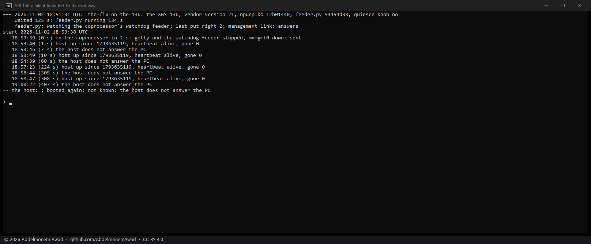

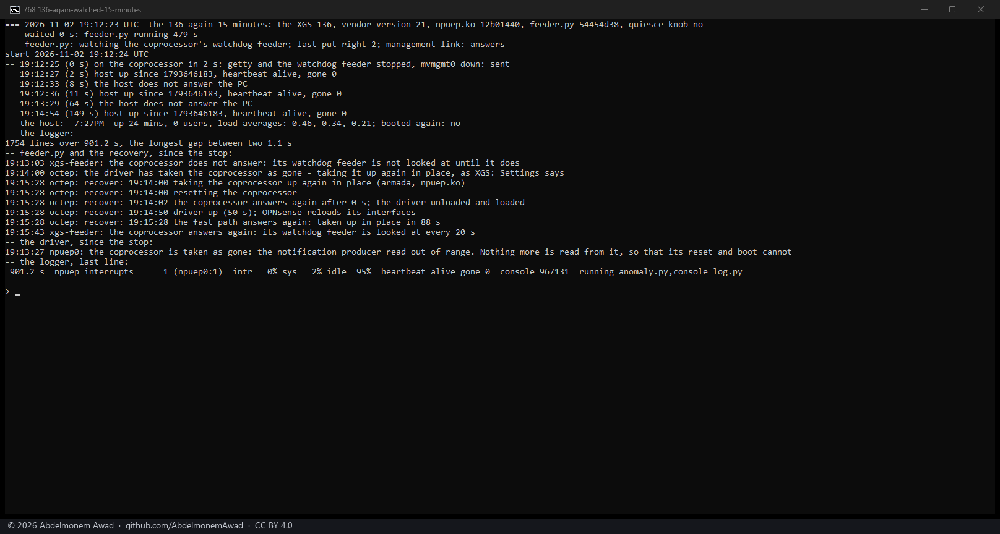

In the first run its host stopped at 19:00:17, about two and a half minutes after the coprocessor had been
taken up again in place, and its hardware watchdog restarted it - not part of the test, and not explained:
[988](https://github.com/AbdelmonemAwad/os-xgs-npu/issues/988). The second run, watched for 15 minutes
through the next cron jobs, had no such stop.

## A panic, slowed down

A panic is the reset no watch can see coming: the coprocessor's kernel restarts one second after it (its
`kernel.panic` is 1). The test (`images/deploy/lab-768-panic2.sh`) panics it through its console - `echo c >
/proc/sysrq-trigger`, the panic any fault of its kernel ends in - once it has been up four minutes, with
`debug.debugger_on_panic` set to 0 on the host first, so that a panic of the host itself would write a dump
and restart instead of waiting in its debugger. The host's logger runs as above.

- **The first XGS 3300.** The first try left the host up (17:16, run from Git Bash and not photographed:
  the gone latch set 17 s in by a read that answered all ones, the coprocessor taken up again in place).
  The next four froze it - 19:36, 19:51, 19:57 and 20:10 - each within a second of the coprocessor's
  "Rebooting in 1 seconds": the logger's last line 3 to 7 s after the start, the hardware watchdog
  restarting the host (bit 25 of the reset record), and no dump - the host hung; its kernel did not panic.
  The watch played no part: at 20:10 `feeder.py` was stopped, and the management link's driver reads the
  device fifty times a second whether the watch's echo requests come or not. One more try, at 19:56,
  tested nothing: its coprocessor had been up only 111 s, and no panic followed - the test now waits for
  four minutes of uptime, and says so when no panic is seen. (The 19:57 try's window was closed before its
  photograph.)
- **The second XGS 3300.** One try, 20:28: frozen the same way, the logger's last line 6.7 s in.

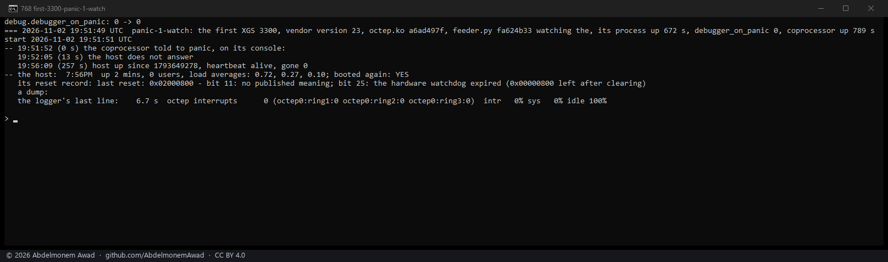

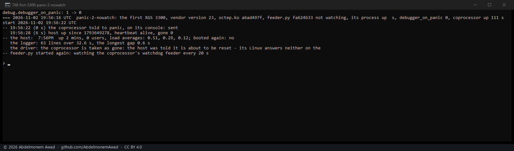

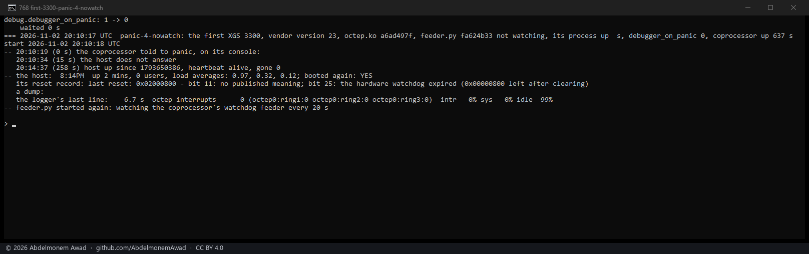

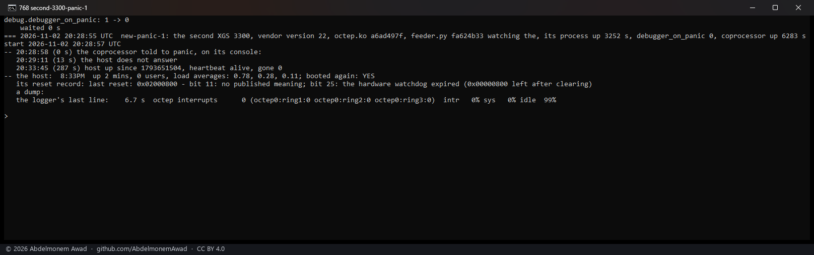

So the panic is slowed down instead. Told to wait 60 s after a panic (`echo 60 > /proc/sys/kernel/panic`),
the coprocessor's fast path stops with it, the heartbeat goes late and dies, and the driver takes it as
gone before the restart - 33 and 36 s after the panic on the first XGS 3300, whose host the PC can see
throughout; the coprocessor is then taken up again in place.
Four tries, the host up in all of them: two on the first XGS 3300 (20:17 and 20:23) and one on the second
(20:36) with the value set by hand, and one on the second (21:11) with `feeder.py` setting it, as each of
its looks now does - "the coprocessor would have restarted 1 s after a panic, before the driver lets go
of it: it waits 60 s now", its log said at 21:09:19, and the coprocessor read 60 after it.

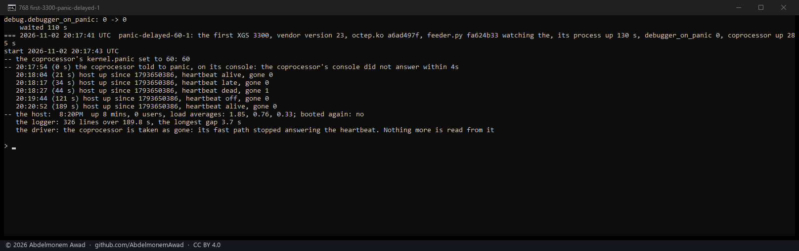

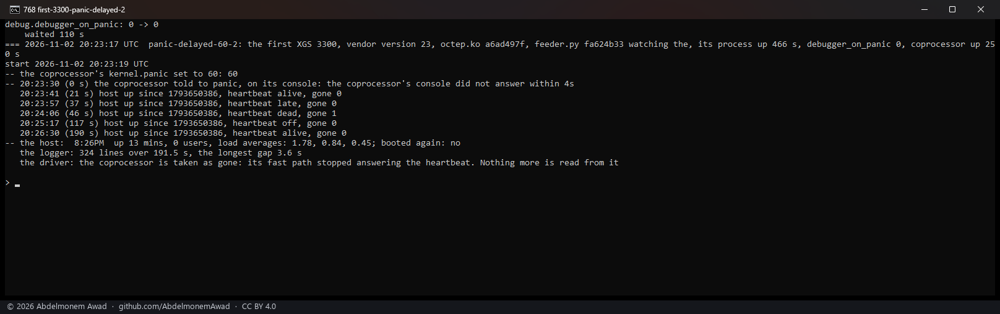

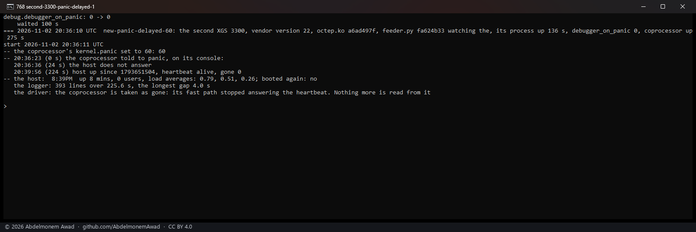

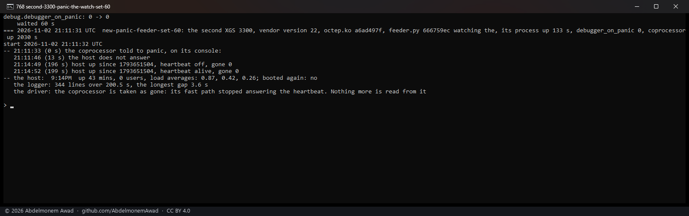

Only on the OCTEON TX family: the XGS 136's link goes down with its coprocessor, and its driver lets go at
once, so `feeder.py` leaves its panic timeout as it is.

## What remains

- A Linux that hangs, or panics, in the watch's first moments is not dealt with: a hang in its first two
  minutes, and a panic before its first look after the coprocessor boots.
- [984](https://github.com/AbdelmonemAwad/os-xgs-npu/issues/984), [985](https://github.com/AbdelmonemAwad/os-xgs-npu/issues/985)
  and [988](https://github.com/AbdelmonemAwad/os-xgs-npu/issues/988), above.
