<!-- reviewed: 2026-11-04 -->
# A coprocessor's reset and BAR2, and the guard that keeps the host up, 2026-11-04

[768](https://github.com/AbdelmonemAwad/os-xgs-npu/issues/768): an XGS 3300's host does not come back
when its coprocessor is reset under the loaded driver. Until now the answer was to see the reset coming -
[feeder.py's watch and octep's quiesce](coprocessor-quiesce-2026-11-02.md) - and a reset nothing
announced still froze the host. The runs below, on the lab's first XGS 3300 (vendor version 23) on
2026-11-04 (UTC), followed a read of the PCIe side, stage by stage, and found what hangs: **a read of BAR2
- the window into the coprocessor's own memory - made in its reset.** BAR0, its registers, goes on
answering through the reset, and its readiness register reads 0 from the reset on. So BAR2 is now read and
written only while BAR0's readiness register holds its magic
([1030](https://github.com/AbdelmonemAwad/os-xgs-npu/pull/1030)), and with that the host lived a reset
nothing announced, and a panic of the coprocessor's kernel that restarted it a second later - on both XGS
3300s, the second (vendor version 22) as well, the coprocessor taken up again in place each time.

Stages 0 to 1c ran a lab build of octep (not published) that adds one timed register read on request, a
sysctl that reads one register whatever the gone latch says, with interrupts off. In every stage octep was
quiesced first (`dev.octep.0.quiesce=1`), so that nothing else read the coprocessor, `feeder.py` was
stopped, and the coprocessor's own watchdog feeder was stopped over its console (SIGSTOP), so that its
watchdog reset it about 45 s later. Each stage's module was in place before its boot.

## The root port through the reset: nothing to see

Stage 0. The root port above the coprocessor (pci0:0:1:1, an AMD 1022:15d3) has no Downstream Port
Containment, no Surprise Down reporting and a slot that is not hot-plug capable; its completion timeout
was set to 260-900 ms; of its Slot Control's two interrupt enables only the data link layer's sticks, the
hot-plug one does not - so no interrupt on a link change can come from it. With octep unloaded, the port's
Link Status, Slot Status and AER registers were read ten times a second through the coprocessor's reset
and into its new boot: **2,769 reads in 300 s, and not one bit changed.** The link stayed up - and its
state-change, bandwidth and AER bits are latches, so not even a short flap went by. The host lived.

So the reset cannot be seen from the root port before a read is lost; it has to be seen from the device.

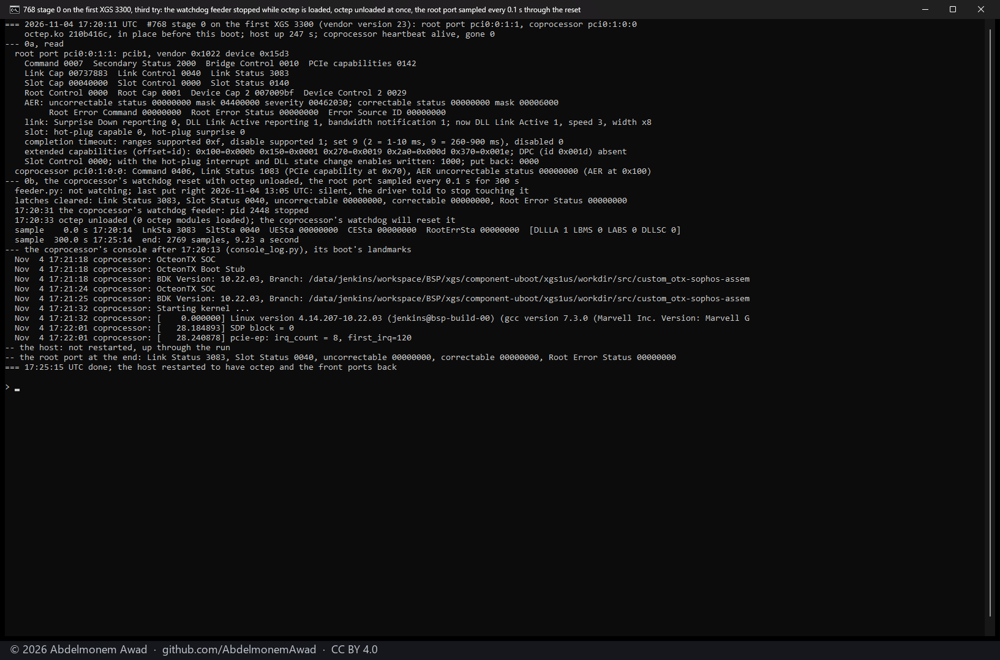

## What answers in the reset, and what does not

Stage 1, the root port's completion timeout at 1-10 ms: a healthy read of BAR0's readiness register gave
0x02000000abcdabcd in 1.4 us; read again 3 s after the coprocessor's console showed its new boot, it gave
**0, in 1.5 us**. The host lived. A read of the coprocessor's registers in its reset is answered.

Stage 1b, the same timeout: BAR0's readiness register and BAR2's barmap word read in turn, ten times a
second. 758 reads, 379 of each, healthy; 43.6 s after the stop BAR0 read 0 in 1.2 us, and **the next read - of
BAR2 - never came back.** The host stopped, and its hardware watchdog restarted it (reset record bit 25).
The completion timeout did not answer it.

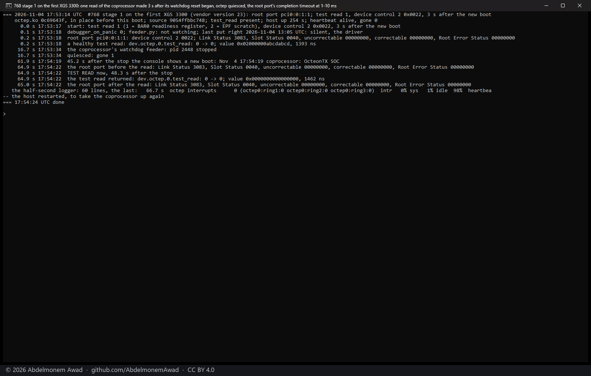

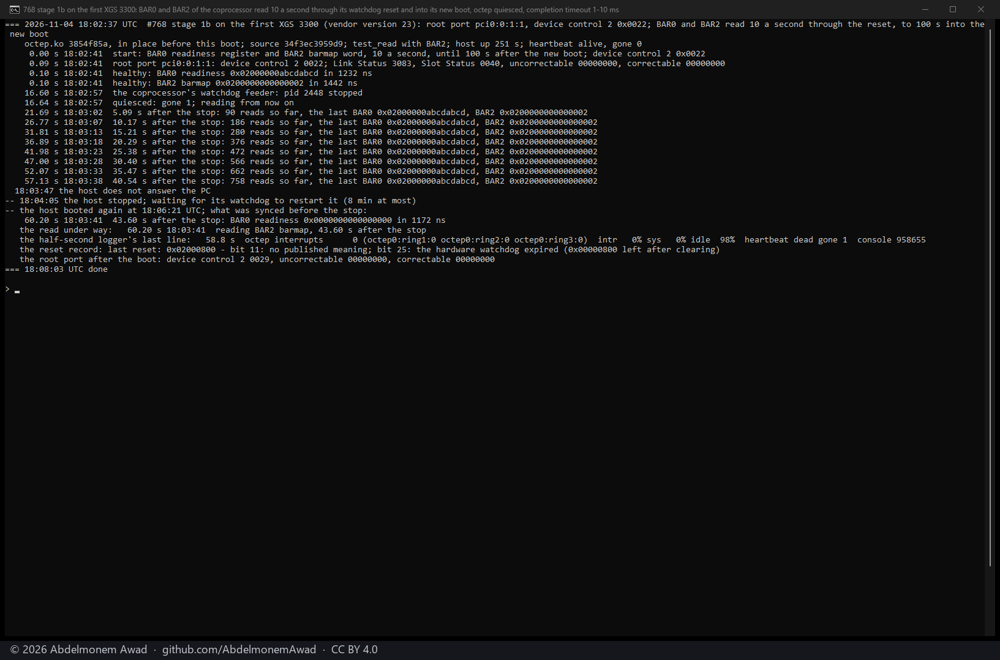

## BAR2 read only while BAR0 holds its magic

Stage 1c, three runs: the same reads, ten times a second through the reset and 100 s into the new boot,
but in the kernel BAR0's readiness register first and BAR2 a microsecond later only when BAR0 held its magic.
**3 of 3 lived.** In each, BAR0 said the reset 0.1-0.2 s before the coprocessor's console showed its new
boot; BAR2 was left alone about 415 times; the magic came back about 43 s later. In the 6 s after that,
BAR2 read 0 once and all ones once - each read coming back, in microseconds - and then healthy.

| run | BAR0 said reset, after the stop | the console's new boot | BAR2 left alone | the magic back | reads | the host |
|---|---|---|---|---|---|---|
| 1 | 45.13 s | 45.34 s | 414 | 88.12 s | 1,375 | lived |
| 2 | 46.37 s | 46.57 s | 415 | 89.41 s | 1,389 | lived |
| 3 | 47.16 s | 47.26 s | 415 | 90.09 s | 1,396 | lived |


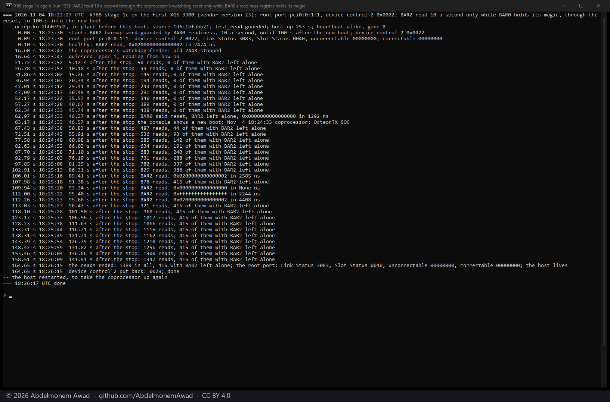


## The guard in octep, and the reset nothing announced

[1030](https://github.com/AbdelmonemAwad/os-xgs-npu/pull/1030) routes every runtime read and write of
BAR2 - the management rings, the network agent, the RPC rings, the doorbell, the probes - through
`octep_bar2_read8/read4/write8/write4`, which read BAR0's readiness register a microsecond before with
interrupts off and, without its magic, take the coprocessor as gone at once and leave BAR2 alone.

**U1**, with that octep (`8793cae7`) loaded and working - not quiesced - and `feeder.py` stopped, so that
nothing announced the reset and its watch did not act: the coprocessor's watchdog feeder stopped at
18:58:39; at 18:59:23 octep wrote "the coprocessor is taken as gone: its readiness register in BAR0 lost
its magic: it is being reset, and BAR2 is not touched in that"; its heartbeat stopped answering; at
19:00:00 the recovery took the coprocessor up again in place, its twelve ports and its heartbeat back at
19:01:32. **The host never restarted.** Before the guard this run stopped the host every time
(2026-10-26 to 11-02, 63-67 s after the stop). From the run's log:

```text
-- 18:58:39 (0 s) the coprocessor's watchdog feeder: pid 2448 stopped
   18:59:24 (62 s) heartbeat alive, gone 1
   18:59:50 (88 s) heartbeat dead, gone 1
   19:00:13 (111 s) heartbeat off, gone 0
   19:01:21 (179 s) heartbeat alive, gone 0
```

**U4**, the same, with `console_log.py` stopped too, so that nothing heard the panic: the coprocessor's
kernel made to panic (`echo c > /proc/sysrq-trigger`) with `kernel.panic` 1, so that it restarted a
second later - the case that froze the host 5 times of 6 on 2026-11-02. octep took the coprocessor as gone
from BAR0 at the restart, the host's half-second logger never missed more than 2.2 s, and **the host
lived.** The recovery began at 19:22:00 and was still waiting when the run ended, 5 min after the panic,
and restarted the host: it takes the coprocessor up in place only once the console's log shows the new
boot waiting for the host ("Waiting for USFP application to connect"), and that log is `console_log.py`'s,
stopped for the run. With `console_log.py` started again 5 s after the panic - after the restart, too late
to announce it - the second XGS 3300 went the whole way (below).

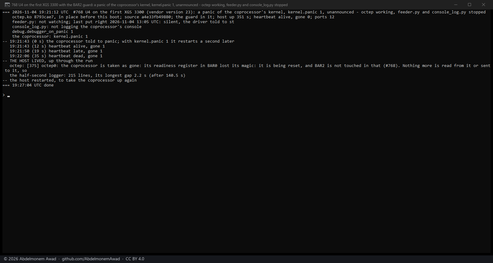

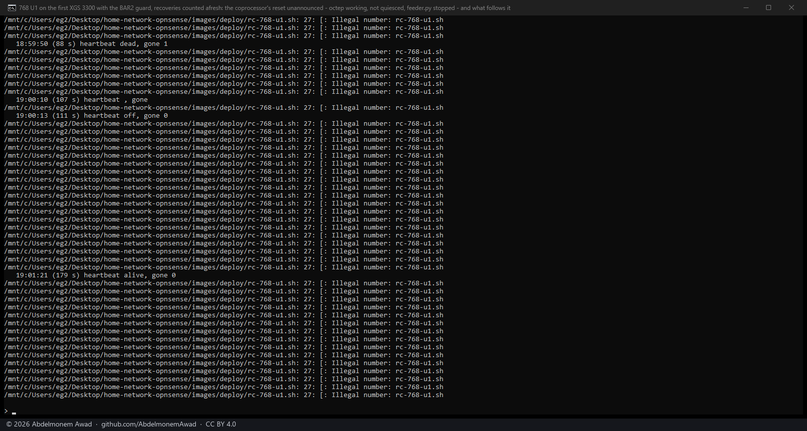

## The second XGS 3300 (vendor version 22)

Main with 1030 (`6217242`, octep `8793cae7`, the module of the first XGS 3300's runs) installed as an update
installs it, reached by its MGMT port - a port of the host's own - since the runs take octep's front ports
away; its IPsec associations up, so that its recovery detaches and attaches the device with the driver
loaded.

| run | what | octep | the coprocessor | the host |
|---|---|---|---|---|
| U1 | its watchdog feeder stopped, octep working, `feeder.py` stopped | gone from BAR0 at the reset (console: new boot 19:42:37) | taken up again in place, heartbeat alive 3 min 24 s after the stop | lived; the logger's longest gap 4.8 s, at the recovery's re-attach |
| U4 | a panic with `kernel.panic` 1, `feeder.py` and `console_log.py` stopped | gone from BAR0 at the restart | the recovery waiting on the console's log, as on the first | lived; longest gap 2.1 s |
| U4, the recovery too | the same, `console_log.py` started again 5 s after the panic | gone from BAR0 at the restart | taken up again in place, heartbeat alive 168 s after the panic | lived; it never restarted (its boot 20:00:16, the panic 20:06) |

`install/verify.sh` after a boot on it: 8 passed, 0 failed, its sixteen front ports there; the fourteen
data sources of the XGS pages: fourteen of fourteen.

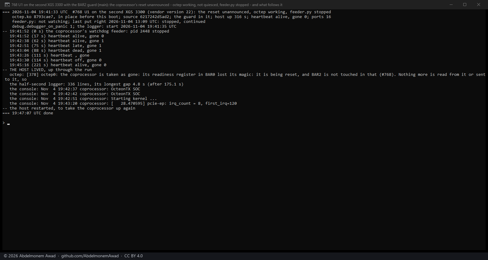

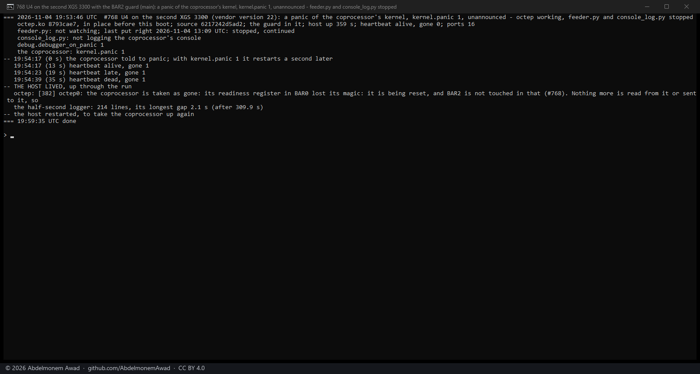

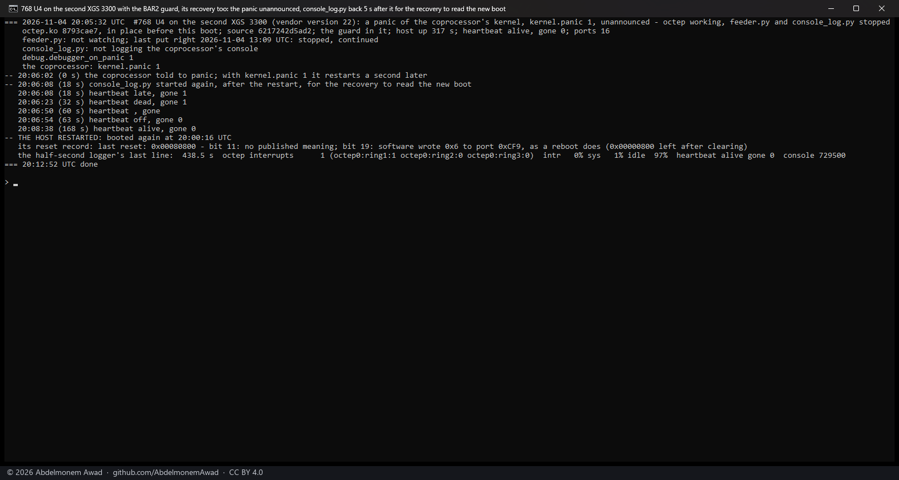

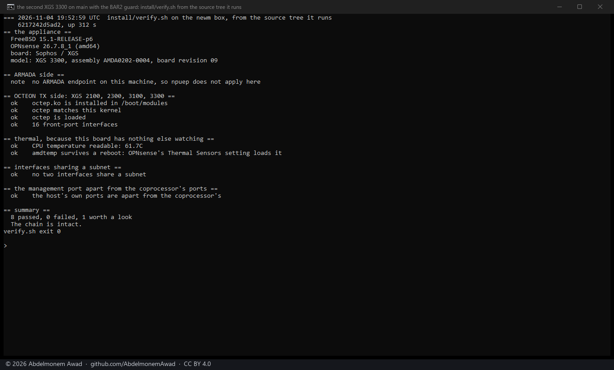

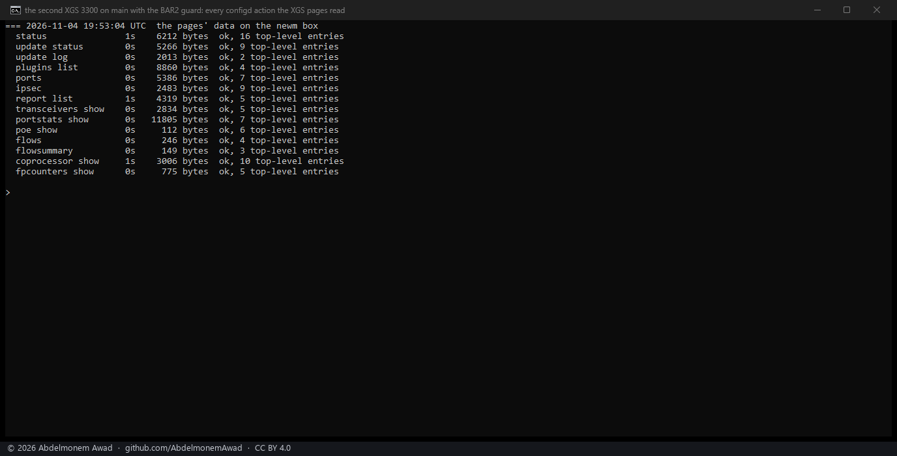

## Ordinary use with the guard

As RELEASING.md asks after a driver change, on the first XGS 3300 with 1030's octep: `install/verify.sh`
8 passed, 0 failed; traffic through octep on the soak's path, one stream 1,981-2,486 Mbit/s and four
8,415-9,443 Mbit/s, no gone, no receive watchdog stall; `contrib/octep/test-detach-refusal.sh` exit 0;
`contrib/octep/test-stop-writes.sh` with frames arriving, 3,423 words written in the second before the
rings stopped and none after, exit 0; the fourteen data sources the XGS pages read, all answered in a
second or less five minutes after a start. Each BAR2 access now costs one more read of BAR0, about 1.2 us.

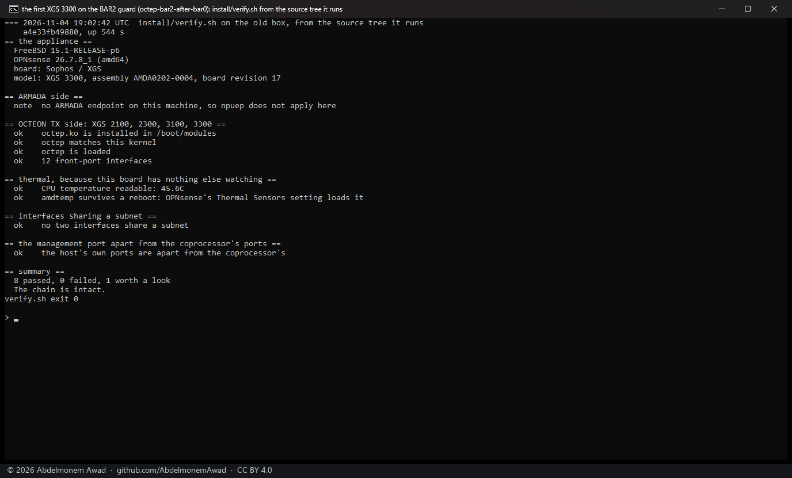

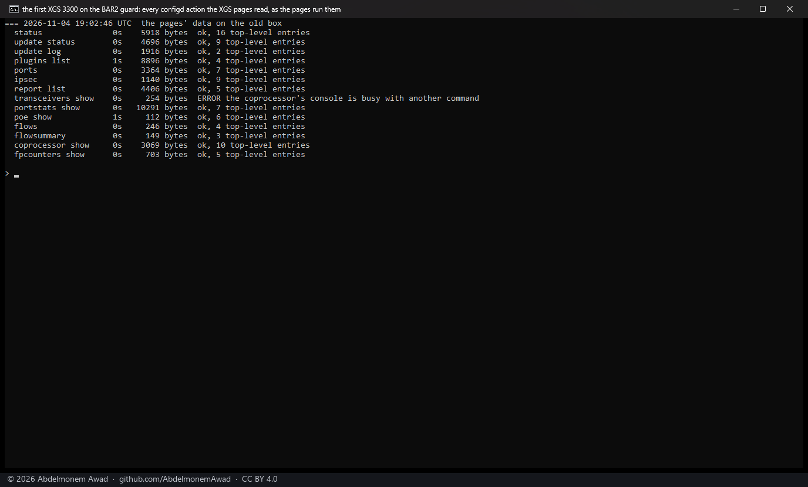

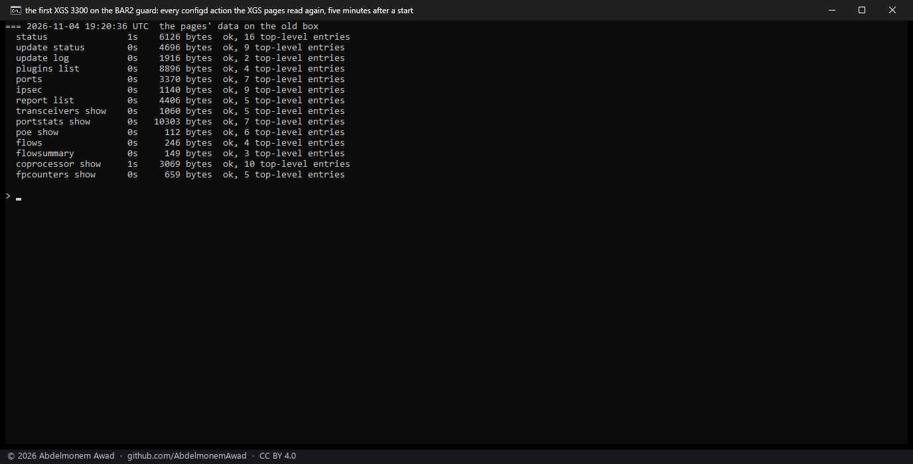

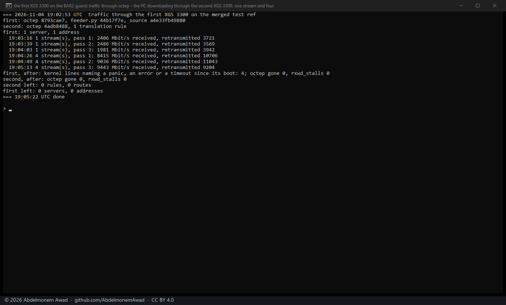

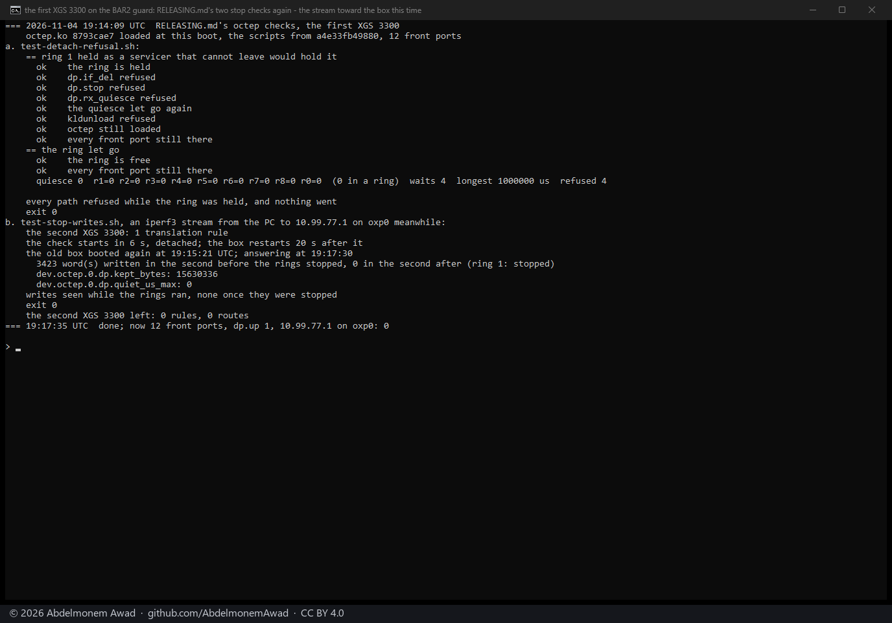

[1032](https://github.com/AbdelmonemAwad/os-xgs-npu/pull/1032) then corrected the comments these runs
proved wrong - comments only, but the module's lock calls carry their line numbers, so it was built on the
first XGS 3300 too: `install/verify.sh` 8 passed, 0 failed.

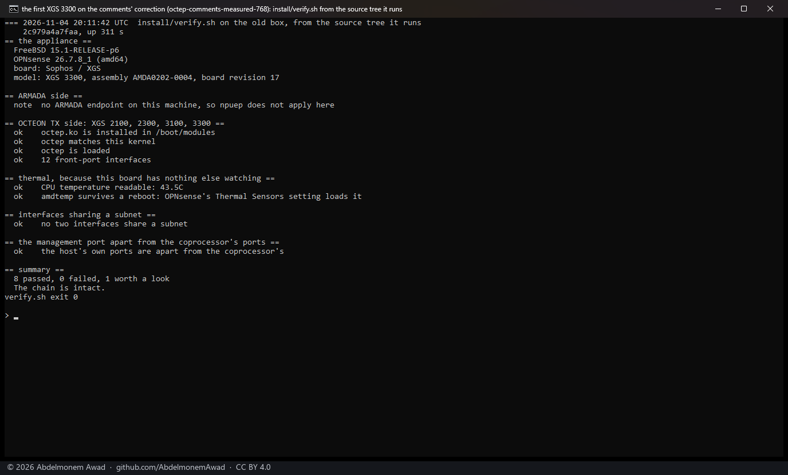

## BAR2 read about eighty thousand times a second through the reset

Stage 1e, how close to the reset a read of BAR2 still comes back: main with 1030 and the lab build's
loop in the kernel, which reads BAR0's readiness register and, while it holds its magic, BAR2's barmap
word, every 10 us with interrupts off for each pair; octep **not** quiesced - its own BAR2 accesses
guarded by 1030 - and `feeder.py` stopped. The coprocessor's watchdog feeder stopped at 20:24:20, the
loop from 25 s after it for 40 s, through the reset (its console's new boot at 20:25:09):
**1,543,886 pairs read while BAR0 held its magic, then 2,063,070 reads of BAR0 with BAR2 left alone;
the last BAR2 read came back 10 us before the first BAR0 read without the magic**, the slowest BAR2 read
took 8 us, octep's own guard took the coprocessor as gone, the root port logged nothing, and **the host
lived**. At the loop's grain - a pair about every 12.6 us - BAR0 lost its magic before BAR2 stopped
answering. One run. The box's own record (its screen lost the last lines - see the corrections):

```text
 42.54 s 20:24:45  the test loop starts, 25.01 s after the stop
 82.58 s 20:25:25  the test loop returned, 65.04 s after the stop: 1543886 pairs, 2063070 with BAR2 left
                   alone; the last BAR2 read 10 us before the first BAR0 without the magic; the slowest BAR2
                   read 8 us
 82.58 s 20:25:25  the console: Nov  4 20:25:09 coprocessor: OcteonTX SOC
 82.71 s 20:25:25  the root port: Link Status 3083, Slot Status 0040, uncorrectable 00000000, correctable
                   00000000; the host lives
```

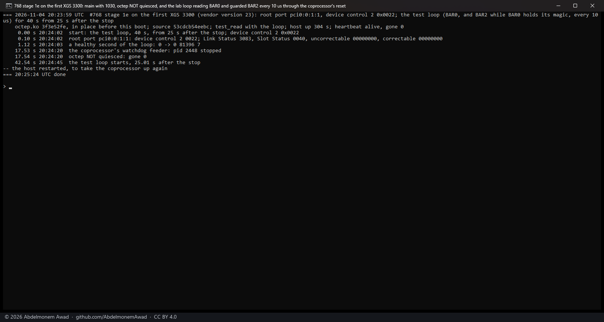

## Not run yet

- The guard's cost on a flow-heavy load, where the RPC rings are busy.
- [768](https://github.com/AbdelmonemAwad/os-xgs-npu/issues/768)'s other cases with the guard: a stop in
  the first two minutes after a boot, and a stopped userland.

## Corrections in the runs

- Stage 0's first try (photo 131) unloaded octep before stopping the watchdog feeder, and npu-run.sh then
  refused the console - it uses it only while the driver reads the coprocessor's handshake as complete - so
  nothing was stopped: not a result. Its first part, the root port read, stands.
- Stage 0's second try (photo 132) is not a result: the script's wait ended after 10 s - its remote
  command's exit status was always 0 - and restarted the host before the reset; and its list of the
  console's boot lines took lines from 2026-11-02, filtered by the time of day alone. Both are fixed, and
  its lines of the console's login are covered.
- Stage 1d (photo 139), a loop in the kernel reading BAR0 and, while it held its magic, BAR2 every 10 us:
  the host "stopped" at 18:43 with reset record bit 19 - a software restart. The kernel's message buffer,
  kept across it, shows an orderly shutdown, and the plugin's log "the driver has taken the coprocessor as
  gone, and it was already taken up again 6 times in 24 hours - restarting the appliance": the day's runs
  had used up the recovery limit. That restart came before the reset: not a result. The first U1 ended the
  same way, after octep had already taken the coprocessor as gone from BAR0 at its reset and the host had
  lived it; its photograph came out as a minimised window, with nothing in it. The recovery counts were
  emptied for the runs after.
- The second U1's photograph (141) is mostly the script's own error, repeated - a wrapper passed it its own
  name as the time to watch, so the watch never ended and was stopped by hand once the recovery was done;
  its log, quoted above, has every line.
- The first run of the stop checks (photo 145) had no traffic arrive at the box, and its stop-writes check
  said so and proved nothing; it was run again (photo 146).
- The second XGS 3300's first U4 (photo 150) did not run: the chain looked for a steady host right after
  U1's last step had asked it to restart, before its shutdown began, and U4's first read then found
  nothing and stopped itself. It ran once the host was back (photo 153).
- The verdict line of photo 154, "the host restarted: booted again at 20:00:16", is the script's own fault:
  the run began at 20:05:32 on a host booted at 20:00:16 - its header says up 317 s - and its first read
  of the boot time came back empty, so the last compare failed. Read afterwards: booted 20:00:16, up 776
  s, the coprocessor not gone, its heartbeat alive, sixteen ports; its logger ran on to 438.5 s. The host
  never restarted. The script now reads that time again until it has it.
- Stage 1e's screen (photo 156) ends at the loop's start: in one look the PC's copy of the box's new lines
  came back empty, and the script moved on as if it had shown them. The box's own record, quoted in its
  section, has every line. Stage 1d's question is answered by stage 1e, which was set to end before the
  recovery could begin.

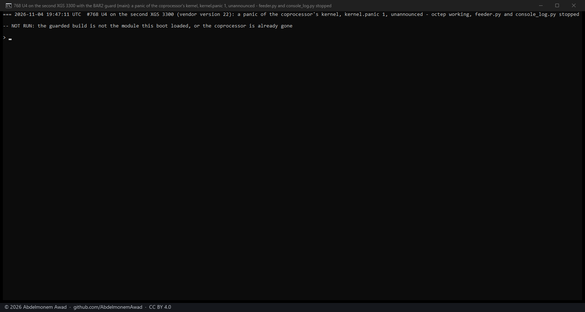

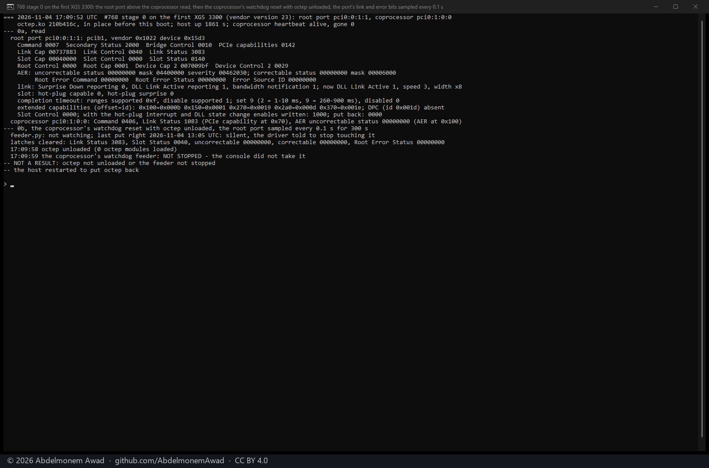

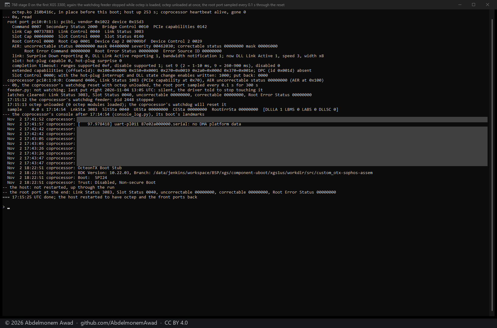

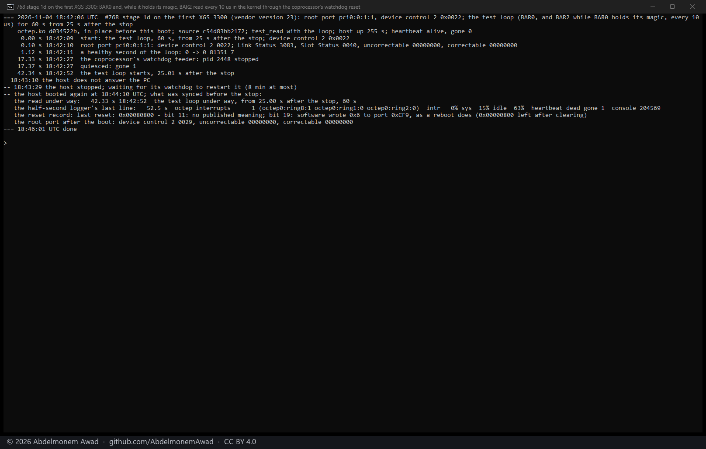

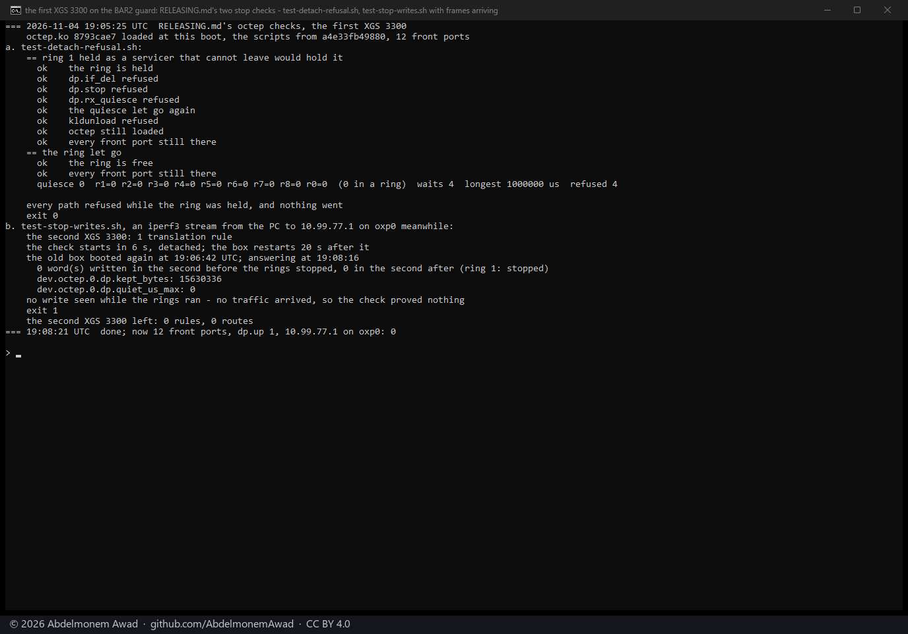
