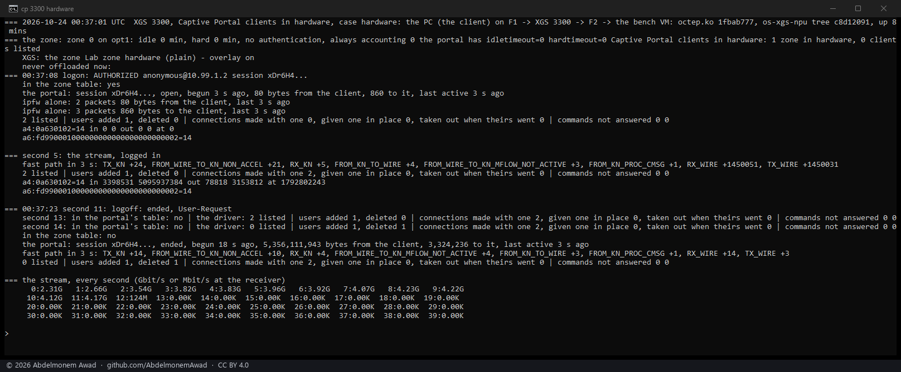
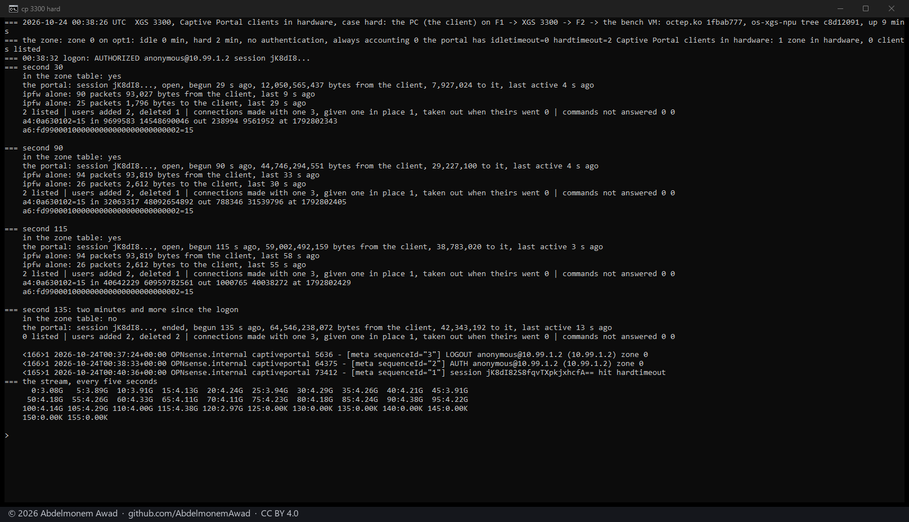
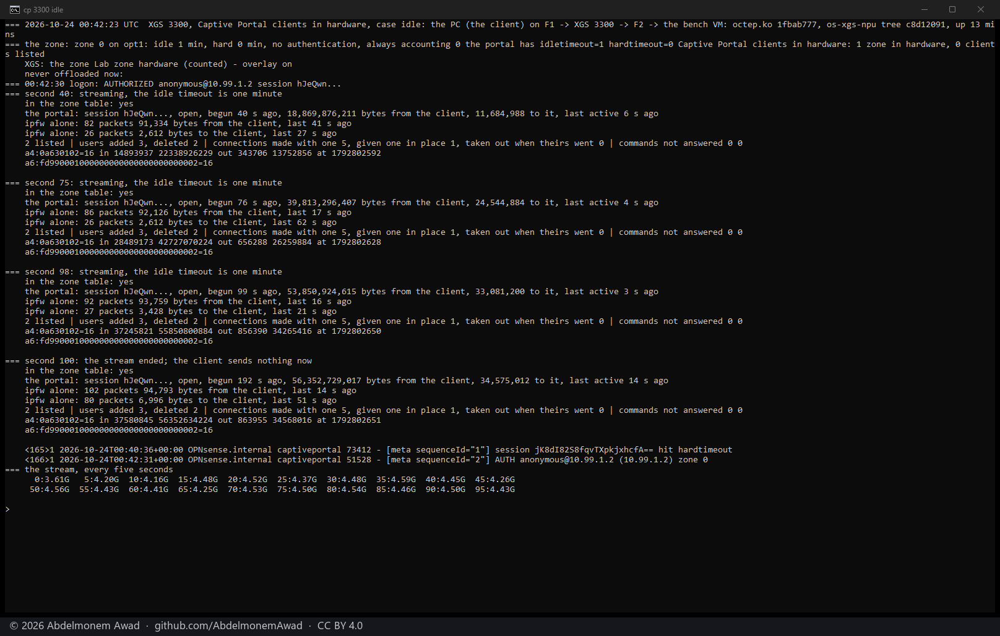
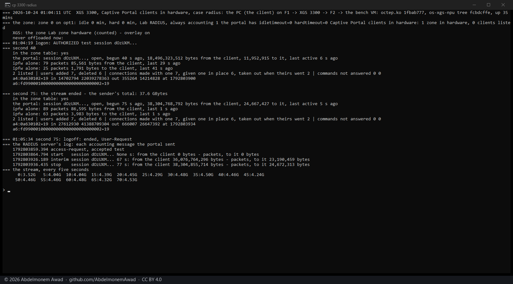
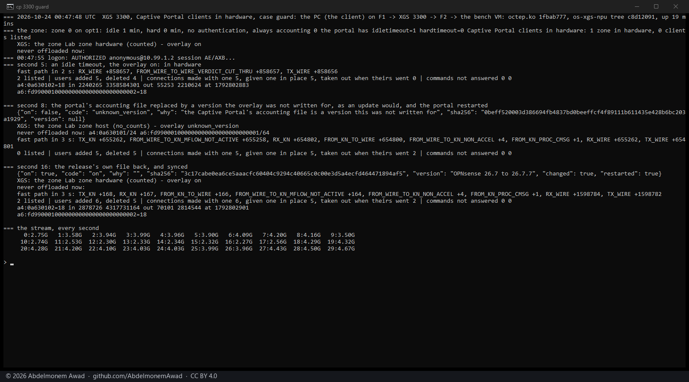
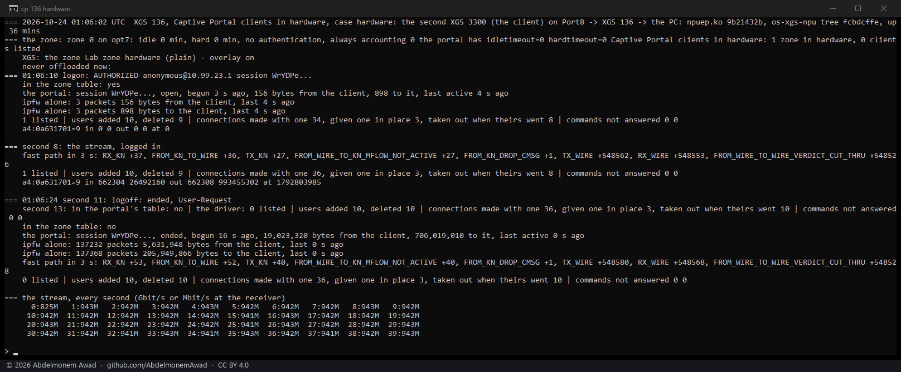
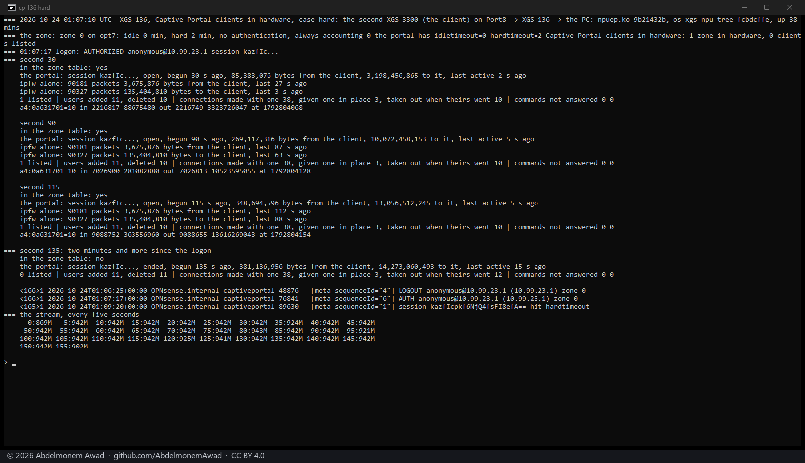
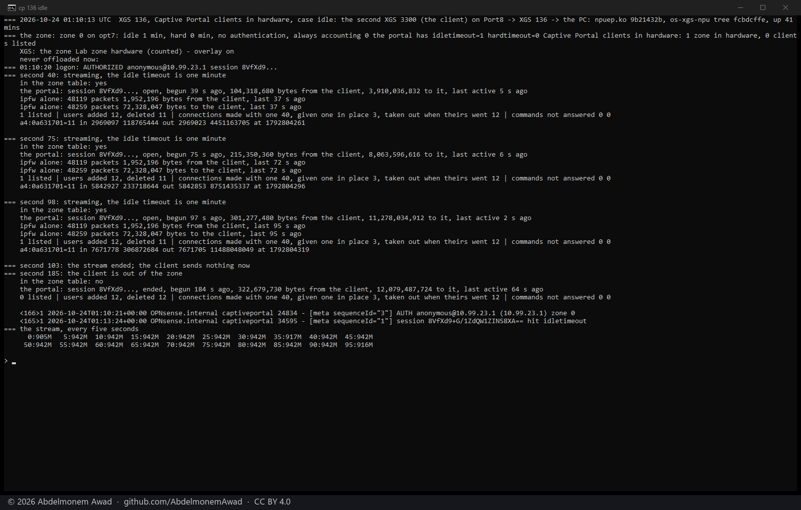
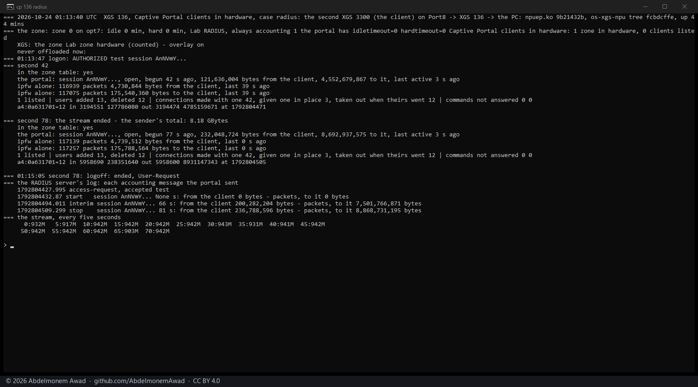
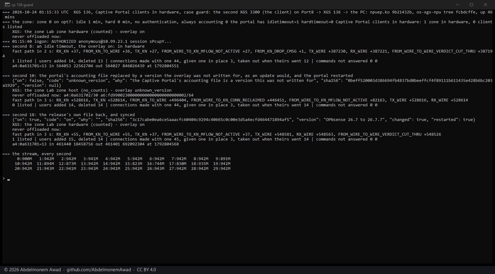

<!-- reviewed: 2026-10-24 -->
# Captive Portal clients in hardware, measured, 2026-10-24

Until today every enabled Captive Portal zone was kept with the host (`flow_exclude.php`): the portal
lets a client through and stops it again in the firewall, and a connection the coprocessor forwards
outlives the pf state the portal kills at a logout. The coprocessor has its own answer to that, the
live users ([discovery 5, measured](luid-2026-10-23.md)): a connection made with a user is given back
at once, every one of them, when the user is deleted. XGS: Settings **Captive Portal clients in
hardware**, off by default, puts it to use:

- **Each session the portal has is a live user.** `scripts/xgs/cp_users.py`, every two seconds,
  gives each portal session a user number and writes its addresses to the driver
  (`dev.octep.0.dp.live_users`, `dev.npuep.0.flow.live_users`); a connection with an end at one of
  them is made with that user. A session that ends - a logout, a timeout, a disconnect - is gone from
  the next table, the user is deleted, and its connections leave hardware.
- **What the coprocessor carries is counted for the portal.** The idle timeout and RADIUS accounting
  read what ipfw counted for each client, and ipfw sees nothing in hardware. The drivers now count,
  for each user, the packets and bytes the coprocessor's statistics messages report for its
  connections; `cp_users.py` writes them to `/var/db/os-xgs-npu/cp/hw-counts.json`, and an overlay on
  the portal's accounting file (`scripts/xgs/cp_overlay.py`) adds them to ipfw's before the portal
  reads them.
- **The overlay changes only the versions of that file it was written for**, told by each file's
  SHA-256 (OPNsense 26.7 to 26.7.7, one file). On any other version it changes nothing; a zone with an
  idle timeout or RADIUS accounting then stays with the host, and XGS: Settings says why. It is kept
  across OPNsense's updates by a pkg trigger on the portal's directory and a boot hook, and is on only
  while it is wanted - OPNsense's health audit names the file as changed while it is.
- **Every other zone runs in hardware** once the setting is on. A zone that cannot is kept with the
  host as before.

## The cases, on the XGS 3300

octep.ko `1fbab777`, the plugin's tree at `cp_users.py` `c8d12091` (`fcbdcffe` for RADIUS, the watcher
as merged), OPNsense 26.7.7. The client is
the PC on F1, its stream to the bench VM behind F2. The zone "Lab zone" is on F1; the
RADIUS server is a small one on the appliance itself (`images/deploy/lab-radius.py` in the lab's
tools, 127.0.0.1), which accepts every login and writes down every accounting message. Each run is
one window, photographed; the text of every run, the earlier builds' among them, is in the lab's log.

| case | what happened |
|---|---|
| **a zone in hardware**, logout | the stream in hardware at 2.3 to 4.2 Gbit/s (the fast path forwarding 1,450,031 frames in 3 s, 24 to the host); the user counted 5,095,937,384 bytes from the client by second 8. Logged off at second 11: by second 13 the client was out of the portal's table, by second 14 out of the driver's, the user deleted; the stream fell to 124 Mbit/s in second 12 and to nothing from second 13 |
| **hard timeout**, 2 minutes | logged in at 00:38:32; "hit hardtimeout" at 00:40:36, 124 s later; the stream at 3.9 to 4.4 Gbit/s throughout, in hardware - ipfw counted 94 packets from the client in all - and nothing from second 125 |
| **idle timeout**, 1 minute | a 100-second stream at 4.2 to 4.6 Gbit/s in hardware: ipfw alone last saw the client 41, 17 and 16 s before each look (the PC's own broadcasts), the portal 6, 4 and 3 s before - so the session stayed. After the stream the PC's own broadcasts, counted by ipfw, kept it open in this run; the timeout itself is shown below |
| **RADIUS accounting** | the login accepted by RADIUS; start, an interim message at 67 s with **36,076,764,296 bytes** from the client, a stop at 77 s with **38,304,855,714** - what the portal had counted at its last read, 38,304,768,792, two seconds before; the driver had counted 41,388,709,304 by second 75 and the sender sent 37.6 GiB of payload |
| **the guard** | a zone with an idle timeout in hardware; at second 8 the portal's accounting file replaced by a version the overlay was not written for, as an update would, and the portal restarted: the overlay said `unknown_version`, the zone went to the host within the two seconds (`no_counts`), F1's networks went into Never offloaded, the user was deleted, and the stream went on through the host at 2.3 Gbit/s, every frame to the host. At second 16 the release's own file back: the overlay on again, the zone and the stream back in hardware at 4.0 to 4.7 Gbit/s |

## The cases, on the XGS 136

npuep.ko `9b21432b`, the plugin's tree at `cp_users.py` `fcbdcffe`. The zone is on Port8; its client
is the second XGS 3300 behind it, and the stream comes from the PC through the XGS 136
to it - the PC opens it and sends, since it takes no connection from outside. The other way, the
client sending (`iperf3 -R`), stayed with the host on this boot whether a user was listed or not:
the fast path's retransmission rule gave it back and nothing took it up again ([#717](https://github.com/AbdelmonemAwad/os-xgs-npu/issues/717)).
Because the PC opens the stream, the portal's logout does not kill its state (below), so here the
stream goes on after a session ends: the driver takes it out when the user goes and, pf still
passing it, makes it again without a user.

| case | what happened |
|---|---|
| **a zone in hardware**, logout | the stream in hardware at 942 Mbit/s (548,526 frames in 3 s, 27 to the host); the user counted 993,455,302 bytes to the client by second 8. Logged off at second 11: by second 13 the client was out of the portal's table and the driver's, the user deleted and its two connections taken out; the stream made again without a user |
| **hard timeout**, 2 minutes | logged in at 01:07:17; "hit hardtimeout" at 01:09:20, 123 s later; the user deleted. ipfw alone counted 135,404,810 bytes to the client, the portal 13,056,512,245 by second 115 - the coprocessor's 13.6 GB added |
| **idle timeout**, 1 minute | a 100-second stream at 942 Mbit/s in hardware: ipfw alone last saw the client 37, 72 and 95 s before each look, the portal 5, 6 and 2 s before - the session stayed. The stream ended at second 103; "hit idletimeout" at 01:13:24, 81 s later, the client out of the zone by second 185 |
| **RADIUS accounting** | the login accepted by RADIUS; an interim message at 66 s with **7,501,766,871 bytes** to the client, a stop at 81 s with **8,868,731,195**; the driver had counted 8,931,147,343 by second 77, and the sender sent 8.18 GiB of payload |
| **the guard** | in hardware at second 8 (387,194 frames in 2 s); the portal's file replaced at second 10: `unknown_version`, the zone to the host, Port8's networks in Never offloaded, the user deleted, the connection taken back (`CONN_RECLAIMED` 446,451 frames in 3 s) and the stream on through the host; the release's file back at second 18 and the zone in hardware again, 548,526 frames in 3 s |

## Two faults found by measuring, fixed before this

- **A logout that counted twice.** The first RADIUS run on the XGS 136 reported 33,452,924,374 bytes
  in its stop for an 8 GB stream. The watcher dropped a session's counts the moment the portal
  ended it, but the portal reads ipfw once more before it takes the address out; without the
  coprocessor's part the total was smaller, and the portal takes a smaller total for a reset and
  counts all of it again. A session's counts now stay while its address is in the zone's table.
- **A connection's counts before its session.** A connection given its user late had its counts so
  far added to the user; one opened toward the address before the session - which the portal's
  logout does not kill - brought 4 GB of an earlier session with it. They are no longer added.

## What a figure here does not say

- **The portal reads every five seconds.** Its background process takes the counts, ends sessions
  and sends accounting once each five seconds, so a logout takes the client out of its table within
  them, and a session's last accounting is the last of those reads: the stop message above carries
  what was counted up to it - on the XGS 3300, 3.1 GB short of the driver's count at the end of the
  stream. OPNsense loses the same seconds of ipfw's own counts at a logout. The driver lets a user go
  within two seconds of the portal's table.
- **The portal's logout kills the states its client opened.** It runs `pfctl -k <address>`, which
  kills states by their source. A connection opened toward the client from elsewhere is left to pf;
  the driver takes it out of hardware when the user goes and, while pf still passes it, makes it again
  without a user.
- **The counts are the coprocessor's**: IP bytes and packets as its statistics messages report them,
  about once a second, added to what ipfw counted for the same client. A connection given its user
  after it was made - in the two seconds between a login and the next table - counts for the user
  from then on, not before.
- **The idle timeout counts everything from the client**: the PC's own broadcasts kept the session
  above alive after its stream, as they would without the coprocessor.
