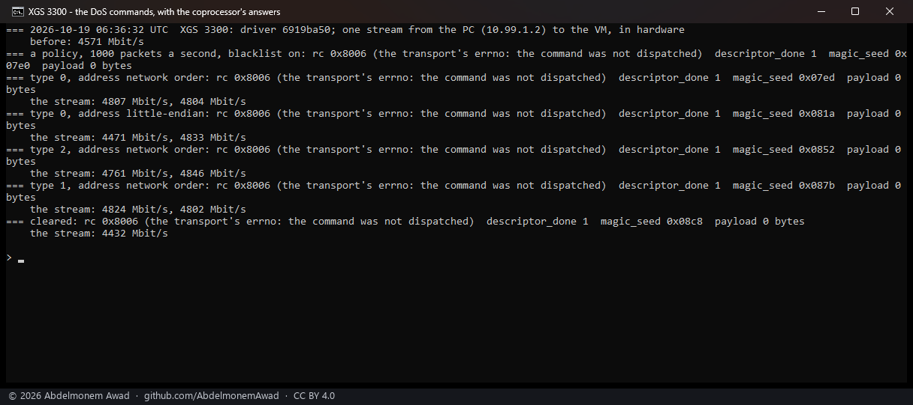

<!-- reviewed: 2026-10-19 -->
# Does the coprocessor drop an address it is given? Measured, 2026-10-19

No - not on the XGS 3300's firmware (v22). The question came from the vendor's own design: its
command list has three commands between the QoS ones and the first IPsec one - `DOS_SET_POLICY`,
`DOS_ADD_BLACKLIST_ENTRY` and `DOS_CLEAR_BLACKLIST`, 27, 28 and 29 - with their structures in
`dos_table.h`: a policy (a packets-per-second ceiling, a type, whether a source over the ceiling is
blacklisted, and for how long) and an entry (a family, a type, an address, a duration). The XGS 136's
helper module was built with two more facts about them - an even type is a source and the next odd
one its destination; an entry lasts 30 seconds by default and 3,600 at most - and with an error code
for a full DoS table. If the coprocessor kept such a table, a block list could be enforced there, at
the port, before a frame reached the host.

Nothing that sends these commands was found: not in the GPL source drop, not in the v22 host module
(`usfp_firewall`), and the v22 fast path has no counter and no string for them. So they were tried.

## How it was measured

On the second XGS 3300, rebooted onto a driver that lets `rpc.cmd` post the three commands with
`rpc.allow_write` (`octep.ko` 398,912 bytes, md5 `6919ba50`; the payloads built from `dos_table.h`).
One stream from the bench PC on F1 to the bench VM behind F2, in hardware; during it, a policy, then a
blacklist entry for the PC's address in four forms, each left for four seconds of the stream - type 0
with the address in network order, the same little-endian, type 2, type 1 - and then the clear. The
coprocessor's answer to each (`rpc.last`) and what the VM received, every two seconds
(`images/deploy/lab-dos-probe.sh`, photographed).

## Results

| command | the coprocessor's answer | the stream |
|---|---|---|
| a policy: 1,000 packets a second, blacklist on | rc 0x8006, not dispatched | - |
| an entry for the PC, type 0, network order | rc 0x8006, not dispatched | 4,807 and 4,804 Mbit/s |
| the same, little-endian | rc 0x8006, not dispatched | 4,471 and 4,833 Mbit/s |
| type 2 | rc 0x8006, not dispatched | 4,761 and 4,846 Mbit/s |
| type 1 | rc 0x8006, not dispatched | 4,824 and 4,802 Mbit/s |
| clear | rc 0x8006, not dispatched | 4,432 Mbit/s |

- **rc 0x8006 is the transport's own errno, "the command was not dispatched"**: the request reached
  the coprocessor, and nothing there takes command 27, 28 or 29. Every read and write this driver
  uses answers rc 0 through the same path.
- **The stream from the listed address never slowed**: 4,571 Mbit/s before, 4.4 to 4.8 Gbit/s
  during every form and after the clear.
- Four runs were made; this is the fourth. The first printed an empty line where the answers should
  have been (the script read the answer's first line, which is blank). The second and third printed
  them, but their rates counted the time each ssh read took as part of the two seconds - the third
  showed 13,293 Mbit/s, more than the 10G link carries. The script now reads the VM's own clock
  beside its byte count. All three earlier runs showed the same answers and a stream that never
  stopped; their photographs were not kept - the first two also caught keystrokes typed into the
  window while it ran.

## What the coprocessor can drop

**One connection.** A microflow programmed with action 0 is dropped by the fast path itself -
measured when the action values were sorted out (`FROM_WIRE_DROP_MFLOW_ACTION` on the first frame;
`OCTEP_MFLOW_ACTION_DROP` in `contrib/octep/octep.h`). That covers a connection pf has already
passed and the driver has put in hardware; it does not cover an address, a port or a flood of new
connections, which still reach the host and pf. The block lists and the TLS fingerprints keep
cutting connections by killing their pf states
([lists-cut-2026-10-19.md](lists-cut-2026-10-19.md), [ja4-cut-2026-10-19.md](ja4-cut-2026-10-19.md)).

**Not tried**: the XGS 136's coprocessor, whose firmware is a different build of the same fast path.
