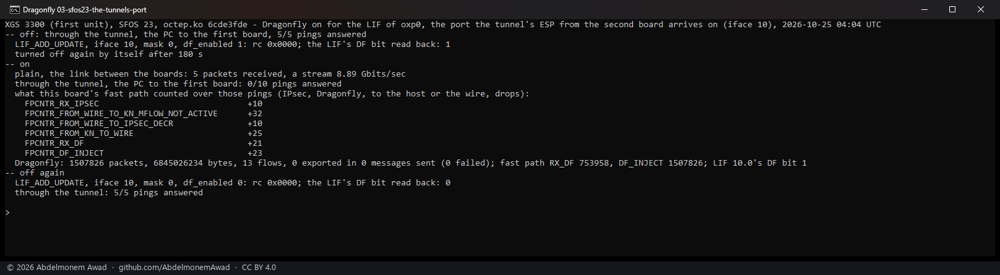
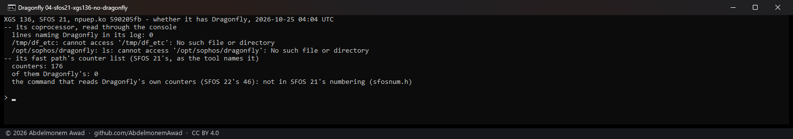

<!-- reviewed: 2026-10-25 -->
# Dragonfly turned on: it inspects, its exports reach nothing seen, and it loses a tunnel's traffic, 2026-10-25

Discovery 22 of [the discoveries](../findings/discoveries-2026-10-22.md#dragonfly-deep-packet-inspection-and-threat-detection).
The XGS 3300's coprocessor starts Dragonfly - a DPI and threat-detection engine built on nDPI - at
every boot, and nothing turns it on for any interface. Two questions were left: how it is turned on,
and where its alerts leave the coprocessor. Measured on both XGS 3300s - the second on vendor version 22's
coprocessor software, the first on vendor version 23 - and read on the XGS 136 (vendor version 21), with octep.ko
`6cde3fde` (main of the morning plus the receive instrument below) and npuep.ko `590205fb`
(`images/deploy/lab-dragonfly.sh`, `lab-dragonfly-report.sh`).

## How it is turned on

By one `LIF_ADD_UPDATE` per logical interface. The vendor's host does it from an interface property
(`df_enabled`, `usfp_netdev_*.c`): an update with a core mask of 0, so nothing else in the entry
changes, and the private tail's DF mask byte and bit set - the handler copies the bit into the entry
(`lif_fpop.c`). os-xgs-npu's request builder already writes that tail, so the RPC instrument sends it
as it is: `rpc.lif_iface`, `rpc.lif_vlan` 0, `rpc.lif_df` 1, `rpc.lif_mask` 0, command 3.

Both coprocessors answered rc 0, and `LO_LIF_READ` gave the bit back - `df_enabled` is at byte 10 of
the entry it returns. The same command with the bit 0 turned it off again, rc 0, read back 0. The
vendor's own vendor build 22.0.2, captured 2026-09-29, had it 0 on every LIF it had.

Dragonfly's own counters - packets, flows, exports, messages, its memory pools - are read with
`LO_WORKER_DF_CNT_READ`, vendor version 22's command 46 and vendor version 23's 47; vendor version 21 has no such command. Both
XGS 3300s showed the engine ready and idle before: its pools allocated (500,000 flows), no packet.

## What it does on the port the PC is on (vendor version 22)

| through the port with Dragonfly on | |
|---|---|
| 20 pings to the board | 20 answered |
| a DNS question to it, HTTPS to its GUI | answered, 200 |
| a stream through it to the other board, and back | 9.67 and 3.33 Gbit/s (off, just before: 9.76 and 2.52) |
| what Dragonfly counted, in the 100 s after | 1,621,926 packets, 16 flows, 6 exported in 2 messages, 0 failed |

The traffic was not slowed. Two earlier streams with it on ran at about 0.35 Gbit/s - one of them
three minutes after the lab tunnel's child had been made again, which is the slow first minute seen
with Dragonfly off too ([cipher-2026-10-25](cipher-2026-10-25.md#what-it-does-not-say)); for the
other, in the first run, no cause was seen - and every other stream with it on ran at 7.96 to 9.81.

## Where its exports go: nowhere this host, the other board or the PC sees

Read from the coprocessor's own program (`export_buf_get`, `df_msg_buf_fin`): each export is built
as an Ethernet broadcast, to ff:ff:ff:ff:ff:ff from a made-up 00:01:02:03:04:05, IPv4 with a time to
live of 2, UDP, its payload starting with the bytes CA FE and a type, and is handed to a transmit
function whose answer decides "sent" or "failed". Its addresses and ports come from a context the
startup script gives nothing for - the program is started with its settings directory and no
collector.

Every message was counted sent and none failed. Where it was looked for while they were sent:

| where | what arrived |
|---|---|
| each of the host's 24 interfaces, as captured for 150 s | no frame from that address, no UDP broadcast |
| the host's receive rings, a frame on a tag no interface owns other than the control channel's (`dp.rx_untagged_other`, new) | none - 143 before and after, all from the boot |
| the virtual function made for the intrusion-prevention stage (`dp.ips_rx`) | none |
| the coprocessor's own Linux interfaces but the management link | none |
| the other XGS 3300's 20 interfaces, captured meanwhile | none |
| the PC's port, its received broadcasts (Windows' counter) | none, with a message sent meanwhile |

So the messages leave by a way none of these is - not found. If its alerts leave as messages too,
they have no reader on this host either. Its rules file holds a single test rule, a TCP flow to one
public address listed for its reputation; no lab traffic went there, and no alert was looked for.

## A tunnel's traffic on that port is lost, on vendor version 22 and vendor version 23

| Dragonfly on for the port the lab tunnel's ESP arrives on | plain traffic on that port | the tunnel's traffic |
|---|---|---|
| second XGS 3300, vendor version 22 (oxp12) | 5 of 5 pings, a stream at 9.02 Gbit/s | 0 of 10 pings; 5 of 5 once off |
| first XGS 3300, vendor version 23 (oxp0) | 5 of 5 pings, a stream at 8.89 Gbit/s | 0 of 10 pings; 5 of 5 once off |

On each, the ten ESP packets arrived (`FPCNTR_RX_IPSEC` +10), were sent for decryption
(`FROM_WIRE_TO_IPSEC_DECR` +10) and went through Dragonfly (`RX_DF`, `DF_INJECT`), and no counter
took them up after - none to the host, none to the wire, no drop. The same in every run, four on
vendor version 22 and seven on vendor version 23. Plain traffic through the same port, at the same time, passed.

## The XGS 136, vendor version 21: no Dragonfly

As read on 2026-10-22, and now further: not even its files are on the coprocessor.

## What it means for os-xgs-npu

**Not built: nothing turns it on.** Its exports reach nothing here, and a port with it on loses the
traffic of every tunnel that arrives there - so the bit stays
0, as the vendor's own software leaves it. An owner's intrusion detection is OPNsense's own, with
[Inspect, then hardware](../findings/discoveries-2026-10-22.md#inspection-then-hardware).

For the search, the XGS 3300's driver gained a receive instrument: `dp.rx_untagged_other` counts the
frames on a tag no interface owns other than the control channel's, and `dp.rx_untag_want`
4294967295 keeps the last of them in `dp.rx_untagged_frame` - a frame from anything else on the
coprocessor's side shows there. It ran on both XGS 3300s, vendor version 22 and 23; the XGS 136's driver,
npuep, is not changed.

## Its settings, read 2026-10-29

Read only, on both XGS 3300s - the second on vendor version 22, the first on 23: Dragonfly runs with
its IPv6 inspection off and its tunnel inspection off, at most 500,000 flows in a table of 65,536,
and a list of protocols beside them - the values the vendor's own software gives it. The coprocessor
writes them itself at every start, from its own copy; nothing comes from the host. So the tunnel's
traffic above was lost with tunnel inspection already off, and turning it off is not the remedy a
comparison with the vendor's settings had suggested.

## What it does not say

- Where the messages go. Every place a frame from the coprocessor could reach on this lab was looked
  at; none had one.
- Why a tunnel's traffic is lost after Dragonfly. Nothing counts it dropped, and its settings - its
  tunnel inspection off - are the vendor's own (above).
- An ARMADA appliance on vendor version 22 or 23. The XGS 3300's vendor version 22 carries an ARMADA directory
  under Dragonfly's libraries, so such an appliance may run it; there is none here.
