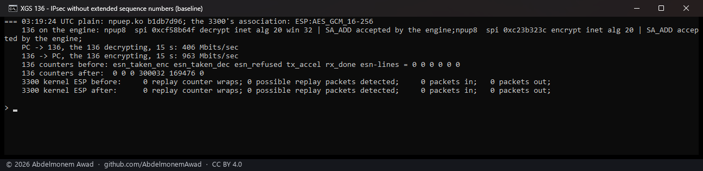
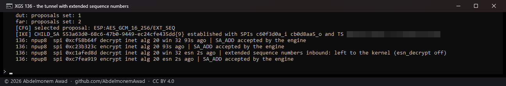
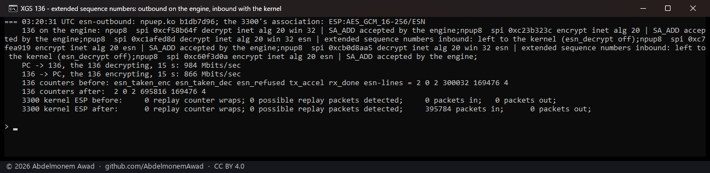
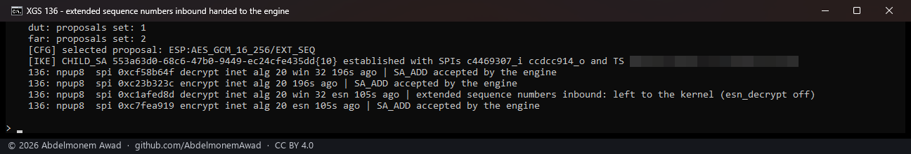
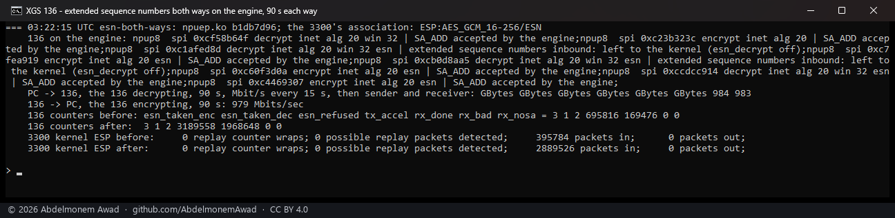
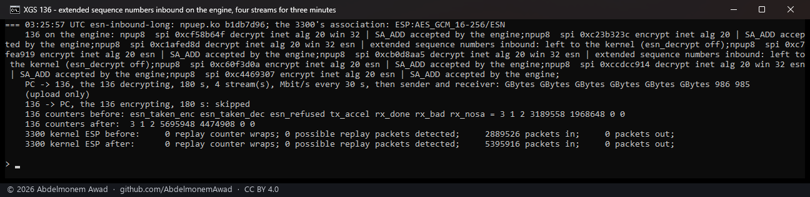
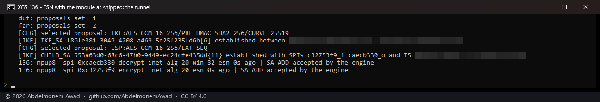
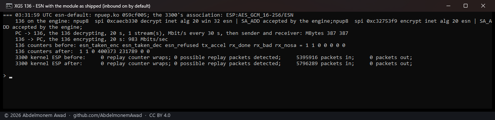
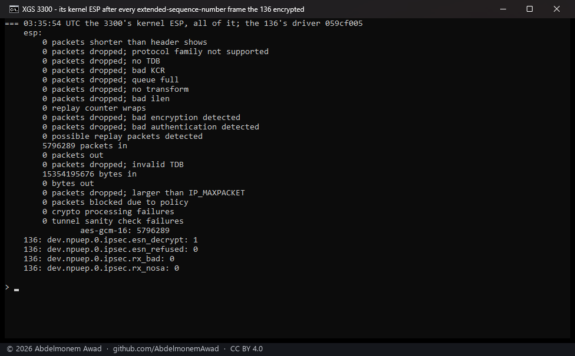

<!-- reviewed: 2026-10-20 -->
# Extended sequence numbers on the XGS 136's engine, both ways. Measured, 2026-10-20

Yes, both ways. The XGS 136's crypto engine keeps an association's 64-bit sequence count when SA_ADD
asks it to - bit 18 of the control word, `ext_seq` - and it did, for every frame of three runs at the
gigabit link's rate: 4,305,432 frames decrypted on one association, none failed, and 5,796,289
frames encrypted that the peer's kernel checked with no authentication failure and no replay.

On the XGS 3300 the same question has a one-sided answer: its coprocessor decrypted about a million
frames of an ESN association and then failed every one on authentication until a rekey, so what
arrives stays with the kernel there ([under ESN, what arrives stays with the
kernel](../findings/esn-inbound-stays-with-the-kernel.md)). The ARMADA's engine is another engine,
and it was measured on its own.

## What the driver does now

[npuipsec.c](../../contrib/npuep/npuipsec.c) sets `ext_seq` in SA_ADD for an association the kernel
marks with `SADB_X_SAFLAGS_ESN`, and takes both directions:

- **outbound**, always - before this change an outbound ESN association was left to the kernel;
- **inbound**, while `dev.npuep.0.ipsec.esn_decrypt` is 1, the default. At 0 an inbound ESN
  association is left to the kernel and counted in `esn_refused`. Before this change an inbound ESN
  association was handed to the engine **without** the bit, as a 32-bit one. Nothing measured that,
  and it could not be reached from the GUI: OPNsense's IPsec pages have no ESN field, and strongSwan
  takes ESN only through the ESP proposal (`aes256gcm16-esn`), set here by hand.
- `esn_taken_encrypt` and `esn_taken_decrypt` count the associations on the engine;
  `dev.npuep.0.ipsec.sas` prints `esn` beside each one.

## How it was measured

The lab tunnel between the XGS 136 (behind its Port8) and the second XGS 3300, AES-GCM-16-256, the
bench PC on the 3300's side. `images/deploy/lab-136-esn.sh` (not in this repository) edits the
child's ESP proposal in `swanctl.conf` on both ends to `aes256gcm16-esn` or back to `aes256gcm16`,
loads it, and has the 3300 make the child again; then one stream from the PC to the 136 (the 136
decrypting) and one back (the 136 encrypting), with iperf3, and what each end counted: the 136's
engine (`tx_accel`, the frames it encrypted; `rx_done`, `rx_bad`, `rx_nosa`, what became of the frames
it decrypted) and the 3300's kernel ESP counters. The 3300's engine decrypts the plain proposal
itself, and leaves an inbound ESN association to its kernel, so the 3300's kernel counts exactly the
136's ESN frames and checks every one of them.

The first build measured (`npuep.ko` md5 `b1db7d96`) had the inbound side off by default; it was
turned on with the sysctl after the "outbound only" run. The build that ships (`059cf005`, 252,776
bytes, compiled on the appliance) has it on, and the last run is that build after a reboot.

## Results

| run | the 136's associations | PC to the 136 (the 136 decrypting) | the 136 to the PC (encrypting) | counted |
|---|---|---|---|---|
| plain, for comparison | without ESN, both on the engine | 406 Mbit/s, 15 s | 963 Mbit/s, 15 s | - |
| ESN, outbound only | outbound on the engine; inbound with the kernel (`esn_decrypt` 0) | 984 Mbit/s (the kernel's cipher) | 866 Mbit/s | the 136 encrypted 395,784; the 3300's kernel took 395,784 |
| ESN, both ways | both on the engine | 984 Mbit/s, 90 s | 979 Mbit/s, 90 s | the 136 decrypted 1,799,172 and encrypted 2,493,742; the 3300's kernel took 2,493,742 |
| ESN inbound, four streams | both on the engine, the same association | 985 Mbit/s, 180 s | - | the 136 decrypted 2,506,260 more, 4,305,432 on that one association; it encrypted 2,506,390 (the streams' acknowledgements), the 3300's kernel took 2,506,390 |
| ESN, the build that ships, after a reboot | both on the engine, `esn_decrypt` 1 by default | 387 Mbit/s, 20 s | 983 Mbit/s, 20 s | the 136 decrypted 231,789 and encrypted 400,373; the 3300's kernel took 400,373 |

`rx_bad` and `rx_nosa` stayed 0 through every run. The 3300's kernel, read at the end: 5,796,289
packets in - the sum of the four counts above, to the packet - 0 dropped for bad authentication, 0
for bad encryption, 0 possible replays, 0 replay counter wraps, 0 crypto processing failures.

## What it does not mean

- **The two slow uploads are not ESN's, and not the plain proposal's.** 406 Mbit/s (plain) and 387
  Mbit/s (ESN, the build that ships) were both measured within a quarter of an hour of the 136's boot;
  every run between them, plain or ESN, carried 984. ~~A stream into the 136 slow for the first
  minutes after a boot is [issue 531](https://github.com/AbdelmonemAwad/os-xgs-npu/issues/531),
  seen there into F1; here it is into Port8, through the tunnel.~~ Each was the first stream of its
  session after a boot, and the time is not what matters: the same afternoon a first stream two hours
  after a boot was as slow (396 Mbit/s), and the ones after it were not ([the IPv6
  page](ipv6-136-2026-10-20.md#what-it-does-not-mean)). It is [issue
  531](https://github.com/AbdelmonemAwad/os-xgs-npu/issues/531), seen there into F1; here into Port8,
  through the tunnel.
- **Not the 32-bit wrap.** 4.3 million frames is about a thousandth of 2^32; no run crossed the point
  where the high half of the count changes. What was measured is that the engine, asked for ESN,
  computes and checks the integrity value with the 64-bit count from the first frame - with the
  wrong count, every frame would have failed - and keeps doing so for millions of frames, which is
  where the XGS 3300's coprocessor stopped. The crossing itself would need a rekey-free association
  for 2^32 frames, about 14 hours at this link's rate.
- **One association pair, one cipher.** AES-GCM-16-256 only; AES-CBC with an HMAC under ESN was not
  run.

All the numbers are in the log of the run, `measurements/esn-136-2026-10-20.log` (kept with the
bench, not in this repository); the addresses in three of the photographs are blurred.
