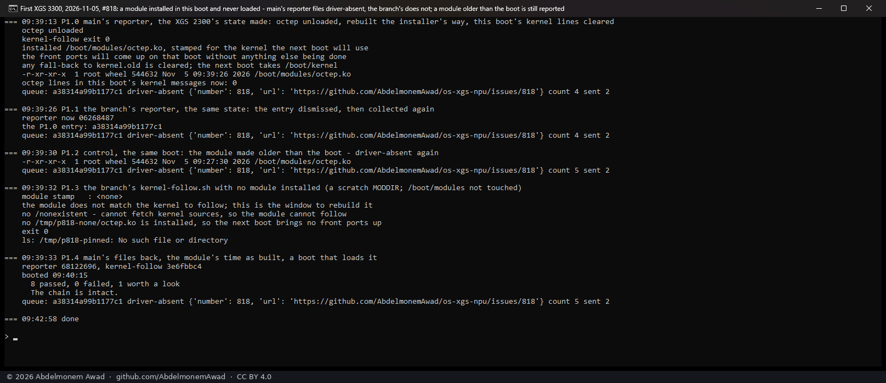

# A first install reported as a driver that failed, and a reporter that no longer does, 2026-11-05

[818](https://github.com/AbdelmonemAwad/os-xgs-npu/issues/818): an XGS 2300 reported "the octep driver is
not attached ten minutes after boot" at 00:55 UTC on 2026-11-02. Read from its own report, it was not a
driver that failed:
- its owner installed the plugin by hand in a boot already more than ten minutes old;
- `install.sh` built and stamped `octep.ko` and, as it always does, left loading it to the next boot;
- the reporter counts its ten minutes from the boot, not from the install;
- the boots after it attached the driver.

## The change

- **`reporter.py`**: a module installed during this boot, stamped for the running kernel, with no line
  of its driver in this boot's kernel messages, is a first install waiting for its restart. It is not
  reported as `driver-absent`.
  - Still reported as before: a module that was there at boot, one stamped for another kernel, and a
    driver that attached in this boot and is gone.
  - The untested-model check waits for the driver instead of reporting a coprocessor it cannot read.
- **`kernel-follow.sh`**: with no module installed at all, a failed build now says the next boot brings no
  front ports up. Before, it said "will refuse the module", the line 818's report carried. It no longer
  arms a fall-back to `kernel.old` that it cannot use.
- Tests: `tools/test-reporter.py` (three more) and a new `tools/test-kernel-follow.py`.

## Measured on the first XGS 3300

Vendor version 23, reporting manual. The XGS 2300's state was made at run time: octep unloaded, its
module rebuilt the installer's way (`kernel-follow.sh` with `FORCE=1 NOFETCH=1`), this boot's kernel
messages saved and cleared.

| step | reporter | what it found |
|---|---|---|
| P1.0 | main's | `driver-absent` again - the entry of 818 from 3 to 4: the report of 818, made on demand |
| P1.1 | this change's, the same state | nothing (`found` 0); the entry stays at 4 |
| P1.2 | this change's, the module's time put before the boot | `driver-absent` (`found` 1), the entry at 5: a module that was there at boot is still reported |
| P1.3 | this change's `kernel-follow.sh`, no module (a scratch directory) | "no ... octep.ko is installed, so the next boot brings no front ports up", exit 1, nothing pinned |
| P1.4 | main's files back, a restart | octep attached at boot; `verify.sh` 8 passed, 0 failed, 1 worth a look |

In the photograph, P1.3's "exit 0" is `tail`'s, read through a pipe. The same step run again with
the script's own exit code gave exit 1.

