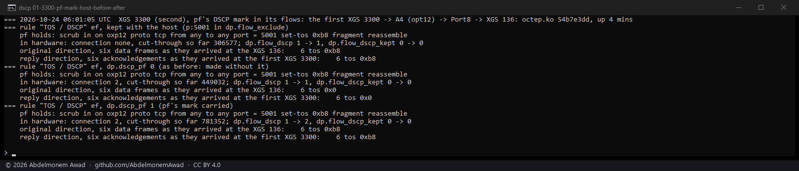
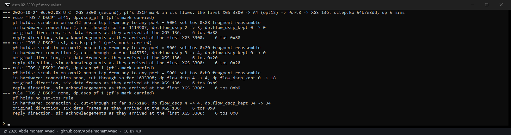
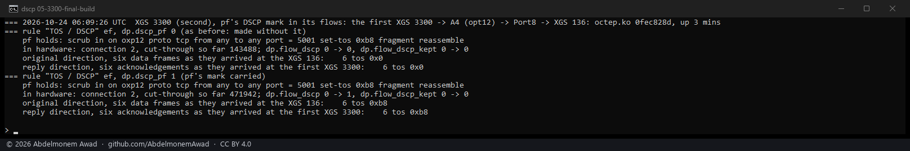
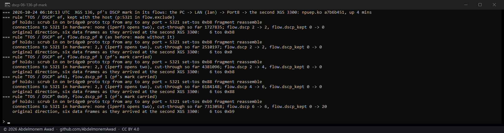
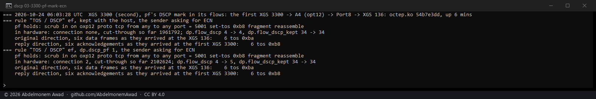
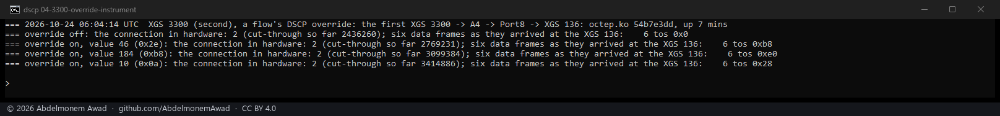

<!-- reviewed: 2026-10-24 -->
# pf's DSCP mark kept in hardware, measured on the XGS 3300 and the XGS 136, 2026-10-24

Discovery 8 of [the discoveries](../findings/discoveries-2026-10-22.md#dscp-rewritten-for-each-flow),
taken from the source to a product. A rule that sets a DSCP - OPNsense's normalization rule
(Firewall: Settings: Normalization, **TOS / DSCP**) - has pf write that value into every frame of the
connections it matches. **Until today a connection in hardware lost the mark**: the fast path
forwarded its frames as they came, measured below. The fast path can write the value itself - each
microflow carries a DSCP override (`dscp_override_en`, `dscp_override_val`) - and since today both
drivers give it pf's value when they make a connection, for both directions.

The path on the second XGS 3300 (octep.ko `54b7e3dd`, OPNsense 26.7.7; before and after once more
with the module as merged, `0fec828d`, which differs from it in two sysctl descriptions only - the
last photograph of this section): TCP streams from the first
XGS 3300 to the XGS 136, in on the second XGS 3300's A4 and out on its Port8, each made a connection
in hardware there (`FROM_WIRE_TO_WIRE_VERDICT_CUT_THRU`). The normalization rule was on A4, inbound,
TCP to the stream's port. The frames' TOS byte was read where they arrived, five seconds into each
stream: the data on the XGS 136's Port8 and the receiver's acknowledgements - the reply direction -
on the first XGS 3300. The sender set no DSCP (`images/deploy/lab-flow-dscp-pf.sh`).

| the rule's TOS / DSCP | the connection | data, as it arrived | acknowledgements, as they arrived |
|---|---|---|---|
| EF (0xb8) | kept with the host (**Never offloaded**) | 0xb8 | 0xb8 |
| EF | **in hardware, as before today** | **0x0 - the mark lost** | **0x0** |
| EF | in hardware, with pf's mark | **0xb8** | **0xb8** |
| AF41 (0x88) | in hardware, with pf's mark | 0x88 | 0x88 |
| CS1 (0x20) | in hardware, with pf's mark | 0x20 | 0x20 |
| 0xB9, which sets an ECN bit too | kept with the host by the driver | 0xb9 | 0xb9 |
| none | in hardware | 0x0 | 0x0 |

## On the XGS 136

The same, with npuep.ko `a7b6b451`: an iperf3 stream from the bench PC through the XGS 136 - in on
its LAN, a bridge, out on its Port8 - to the second XGS 3300, with the normalization rule on the LAN,
inbound, TCP to the stream's port. iperf3 opens two connections, its control and its data, and both
were made in hardware with the mark. Read on the second XGS 3300's Port8: **the original direction
only** - the reply arrives at the bench PC, which has no capture here; on the XGS 136 the reply's
value is chosen by the same lines as the original's, measured both ways on the XGS 3300.

| the rule's TOS / DSCP | the connections | data, as it arrived |
|---|---|---|
| EF (0xb8) | kept with the host (**Never offloaded**) | 0xb8 |
| EF | **in hardware, as before today** | **0x0 - the mark lost** |
| EF | in hardware, with pf's mark | **0xb8** |
| AF41 (0x88) | in hardware, with pf's mark | 0x88 |
| 0xB9 | kept with the host by the driver | 0xb9 |

## ECN is kept

pf writes the DSCP and leaves the frame's two ECN bits as they came (`pf_scrub`). The fast path does
the same, measured on the XGS 3300: with the sender's TCP asking for ECN, its data frames carry
ECT(0), and they arrived as 0xba - EF and ECT(0) - on the host path and in hardware alike; the
acknowledgements, which carry no ECT, as 0xb8.

A mark that sets the ECN bits itself - the page offers every value from 0x00 to 0xFF - is one the
fast path cannot write, since it writes six bits; such a connection is kept with the host, where pf
writes it, and counted (`dp.flow_dscp_kept`, `flow.dscp_kept` on the XGS 136, an attempt each).

## Which value each direction takes

A forwarded frame passes two of pf's states, the one on the interface it arrives on and the one on
the interface it leaves by, and pf writes each one's mark in turn - so the second wins. The original
direction leaves by the out state's interface and the reply by the in state's: each direction takes
that state's mark, or the other's when it has none (`octep_pf_tos_scan`, `npuep_pf_tos_scan`). A
mark is fixed when the state is made - a later change to the rule reaches new connections, as it
does in pf.

## What stays with the host

An IPv6 connection with a mark, and a tunnelled one: ~~the fast path's writing of an IPv6 traffic
class, and of a frame it is about to encrypt, has not been measured~~ the fast path's writing of a
frame it is about to encrypt has not been measured, and an IPv6 traffic class it does not write - on
either appliance, measured the same day
([flow-dscp6-2026-10-24.md](flow-dscp6-2026-10-24.md)). Before today both were made like
any other connection, without the mark; now pf writes it, on the host, and the attempt is counted.

## The override itself

The microflow's override, written by hand with the instrument below and no rule: the value is the
DSCP, and only its six bits are used - 46 became 0xb8, 184 (0xb8, a TOS byte given by mistake) became
0xe0, 10 became 0x28.

## The instruments

- `dev.octep.0.dp.dscp_pf` and `dev.npuep.0.flow.dscp_pf`: 1, the default, makes connections with
  pf's mark; 0 makes them without it, as before - how the "before" above was measured. On the XGS
  136, 2 makes IPv6 connections with a mark as well, an instrument
  ([the IPv6 measurement](flow-dscp6-2026-10-24.md)).
- `dev.octep.0.dp.flow_dscp` and `dev.npuep.0.flow.dscp`: connections made with a mark;
  `dp.flow_dscp_kept` and `flow.dscp_kept`: attempts refused for a mark the fast path cannot write.
- `dev.octep.0.dp.mflow_dscp_on` and `dp.mflow_dscp`: the override by hand, in place of pf's mark,
  for every connection made while it is on.
