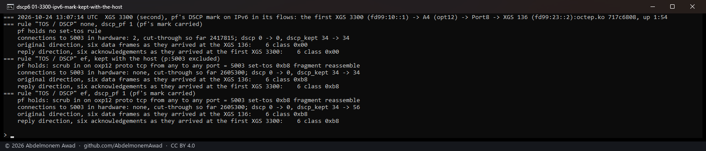
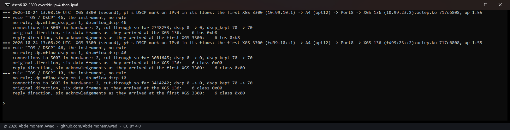
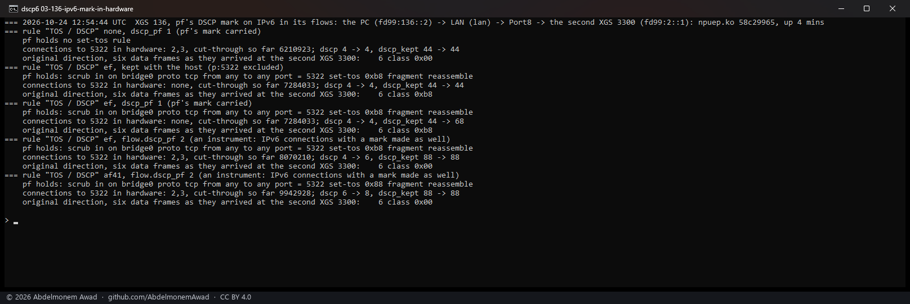
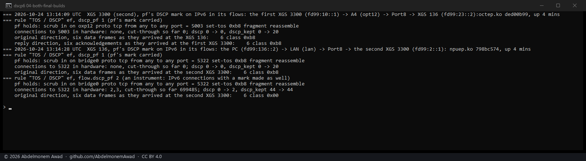

<!-- reviewed: 2026-10-24 -->
# pf's DSCP mark on IPv6, measured on the XGS 3300 and the XGS 136, 2026-10-24

[Discovery 8](flow-dscp-2026-10-24.md) put pf's DSCP mark - OPNsense's normalization rule
(Firewall: Settings: Normalization, **TOS / DSCP**) - into the microflows of the connections each
driver makes, and the fast path writes it into every frame: measured for IPv4. An IPv6 connection
with a mark was kept with the host, because the fast path's writing of an IPv6 traffic class had not
been measured. It has now.

**The XGS 3300's fast path does not write it.** On one path, one build and in the same minutes, the
microflows' override set by hand to 46 came out of the fast path as 0xb8 in every IPv4 frame and as
0x00 in every IPv6 frame, both directions. An IPv6 connection with a mark stays with the host, where
pf writes it - now because it is measured, not for want of a measurement.

## The path

The first XGS 3300 (`fd99:10::1`, given IPv6 for this on its link to the second's A4) sends a TCP
stream to the XGS 136's Port8 (`fd99:23::2`), through the second XGS 3300: in on A4, out on Port8. The
normalization rule on A4, inbound, TCP to the stream's port, no address family - so it marks IPv6 as
well. The frames' traffic class read where they arrive, five seconds into each stream: the data on
the XGS 136's Port8, the receiver's acknowledgements on the first XGS 3300. The sender sets none.
`images/deploy/lab-flow-dscp6.sh`, its `setup` first; octep.ko `717c6808` on the second XGS 3300.

## pf marks IPv6; the driver keeps it with the host

| the rule's TOS / DSCP | the connection | data, as it arrived | acknowledgements |
|---|---|---|---|
| none | in hardware | 0x00 | 0x00 |
| EF (0xb8) | kept with the host (the port excluded) | **0xb8** | **0xb8** |
| EF | as the driver has it: kept with the host, `dp.flow_dscp_kept` +22 | 0xb8 | 0xb8 |

## The override, IPv4 and IPv6 side by side

No rule, the override written into both microflows of every connection made by the instrument
`dp.mflow_dscp_on` and `dp.mflow_dscp`, the same path over IPv4 first, between the same two ends:

| family | the override | the connection | data | acknowledgements |
|---|---|---|---|---|
| IPv4 | 46 | in hardware | **0xb8** | **0xb8** |
| IPv6 | 46 | in hardware | **0x00** | **0x00** |
| IPv6 | 10 | in hardware | 0x00 | 0x00 |

Every one in hardware - the fast path's cut-through counter rose by about 333,000 frames from one
run's reading to the next - so the frames read were the fast path's, and it wrote the IPv4 frames' DSCP and left the IPv6 frames'
traffic class as it came.

## On the XGS 136

The XGS 136's driver has no override by hand, so it was given a setting that makes an IPv6
connection with a mark the way it makes an IPv4 one: `flow.dscp_pf` 2, an instrument (npuep.ko
`58c29965`). The path: an iperf3 stream from the bench PC (`fd99:136::2`) through the XGS 136 - in on
its LAN, out on its Port8 - to the second XGS 3300 (`fd99:2::1`), the normalization rule on the LAN,
inbound, TCP to the stream's port. Read on the second XGS 3300's Port8, the original direction only:
the reply arrives at the PC, which has no capture here.

| the rule's TOS / DSCP | the connections | data, as it arrived |
|---|---|---|
| none | in hardware | 0x00 |
| EF (0xb8) | kept with the host (the port excluded) | **0xb8** |
| EF | as the driver has it: kept with the host, `flow.dscp_kept` +24 | 0xb8 |
| EF | **made in hardware with the mark** (`flow.dscp_pf` 2, `flow.dscp` +2) | **0x00 - the mark lost** |
| AF41 (0x88) | made in hardware with the mark | 0x00 |

The XGS 136's fast path left the traffic class as it came, as the XGS 3300's did: both connections
iperf3 opens were made with pf's mark in their microflows, and their frames arrived unmarked.

## What it means

An IPv6 connection with a mark stays with the host on both appliances, as it did, and pf writes the
mark there. That costs the host the connection's frames: a marked IPv6 stream is carried as on an
appliance without a fast path. An IPv4 connection with a mark is made in hardware with it, as
[discovery 8](flow-dscp-2026-10-24.md) measured. A marked connection in a tunnel stays with the host,
still untried.

The reason a connection kept this way is given - as `dp.accelerate` on the XGS 3300 and
`flow.accelerate` on the XGS 136 print it - now says why: "the fast path does not write an IPv6 traffic class", where it said the
writing was untried.

## The modules as merged

octep.ko `ded00b99` and npuep.ko `798bc574` differ from the measured ones in the reason's words and in
comments only. Put on both appliances and run once more: on each, an IPv6 connection with EF kept
with the host (`dscp_kept` +20 on each) and its frames 0xb8; on the XGS 136, `flow.dscp_pf` 2 made the
two connections in hardware with the mark (`flow.dscp` +2), and their frames arrived 0x00.

## The instruments

- `dev.octep.0.dp.mflow_dscp_on` and `dp.mflow_dscp`, the XGS 3300's override by hand, as in
  [discovery 8](flow-dscp-2026-10-24.md#the-instruments).
- `dev.npuep.0.flow.dscp_pf` 2 on the XGS 136: an IPv6 connection with a mark is made in hardware
  with it, to see what the fast path writes; 1, the default, keeps it with the host.
- `images/deploy/lab-flow-dscp6.sh` - `setup` gives the first XGS 3300's link to the second's A4 IPv6
  (`lab-v6.php`, `fd99:10::1` and `::2`, a rule passing IPv6 on each end) and the routes by hand,
  which a reboot of the XGS 136 or the first XGS 3300 takes away; then `3300`, `136` and `override`
  as the photographs ran them, `V=4` for the IPv4 control.
