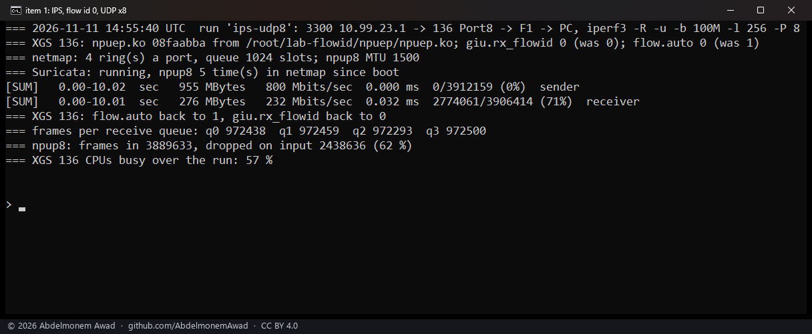
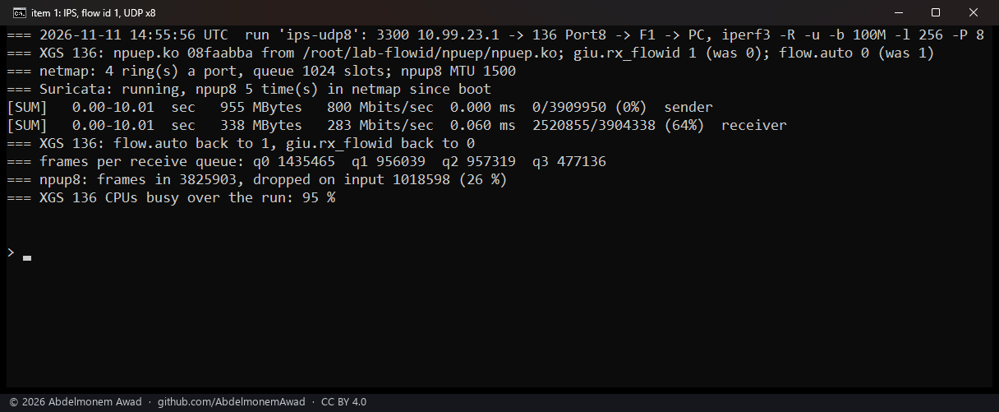
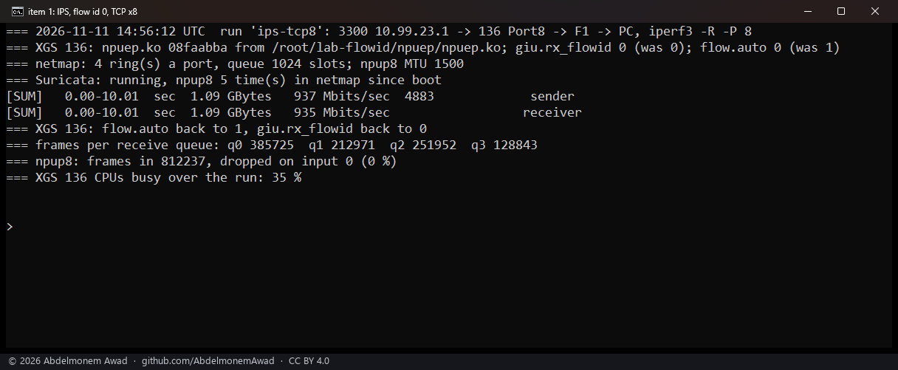
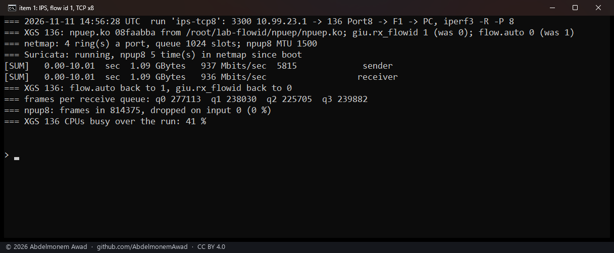
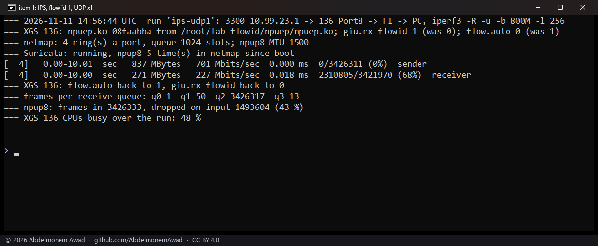
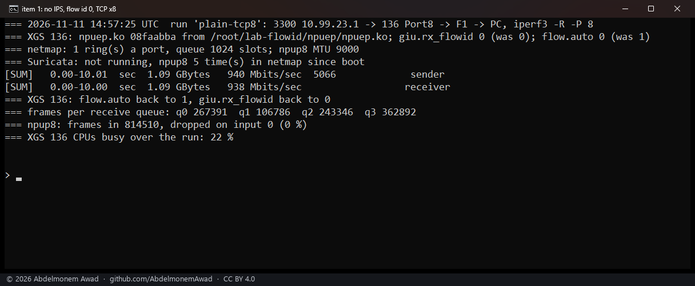
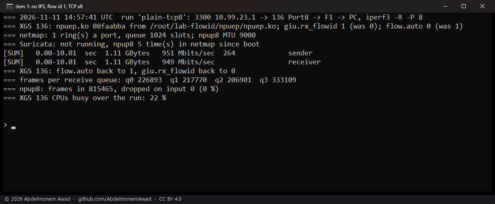
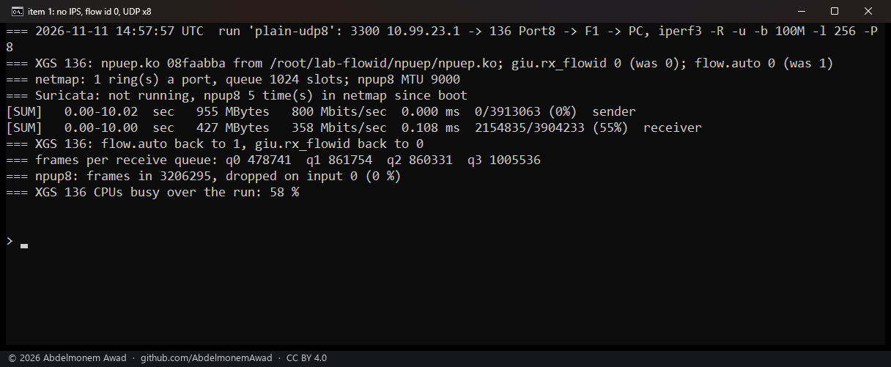
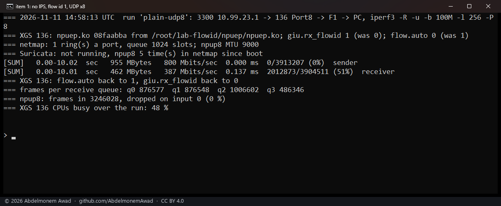

<!-- reviewed: 2026-11-11 -->
# The receive queue as the flow id: four netmap rings for Suricata on the XGS 136, 2026-11-11

Suricata in IPS mode reads the XGS 136's ports through netmap's emulated adapter. That adapter puts a received
frame in the ring its flow id names (FreeBSD's `netmap_generic.c`), and npuep gave its frames no flow id, so
with `dev.netmap.generic_rings` at 4 every frame still went to the first ring.

## What changed

- **`dev.npuep.0.giu.rx_flowid`**, 0 by default: at 1 a received frame carries as its flow id the number of
  the receive queue the coprocessor put it in. The coprocessor picks the queue by a hash of the connection, so
  both directions of one connection land in one queue and several connections spread over the four. A
  forwarded frame then leaves on the transmit queue of the same number.
- Nothing else: at 0 the receive path is as it was.

## How it was measured

The XGS 136 (vendor version 21, four CPUs, its coprocessor set up for four queues), OPNsense 26.7.8_2 on
FreeBSD 15.1-RELEASE-p6, its release module in `/boot/modules`. The module with this change was built on the
appliance against its own kernel's sources (md5 `08faabba`) and loaded in place from a test directory for the
runs; the release module was loaded again after them, `/boot/modules` untouched.

- **Intrusion Detection in IPS mode** on Port8 (`npup8`), with `dev.netmap.generic_rings=4` and the port at
  MTU 1500, and the driver's automatic acceleration at 0 for each run (`dev.npuep.0.flow.auto`, which XGS:
  Settings "Accelerate connections automatically" writes), so every frame crossed the host and Suricata.
- **The traffic** from the second XGS 3300 through the XGS 136's Port8 and out of its F1 to a PC, 10 seconds
  each with iperf3: eight UDP flows of 100 Mbit/s in 256-byte datagrams, eight TCP streams, and one UDP flow
  of 800 Mbit/s. The setting at 0, then at 1, back to back.
- **Read on the XGS 136**: how many frames each receive queue took, what `npup8` dropped on input (netmap's
  ring full), and how busy its CPUs were over the run.

## Results

| Run | Setting | Received | Lost end to end | Dropped at the ring | CPUs busy |
|---|---|---|---|---|---|
| IPS, eight UDP flows | 0 | 232 Mbit/s | 71 % | 62 % | 57 % |
| IPS, eight UDP flows | 1 | **283 Mbit/s** | 64 % | 26 % | 95 % |
| IPS, eight UDP flows, a pair two minutes earlier | 0 | 265 Mbit/s | 67 % | 63 % | 54 % |
| IPS, eight UDP flows, a pair two minutes earlier | 1 | **334 Mbit/s** | 58 % | 12 % | 92 % |
| IPS, eight TCP streams | 0 | 935 Mbit/s | - | 0 % | 35 % |
| IPS, eight TCP streams | 1 | 936 Mbit/s | - | 0 % | 41 % |
| IPS, one UDP flow | 1 | 227 Mbit/s | 68 % | 43 % | 48 % |
| no IPS, eight TCP streams | 0 | 938 Mbit/s | - | 0 % | 22 % |
| no IPS, eight TCP streams | 1 | 949 Mbit/s | - | 0 % | 22 % |
| no IPS, eight UDP flows | 0 | 358 Mbit/s | 55 % | 0 % | 58 % |
| no IPS, eight UDP flows | 1 | 387 Mbit/s | 51 % | 0 % | 48 % |

- **Eight UDP flows through IPS: 22 and 26 % more received**, and netmap's drops fell from 62-63 % to 26 and
  12 %. The gain follows how the eight connections fell over the queues, which their hash decides: 3, 2, 2 and
  1 in the photographed pair's queues gave 26 % dropped, two in each in the earlier pair's gave 12 %.
- **The CPUs are the limit then**, at 92-95 % busy against 54-57 %: four Suricata threads do more work, not the
  same work faster.
- **One flow gains nothing**: all its frames are in one queue, so in one ring, whatever the setting - 227 Mbit/s,
  about what eight flows reach with the setting at 0.
- **TCP through IPS is the same either way** (935 and 936 Mbit/s): eight streams that slow down when frames are
  lost never filled the one ring.
- **Without IPS nothing was lost**: TCP 938 to 949 Mbit/s, UDP 358 to 387 Mbit/s with the CPUs 48 % busy
  against 58 %.

## What it does not mean

- **It is not the fastest way to run IPS here.** With "Inspect, then hardware" on, Suricata sees each new
  connection's start and the coprocessor carries the rest ([the measurement](inspect-2026-10-23.md)); this
  setting matters only where every frame must cross Suricata.
- **Most of the UDP is still lost end to end**, at both settings: the flows offered 800 Mbit/s of 256-byte
  datagrams, more than the host forwards through Suricata at either setting.
- **Only the XGS 136 was measured**, and only npuep has the setting.

To use it: XGS 136, System: Settings: Tunables, `dev.netmap.generic_rings` at 4 and `dev.npuep.0.giu.rx_flowid`
at 1, then Intrusion Detection restarted so Suricata opens its four rings. At a boot OPNsense sets its tunables
after the plugin's early hook has loaded npuep (`/usr/local/etc/rc` runs the early hooks, then `rc.bootup`,
which sets them), so both are in place before Suricata starts. The runs above set them by hand; a boot with
them set was not run.
