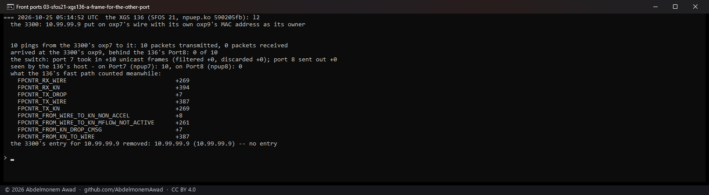
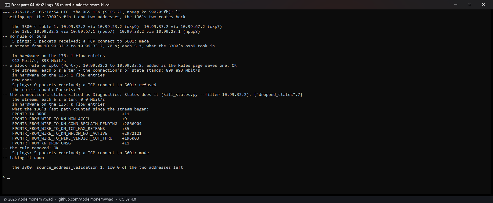
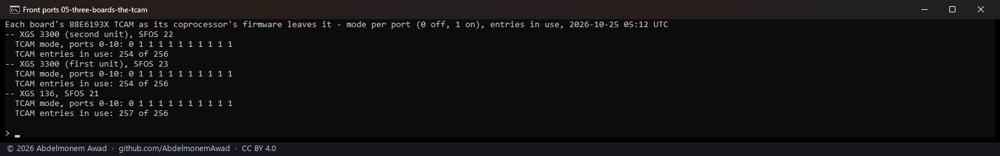

<!-- reviewed: 2026-10-25 -->
# Two front ports: nothing crosses in the switch, and the host's rules decide, 2026-10-25

Discovery 21 of [the discoveries](../findings/discoveries-2026-10-22.md#two-front-ports-never-switch-to-each-other-in-the-chip).
The vendor's TCAM sends every frame that comes in at a front port behind the switch to the
coprocessor, so two devices on two of those ports should never reach each other inside the switch.
Whether the host's rules then see what passes between them was left to be measured. The XGS 136 and
the second XGS 3300 are joined by two cables, each from a switch port to a switch port - the 3300's
Port6 to the 136's Port7, its Port8 to the 136's Port8 - so each board stood for the two devices
while the other was the board under test: the second XGS 3300 on vendor version 22's coprocessor software
(octep.ko `6cde3fde`) and the XGS 136 on vendor version 21's (npuep.ko `590205fb`)
(`images/deploy/lab-frontports.sh`, `lab-frontports-136.sh`, `lab-tcam-read.sh`).

## A frame for the other port's device does not cross

The device on one port sent ten pings to an address it had been told belonged to the MAC address of
the device on the other port - so each frame came in at the first port addressed, at the Ethernet
layer, to the device behind the second.

| the board under test | the switch, in at the first port / out at the second | arrived at the device | where they went |
|---|---|---|---|
| second XGS 3300, vendor version 22 | 10 / 0 | 0 of 10 | the fast path dropped them as not addressed to the port (`FROM_WIRE_DROP_LIF_NOT_MY_MAC` +10) |
| XGS 136, vendor version 21 | 10 / 0 | 0 of 10 | to the host, which saw the ten on the port they came in at |

The switch carried none across, on either. On the XGS 3300 the fast path took all ten in each run,
and in some runs dropped part of them and gave the rest to the host as not accelerated
(`FROM_WIRE_TO_KN_NON_ACCEL`), whose capture on the port showed none; on the XGS 136 the host had
them. A frame that is not for the board's own address goes no further than the board.

## Routed between two front ports, the host's rules decide

Two addresses on the device side, each routed to the other through the board under test - in at one
switch port, out at the other, and back - and between them pings, a TCP connect and a stream. Then a
block rule from the one to the other on the first port's interface, added as the Rules page saves
one (the Filter model, the filter reloaded); then the connection's states killed as Diagnostics:
States does it (`kill_states.py`); then the rule removed.

| | second XGS 3300, vendor version 22 | XGS 136, vendor version 21 |
|---|---|---|
| no rule: pings, a TCP connect | 5 of 5, made | 5 of 5, made |
| a stream | 710, 672 Mbit/s, in hardware | 912, 898 Mbit/s, in hardware |
| the block rule added: the stream already running | 712, 713 Mbit/s, still in hardware | 899, 893 Mbit/s, still in hardware |
| the block rule: new pings, a new connect | 0 of 5, refused - the rule counted 7 | 0 of 5, refused - the rule counted 7 |
| the connection's states killed | the stream 0, 0 Mbit/s, out of hardware | the stream 0, 0 Mbit/s, out of hardware |
| the rule removed | 5 of 5, made | 5 of 5, made |

Everything new between the two ports met the rule, and the connection already running went on
because pf's state for it did - which is what pf does on any firewall, the coprocessor or not:
a rule decides new connections, a state carries an existing one. The reload took the connection out
of hardware for a while (`FROM_WIRE_TO_KN_FW_REV_MISMATCH` +3,706 on the XGS 3300, the flow table's
revision bumped by the reload) and the host carried it - `CONN_RECLAIM_PENDING` counts millions of
its frames - while it stood; killed, it stopped at once and left the hardware on both boards.

## The TCAM on all three versions

The TCAM is on for every front port and off for the coprocessor's, on vendor version 22, 23 and 21 alike, and
both XGS 3300s hold 254 entries. On the XGS 136 the walk through them, done as on the XGS 3300s, did
not reach an end - three times the same - so its entries were not counted. The first XGS 3300 (vendor version
23) was read only: of its switch ports only the WAN and Port4 have a link, Port4 with no address on
it, so no two of them join the lab's boards.

## What it means for os-xgs-npu

Nothing to build: two devices on two front ports reach each other only through the board, and what
passes is what the host's rules and states allow - in hardware too, where a killed state or a ruleset
reload takes a connection out. The XGS 3300's fast path drops a frame that is not addressed to the
port it came in at, rather than giving it to the host every time.

## What it does not say

- Two ports in one OPNsense bridge, where the host forwards by MAC - measured as flows on
  [2026-10-24](bridged-2026-10-24.md), not with a rule between the members.
- Why the XGS 3300's fast path drops some frames that are not for its port and gives others to the
  host, and why the host's capture showed none of those.
- How many of the XGS 136's TCAM entries are in use.
