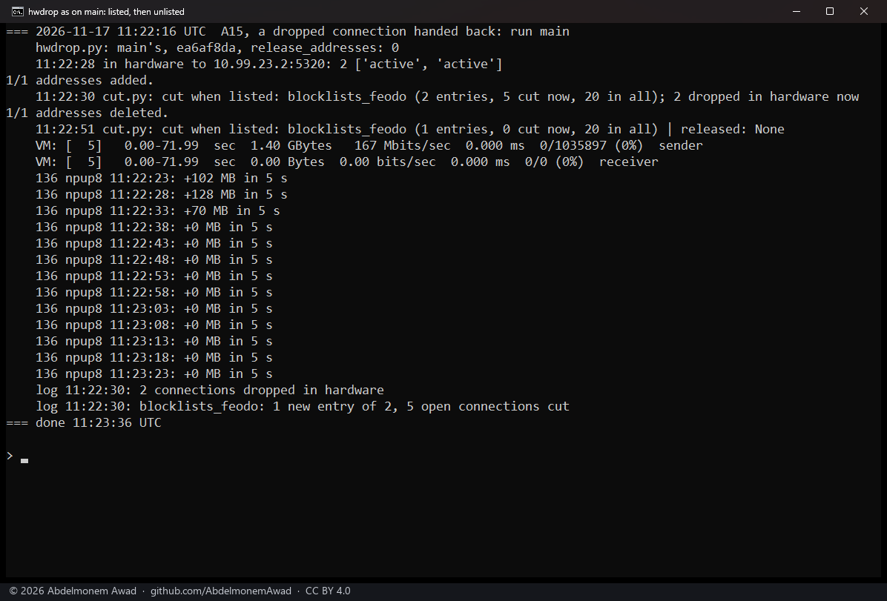
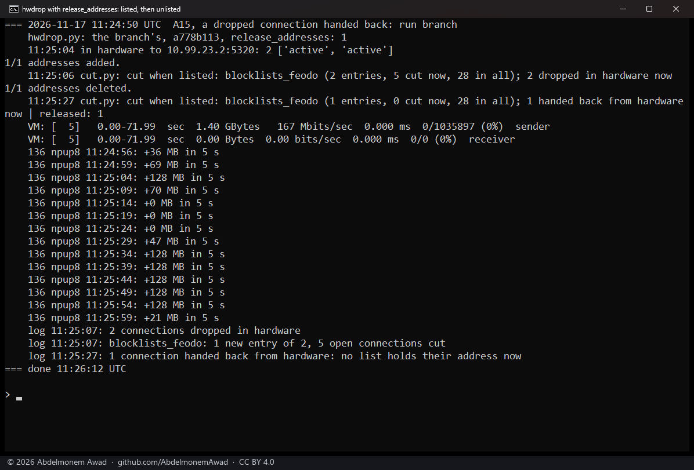

<!-- reviewed: 2026-11-17 -->
<!-- board: Cut in hardware | XGS 3300 | handed back 5 s after unlisting -->
# A connection dropped by a cut, handed back when its address leaves the list. Measured, 2026-11-17

A cut drops a connection on the coprocessor by its verdict, and keeps it there while its sender goes
on sending ([measured 2026-10-23](verdict-2026-10-23.md)). Until this, nothing took it back by
address when the cut was over - its address taken out of the list, the list unchosen, the plugin that
cut it turned off: the connection stayed dropped until its sender stopped, or until it was handed back
by hand on XGS: Offloaded Flows (found by the review of os-blocklists' phase 1).

`hwdrop.release_addresses` hands back to the host every connection with an end in a set of
addresses, by its index and revision, through each driver's own hand-back - the write `flows.py
release` makes. os-blocklists' `cut.py` calls it for the entries no watched list holds any more.
Handed back, the connection meets pf again: a pass rule makes it a new state, and it goes through.

## How it was measured

On the second XGS 3300 (OPNsense 26.7.9, os-xgs-npu main, octep.ko 10eee77b), with os-blocklists'
`cut.py` of its phase 1 branch:

- UDP at 200 Mbit/s for 60 s from the bench machine on F2 to an address of the XGS 136 that the 3300
  reaches out of Port8; the XGS 136 counts what arrives on its link from Port8 every 5
  seconds.
- At 12 s, that address goes into `blocklists_feodo` and `cut.py` runs: the pf cut, and the drop on the
  coprocessor. At 32 s it leaves the table and `cut.py` runs again.
- Once with `hwdrop.py` as on main, and once with `release_addresses` in it. Block Lists' settings
  and `hwdrop.py` were put back as found after.

## What came of it

| MB arriving per 5 s | before the cut | after the cut | after the address left the list |
|---|---|---|---|
| `hwdrop.py` as on main | 102, 128 | 0 | 0, to the end of the stream (30 s) |
| with `release_addresses` | 69, 128 | 0, 0, 0 | 47 within 5 s, then 128 each 5 s to the end |

Both times the cut dropped the stream's two connections on the coprocessor ("2 dropped in hardware
now"). With `release_addresses`, the run after the address left the list said "1 handed back from
hardware now", and the system log "1 connection handed back from hardware: no list holds their
address now". `hwdrop.py` as on main has no `release_addresses`, and `cut.py` hands nothing back.

## Not measured

- The XGS 136's driver, whose hand-back `flow.release` takes the same write: nothing in the lab
  forwards a connection through that unit. `tools/test-hwdrop.py` holds both drivers' writes and the
  words they answer with.
- A list unchosen or the plugin turned off: the same call, for every entry kept for the list;
  os-blocklists' `tools/test-hwdrop.py` holds them.
