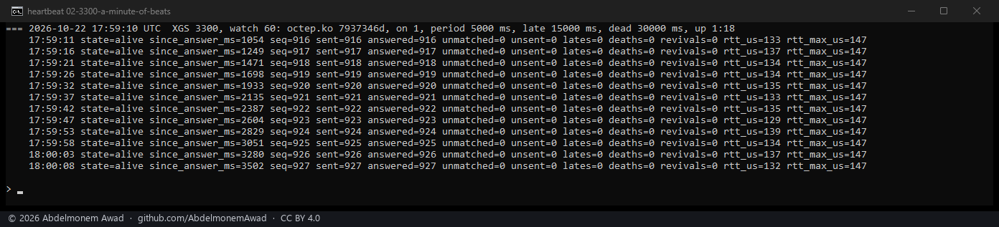
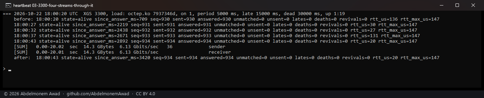
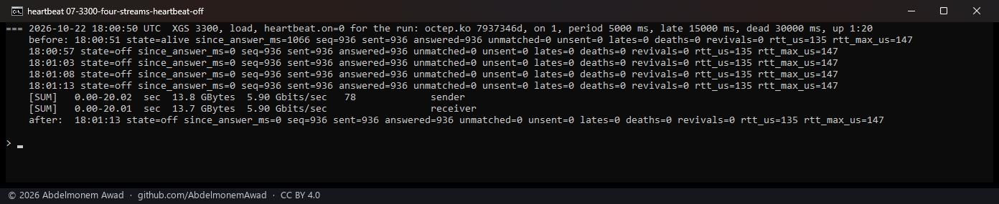
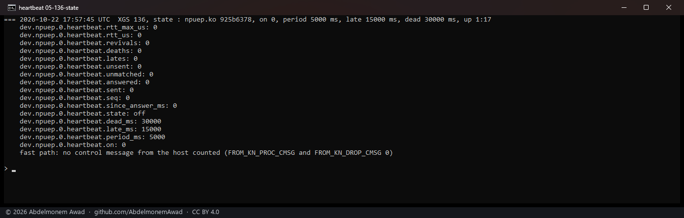
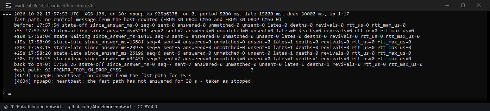
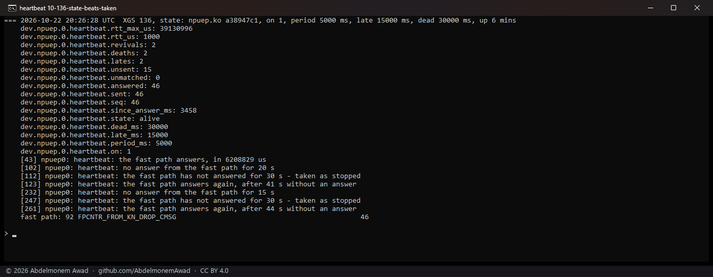
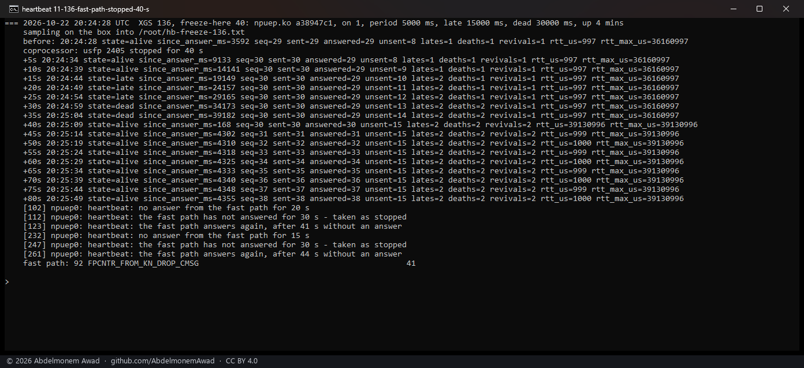
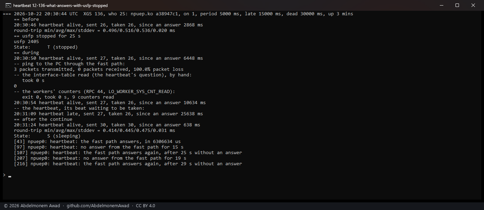
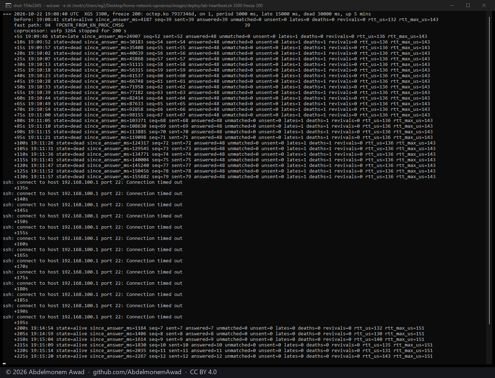
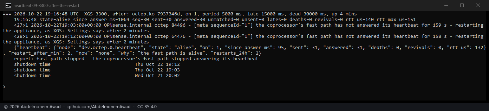

<!-- reviewed: 2026-10-23 -->
<!-- board: Fast path heartbeat | XGS 3300 | stopped: seen in 30 s -->
# The heartbeat with the fast path. Measured, 2026-10-22

Until this, the host could not tell a coprocessor that stopped forwarding from one with nothing to
forward. The vendor's own host sends its fast path a heartbeat message every five seconds and waits
for it to be answered with the same sequence number; this driver counted both message types and sent
neither ([the discovery](../findings/discoveries-2026-10-22.md#a-heartbeat-with-the-fast-path),
[680](https://github.com/AbdelmonemAwad/os-xgs-npu/issues/680)).

Now:

- **On the XGS 3300 the host asks every five seconds and the fast path answers every time**, in
  about 130 microseconds. With no answer for 15 seconds the heartbeat is *late*, at 30 seconds the
  fast path is *taken as stopped*, and the first answer after either is said too - each once, in the
  system log. Measured by stopping the fast path's own process on the coprocessor for 45 seconds:
  late, then stopped, then "answers again, after 48 s without an answer", the data path through it
  unhurt.
- **On the XGS 136 the fast path does not answer it.** It reads the message - its own counters
  count every beat - and drops it, unanswered. ~~The heartbeat is there, `heartbeat.on` 0 by default
  on that family.~~ **The next day, 2026-10-23, the answer there is the beat being taken**: the fast
  path's own process takes each beat off the host's queue, and a stopped one leaves it there -
  measured by stopping it, late, then taken as stopped, then answering again
  ([below](#the-answer-on-this-family-the-beat-taken)). On by default on both families now.
- It begins only once the fast path runs - its RPC answered and an interface made over it. Beats
  sent from the moment the host's ring came up, before the coprocessor's handshake, were followed by
  a boot on which the fast path sent the host nothing at all; [below](#what-it-found-on-the-way).

~~What it does with a fast path taken as stopped is to say so; it does not take connections back or
reload anything - that is the next step, and the question of
[361](https://github.com/AbdelmonemAwad/os-xgs-npu/issues/361) and
[454](https://github.com/AbdelmonemAwad/os-xgs-npu/issues/454).~~ **What is done when it stops, the
same evening** ([below](#what-is-done-when-it-stops)): it is said - the driver's lines in the system
log, a problem report of its own, and the Overview's Fast path line - and, when the owner chooses so
in XGS: Settings, the appliance is restarted after 2, 5 or 10 minutes without an answer, at most
three times a day; off by default. Taking connections back is not what helps: every frame through
the front ports goes through the fast path, so there is nothing the host could carry on its own. The
vendor's host panics the box when its fast path is dead for 120 seconds (with that switched off by
default) and waits five minutes after loading before its first beat.

New, `dev.octep.0.heartbeat.*` and `dev.npuep.0.heartbeat.*`, the same on both: `on`, `period_ms`
(5000, the vendor's), `late_ms` (15000), `dead_ms` (30000); `state` - off, waiting, alive, late or
dead - `since_answer_ms`, `seq`, `sent`, `answered`, `unmatched` (an answer carrying another
sequence, one that came too late), `unsent`, `lates`, `deaths`, `revivals`, `rtt_us`, `rtt_max_us`.
The modules measured: **octep.ko 7937346d** on the second XGS 3300, **npuep.ko 925b6378** on the
XGS 136, and **npuep.ko a38947c1** for the beat taken there (2026-10-23).

## How it was measured

Each run in a window of its own, photographed (`images/deploy/lab-heartbeat-series.ps1`,
`lab-heartbeat.sh`); the text of every run, and of the ones before the series, is kept in the run
log. The fast path's own counters of control messages from the host,
`FPCNTR_FROM_KN_PROC_CMSG` and `FPCNTR_FROM_KN_DROP_CMSG`, are read with the counter tools
(`octep-fpcnt.sh`, `npuep-fpcnt.sh`).

- **A minute of beats**: the heartbeat's counters every five seconds.
- **Four streams through it**: iperf3 from the PC through the second XGS 3300 to the first, four
  streams down for 20 seconds, the heartbeat sampled during them - then the same with the heartbeat
  off, to see what asking costs.
- **The fast path stopped**: on the coprocessor's own Linux, through its console (`npu-run.sh`), the
  fast path's process `usfp` is sent SIGSTOP, and SIGCONT 45 seconds later.
- **The XGS 136**: its state as installed, then `heartbeat.on` 1 for 30 seconds and back to 0.

## The XGS 3300

| | sent | answered | the fast path counted | answer |
|---|---|---|---|---|
| a minute, idle | 11 | 11 | every one | 129-139 µs |
| four streams, 6.13 Gbit/s | 4 | 4 | every one | 20-131 µs |
| four streams, the heartbeat off | - | - | - | 5.90 Gbit/s |

Under load the answer comes sooner, not later - most likely because the receive path is already
awake and reads it at once. The heartbeat costs the stream nothing - 6.13 Gbit/s with it, 5.90 without, both lower
than the 9.91 of [the window check's runs](tcp-window-2026-10-22.md) the same day for a reason that
is the lab's, not the heartbeat's.

### The fast path stopped

- **Late after 19 seconds, not 15**: the silence is judged at each beat, every five seconds, so a
  state is reached at the first beat past its limit.
- **Taken as stopped at 30 seconds**, and **alive again** at the first answer after the fast path
  went on, 48 seconds after the last one before it stopped.
- **The eight beats sent while it was stopped were answered when it went on** - its queue was kept -
  each carrying a sequence that was no longer the last one sent, so counted as `unmatched`, and the
  longest answer, `rtt_max_us`, is the beat sent just before it went on: 3.85 seconds.
- **The data path came back with it**: a ping through it after, 3 of 3; nothing else from the
  driver in the log.

Two earlier tries at this run did not stop anything, and are in the log: the console was busy - it is
read for the first fifteen seconds of every minute by the temperature task - and the command as first
written ended in `&` before the console helper's own `; echo`, which the coprocessor's shell refused.
The run above sends it between seconds 20 and 40.

## The XGS 136

How it got there, with throwaway builds before the series (in the run log, not photographed):

| sent as | the fast path counted | the coprocessor's log |
|---|---|---|
| an Ethernet frame, EtherType 0xefef, the message after it - as the XGS 3300's fast path takes it - 60 bytes | dropped, one for each beat | - |
| the vendor's host's own frame, to the byte: both addresses zero, 22 bytes, no padding | dropped, one for each | `cmsg: unknown version 0` |
| every byte 0x20 plus its own offset | dropped | `cmsg: unknown version 35` - the version read from byte 3 |
| the message alone, from the frame's first byte | dropped, one for each beat | - (the version accepted) |
| the same framing, a port rate update of no entries (type 7) | **processed**, one for each | - |

So this fast path reads a control message from the host from the frame's first byte, with no
Ethernet header in front of it - the XGS 3300's reads one behind its Ethernet header - and with that
framing it processes a type it handles and drops the heartbeat's. The XGS 136's fast path does not
answer the heartbeat; ~~the driver keeps it, framed as this fast path reads a message, and off.~~ the
driver keeps it, framed as this fast path reads a message - and takes it being read as the answer.

### The answer on this family: the beat taken

Measured 2026-10-23, npuep.ko a38947c1. What answers the host on this family, and what does not, was
found by stopping the fast path's own process, `usfp`, on the coprocessor and asking everything at
once. With it stopped - `State: T`, and nothing through the front ports, a ping to the PC through
them 3 of 3 lost - **the RPC channel still answered at once**: the interface-table read and the
workers' counters (command 44) alike. Something other than `usfp` answers that channel here, so an
RPC command, the stand-in this page named the day before, would have said "alive" with the fast path
stopped - it was built, and the run below is why it was taken out again. What `usfp` does itself is
take the host's frames off its queues (the coprocessor's `eth_mvgiu`), the beats among them: each beat
counted once in `FPCNTR_FROM_KN_DROP_CMSG`, sent 46, taken 46, counted 46. So the answer is the beat
taken - queue 0's consumer index past it - looked at on every pass of the poll, so it is timed to the
poll's millisecond; one beat at a time, the next not sent while one waits.

| with usfp stopped | answers? |
|---|---|
| a ping through the front ports | no, 3 of 3 lost |
| the RPC channel: an interface-table read, the workers' counters | **yes, at once** |
| the heartbeat's beat, taken off the host's queue | no - late at 15 s, taken as stopped at 30 |

The watcher, the report and the Overview read it as they read the XGS 3300's: the problem reporter
made its `fast-path-stopped` report on the XGS 136 from the first of these runs (reporting set to
manual for the tests, the report dismissed).

## What is done when it stops

XGS: Settings, "When the fast path stops": "Say so, and nothing more" (the default), or "Restart the
appliance after 2 / 5 / 10 minutes". `scripts/xgs/fastpath.py` reads the heartbeat every minute and,
with a restart chosen, restarts the appliance cleanly once the fast path has been taken as stopped and
gone that long without an answer - the problem report collected first, so it is not lost with the
boot - and never more than three times in 24 hours. The report is a kind of its own,
`fast-path-stopped`, with the heartbeat's counters and this boot's `heartbeat:` lines, looked for at
once after a boot rather than after the ten minutes the driver's readiness waits. The Overview's
Fast path line says answering and in how long, no answer for how long, or taken as stopped, and the
Coprocessor card turns to a warning while it is.

- **Restarted at 158 seconds without an answer**, not 120: the watcher looks once a minute, so the
  restart comes at the first look after the minutes chosen.
- **The report went with it**: queued before the restart (reporting set to manual for the test, so
  it stayed in the queue instead of going to GitHub, and was dismissed after).
- **A first test the same evening** found two things, both fixed before this run: the report was not
  made, because the reporter looked at the driver only ten minutes after a boot and the fast path had
  been stopped four minutes into one; and the watcher's own line, logged as an error, had become a
  second, generic report. The heartbeat is looked at from the boot's first minute now, and the line is
  a warning.
- ~~**On the XGS 136** the heartbeat is off, so the watcher reads it and does nothing; the Overview says
  "not asked".~~ **On the XGS 136** since 2026-10-23 the same, its answer the beat taken
  ([above](#the-answer-on-this-family-the-beat-taken)).

## What it found on the way

**A heartbeat sent before the coprocessor is up.** The first build sent its beats from the second the
host's ring 0 came up - twenty seconds before the coprocessor's handshake. On that boot the second
XGS 3300's fast path sent the host nothing at all: no answer to any of 135 beats, nor to a message
posted by hand twelve minutes in (the instrument whose message was answered earlier that day), no
control message of any type, and the far end of the lab unreachable through it. The next boot, with
the heartbeat held until the RPC had answered and an interface was made: every beat answered, the far
end reached. One boot each: what is measured is that the boot with early beats was dead and the
boots since, with the gate, are not. The vendor's host waits five minutes.

**`dp.rx_seen` is not a count of what the host received**: it read 0 on the boot where everything
was answered.

## What it does not do yet

- ~~Act on a fast path taken as stopped - take connections back, or tell the Status page and the
  problem reporter; for now it is a line in the system log and `heartbeat.state`.~~ Done the same
  evening, [above](#what-is-done-when-it-stops).
- ~~The XGS 136: no heartbeat its fast path answers. Something else it answers - an RPC command that
  reads one counter, say - could stand in for it there.~~ Done 2026-10-23 with the beat taken; an
  RPC command could not stand in, measured: the channel answers with the fast path stopped
  ([above](#the-answer-on-this-family-the-beat-taken)).
