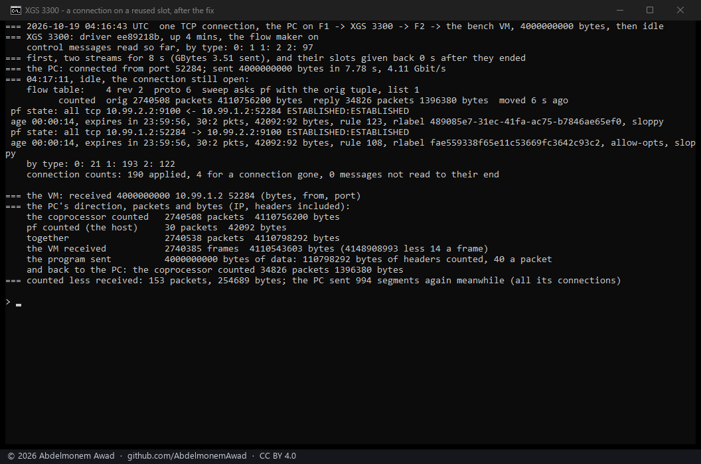
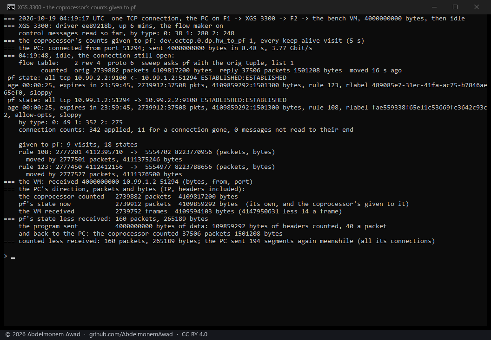
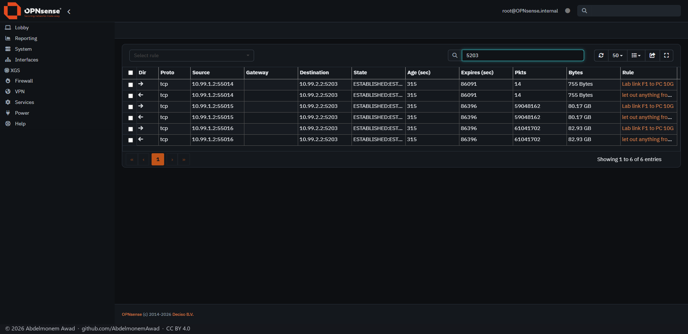
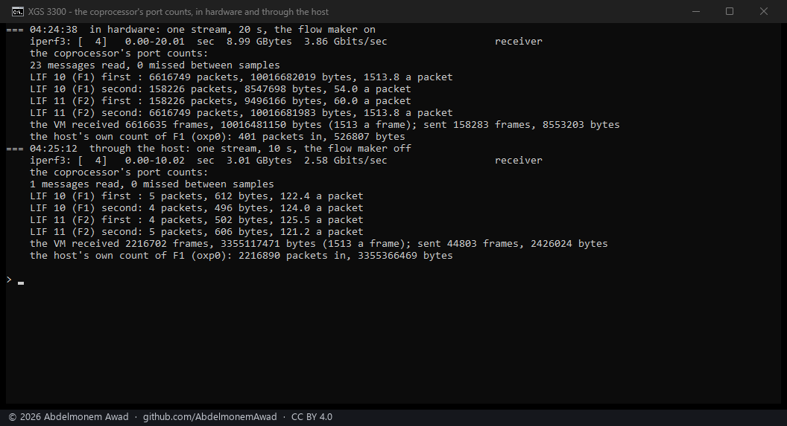
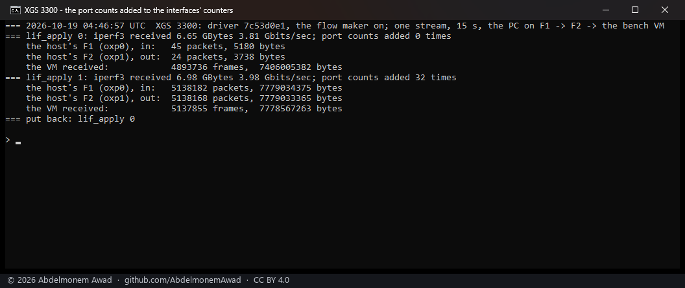
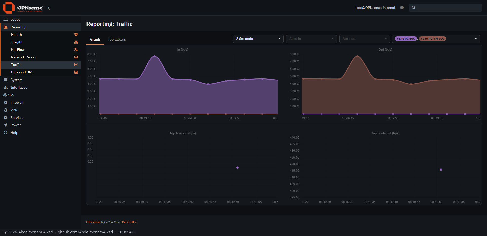

<!-- reviewed: 2026-10-19 -->
# What the coprocessor counts of a connection, measured, 2026-10-19

Once a connection is in hardware the host stops seeing it: its frames go from port to port inside
the coprocessor, and pf's state, the interface counters and every graph built on them stop growing -
which is why every throughput on these pages is read at the far end, not on the appliance. The
coprocessor itself counts every connection it forwards, and the XGS 3300's sends those counts to the
host unasked, about once a second, as control messages on tag 254 - which the driver had dropped
unread since the receive path was written. Since this change it reads them
(`octep_dp_cmsg_rx` in `contrib/octep/octep_dp.c`): each connection in the table keeps the packets and
bytes the coprocessor counted for each direction, `dev.octep.0.dp.flow_table` prints them, and the
**Offloaded Flows** page shows them as **Counted in hardware**.

## The message, read before it was trusted

The layout is the vendor's - `CONN_STATS_BULK_UPDATE` in its `cmsg_types.h` - and was read off a
frame the coprocessor sent during one stream in hardware (`dp.rx_untagged_frame` with
`dp.rx_untag_want` 254) before any code relied on it. After the Ethernet header, EtherType 0xEFEF:
the control header (padding, type 1, version 1), the number of entries (u16), of bursts (u8) and a
both-directions flag (u8); then each burst - a u32 with the first connection's index in its low 26
bits and the count less one in the top six - and that many entries of eighteen bytes: for each
direction a u32 of bytes and a u32 holding the bytes' bits 32 to 34 under the packet count shifted
left by three, then the connection's revision. Everything little-endian; ~~the totals run from the
connection's making, so the driver adds the difference from the last message, in the coprocessor's
own widths, as the vendor's host does. An entry whose revision is not the connection's own is for a
connection that has gone, and is counted and left.~~ **Corrected the same day:** the totals are the
table slot's, not the connection's - the coprocessor does not start them again when a slot is given
to a new connection. Taking a new connection's first message as all new, as this change did, gave a
reused slot the whole history of the connections before it: a fetch of a few megabytes through IPsec
was shown with 47,013,607 packets and 1,792,591,546 bytes, 38 bytes a packet, the 35 bits of bytes
having wrapped and the 29 of packets not. The two runs below were right because their slots had
carried next to nothing before. The driver now keeps the last totals for the slot, across the
connections that use it, and gives each connection only what moved while it held the slot - as the
vendor's host keeps them, per slot, for the life of its module.

## How it was measured

On the second XGS 3300, rebooted onto this driver (`octep.ko` built from this change, 391,072
bytes, md5 `0afb356c`). One TCP connection from the bench PC on F1, through the appliance and out of
F2, to the bench VM, with the flow maker on: the PC sends exactly 4,000,000,000 bytes and then holds
the connection open, idle, so that its counts can be read while it is still in the table. Then:

- **the coprocessor's count** of the PC's direction, from the flow table;
- **pf's count**, from the connection's state - what passed through the host before the flow was made;
- **what the VM received**, from its own interface counters before and after, less fourteen bytes of
  Ethernet header a frame - so IP bytes, as the other two count them.

The second run also reads the PC's own count of TCP segments it sent again, for all its connections
together. Run by `images/deploy/lab-hw-counters.sh` (sender `hw-count-send.py`), each in a window of
its own, photographed.

## Results

| | run 1, 3.87 Gbit/s | run 2, 2.47 Gbit/s |
|---|---|---|
| the coprocessor counted | 2,739,932 packets, 4,109,766,640 bytes | 2,739,713 packets, 4,109,547,896 bytes |
| pf counted, before the flow was made | 30 packets, 42,092 bytes | 30 packets, 42,092 bytes |
| **together** | **2,739,962 packets, 4,109,808,732 bytes** | **2,739,743 packets, 4,109,589,988 bytes** |
| the VM received | 2,739,848 frames, 4,109,612,543 bytes | 2,739,757 frames, 4,109,592,843 bytes |
| counted less received | 114 packets, 196,189 bytes | -14 packets, -2,855 bytes |
| the PC's retransmissions meanwhile, all its connections | not read | 81 |
| back to the PC, the coprocessor counted | 37,099 packets, 1,485,240 bytes | 37,725 packets, 1,513,084 bytes |

- **The coprocessor's count and pf's together are what crossed the wire.** In run 2 they came to
  fourteen packets fewer than the VM received - 2,855 bytes in 4.1 GB, which is the VM's own other
  traffic in the same window - and the bytes are the payload and forty bytes of IP and TCP header a
  packet, to 268 bytes. The coprocessor counted all but thirty packets of the connection: the
  handshake and the first frames, which pf saw before the flow was made.
- **The bytes are IP bytes**, headers included and the Ethernet header not: forty a packet over the
  4,000,000,000 of data, and forty a packet back, where the VM only acknowledged.
- **Run 1 counted 114 packets more than the VM received**, 196,189 bytes, and its count exceeds the
  data and headers by 210,252 bytes - about 144 full segments. That is what segments sent twice look
  like, each copy counted where it crossed the appliance; the PC's retransmission count, added for
  run 2, was not read in run 1, so this is not established.
- What the coprocessor sends, by type, eight minutes after the boot: 31 messages of interface
  counters (type 0), 187 of connection counts (type 1), 373 of IPsec association counters (type 2);
  183 entries applied, 4 for a connection already gone, none that could not be read to its end
  (`dev.octep.0.dp.cmsg_rx`).
- ~~**Not done yet**: the counts are kept and shown, not yet given to pf - its state's counters, and the
  interface counters, still miss what went through hardware, which the vendor's host fixes by adding
  each message's difference to the connection's state; nor are the interface counters (type 0) read.~~
  Both done the same day, below. The XGS 136's coprocessor has not been looked at for the same
  messages.

## After the fix: a slot used before

The fix of [#515](https://github.com/AbdelmonemAwad/os-xgs-npu/issues/515), loaded by a reboot
(`octep.ko` 397,752 bytes, md5 `ee89218b`): two streams for eight seconds first, 3.51 GB, their
slots given back; then the same 4,000,000,000 bytes on one connection, which took slot 4 at its
second revision - a slot that had just carried one of those streams.

| | run 3, a slot used before, 4.11 Gbit/s |
|---|---|
| the coprocessor counted | 2,740,508 packets, 4,110,756,200 bytes |
| pf counted, before the flow was made | 30 packets, 42,092 bytes |
| **together** | **2,740,538 packets, 4,110,798,292 bytes** |
| the VM received | 2,740,385 frames, 4,110,543,603 bytes |
| counted less received | 153 packets, 254,689 bytes |
| the PC's retransmissions meanwhile, all its connections | 994 |

- **The slot's history did not come with it**: the stream before it on the same slot had carried
  about 1.75 GB, and the count is the connection's own, the data and forty bytes a packet. It exceeds
  them by 1,176,772 bytes - about 800 segments sent twice, in a run where the PC sent 994 again - and
  the VM, which received 153 packets fewer than were counted, took most of them twice too: what
  crossed the appliance, and was counted there, is what the sender put on the wire.

## Given to pf

`dev.octep.0.dp.hw_to_pf` (off by default, set to 1 for the run): every few seconds the keep-alive
adds what the coprocessor counted for a connection since its last visit to pf's states for it, and
to the counters of the rule that passed it, as the packets would have had they come through pf.

| | run 4, 3.77 Gbit/s |
|---|---|
| the coprocessor counted | 2,739,882 packets, 4,109,817,200 bytes; back 37,506 packets, 1,501,208 bytes |
| **pf's state, afterwards** | **2,739,912 packets, 4,109,859,292 bytes; back 37,508 packets, 1,501,300 bytes** |
| that is | pf's own 30 packets and 42,092 bytes (2 and 92 back), and every one of the coprocessor's |
| the VM received | 2,739,752 frames, 4,109,594,103 bytes |
| the rules that passed it (one for each of its two states) | moved by 2,777,501 and 2,777,527 packets, 4,111,375,246 and 4,111,376,500 bytes |

- **pf's state now holds the whole connection**, to the packet: what it saw itself and what the
  coprocessor counted, nothing twice. Each rule moved by the connection's packets both ways
  (2,777,420) and a few dozen of other connections on the same rules.
- And so OPNsense's own pages show it. **Firewall: Diagnostics: Sessions**, during two streams in
  hardware with `hw_to_pf` on: 80.17 and 82.93 GB for connections pf would otherwise have shown at a
  few kilobytes.

- A first attempt at run 4 read the state of the run before, still closing on the same server port,
  for the summary; the states and rules it printed were right, its last lines were not. The script
  now picks the connection by its port at the PC, and the photograph is of the run after.

## The port counts

The coprocessor's other message, type 0 (`LIF_STATS`), counts each port. Every one of them was kept
during a stream (`images/deploy/lif-sample.sh`, from `dev.octep.0.dp.cmsg_last`) and summed
(`lif-decode.py`), first in hardware, then with the flow maker off so the same stream went through
the host (`lab-lif-counts.sh`):

| | in hardware, 20 s, 3.86 Gbit/s | through the host, 10 s, 2.58 Gbit/s |
|---|---|---|
| messages | 23, none missed | 1, from before the stream |
| F1, the first direction | 6,616,749 packets, 10,016,682,019 bytes, 1,513.8 a packet | 5 packets, 612 bytes |
| F1, the second | 158,226 packets, 8,547,698 bytes, 54.0 a packet | 4 packets, 496 bytes |
| F2, the second | 6,616,749 packets, 10,016,681,983 bytes | 5 packets, 606 bytes |
| the VM received | 6,616,635 frames, 10,016,481,150 bytes | 2,216,702 frames, 3,355,117,471 bytes |
| the host's own count of F1, in | 401 packets | 2,216,890 packets, 3,355,366,469 bytes |

- **A port count is not a running total**: each message holds what moved since the one before, about
  once a second while the port forwards anything in hardware. Summed, they are the stream to within
  114 packets of what the VM received.
- **The first direction is what arrived on the port, the second what left it**, and the bytes are the
  Ethernet frame without its FCS - 1,514 for a full frame, 54 for an acknowledgement, 60 for one
  padded on the wire - as an interface counts them.
- **Only what the coprocessor forwarded itself**: the same stream through the host brought no message
  at all, while the host's own counter carried it. So these are exactly what an interface's counters
  miss under offloading, and `dev.octep.0.dp.lif_apply` adds them there.
- The reader that first took them for totals, as a connection's are, was corrected after this
  measurement; ~~that correction is built and installed (`octep.ko` md5 `7c53d0e1`) and loads at the
  next boot, so `lif_apply` has not yet been measured on the interfaces' counters, and stays off.~~
  loaded by a reboot the same day and measured, below.

## Added to the interfaces' counters

On the corrected driver (`octep.ko` md5 `7c53d0e1`, loaded by a reboot): one stream of 15 s in
hardware, twice - with `dev.octep.0.dp.lif_apply` 0 and with 1 - and F1's "in" and F2's "out" as the
host's interfaces count them (`netstat -I`), beside what the VM received (`lab-lif-apply.sh`).

| | lif_apply 0, 3.81 Gbit/s | lif_apply 1, 3.98 Gbit/s |
|---|---|---|
| F1 (oxp0) in, as the host counts it | 45 packets, 5,180 bytes | **5,138,182 packets, 7,779,034,375 bytes** |
| F2 (oxp1) out, as the host counts it | 24 packets, 3,738 bytes | **5,138,168 packets, 7,779,033,365 bytes** |
| the VM received | 4,893,736 frames, 7,406,005,382 bytes | 5,137,855 frames, 7,778,567,263 bytes |
| port counts added | none | 32 times |

- **Without them, the interfaces saw nothing of a stream in hardware** - 45 packets of 4.9 million.
  **With them, both ports count the whole stream**, to 327 packets in 5.1 million of what the VM
  received (0.006%), the same few hundred segments sent twice that the connection counts showed.
- And so OPNsense's own graphs show it. **Reporting: Traffic** for F1 and F2 during two streams in
  hardware: about 4.5 Gbit/s in on F1 and out on F2, where it had drawn next to nothing. The counts
  arrive in steps about once a second and the graph reads every two seconds, so one reading can take
  two of them: the single peak at 7.7 Gbit/s is that, not the streams.

## Settings

Both are settings since then - **XGS: Settings, Acceleration**: **Count hardware traffic in pf**
(`dp.hw_to_pf`) and **Count hardware traffic on the interfaces** (`dp.lif_apply`), on by default,
XGS 3300 only, applied when the page is saved and at every boot by the driver's bring-up. Tested on
the second XGS 3300: with neither saved yet, both came on by default; one turned off through the
model and applied went off, and on again. ~~Their path at boot was checked by running its lines, not
by a reboot.~~ Their path at boot too, at the reboot of 06:28 UTC the same day: both on as the
appliance came up, with nothing saved.
