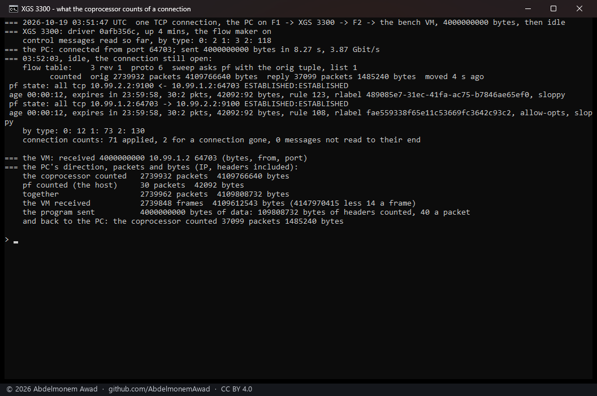
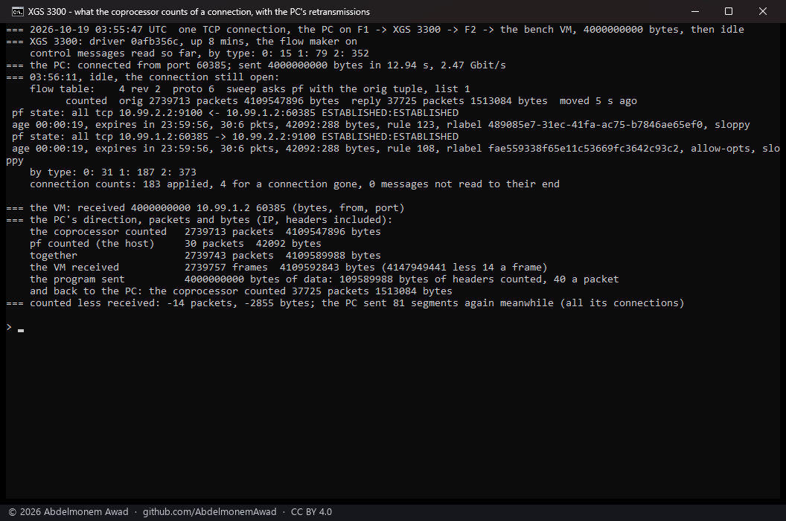

<!-- reviewed: 2026-10-19 -->
# What the coprocessor counts of a connection, measured, 2026-10-19

Once a connection is in hardware the host stops seeing it: its frames go from port to port inside
the coprocessor, and pf's state, the interface counters and every graph built on them stop growing -
which is why every throughput on these pages is read at the far end, not on the appliance. The
coprocessor itself counts every connection it forwards, and the XGS 3300's sends those counts to the
host unasked, about once a second, as control messages on tag 254 - which the driver had dropped
unread since the receive path was written. Since this change it reads them
(`octep_dp_cmsg_rx` in `contrib/octep/octep_dp.c`): each connection in the table keeps the packets and
bytes the coprocessor counted for each direction, `dev.octep.0.dp.flow_table` prints them, and the
**Offloaded Flows** page shows them as **Counted in hardware**.

## The message, read before it was trusted

The layout is the vendor's - `CONN_STATS_BULK_UPDATE` in its `cmsg_types.h` - and was read off a
frame the coprocessor sent during one stream in hardware (`dp.rx_untagged_frame` with
`dp.rx_untag_want` 254) before any code relied on it. After the Ethernet header, EtherType 0xEFEF:
the control header (padding, type 1, version 1), the number of entries (u16), of bursts (u8) and a
both-directions flag (u8); then each burst - a u32 with the first connection's index in its low 26
bits and the count less one in the top six - and that many entries of eighteen bytes: for each
direction a u32 of bytes and a u32 holding the bytes' bits 32 to 34 under the packet count shifted
left by three, then the connection's revision. Everything little-endian; ~~the totals run from the
connection's making, so the driver adds the difference from the last message, in the coprocessor's
own widths, as the vendor's host does. An entry whose revision is not the connection's own is for a
connection that has gone, and is counted and left.~~ **Corrected the same day:** the totals are the
table slot's, not the connection's - the coprocessor does not start them again when a slot is given
to a new connection. Taking a new connection's first message as all new, as this change did, gave a
reused slot the whole history of the connections before it: a fetch of a few megabytes through IPsec
was shown with 47,013,607 packets and 1,792,591,546 bytes, 38 bytes a packet, the 35 bits of bytes
having wrapped and the 29 of packets not. The two runs below were right because their slots had
carried next to nothing before. The driver now keeps the last totals for the slot, across the
connections that use it, and gives each connection only what moved while it held the slot - as the
vendor's host keeps them, per slot, for the life of its module.

## How it was measured

On the second XGS 3300, rebooted onto this driver (`octep.ko` built from this change, 391,072
bytes, md5 `0afb356c`). One TCP connection from the bench PC on F1, through the appliance and out of
F2, to the bench VM, with the flow maker on: the PC sends exactly 4,000,000,000 bytes and then holds
the connection open, idle, so that its counts can be read while it is still in the table. Then:

- **the coprocessor's count** of the PC's direction, from the flow table;
- **pf's count**, from the connection's state - what passed through the host before the flow was made;
- **what the VM received**, from its own interface counters before and after, less fourteen bytes of
  Ethernet header a frame - so IP bytes, as the other two count them.

The second run also reads the PC's own count of TCP segments it sent again, for all its connections
together. Run by `images/deploy/lab-hw-counters.sh` (sender `hw-count-send.py`), each in a window of
its own, photographed.

## Results

| | run 1, 3.87 Gbit/s | run 2, 2.47 Gbit/s |
|---|---|---|
| the coprocessor counted | 2,739,932 packets, 4,109,766,640 bytes | 2,739,713 packets, 4,109,547,896 bytes |
| pf counted, before the flow was made | 30 packets, 42,092 bytes | 30 packets, 42,092 bytes |
| **together** | **2,739,962 packets, 4,109,808,732 bytes** | **2,739,743 packets, 4,109,589,988 bytes** |
| the VM received | 2,739,848 frames, 4,109,612,543 bytes | 2,739,757 frames, 4,109,592,843 bytes |
| counted less received | 114 packets, 196,189 bytes | -14 packets, -2,855 bytes |
| the PC's retransmissions meanwhile, all its connections | not read | 81 |
| back to the PC, the coprocessor counted | 37,099 packets, 1,485,240 bytes | 37,725 packets, 1,513,084 bytes |

- **The coprocessor's count and pf's together are what crossed the wire.** In run 2 they came to
  fourteen packets fewer than the VM received - 2,855 bytes in 4.1 GB, which is the VM's own other
  traffic in the same window - and the bytes are the payload and forty bytes of IP and TCP header a
  packet, to 268 bytes. The coprocessor counted all but thirty packets of the connection: the
  handshake and the first frames, which pf saw before the flow was made.
- **The bytes are IP bytes**, headers included and the Ethernet header not: forty a packet over the
  4,000,000,000 of data, and forty a packet back, where the VM only acknowledged.
- **Run 1 counted 114 packets more than the VM received**, 196,189 bytes, and its count exceeds the
  data and headers by 210,252 bytes - about 144 full segments. That is what segments sent twice look
  like, each copy counted where it crossed the appliance; the PC's retransmission count, added for
  run 2, was not read in run 1, so this is not established.
- What the coprocessor sends, by type, eight minutes after the boot: 31 messages of interface
  counters (type 0), 187 of connection counts (type 1), 373 of IPsec association counters (type 2);
  183 entries applied, 4 for a connection already gone, none that could not be read to its end
  (`dev.octep.0.dp.cmsg_rx`).
- **Not done yet**: the counts are kept and shown, not yet given to pf - its state's counters, and the
  interface counters, still miss what went through hardware, which the vendor's host fixes by adding
  each message's difference to the connection's state; nor are the interface counters (type 0) read.
  The XGS 136's coprocessor has not been looked at for the same messages.
