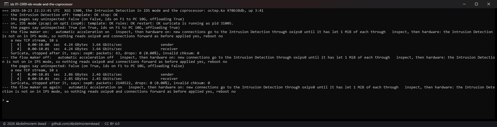
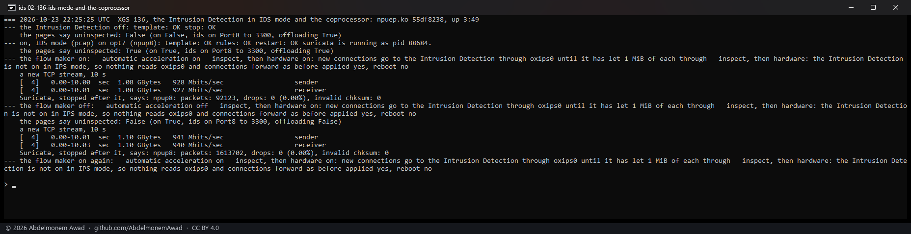
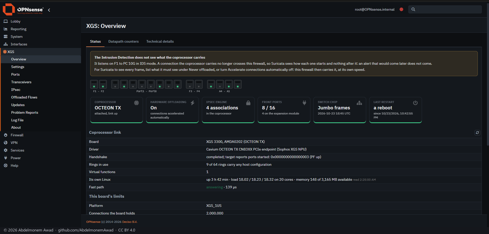
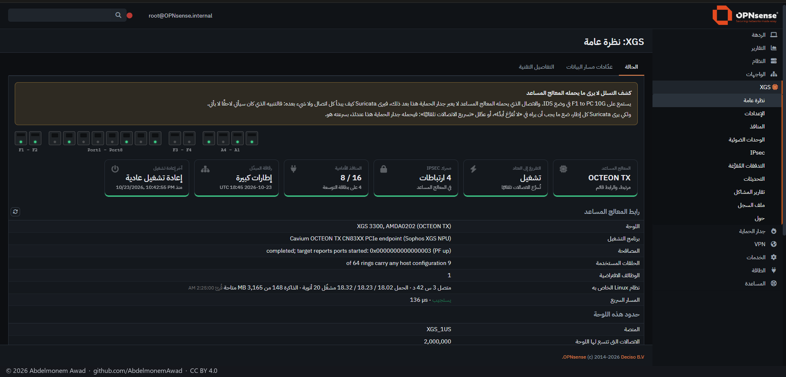
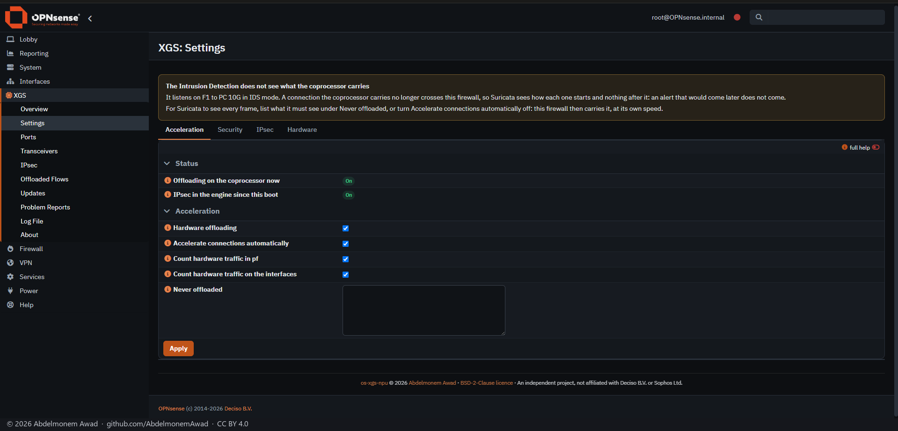
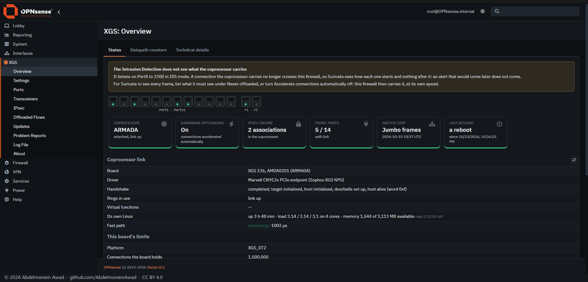

<!-- reviewed: 2026-10-24 -->
# What the Intrusion Detection sees of a connection in hardware, measured - and the pages that say so, 2026-10-24

Suricata, OPNsense's Intrusion Detection, listens on this host. A connection the flow maker hands to
the coprocessor no longer crosses it, so in IDS mode - which only listens - and in IPS mode without
"Inspect, then hardware" running, Suricata sees how each connection starts and nothing after it. No
page said so until today; asked about on the OPNsense forum. Since this change XGS: Overview and XGS:
Settings say it whenever it is the case ([what it cannot do](../guide/limitations.md#suricata-sees-how-a-connection-starts-not-all-of-it)).

**Measured on both appliances**, Suricata in IDS mode (pcap) on the interface a 10-second TCP stream
came in on, started fresh before the stream and stopped after it - a stopped Suricata says how many
packets it captured on each interface:

| | the flow maker on: the stream in hardware | the flow maker off: the host carries it all |
|---|---|---|
| XGS 3300, octep.ko 970b38db | 4.24 GB at 3.64 Gbit/s, **63 packets** captured | 2.86 GB at 2.46 Gbit/s, **2,148,522 packets** |
| XGS 136, npuep.ko 55df8238 | 1.08 GB at 928 Mbit/s, **92,123 packets** captured | 1.10 GB at 941 Mbit/s, **1,613,702 packets** |

On the XGS 3300 the connection was in hardware after its first few dozen packets. On the XGS 136 the
flow maker makes connections in a sweep once a second, so the host - and Suricata - carried about the
first second of the stream at the link's rate, about 94,000 frames each way, and then nothing:
counted on the same port with `tcpdump -Q in` and `-Q out` in a run of its own, 94,134 and 94,348
frames. Either way, what Suricata sees is how the connection starts.

In each state the pages' flag (`status.py`, `intrusion_detection.uninspected`) was read: false with
the Intrusion Detection off, true with it on in IDS mode and the flow maker on, false again with the
flow maker off.

## What the pages say

A warning above the page, on XGS: Overview and on XGS: Settings, while the Intrusion Detection is on,
the flow maker is on, and "Inspect, then hardware" is not running in Netmap mode: which interfaces it
listens on and in which mode, that Suricata sees how each connection starts and nothing after it, and
what to do - in IPS mode, "Inspect, then hardware"; in either mode, Never offloaded for what it must
see, or the flow maker off. In Arabic from the opnsense-arabic catalogue.

## Why a warning and not the connections kept with the host

The other way was to keep the connections of the interfaces the Intrusion Detection listens on with
the host, as an enabled Traffic Shaper rule or Captive Portal zone already does
(`ipfw_keeps()` in `src/opnsense/scripts/xgs/flow_exclude.php`). Not taken, for two reasons:

- **IDS mode with the offload is used on purpose.** XGS: Settings "Cut connections by TLS fingerprint"
  needs only the Intrusion Detection's TLS log, in IDS mode, and takes the fingerprint from a
  connection's first message before it goes into hardware. Keeping everything with the host while
  the Intrusion Detection runs would take the offload away from every such owner without asking.
- **An interface's networks are not what crosses it.** The exclusion matches either end of a
  connection; traffic routed through a WAN without NAT has neither end on the WAN's network, and a
  WAN by DHCP has no fixed network at all. Doing it properly needs an exclusion by interface in both
  drivers - work of its own.

So the owner is told, on the two pages an owner of this plugin reads, with the two ways to have
Suricata see everything.

## How it was measured

`images/deploy/lab-ids-note.sh` (local), photographed by `lab-ids-note-series.ps1`; the GUI and its
scripts on both appliances were brought to this tree as a set first, every tracked file that
differed. The Intrusion Detection was set through its own model, as its page sets it, and put back
afterwards: off, Netmap mode, its interface as before. The log is kept as
`measurements/ids-note-2026-10-24.log`.
