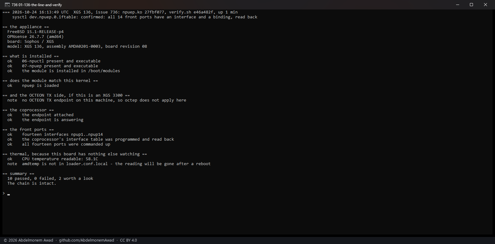
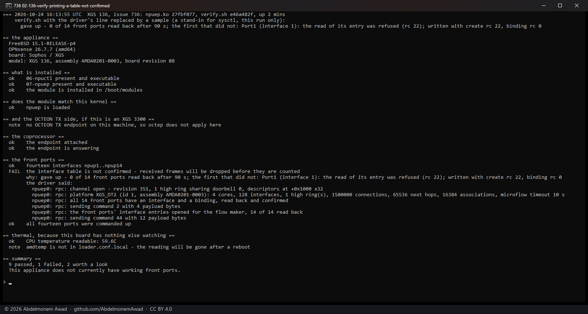

<!-- reviewed: 2026-10-24 -->
# Why the front ports' interface table is not confirmed, said by the driver, 2026-10-24

Issue [736](https://github.com/AbdelmonemAwad/os-xgs-npu/issues/736): the second XGS 126 run by its
owner, board revision 07, has its fourteen ports up and carries nothing. The owner pasted what
`verify.sh` printed, and it named the fault -

    FAIL  the interface table was never confirmed - received frames will be dropped before they are counted

\- but not its reason. That was left in the driver's boot messages, and asking for them is a second
round with an owner whose appliance cannot reach the network. On the XGS 136 here and on the first
XGS 126, both board revision 08, the table is confirmed seconds after the boot. Two boards of one
model can differ: the two XGS 3300s did (revision 17 and 09, an I210 against an I211), which is why
the port tables go by the assembly number and never by the revision
([front ports by model](../families/front-ports-by-model.md)). This difference may not be in the
hardware at all - the coprocessor keeps the software the appliance last had from Sophos, and the
vendor's own header says an older coprocessor reads the channel's state block in an older layout.
Which it is, the next owner should not have to be asked.

**The driver now says why, in one line, and `verify.sh` prints it.** `dev.npuep.0.iftable` holds
either `confirmed: ...` or the reason the table is not, with the numbers the coprocessor gave, and no
addresses - it is meant to be pasted in public:

- the channel never opened: the facility table offered no control-message channel, nothing on the
  coprocessor claimed its window, or the coprocessor did not acknowledge or take the configuration
  (with the state and magic it left);
- the channel stalled: which command went unanswered;
- or, pass by pass, how many of the fourteen ports read back, and for the first that did not, what
  the read of its entry found - not answered, refused with its rc, a short answer, an empty entry,
  another address, the wrong forwarding field - and what the coprocessor answered the create and the
  binding written before it, whose rc the driver never looked at before.

`verify.sh` prints the line under a table that is not confirmed, then the driver's own control-channel
messages from the boot with any address masked, and at the top the model, its assembly number and the
board's revision - never the serial number. The support bundle carries the line with the rest of
`dev.npuep`. The problem template asks for `verify.sh`'s output, and the guide's table of what can go
wrong says to paste it.

## The line and `verify.sh` on the XGS 136

npuep.ko `27fbf077`, verify.sh `e46a482f`, a minute after the boot: the line says `confirmed`, and
`verify.sh` passes, now naming the model, its assembly and the board's revision at the top. A ping
crossed Port8 to the second XGS 3300 and the WAN kept its DHCP address afterwards: the build changes
what the driver reports, not what it programs.

## `verify.sh` printing a table that is not confirmed

The XGS 136's table is confirmed, so this one is the script's branch, not the driver's: for one run,
a stand-in for `sysctl` on the PATH answers `dev.npuep.0.iftable` with a sample in the driver's own
wording - a refused read on Port1 - and passes everything else to the real one. The FAIL carries the
reason, and under it the driver's messages from this boot, which on this appliance say the table was
confirmed. On an appliance that failed they say how.

## What it does not do

It does not make the XGS 126 of #736 work. It makes the next appliance that fails this way say why in
the first paste. The reason for #736 is still to come from its owner's boot messages, asked for on
the issue; what that shows becomes the next change, made for every appliance with that difference.

- `sysctl dev.npuep.0.iftable`: the line, live.
- `images/deploy/lab-736.sh`, and `lab-736.sh failed`; `lab-736-series.ps1` photographed them.
