<!-- reviewed: 2026-10-23 -->
# Where a connection sent to inspection goes, measured - and then the inspector made, 2026-10-23

A connection on the coprocessor has a third verdict beside forward and drop: **send to inspection**
(0). The fast path then hands the connection's frames to an inspector instead of the wire, and the
inspector hands each one back to be sent on - the shape an IPS needs to see a connection's start and
let the rest run in hardware
([the discovery](../findings/discoveries-2026-10-22.md#inspection-then-hardware),
[680](https://github.com/AbdelmonemAwad/os-xgs-npu/issues/680)). Before building anything on it, this
is where those frames go on an appliance running OPNsense.

**The fast path hands them over, on both families, and nothing on this host receives them.** Every
frame of a connection set to inspection was counted as sent to the inspector, with no error; none
reached the far end, none came back, and none reached the host's own receive rings. The inspector
the fast path sends to is a PCIe virtual function, and OPNsense ~~makes none~~ made none - until the
afternoon, when the XGS 3300's driver made one and Suricata inspected connections in hardware through
it ([below](#then-made-on-the-xgs-3300)), and the evening, when the XGS 136's did
([below](#then-made-on-the-xgs-136)).

| | stream | sent to the inspector in six seconds | errors sending to it | back from it | to the far end meanwhile | set back to forward |
|---|---|---|---|---|---|---|
| XGS 3300 | TCP | 30 | 0 | 0 | 0 Mbit/s | 3,720 Mbit/s |
| XGS 3300 | UDP, 300 Mbit/s | **167,677** | 0 | 0 | 0 Mbit/s | 338 Mbit/s |
| XGS 136 | TCP | 48 | 0 | 0 | 0 Mbit/s | 1,006 Mbit/s |
| XGS 136 | UDP, 300 Mbit/s | **151,867** | 0 | 0 | 0 Mbit/s | 323 Mbit/s |

The modules measured: **octep.ko e0dd1809** on the second XGS 3300 and **npuep.ko b1cc86a8** on the
XGS 136 - the builds of [the verdict's measurement](verdict-2026-10-23.md) with one change, their
`dp.flow_verdict` and `flow.verdict` instruments taking 0 as well as 1 and 2. ~~Nothing else in either
driver sets a connection to 0.~~ Since the afternoon the XGS 3300's driver makes a connection with 0
when it is asked to and something inspects ([below](#then-made-on-the-xgs-3300)), and since the evening
the XGS 136's ([below](#then-made-on-the-xgs-136)).

## Where the inspector is

In the vendor's own system the inspector is a program on the host that reads the coprocessor's
**virtual functions** from user space:

- On the XGS 3300 the vendor's host driver enables SR-IOV on the coprocessor's PCIe endpoint and
  makes **eight** virtual functions (`177d:a303`, `sriov_numvfs` 8), one ring each - which is why its
  own rings start at 8 (read under the vendor's system on 2026-09-29).
- On the XGS 136 the coprocessor's startup script sets up **four** (`giu-1` to `giu-4`, fixed for the
  XGS 116 to 138), and the vendor's host makes them as SR-IOV functions (`11ab:7081`) and gives them
  to `vfio-pci`, for DPDK.
- The metadata the fast path puts in front of each frame for it is in the vendor's
  `metadata_dpi.h`: sixty-four bytes headed by the magic `0xC352A8B1`, the session's identity and
  revision, the direction, and room for the inspector to say it rewrote the frame and wants new
  checksums. "USFP metadata structures and defines shared with DPI", "USFP <-> DPI (DPDK DAQ)": the
  inspector reads it through a DPDK packet-acquisition module. A frame comes back with forwarding
  metadata, and the fast path sends it on (`FROM_IPS_TO_WIRE`, `proc_from_ips`).
- The vendor's host picks the function for each connection from a table of inspector instances
  (`read_ips_lb_tbl`), and writes its number into the connection's `ips_vf` field.

On OPNsense neither driver makes a virtual function. `octep` tells the coprocessor it has none
(`num_vfs` 0 in [the endpoint handshake](../families/octeon-tx.md#the-handshake)); telling it eight without making them took the coprocessor's
side down on 2026-09-29. The XGS 136's coprocessor sets up its four regardless, and nothing on the
host services them. So a frame sent to inspection is sent to a function that is not there, and is
lost: ~~today~~ until the XGS 3300's driver made one, the verdict 0 ~~is~~ was a drop by another way,
and nothing here ~~uses~~ used it.

## What using it would take

1. **The virtual functions themselves**, on both families: SR-IOV in `octep` and `npuep` (FreeBSD's
   `pci_iov`), and something on the host that services their rings.
2. **A go-between for Suricata**, which knows nothing of the coprocessor's metadata: take the
   sixty-four bytes off each frame, give Suricata the Ethernet frame (netmap, as OPNsense runs it),
   and send each frame Suricata passes back with its metadata - matched to it, since Suricata may drop
   or hold frames.
3. **A way for Suricata to say it is done with a connection**, so the connection's verdict can be set
   to forward and the rest of it run in hardware. Suricata's bypass has no outside hook in the netmap
   capture OPNsense uses.

~~None of that is started.~~ All three were made on the XGS 3300 the same day - below; ~~the XGS 136 is
next.~~ and on the XGS 136 the same evening. ~~There is a nearer way to the same end with what OPNsense already has - a connection kept on
the host until the IPS has seen what it inspects, then put in hardware - and it has not been measured
either: Suricata's IPS mode, over netmap, has never been run on these drivers' interfaces.~~ Suricata's
IPS mode over netmap now runs on the inspector's interface below.

## Then made, on the XGS 3300

The same afternoon, on the second XGS 3300, as the vendor's source does it - and off unless it is
asked for (the marker `/var/db/os-xgs-npu/inspector-vf`, read at boot):

1. **One virtual function, on ring 0.** The PF publishes one function of one ring in `SDP_EPF_RINFO`,
   gives ring 0 to it in `R_VF_NUM` (which this driver never wrote), switches SR-IOV on and lets the
   function master the bus, and starts its own rings at 1, its pkind at 41 (40 plus the functions).
   The coprocessor took it - **two host ports started** where there had been one, and its fast path,
   its RPC and its heartbeat all answered. On 2026-09-29 eight functions published without being made
   had taken it down; made, one did not.
2. **The frames arrive.** With the function's ring armed, a connection set to inspection has its frames
   on this host, each behind the vendor's `usfp_dp_md` exactly as `metadata_dpi.h` lays it out: the
   magic `0xC352A8B1`, both checksums good, IPS and forwarding blocks valid, the connection's own index
   as the session, the IP header at 14, and in the forwarding block the next hop's two MACs, the egress
   port and its MTU. The frame behind it is the one that arrived from the wire.
3. **Handed back, they go on.** Posting the same sixty-six bytes and the frame on the function's input
   ring, with pkind 40, the fast path takes them back (`RX_IPS`) and sends them to the wire
   (`FROM_IPS_TO_WIRE`), nothing dropped.
4. **Suricata reads them.** The driver makes `oxips0`, the inspector's interface: a frame for the
   inspector goes to it as input with its sixty-six bytes kept by the driver, keyed by the frame's
   addresses and ports. Suricata in IPS mode over netmap takes the interface's input over while it
   runs, and netmap hands each frame it lets through to the interface's own input function - the
   driver's, which puts the bytes back in front and hands it back. Nothing in Suricata changes.
5. **Then hardware.** With `dp.ips_new`, a new connection is made with the verdict "send to
   inspection" while something reads `oxips0`; once the inspector has let `dp.ips_depth` bytes of it
   through - 1 MiB, Suricata's own stream depth - the driver sets it to forward and the rest runs in
   hardware. With nothing reading `oxips0`, a frame for the inspector is handed straight back and its
   connection set to forward: an inspector that stops costs its connections nothing.

| on the XGS 3300, octep.ko | | |
|---|---|---|
| 946415d4 | a TCP stream set to inspection, every frame through this host and back | **4,105 to 4,856 Mbit/s**, nothing dropped |
| 946415d4 | a UDP stream at 300 Mbit/s, the same | 341 to 344 Mbit/s - all of it |
| 4d04264a | Suricata 8.0.7 on `oxips0`, one rule dropping UDP to port 5204: the UDP stream set to inspection | **blocked** - 203,608 drop events, nothing delivered |
| 4d04264a | the same, a TCP stream no rule names | **2,943 and 3,230 Mbit/s through Suricata** |
| 1d1f2d08 | `dp.ips_new`: a new TCP stream | 731 to 811 frames through Suricata, then forward: **3.82 to 3.85 Gbit/s** overall |
| 1d1f2d08 | `dp.ips_new`: a new UDP stream to the dropped port | dropped by Suricata from the moment it was in hardware - 205,338 and 205,642 |

**The function costs the forwarding nothing measured.** With the same module after a reboot each way,
a TCP stream through the XGS 3300 ran at 3.82 Gbit/s without the function and 3.97 with it, UDP offered
at 2 Gbit/s 1.44 and 1.66. One boot with the function ran slow - 532 Mbit/s plain, about 100 inspected -
and the same steps after the next boot did not; why, is not known.

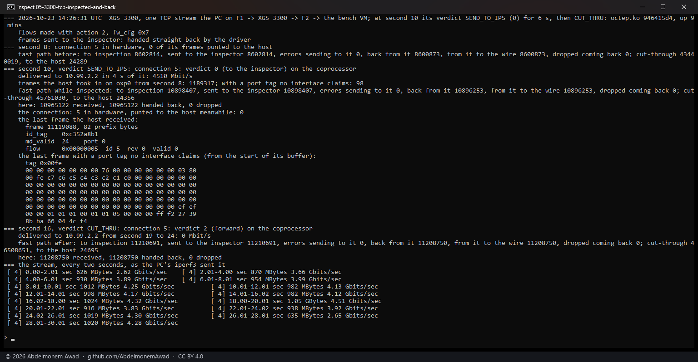

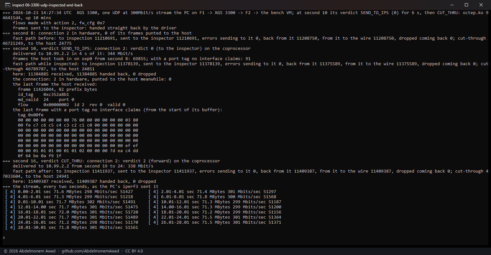

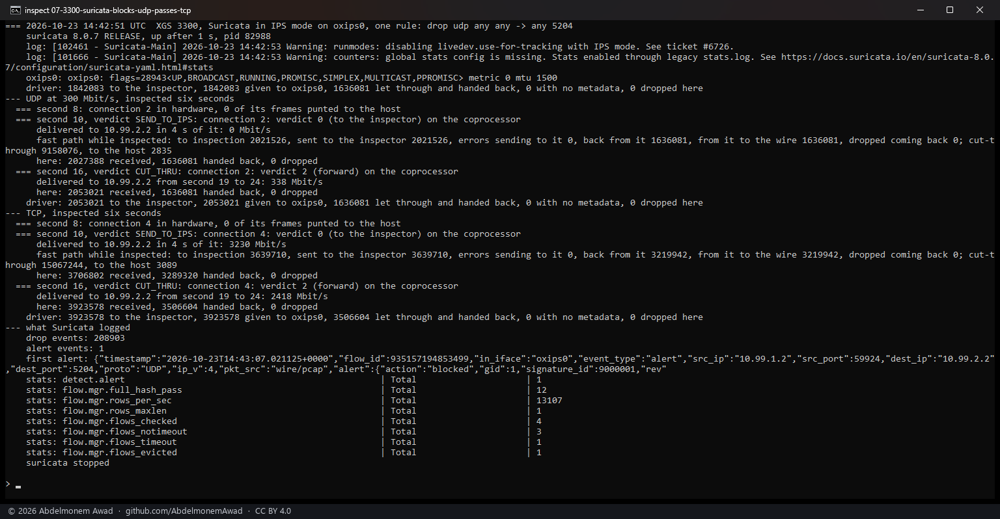

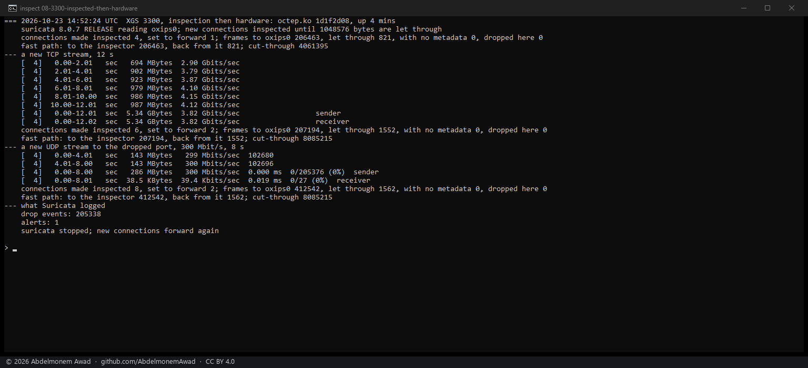

### How to turn it on, while it is an experiment

~~There is no setting yet.~~ Since the evening there is one, which does all of this and has OPNsense's
own Intrusion Detection read `oxips0` ([below](#the-setting-and-the-intrusion-detection-service)).
By hand, on an XGS 3300 with this driver:

    touch /var/db/os-xgs-npu/inspector-vf     # then reboot: the function is made at boot
    ifconfig oxips0 up
    sysctl dev.octep.0.dp.ips_new=1           # new connections inspected while Suricata reads oxips0

and Suricata in IPS mode on `oxips0`, its netmap section pairing the interface with its host side:

    netmap:
      - interface: oxips0
        copy-mode: ips
        copy-iface: oxips0^
      - interface: oxips0^
        copy-mode: ips
        copy-iface: oxips0
    stream:
      midstream: true

`midstream`, because a connection's first frames cross the host before it is made in hardware, so
Suricata on `oxips0` meets it already open; the measurements ran Suricata by hand beside OPNsense's
own IDS service rather than through it (`images/deploy/inspect-suricata.yaml`,
`images/deploy/lab-inspect-then.sh`). Counters: `dp.ips_rx`, `ips_up`, `ips_passed`, `ips_back`,
`ips_nomd`, `ips_dropped`, `ips_made`, `ips_cut`.

### What it does not do yet

- ~~**The XGS 136**: its coprocessor sets up four functions of its own; the host makes none yet.~~
  The XGS 136's driver makes one since the same evening ([below](#then-made-on-the-xgs-136)).
- ~~**A setting**, and OPNsense's Intrusion Detection service reading `oxips0`: the interface is not
  assigned, and the service only lists assigned ones.~~ Both since the evening, the interface still
  unassigned ([below](#the-setting-and-the-intrusion-detection-service)).
- **A connection's first frames**, before it is in hardware, cross the host and are not on `oxips0`;
  Suricata sees them only if it also inspects the front ports.
- A frame longer than one receive buffer, and a frame that is not IP, is not inspected - it is dropped
  and counted; a later fragment of a packet is keyed without ports and comes back without its bytes.
- A tunnel's connections are made forward, as before.

## Then made, on the XGS 136

The same evening, on the XGS 136 - the same design on the other family, off unless asked for by the
same marker:

1. **The host makes the first of the coprocessor's four functions.** The coprocessor's startup script
   sets up four (`giu-1` to `giu-4`) and backs each function's two windows with memory inside the PF's
   own, at an offset the host gives it: before it tells the coprocessor its management rings are
   ready, the PF writes where the functions' windows start - BAR0 at `0x66000`, BAR2 at `0x170000`, a
   function every 64 KiB - into the two fields the coprocessor reads once at that moment
   (`bar0_vf_start_off` and `bar2_vf_start_off` of `agnic_config_mem`, the vendor's `musdk` `pf.c`).
   Then SR-IOV on with four functions, the first allowed to master the bus.
2. **Its own handshake.** A function's configuration is in its second window, as the vendor's `vf.c`
   maps it, and it reads zero until the host asks it to reset (bit 31 of its status). Then the PF's
   handshake on the function's rings - ready, management rings published, `MGMT_ECHO` answered - with
   one difference: each command says it comes from a function, its client type and the function's
   number in the descriptor. Without them nothing answered; the coprocessor's dispatcher routes a
   command by those two fields (`musdk` `dispatch.c`).
3. **Its datapath**: one queue each way and a buffer pool, 9,304-byte buffers, brought up with the
   PF's own commands; the steps a function does not take - its MTU, its MAC, promiscuous mode - are
   refused and passed over. The PF went on as before: fourteen front ports, its heartbeat answered.
4. **The frames, and back.** A connection set to inspection has its frames on the function's receive
   queue behind the same `usfp_dp_md`; handed back with the same sixty-six bytes on its transmit
   queue, the fast path sends them on (`RX_IPS`, `FROM_IPS_TO_WIRE`).
5. **`oxips0`, then hardware**, as on the XGS 3300: Suricata over netmap reads `oxips0`;
   `flow.ips_new` makes a new connection inspected while something reads it, and sets it to forward
   once the inspector has let `flow.ips_depth` bytes through (1 MiB); with nothing reading, a frame is
   handed straight back and its connection set to forward.

| on the XGS 136, npuep.ko | | |
|---|---|---|
| d74eca48 | a TCP stream set to inspection, every frame through this host and back | **865 to 942 Mbit/s** as sent, 994 read at the far end - the link full; 401,868 frames there and back, none dropped |
| d74eca48 | a UDP stream at 300 Mbit/s, the same | 326 and 327 Mbit/s at the far end - all of it |
| 687b1f3e | `flow.ips_new`, Suricata 8.0.7 on `oxips0`: a new TCP stream | 1,441 frames through Suricata, then forward: **930 to 940 Mbit/s** overall - the link full |
| 687b1f3e | the same, a new UDP stream to the port its one rule drops | dropped by Suricata from the moment it was in hardware - 189,977 and 199,507 drop events; the 13,569 and 5,860 frames that arrived crossed the host before it was |

The link here is a gigabit, so the TCP figures say the inspector kept up with it, not how far it
goes. Two runs went otherwise, and why is not known: in the TCP run before the photographed one the
stream fell to 229 to 254 Mbit/s for the six seconds it was inspected, and after the photographed UDP
run was set back to forward the far end read 98 Mbit/s while the fast path counted its frames
forwarded at about the stream's whole rate. Both are in the run log.

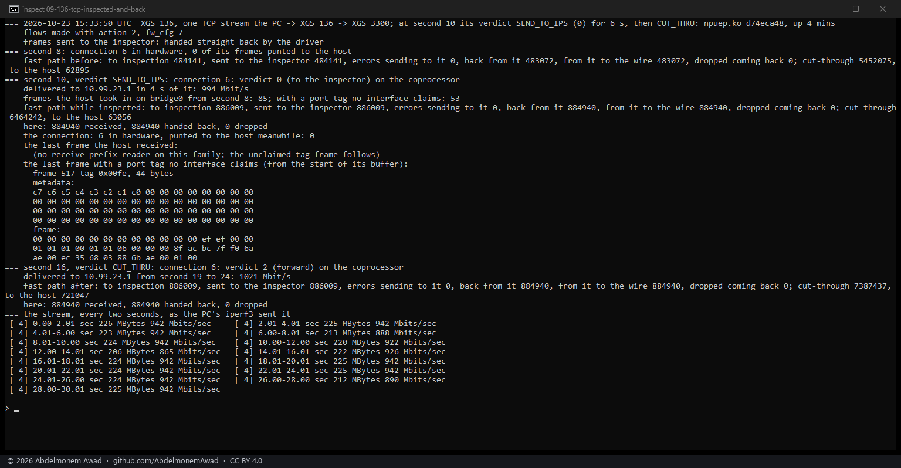

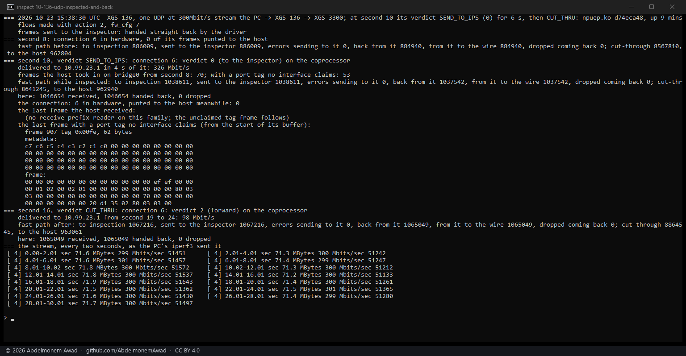

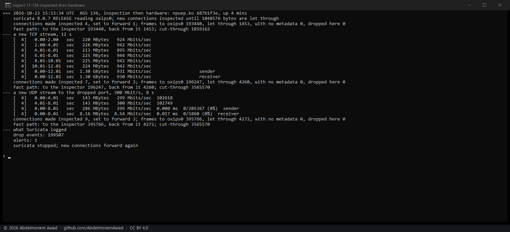

On an XGS 136 with this driver it is turned on as on the XGS 3300, with this family's switch:

    touch /var/db/os-xgs-npu/inspector-vf     # then reboot: the function is made at boot
    ifconfig oxips0 up
    sysctl dev.npuep.0.flow.ips_new=1         # new connections inspected while Suricata reads oxips0

Counters: `dev.npuep.0.ips.rx`, `up`, `passed`, `back`, `nomd`, `unkeyed`, `dropped`, and
`dev.npuep.0.flow.ips_made`, `ips_cut`. Beside what the XGS 3300's list says it does not do yet, the
function's queue is one, read on the receive poll, and only the XGS 136 (AMDA0201) has made it.

## The setting, and the Intrusion Detection service

Later the same evening, on both appliances: XGS: Settings, on the **Security** tab, **Inspect, then
hardware** - off by default - and OPNsense's own Intrusion Detection reading `oxips0`, with nothing
run by hand and nothing in OPNsense's own files changed.

- **The setting** writes the marker, so the function is made at the next boot (a save says a reboot
  is needed while `oxips0` is not there yet), and while `oxips0` is there turns `ips_new` on and
  brings the interface up - at the save and at every boot, in the boot hook beside "Cut in hardware".
- **The Intrusion Detection** lists only assigned interfaces, and `oxips0` is not assigned: an
  interface assigned in OPNsense that is missing at boot has OPNsense assign every interface again by
  itself, which wiped the second XGS 3300's assignments on 2026-10-23 when an interface the driver made
  late had been assigned. So the package adds `oxips0` where Suricata reads it instead: OPNsense's
  template engine takes extra targets for a module from `+TARGETS.D`, and the IDS's `suricata.yaml`
  includes every file in `/usr/local/etc/suricata/conf.d`. The package's overlay on the IDS module,
  `OPNsense/IDS/xgs-inspector.yaml`, is written with OPNsense's own `suricata.yaml` - every time the
  IDS page is applied, and at every boot - and adds `oxips0` and its host side to the interfaces
  Suricata opens in IPS mode, beside the ones chosen on the IDS page.
- **Suricata replaces a whole list or mapping that an included file names**: an included `netmap`
  list took the place of the IDS page's interfaces and an included `stream` mapping of every stream
  setting (`--dump-config`, Suricata 8.0.7). A key written with dots - `netmap.900.interface` - sets that
  one node and leaves the rest; given without its value, `interface`, as a list entry has, it stopped
  Suricata with a segmentation fault. The overlay writes its two entries that way, and
  `stream.midstream: true`, because a connection reaches `oxips0` already open. While the setting is
  on, that is Suricata's midstream pick-up for every interface it inspects.
- **Suricata does not start when an interface it is given is missing.** The overlay adds `oxips0` only
  in IPS mode, with the setting on, and while `/var/run/os-xgs-npu.oxips0` says `oxips0` is on the
  appliance this boot - the boot hook writes it before OPNsense writes its templates, and the save when
  it runs. On the XGS 136, the marker taken away by hand and the appliance restarted: no function, the
  overlay empty, Suricata running on the IDS page's interface alone; the save then said a reboot was
  needed and put the marker back, and the next boot had it all again.

Measured with the Intrusion Detection on in IPS mode on an interface that carries nothing - F2 on the
XGS 136, Port1 on the XGS 3300 - and one user-defined rule acting on everything to the far end: first
**alert**, while a new TCP stream ran twelve seconds, then **drop**, while a new UDP stream ran eight at
300 Mbit/s (`images/deploy/lab-inspect-ids.sh`, `lab-inspect-config.php`):

| | the rule | the stream | through Suricata on `oxips0` | the Intrusion Detection's log |
|---|---|---|---|---|
| XGS 136, npuep.ko 687b1f3e | alert | TCP, **941 Mbit/s** - the link full | its first 1,502 frames, then forward in hardware | 2 alerts, allowed |
| XGS 136 | drop | UDP, 300 Mbit/s | 182,288 frames, none let through | 2 alerts, blocked |
| XGS 3300, octep.ko 1d1f2d08 | alert | TCP, **3.98 Gbit/s** | its first 749 frames, then forward in hardware | 2 alerts, allowed |
| XGS 3300 | drop | UDP, 300 Mbit/s | 205,409 frames, none let through | 2 alerts, blocked |

What the dropped stream left behind it at the far end: 35 MB on the XGS 136, read on the second XGS
3300's Port8 (15 MB in the run before) - its frames before it was put in hardware, which cross this
host and an interface the IDS does not inspect - and nothing on the XGS 3300, read on its F2's counters,
which carry what the coprocessor forwards. iperf3's own receiver line says nothing here: it comes back
on iperf3's control connection, which the rule cuts as well.

After a reboot of each, with nothing done by hand, a new connection was inspected by the service's
Suricata: on the XGS 136 the drop rule still in place, 290 frames to `oxips0` and none back; on the
XGS 3300 with the alert rule, 744 frames, then forward, 3.73 Gbit/s.

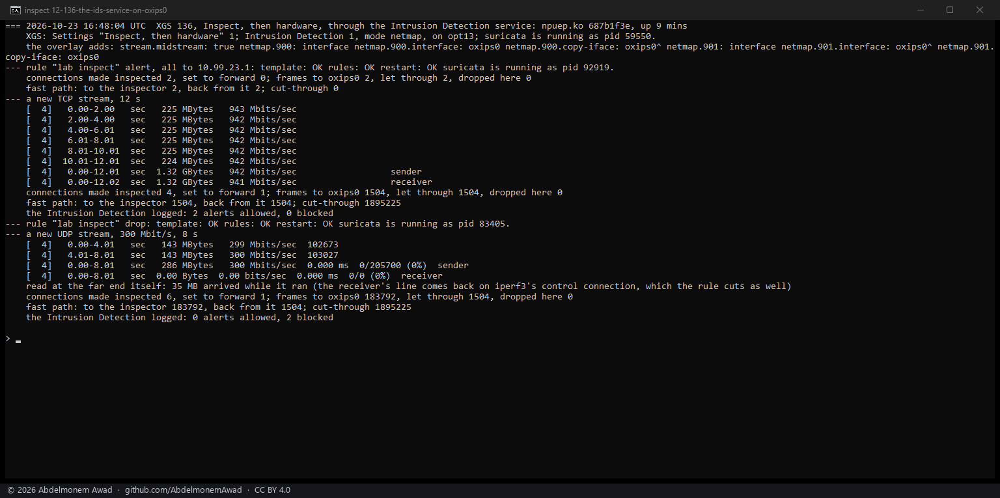

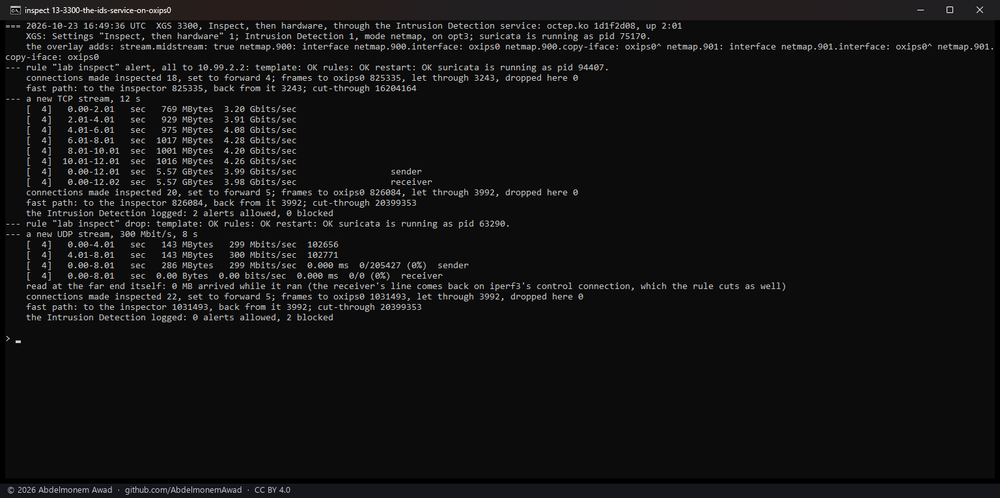

To use it: XGS: Settings, **Security**, **Inspect, then hardware**, and reboot once; **Cut in
hardware** on, as it is by default; the Intrusion Detection on in IPS mode on any interface
(**Services: Intrusion Detection: Administration**), with the rules to apply. What the list above
says it does not do yet still holds: a connection's first frames are inspected only where the IDS
inspects the interface they arrive on.

## How it was measured

`images/deploy/lab-inspect.sh`, each run in a window of its own and photographed
(`images/deploy/lab-inspect-series.ps1`); the text of every run, the ones before the photographs
among them, is in the run log. One iperf3 stream from the PC through the appliance, made in hardware
with the action IPS and the fast path's IPS switch on - the "Cut in hardware" default - so its verdict
is asked for every frame. At second 10 its verdict set to 0 with the driver's instrument, at second 16
back to forward (2). Read before and after: the fast path's own counters for the inspector's path
(`FROM_WIRE_TO_IPS_INSPECT`, `TX_IPS`, `TX_IPS_ERR`, `RX_IPS`), what reached the far end, frames the
host received with a port tag no interface claims - where a frame for a function the host does not
know would land - and the last such frame itself. Through the six seconds those were only the
coprocessor's control messages (tag 254), at their usual rate of about one a second.

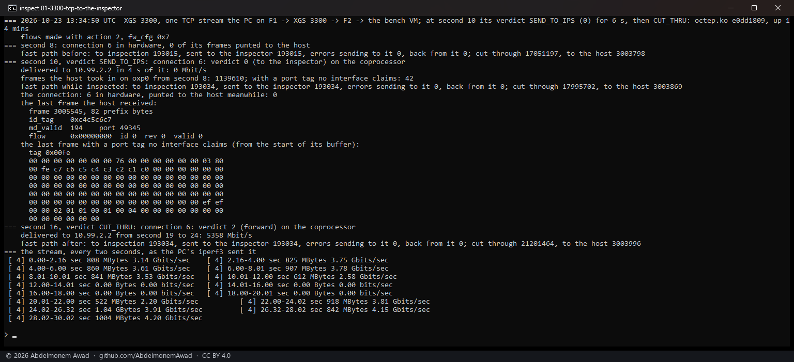

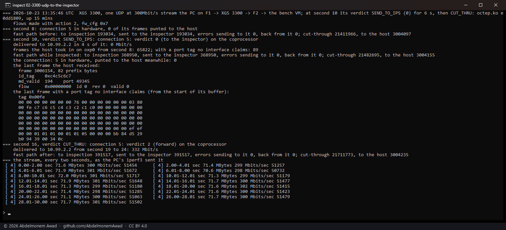

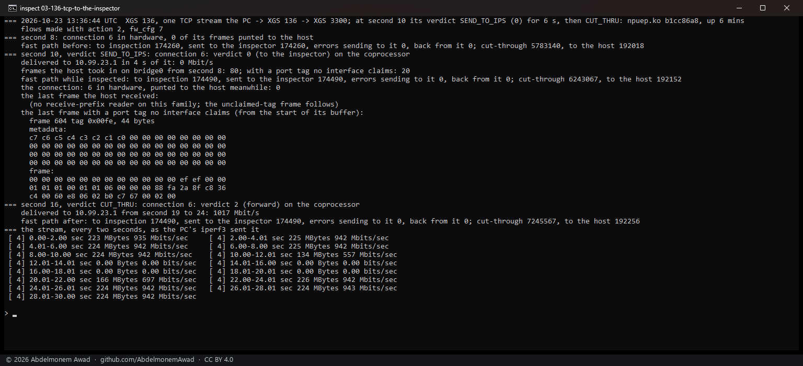

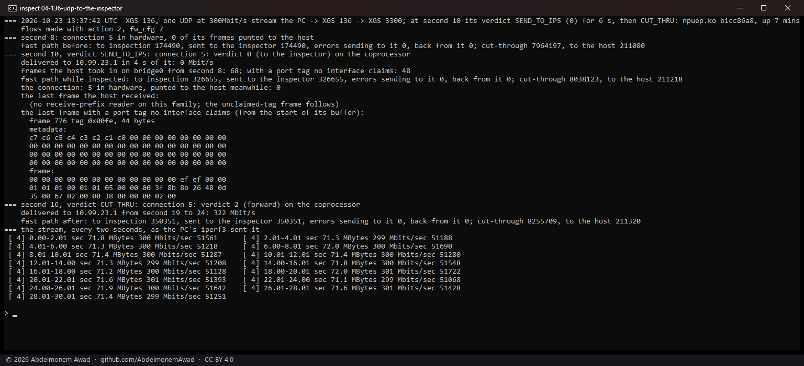

The figures in the table are from the runs before the photographs, in the run log; the photographed
runs are the same measurement made again.

## What it found on the way

**A run can pick the last run's connection.** The script takes the stream's connection as the one
with the most frames, and a TCP stream finished seconds before was still in the XGS 136's table with
more frames than the new UDP stream - so the first UDP run set the old connection to inspection, and
the stream went on at 326 Mbit/s. The script now passes over every connection that was in the table
before its stream started.
