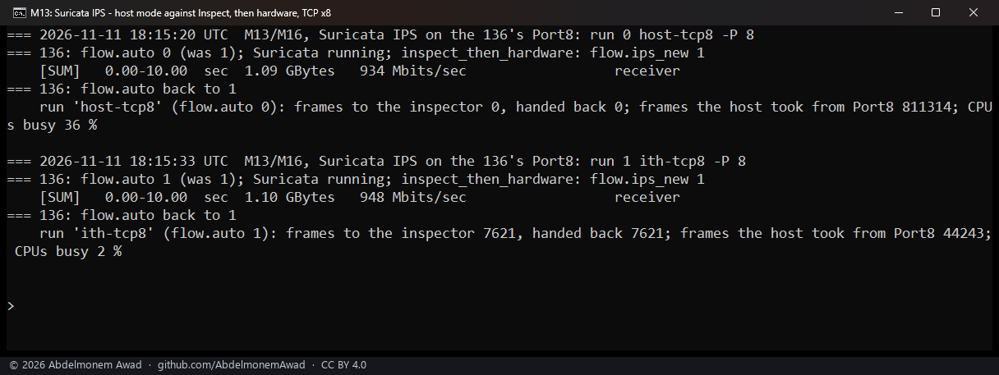
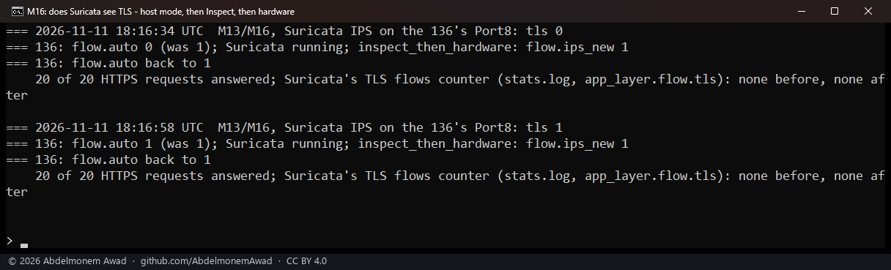

<!-- reviewed: 2026-11-11 -->
# IPS on XGS 136 with Inspect, then hardware: 948 Mbit/s at 2 % CPU against 934 at 36 %, and TLS recognised in both modes, 2026-11-11

Intrusion Detection in IPS mode on an XGS 136 can inspect every frame, the host carrying all of them, or - with
XGS: Settings "Inspect, then hardware" - each new connection's start, the coprocessor carrying the rest
([how it works](inspect-2026-10-23.md#then-made-on-the-xgs-136)). What does each cost in throughput and CPU on
the same traffic? And does Suricata still recognise an application, TLS, when only a connection's start crosses
it? This is how the plugin inspects in depth: without the frames a host can inject into the fast path
(discovery 18), and without the XGS 3300's own deep-inspection engine (discovery 22), which stays off
([the discoveries](../findings/discoveries-2026-10-22.md#all-of-them-in-one-table)).

## How it was measured

XGS 136, vendor version 21, with its installed module (npuep.ko `ad3b1480`, loaded at 18:06 UTC and not changed
until after the runs), 2026-11-11 from 18:15 to 18:20 UTC.

- **"Inspect, then hardware" on**, as it already was on that appliance (`dev.npuep.0.flow.ips_new` 1). With it
  on, Suricata in IPS mode also reads the inspector's interface `oxips0`
  ([the setting](inspect-2026-10-23.md#the-setting-and-the-intrusion-detection-service)).
- **Intrusion Detection** turned on for the runs, IPS mode (Netmap) on Port8 (`npup8`), with the rules already
  set on the appliance. Port8 went from MTU 9000 to 1500, which netmap's emulated adapter needs, with one netmap
  ring. At 18:20 UTC Intrusion Detection was off again, as before, and Port8 back at 9000.
- **Two modes, run after run**, set by the driver's automatic acceleration (`dev.npuep.0.flow.auto`, which XGS:
  Settings "Accelerate connections automatically" writes). At 0 the host carries every frame, and Suricata reads
  them on Port8. At 1, its usual value, each new connection goes to Suricata through `oxips0` for its start and
  then runs in hardware. Set back to 1 after each run.
- **Traffic** from the second XGS 3300 (10.99.23.x) into the XGS 136's Port8 and out of its F1 to a PC, 10
  seconds each with iperf3: eight TCP streams, then eight UDP flows of 100 Mbit/s in 256-byte datagrams.
- **Read on the XGS 136** over each run: frames handed to the inspector and handed back (`dev.npuep.0.ips.rx`,
  `ips.back`), frames the host took from Port8 (`dev.npuep.0.giu.rx_port.Port8`), CPUs busy (`kern.cp_time`).
- **TLS**: twenty HTTPS requests from the PC through the XGS 136 to the second XGS 3300's web server, each a GET
  of its login page with no login, in each mode. Suricata's own count of flows it recognised as TLS
  (`app_layer.flow.tls` in its `stats.log`), read after each mode's requests and again once Suricata had next
  written its statistics.

## Results

| Traffic | Mode | Received | Lost end to end | Frames to inspector / back | Frames host took from Port8 | CPUs busy |
|---|---|---|---|---|---|---|
| eight TCP streams | host carries every frame | 934 Mbit/s | - | 0 / 0 | 811,314 | 36 % |
| eight TCP streams | Inspect, then hardware | **948 Mbit/s** | - | 7,621 / 7,621 | 44,243 | **2 %** |
| eight UDP flows | host carries every frame | 209 Mbit/s | 74 % | 0 / 0 | 3,789,577 | 63 % |
| eight UDP flows | Inspect, then hardware | **290 Mbit/s** | 64 % | 30,630 / 30,630 | 1,482,560 | 21 % |

- **TCP: same rate, an eighteenth of the CPU.** Both runs were at about the gigabit link's rate. With Inspect,
  then hardware the host took 44,243 frames from Port8 instead of 811,314, and 7,621 frames went to Suricata
  through the inspector, every one of them handed back.
- **UDP: 39 % more delivered with a third of the CPU**: 290 against 209 Mbit/s, the CPUs 21 % busy against
  63 %. 30,630 frames went through the inspector, all handed back.
- **TLS recognised in both modes.** All 40 requests were answered. Read 20 seconds after each mode's twenty,
  `stats.log` held no TLS count yet. The first statistics Suricata wrote after them, at 18:20:02 UTC with
  Suricata up 5 min 3 s, counted **40 TLS flows**: every request, twenty in each mode. They were 40 of its 60
  TCP flows; the other 20 were the iperf3 runs' connections (eight streams and a control connection in each
  TCP run, a control connection in each UDP run).

## What it does not mean

- **Suricata sees a connection's start, not all of it.** With Inspect, then hardware, frames past a connection's
  first megabyte do not reach it
  ([what it cannot do](../guide/limitations.md#suricata-sees-how-a-connection-starts-not-all-of-it)). Where
  every frame must be inspected, the host-mode rows above are the cost, and four netmap rings help UDP there
  ([the measurement](flowid-136-2026-11-11.md)).
- **What Suricata did with the frames was not read**: its alerts and drops, and how many frames it read on Port8
  and on `oxips0`. A rule's drop under Inspect, then hardware was measured on 2026-10-23
  ([the measurement](inspect-2026-10-23.md#the-setting-and-the-intrusion-detection-service)).
- **Most of the UDP was lost in both modes, and where was not measured**: host, Suricata's ring, coprocessor or
  PC. The same eight flows on the same path without IPS, the host carrying every frame, reached 358 and 387
  Mbit/s earlier the same day ([the measurement](flowid-136-2026-11-11.md)), so 290 Mbit/s is not the path's
  ceiling. Why the host still took 1,482,560 frames from Port8 with the flow maker on was not looked into.
- **TLS was not counted per mode**: one statistics block holds both. Whether the HTTPS connections were in
  hardware before they ended was not read. Only TLS was tried: no other application, and no rule acting on it.
- **One run of each, on the XGS 136 only.** The link is a gigabit, so the TCP figures say the path was full, not
  how far it goes.
