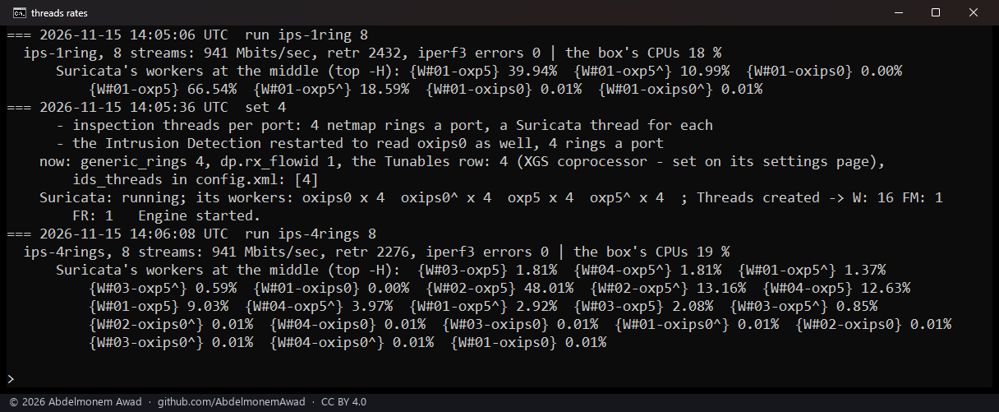
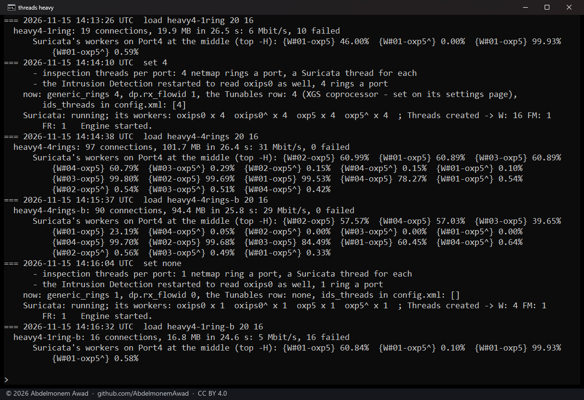
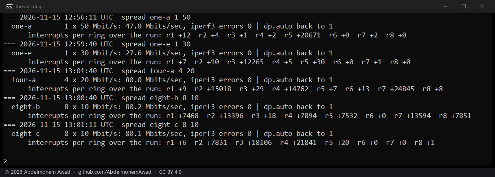
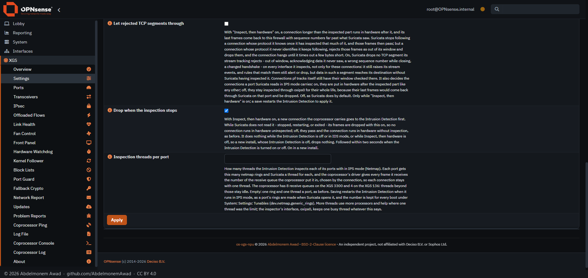
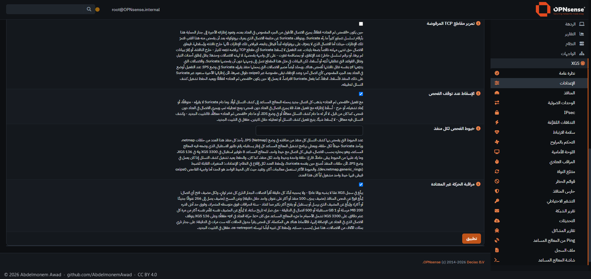

<!-- reviewed: 2026-11-15 -->
# Inspection threads per port: four netmap rings give Suricata four threads a port, and five times the inspected rate where one thread was the limit, 2026-11-15

How many threads Suricata inspects a port with in IPS mode was nobody's setting. OPNsense's `suricata.yaml` leaves
netmap's `threads` at `auto`, which Suricata 8.0 takes as one thread a netmap ring, and netmap's emulated adapter -
the one the coprocessor's front ports get - has one ring unless `dev.netmap.generic_rings` says more. XGS: Settings
now has **Inspection threads per port**, which sets those rings, and with them the threads.

## Why the rings, and not Suricata's own thread count

Suricata 8.0's netmap capture (its `runmode-netmap.c` and `source-netmap.c`, read on its main-8.0.x branch)
gives each thread of a port one ring, in the order the threads open it - the first thread ring 0, the next ring 1 -
and compares that count with the rings nowhere. A thread count below the rings leaves the others unread; one above
them has a thread open a ring that does not exist, and Suricata stops. With `auto`, its default, the count is the
rings. So the setting writes the rings and leaves Suricata at `auto`.

More rings help only if a port's frames spread over them, and the emulated adapter puts a frame in the ring its flow
id names. The XGS 136's driver can give a frame the receive queue it came in on as its flow id (`giu.rx_flowid`,
[measured on 2026-11-11](flowid-136-2026-11-11.md)); the XGS 3300's could not, so every frame went to ring 0. Its
driver can now (`dp.rx_flowid`, the ring the frame arrived on), and a save with more than one ring turns either on.

## How it was measured

2026-11-15, the second XGS 3300 (vendor version 22, eight CPUs: an AMD Ryzen Embedded V1780B, four cores of two
threads each), with this change's octep.ko (`55740a01`) installed and its files in place.

- **Which receive ring a connection arrives on** (12:56 to 13:02 UTC): a routed path through the XGS 3300, the
  test machine's jail on Port4 to its other adapter on Port3, with the flow maker off so that every frame crossed
  the host; the interrupts of each of the coprocessor's eight receive rings counted over a run of iperf3 TCP
  streams.
- **The setting, saved as the page saves it** (14:02 to 14:23 UTC): `ids_threads` written through the model and
  saved, then `scripts/xgs/apply.php`, the script behind Apply - with the Intrusion Detection off, then on in IPS
  mode on Port4 (`oxp5`) as OPNsense's own service; and a reboot with the setting at 4.
- **The rate through Suricata** (14:05 to 14:17 UTC), every frame through the host (the flow maker off), one ring
  and then four: eight TCP streams with iperf3, with no rule beyond what the appliance had; then, to make one
  Suricata thread the limit, four copies of a synthetic rule - a regular expression run on every data segment to
  port 5300, added to the rules OPNsense loads for these runs and taken out after - and sixteen senders on the test
  machine, each connecting, sending 1 MiB of zeros and closing, again and again for 20 seconds.
- **The XGS 136** (vendor version 21, four CPUs, four receive queues): the same saves, a reboot, and a reload of its
  module, which runs the boot's own settings step.

## Results

| Traffic | Rings a port | Received | Connections (failed) | Suricata's threads on Port4 |
|---|---|---|---|---|
| eight TCP streams, no rule | 1 | 941 Mbit/s | - | one, 40 to 67 % busy |
| eight TCP streams, no rule | 4 | 941 Mbit/s | - | four, 48, 13, 9 and 2 % busy |
| four synthetic rules, sixteen senders of 1 MiB | 1 | 6 and 5 Mbit/s | 19 (10 failed), 16 (16 failed) | one, 99.9 % busy |
| four synthetic rules, sixteen senders of 1 MiB | 4 | **31 and 29 Mbit/s** | 97 (none), 90 (none) | four, 60 to 99.8 % busy |

- **A connection stays on one receive ring**, both its directions: one TCP stream raised one ring's interrupts and
  no other's - ring 5 in one run, ring 3 in another, and rings 7 and 5 in two that the test machine's adapter cut
  short. Four and eight streams fell on three to six of the eight rings, as the coprocessor hashed them.
- **With no rule the link was full either way**: 941 Mbit/s, the XGS 3300 18 and 19 % busy. With four rings the
  work went to four threads by connection, unevenly, as eight connections fall over four rings.
- **Where one thread was the limit**, four rings carried five times as much - 31 and 29 Mbit/s against 6 and 5 -
  and no connection failed, where one ring left 10 and 16 of them to time out. The four threads were 60 to 99.8 %
  busy.
- **The save**: at 4, `dev.netmap.generic_rings` 4, `dp.rx_flowid` 1 and a row of System: Settings: Tunables. With
  the Intrusion Detection on in IPS mode Suricata was restarted, from 4 worker threads - Port4 and `oxips0`, one
  each way - to 16. Emptied, all of it went back: one ring, the flow id off, the row removed, and Suricata with 4.
- **A reboot with it at 4** came back with 4 rings and the flow id on, the boot logging `inspection threads per
  port 4: each frame's ring as its flow id`.
- **On the XGS 136** the saves did the same with `giu.rx_flowid`, and a reboot gave 4 rings. Its flow id came back
  on with a module that has the switch - main's, loaded again by its reload script, which runs the boot's settings
  step; the module installed on it, the release, predates the switch, and the boot passes over it.

The same field in Arabic

The pictures show the runs as their log has them (`lab-threads-3300.sh`, `lab-rings-3300.sh`), not runs done again
for the camera; the three copies of the rule beyond the first were added by hand between the runs and are noted in
the same log.

### What these figures do not mean

- **A synthetic rule, not a ruleset**: it was chosen to make one thread the limit at the speeds this lab reaches -
  the test machine's adapters carry about a gigabit. How many threads a real ruleset needs was not measured.
- **The inspector's interface**, `oxips0` (Inspect, then hardware), gets the rings too, but its frames carry no flow
  id, so one of its threads does the work. A second inspector function, which would split it, is measured apart
  (plan 01, package 1.5).
- **The XGS 136's rate** through Suricata with more rings was [measured on 2026-11-11](flowid-136-2026-11-11.md),
  not again here.
- **A port on the XGS 136's own netmap adapter** (`hw.npuep.netmap`, off by default) has the rings that adapter
  makes, which the setting does not change; not tried here.
- **The spread is the coprocessor's**: its hash places the connections, and eight of them fell on three rings in one
  run.
- **What else the flow id moves**: on the XGS 3300 a frame the host forwards leaves on the transmit ring its flow id
  names rather than the one of the CPU that sent it, and a lagg over the coprocessor's ports would pick its member by
  it where `net.link.lagg.default_use_flowid` is 1 - it is 0 on both appliances here.
