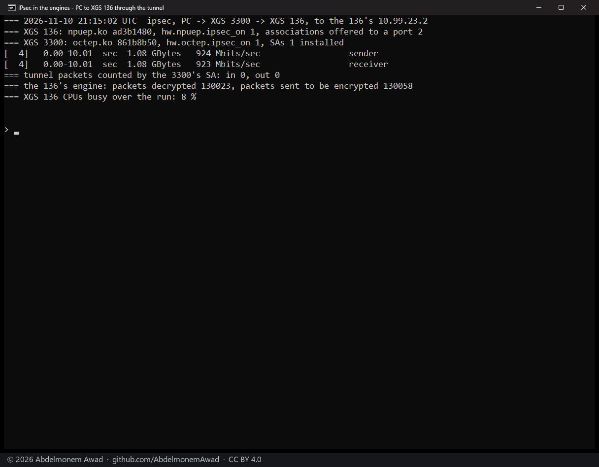
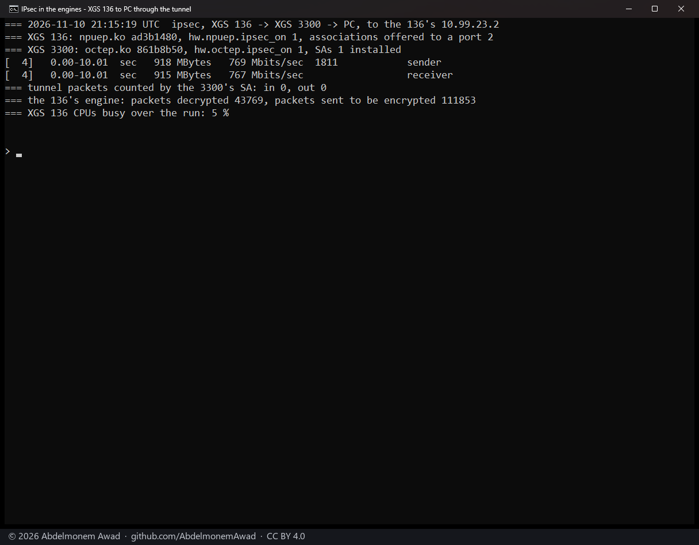
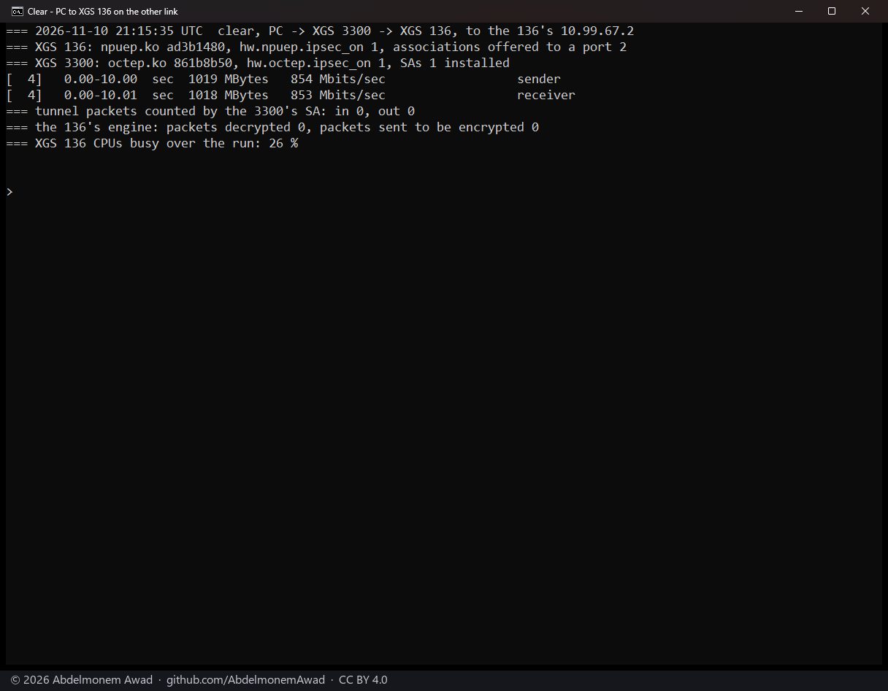
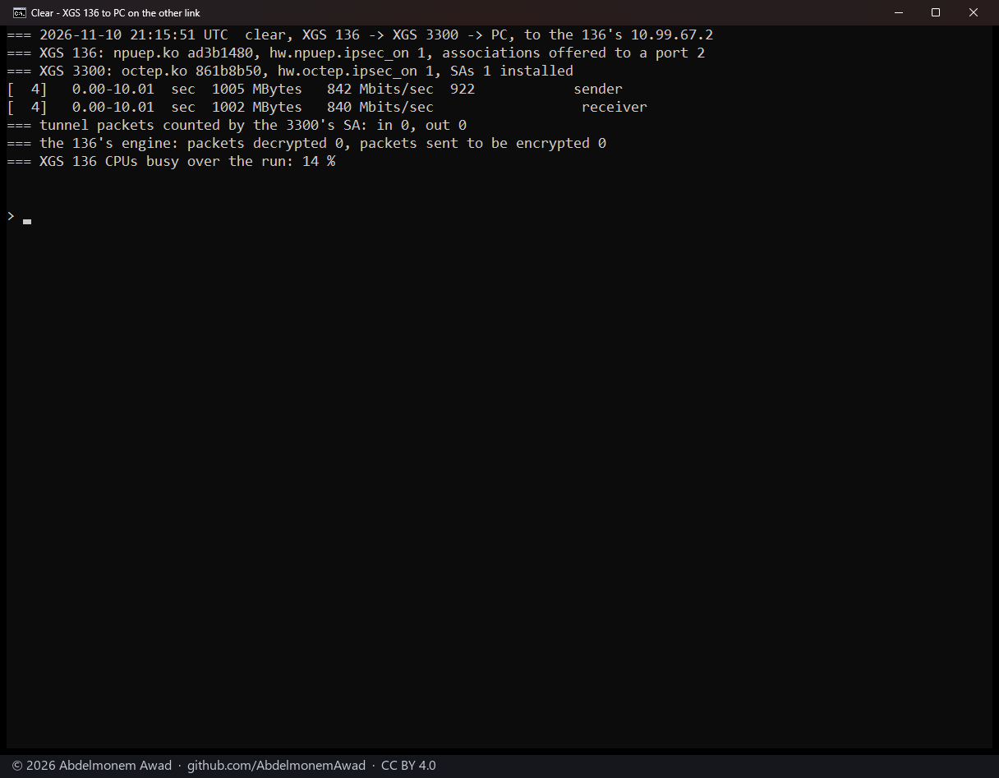
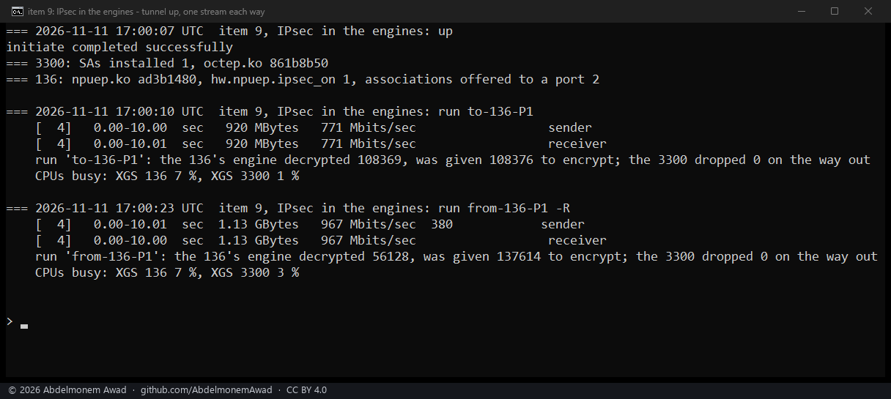
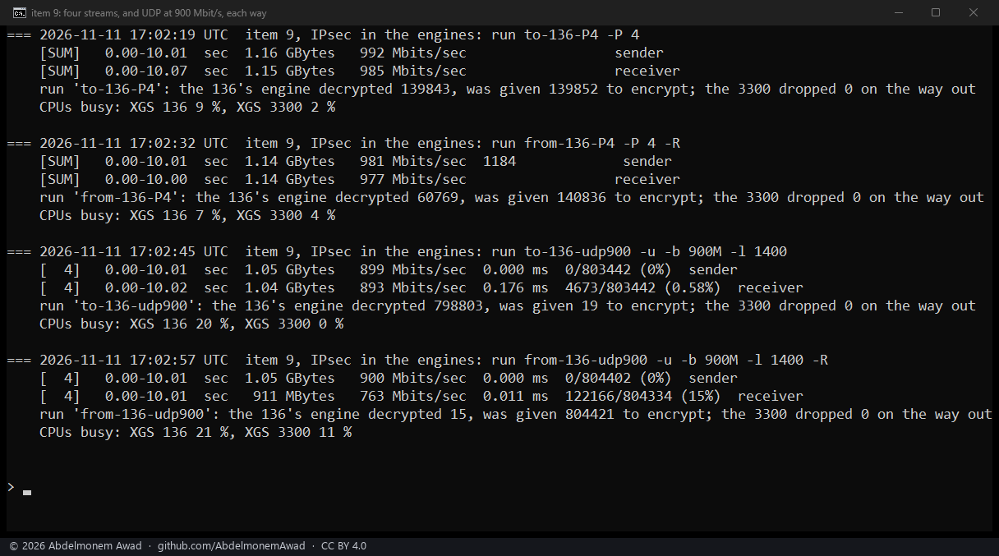
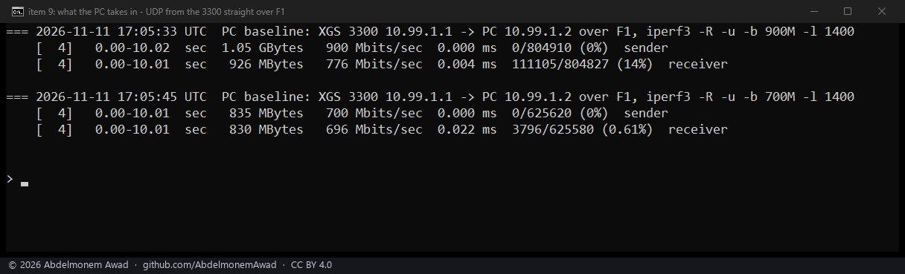
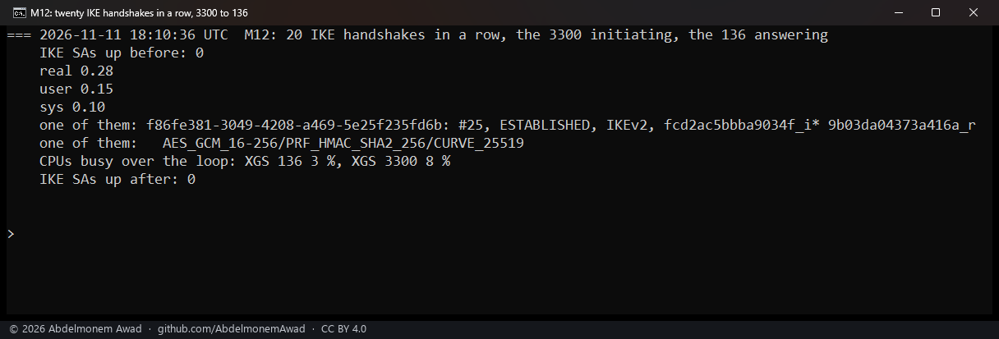
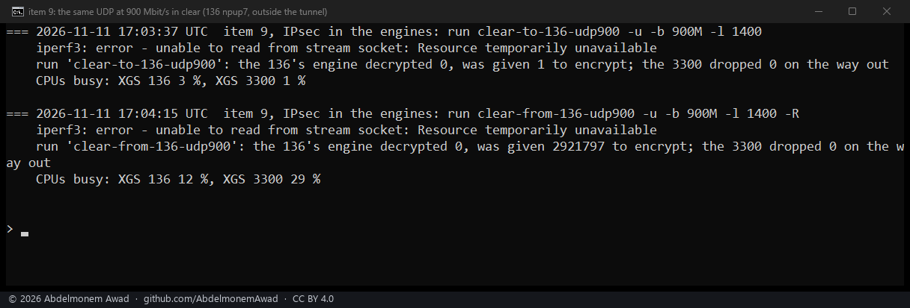

<!-- reviewed: 2026-11-11 -->
# IPsec in both engines, XGS 3300 and XGS 136: no gap between directions, and twenty IKE handshakes in 0.28 s, 2026-11-11

With both appliances' engines carrying a tunnel, a stream from the XGS 136 to the PC ran at 767 Mbit/s on
2026-11-10, against 923 the other way. Is one direction slower through the engines, and when UDP is lost, is it
lost there? And IKE's public-key work stays with the hosts: the coprocessors' public-key engine is reached only
from the vendor's intrusion-prevention stage, with no request format in its source
([discovery 16](../findings/discoveries-2026-10-22.md#public-key-operations)). Is that work heavy enough to want
hardware?

## How it was measured

- **The tunnel**: IKEv2, AES-GCM-256 for ESP, between the second XGS 3300 (vendor version 22, octep.ko
  `861b8b50`) and the XGS 136 (vendor version 21, npuep.ko `ad3b1480`) over their gigabit Port8 link. It protects
  the PC's network (10.99.1.x/24, on the XGS 3300's F1) and the XGS 136's 10.99.23.x. Both ends in their engines:
  `hw.octep.ipsec_on` and `hw.npuep.ipsec_on` at 1, the XGS 136's two associations offered to a port. Earlier
  figures for this pair, at MTU 1500, are on [the bench page](bench-2026-10-17.md#ipsec).
- **2026-11-10, 21:15-21:16 UTC**: one TCP stream each way, 10 seconds, between the PC and an iperf3 server on
  the XGS 136's host, through the tunnel; then the same in clear on another link, to the XGS 136's 10.99.67.x
  (its Port7, cabled to the XGS 3300's Port6), outside the tunnel.
- **2026-11-11, 17:00-17:06 UTC**: the tunnel brought up for the runs and taken down after, as it had been. One
  TCP stream four times each way, four streams each way, and UDP at 900 Mbit/s in 1,400-byte datagrams each way.
  Then UDP from the XGS 3300's own host straight to the PC over F1, with no tunnel and no XGS 136, at 900 and 700
  Mbit/s: what the PC takes in that way.
- **Read over each run**: the XGS 136's engine counts - packets it decrypted and handed to its host's IP stack
  (`dev.npuep.0.ipsec.rx_done`), packets its host gave it to encrypt (`ipsec.tx_accel`) - and how busy both
  hosts' CPUs were (only the XGS 136's on 2026-11-10).
- **IKE**, 2026-11-11 at 18:10 UTC: the same connection brought up and taken down twenty times in a row from the
  XGS 3300 (`swanctl --initiate --ike`, then `--terminate --ike`), the loop timed with `time -p`, both hosts'
  CPUs read before and after it. No IKE association was up before or after.

## Results

TCP through the tunnel, and in clear for comparison; the XGS 136's CPUs busy in brackets:

| Run | PC to XGS 136 | XGS 136 to PC |
|---|---|---|
| 2026-11-10, one stream | 923 Mbit/s (8 %) | 767 Mbit/s (5 %) |
| 2026-11-11, one stream, first | 771 Mbit/s (7 %) | 967 Mbit/s (7 %) |
| 2026-11-11, one stream, second | 966 Mbit/s (19 %) | 979 Mbit/s (6 %) |
| 2026-11-11, one stream, third | 983 Mbit/s (9 %) | 930 Mbit/s (6 %) |
| 2026-11-11, one stream, fourth | 982 Mbit/s (9 %) | 941 Mbit/s (17 %) |
| 2026-11-11, four streams | 985 Mbit/s (9 %) | 977 Mbit/s (7 %) |
| 2026-11-10, in clear on the other link | 853 Mbit/s (26 %) | 840 Mbit/s (14 %) |

UDP at 900 Mbit/s in 1,400-byte datagrams, 2026-11-11:

| | PC to XGS 136, tunnel | XGS 136 to PC, tunnel | XGS 3300 to PC, no tunnel |
|---|---|---|---|
| received | 893 Mbit/s | 763 Mbit/s | 776 Mbit/s |
| lost | 0.58 % | 15 % | 14 % |
| XGS 136's engine | decrypted 798,803 of 803,442 sent | given 804,421 to encrypt, for 804,402 sent | - |
| CPUs busy, XGS 136 and XGS 3300 | 20 % and 0 % | 21 % and 11 % | - |

At 700 Mbit/s, the XGS 3300's host straight to the PC: 696 Mbit/s received, 0.61 % lost.

- **No steady gap between directions.** On 2026-11-11 seven of the eight single streams ran at 930 to 983
  Mbit/s, and four streams at 985 and 977. The eighth, the first into the XGS 136, ran at 771 - about what the
  stream out of it gave on 2026-11-10 (767). A run near 770 came once in each session, in opposite directions.
- **UDP out of the XGS 136 is lost on the way into the PC, not in the engines.** Its engine was given every
  datagram to encrypt, and the PC lost as much when the XGS 3300's own host sent it the same UDP with no tunnel
  and no XGS 136: 14 % at 900 Mbit/s, 0.61 % at 700. Into the XGS 136 its engine decrypted 798,803 datagrams,
  and 0.58 % were lost.
- **The engines leave the hosts' CPUs mostly idle**: the XGS 136's 6 to 19 % busy on TCP and 20 to 21 % on UDP,
  the XGS 3300's 0 to 11 %.

| IKE, twenty handshakes in a row: the XGS 3300 starts, the XGS 136 answers | |
|---|---|
| whole loop, each handshake brought up and taken down | 0.28 s |
| one of them | IKEv2, AES_GCM_16-256, PRF_HMAC_SHA2_256, CURVE_25519 |
| CPUs busy across the loop | XGS 136 3 %, XGS 3300 8 % |

- **14 ms a handshake, up and down, round trips included.** Its public-key work here is one Curve25519 exchange
  on each side, and twenty took 0.28 s on the hosts' CPUs. There is no load here to move to the coprocessor's
  public-key path.

## What it does not mean

- **Every stream ended on the XGS 136's own host**, so each figure is the smallest of the PC, the XGS 3300's
  forwarding and encryption, the link, and the XGS 136's own receive or send - not a forwarding ceiling
  ([the rules every page keeps](methods.md#the-rules-every-page-keeps)).
- **TCP and UDP figures are not at the same packet size.** Through the tunnel the TCP streams used large
  packets: the XGS 136's engine handed its host about 8,900 bytes of the stream per packet it decrypted (1.15
  GBytes in 138,743 packets, the third run into it), the Port8 link being at MTU 9000. The UDP used 1,400-byte
  datagrams, about six times as many packets for the same rate. The clear runs of 2026-11-10 went over another
  link whose packet size was not recorded, so their CPU against the tunnel's does not say what the engine saves.
- **Where on the way into the PC the UDP is lost** - the XGS 3300's host sending over F1, or the PC receiving -
  was not counted in these runs.
- **The runs near 770 Mbit/s are not explained.**
- **A clear UDP comparison on 2026-11-11 failed**: in both directions iperf3 lost its control connection, and
  during the run from the XGS 136 its engine was given 2,921,797 packets to encrypt, so what was meant to go in
  clear went to the tunnel's engine. Not run again; the measurement of the PC on its own replaced it.
- **The XGS 3300's association counts in the 2026-11-10 photographs read 0 by a fault of the script**: it took
  the word "bytes" from swanctl's line as the number. They say nothing about the tunnel; the XGS 136's engine
  counts are the ones to read.
- **IKE: twenty handshakes one after another from one side, not many at once.** The connection authenticates
  with a pre-shared key, so no RSA or ECDSA signature was made: certificates were not measured, nor the web
  GUI's TLS. The CPU figures span two reads that also take in the ssh sessions around the loop, so they average
  over more than its 0.28 s.

