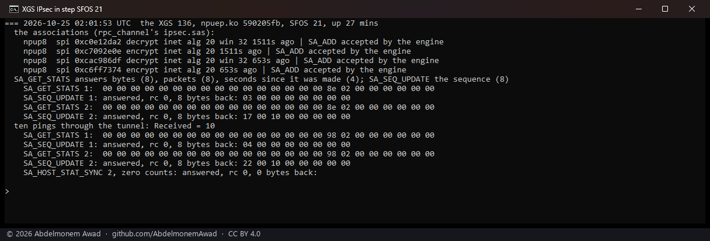

<!-- reviewed: 2026-10-25 -->
# An offloaded association's state kept in step: the three commands measured, 2026-10-25

Discovery 14 of [the discoveries](../findings/discoveries-2026-10-22.md#ipsec-state-kept-in-step). Three
commands move an offloaded IPsec association's state between the host and the engine (the vendor's
`sa_table.h` and `ipsec_fpop.c`; the same sizes on SFOS 21, 22 and 23):

- `SA_SEQ_UPDATE` (34) answers the engine's next outbound sequence number and moves its counter on by
  one - the vendor's host asks it before it sends a packet of an offloaded association itself, so the
  two never use one number twice. The first ask switches the association's counter to atomic.
- `SA_REPLAY_UPDATE` (33) checks one inbound sequence number against the engine's window and takes it
  in - for a packet of an offloaded association the host decrypted itself. On an association whose
  window the fast path has not marked active, more than two seconds old, it takes the association
  out of the fast path's lookup instead: the vendor's answer to one installed on the wrong port.
- `SA_HOST_STAT_SYNC` (35) gives the engine the host's own counts of associations, for its combined
  lifetime checks.

This project's design does not call for them: one encryptor per association - once an outbound
association is in the engine every packet of it is encrypted there, the kernel's cipher taken - and
every inbound packet of it decrypted there; the kernel's counter is started a million numbers behind
the engine's and raised by the drivers' own reckoning; the lifetimes are the kernel's. So they were
measured, as instruments: octep's hand commands (`rpc.cmd` 33, 34, 35 through the write gate,
octep.ko `e9241bfd`) on the lab tunnel between the two XGS 3300s, and npuep's
`rpc_channel.command` on the XGS 136's tunnel to the second XGS 3300 (npuep.ko `590205fb`)
(`images/deploy/lab-ipsec-step.sh`, `lab-ipsec-step-136.sh`).

## What each answered

**`SA_SEQ_UPDATE` is exact, on all three versions.** Each second ask, ten pings after the first, came
back eleven higher - the ten replies the engine encrypted and the one number the first ask took:

| board | its software | the engine's sequence | ten pings later | the counts `SA_GET_STATS` gave, packets |
|---|---|---|---|---|
| the first XGS 3300 | SFOS 23 | 4,023,430 | 4,023,441 | **0** |
| the second XGS 3300 | SFOS 22 | 5,538,588 | 5,538,599 | 4,353,708 - with the start of 1,048,576, 136,304 behind |
| the XGS 136 | SFOS 21 | 1,048,599 | 1,048,610 | **0** |

The earlier runs, not photographed, came out the same: 1,704,917 then 1,704,928 on the first XGS 3300
with its counts at 0, 3,283,004 then 3,283,015 on the second with its counts 145,966 behind, 1,048,587
then 1,048,598 on the XGS 136.

**The atomic counter cost nothing seen.** Streams the board itself encrypts, before the first ask and
after it: 2.24, 2.61, 3.11 and 3.04, 3.03, 1.97 Gbit/s on the first XGS 3300 (2.07, 2.07, 3.47 and
2.74, 3.26, 3.13 in the earlier run), 8.17, 8.16, 8.16 and 8.19, 7.79, 8.18 on the second.

**`SA_REPLAY_UPDATE` takes the association out of the fast path.** Sent with sequence 1 to each XGS
3300's inbound association, which had carried the streams, it answered `0x13` on both - and from then
on the kernel decrypted that association's packets: 40 pings after it raised the kernel's ESP count
by 40 and the engine's by none. The window had not been marked active by the traffic, so the call
took the vendor's wrong-port branch. A rekey put fresh associations back in both engines.

**`SA_HOST_STAT_SYNC`** with zero counts answered rc 0 on all three.

After the first of those rekeys, read by hand: a stream from the PC into the first XGS 3300 through
the tunnel, its engine decrypting, ran at 7.65, 9.77 and 9.68 Gbit/s - 2,289,733 frames decrypted by
the engine and none by the kernel - where the same stream had varied from 196 to 1,770 Mbit/s an hour
before ([sa23-2026-10-25](sa23-2026-10-25.md#a-stream-through-it)).

## What it changes here

- Nothing is built on them. The design keeps every packet of an offloaded association in the engine
  - measured again here: the kernel's ESP counts stood still while the engine carried the tunnel -
  so the host never needs a number from the engine for a packet of its own, and never decrypts one
  for which it would ask the engine's window. `SA_REPLAY_UPDATE` must not be sent: on these boards
  it removes the association it is asked about.
- **`SA_GET_STATS` counts nothing on SFOS 23's software, nor on the XGS 136's.** On the XGS 136 the
  ARMADA driver takes a tunnel's counts from the coprocessor's connection statistics instead
  (`npuipsec_flow_account`), so nothing there depended on it. The OCTEON TX driver reads its
  associations' counts with it, and on SFOS 23 they stay at 0: the kernel's byte and packet counts
  of an offloaded association, and the lifetimes that run on them, stand still, and the margin the
  kernel's counter is raised by at an association's end does not grow with what it carried. Issue
  #761.
- `SA_SEQ_UPDATE` is the exact count that margin stands in for, on every version: the place to use it
  is where an association leaves the engine while the kernel goes on with it. That path is reached
  only when the association outlives its interface, and has not been exercised.
