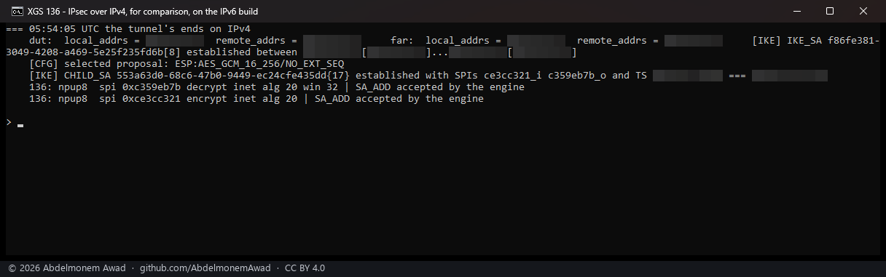
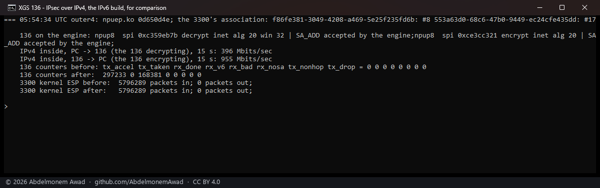
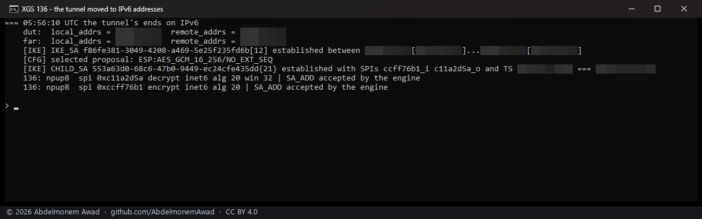
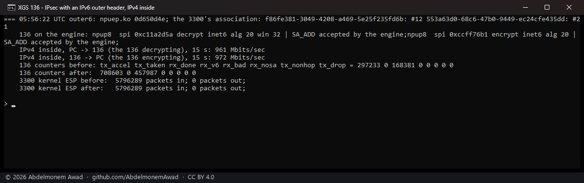
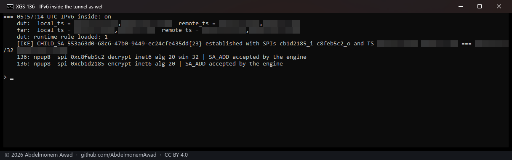
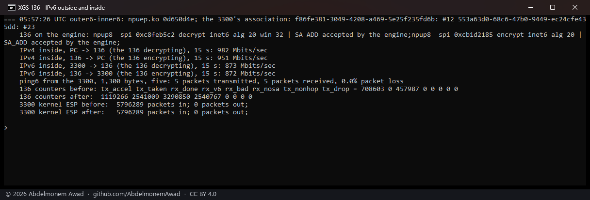
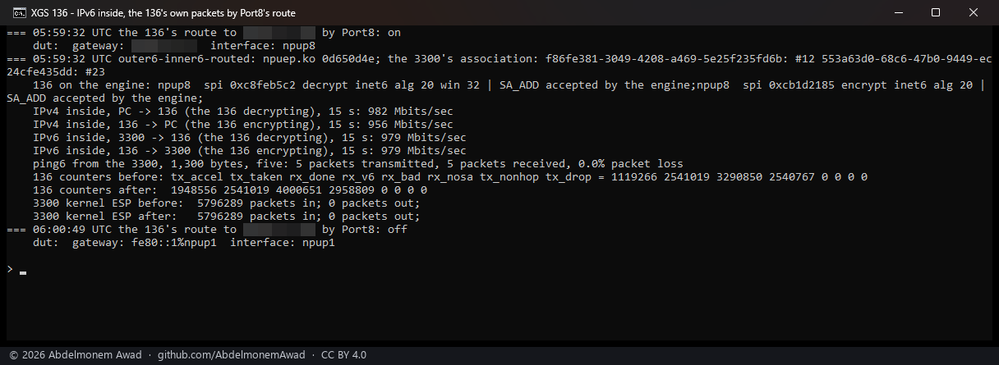
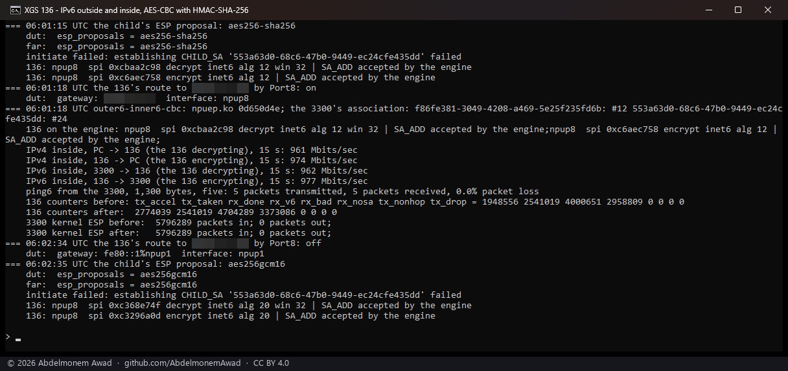
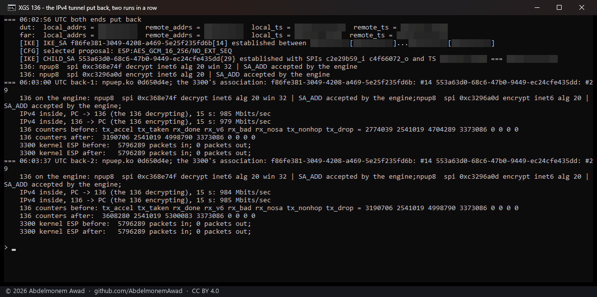

<!-- reviewed: 2026-10-20 -->
# IPsec over IPv6 on the XGS 136's engine, outside and inside. Measured, 2026-10-20

Yes, both. A tunnel whose two ends are IPv6 addresses, and IPv6 packets inside it, are taken by the
XGS 136's crypto engine in both directions: through the lab tunnel to the second XGS 3300, 951 to 982
Mbit/s with IPv4 inside and 962 to 979 with IPv6 inside, each way, at the gigabit link's rate; with AES-GCM
and with AES-CBC and an HMAC; every frame decrypted on the engine and handed up, none refused.

The XGS 3300 has carried both since 2026-10-12 ([the outer header can be
IPv6](../findings/the-outer-header-can-be-ipv6.md), [IPv6 inside the
tunnel](../findings/ipv6-inside-the-tunnel.md)). This is the same work on the other family's driver,
measured on its own.

## What the driver does now

[npuipsec.c](../../contrib/npuep/npuipsec.c), the OCTEON TX driver's handling brought over:

- **The association.** An association whose ends are IPv6 is offered and taken like an IPv4 one.
  SA_ADD carries all sixteen bytes of each address and option bit 21 (`opt.ipv6`, the vendor's
  "Ena/Dis Outbnd IPv6 Header format"); the record keeps both addresses.
- **What leaves.** The envelope gets a 40-byte IPv6 outer header (ethertype `0x86DD`, payload length,
  next header ESP or the NAT-T UDP, hop limit 64), and the next hop of the far end comes from the
  IPv6 resolver (`fib6_lookup`, `nd6_resolve`). The trailer's next-header byte names the inner
  packet's family - IPv4 or IPv6 - in both of the kernel's doors: the association's output step (a
  forwarded packet, or the host's own when it is not routed out of the tunnel's port) and the
  kernel's offload path (the host's own, routed out of it). An IPv6 packet too large for the tunnel
  is not fragmented: the sender is told the size that fits (ICMPv6 "packet too big"), as a router
  must (RFC 8200 4.5) - written, not exercised here (below).
- **What arrives.** The termination takes a frame with an IPv6 outer header (next header at its sixth
  byte, ESP at +40), asks the kernel for the association by its `in6` destination, and hands an IPv6
  inner packet to IPv6 input, past enc0's capture and its IPv6 rules. `ipsec.rx_v6` counts those
  frames, and the `receive:` line of `ipsec.sas` prints it.

Before this the driver took IPv4 only: an association with IPv6 ends was offered and declined, and
the kernel encrypted it in software.

## How it was measured

The lab tunnel between the XGS 136 (its Port8) and the second XGS 3300, AES-GCM-16-256, the bench PC
on the 3300's side. Both ends already had lab IPv6 addresses on that link and a rule passing IPv6
arriving on it. `images/deploy/lab-136-v6.sh` (not in this repository) changes the tunnel by hand in
`swanctl.conf` at both ends and loads it - the tunnel's addresses to the IPv6 ones, the child's
selectors widened by an IPv6 pair, the ESP proposal - and has the 3300 make the tunnel again; for IPv6
inside, a runtime rule on the 136 passes that pair on enc0, the 136's IPsec rules being IPv4 only. Each
run is one stream each way with iperf3, the 136's counters and the 3300's kernel ESP counters read
before and after, photographed. IPv4 inside is the PC to the 136; IPv6 inside is the 3300 itself to
the 136, the PC being on both sides of the tunnel at once for IPv6. At the end both files were put
back and the 136's rules reloaded.

The driver is the build that ships with this change, `npuep.ko` md5 `0d650d4e` (253,552 bytes),
compiled on the appliance with no warning, every symbol it needs found in the kernel.

## Results

Stream rates in Mbit/s, 15 seconds each; "decrypting" is into the 136, "encrypting" out of it. The
136's counters are the changes over each run.

| run | outer | inside | the 136 decrypting | the 136 encrypting | the 136's engine counted |
|---|---|---|---|---|---|
| for comparison | IPv4 | IPv4 | 396 (see below) | 955 | `rx_done` +168,381, `tx_accel` +297,233 |
| IPv6 outside | IPv6 | IPv4 | 961 | 972 | `rx_done` +289,606, `tx_accel` +411,370 |
| IPv6 outside and inside | IPv6 | IPv4 / IPv6 | 982 / 873 | 951 / 872 | `rx_v6` +2,540,767; the 136's own IPv6 packets through the output step, `tx_taken` +2,541,009 |
| the same, the 136's route by Port8 | IPv6 | IPv4 / IPv6 | 982 / 979 | 956 / 979 | `rx_v6` +418,042; through the offload path, `tx_accel` +829,290, `tx_taken` +0 |
| AES-CBC-256 with HMAC-SHA-256 | IPv6 | IPv4 / IPv6 | 961 / 962 | 974 / 977 | `rx_v6` +414,277, `tx_accel` +825,483 |
| the IPv4 tunnel put back, two runs | IPv4 | IPv4 | 985, 984 | 979, 985 | `rx_done` +294,501 and +301,293 |

- `rx_bad`, `rx_nosa`, `tx_nonhop` and `tx_drop` stayed 0 through every run, and five 1,300-byte
  IPv6 pings from the 3300 were answered in each run with IPv6 inside.
- The 136's associations read `inet6` on the engine with the tunnel moved, `SA_ADD accepted by the
  engine` both ways, with GCM (`alg 20`) and with CBC (`alg 12`).
- The 3300's kernel ESP counters did not move (5,796,289 packets in, as at the start): its engine took
  its side of the IPv6 tunnel too.
- **873 and 979 with IPv6 inside are the same engine.** In the first IPv6-inside run the 136's route to
  the 3300's inner network was its default, out of another port with a 1,500-byte MTU, so its
  connection used segments sized for that and its packets left by the output step; with a route by
  Port8 (MTU 9000) the same two streams carried fewer, larger segments - 418,042 frames decrypted in
  place of 2,540,767 - at the link's rate, through the offload path. Both doors were measured that way.

## What it does not mean

- **The 396 is not IPv4's.** It was the first stream into the 136 since its boot, two hours earlier;
  every later one, on the IPv4 tunnel put back as well, carried 961 to 985. The two slow runs on the
  [ESN page](esn-136-2026-10-20.md) were also each the first stream of a session after a boot. It is
  [issue 531](https://github.com/AbdelmonemAwad/os-xgs-npu/issues/531), and these runs say it goes with
  the first stream after a boot rather than with the minutes after it.
- **Not the PC's IPv6 through the tunnel.** The PC has an IPv6 address on each side of the tunnel, so
  its IPv6 never needs it; IPv6 inside was between the two appliances themselves. A packet forwarded
  through the 136 into the tunnel takes the same output step the 136's own took here, but no forwarded
  IPv6 packet was sent, and so the "packet too big" answer was not exercised either.
- **Not NAT-T or extended sequence numbers over IPv6.** Each is measured over IPv4 ([NAT-T on the
  ARMADA](../findings/esp-behind-udp-on-the-armada.md), [ESN](esn-136-2026-10-20.md)); together with an
  IPv6 outer header they were not run.
- **The first attempt to move the tunnel failed, and why.** The lab tool's first version sent its
  `sed` commands through `echo` in a shell that reads `\1` as a control byte, which replaced the
  address lines of both ends' `swanctl.conf` with two bytes each. The copies kept before anything were
  put back, the tool now uses `printf`, and the second attempt is the one photographed. The log keeps
  both.

All the numbers are in the run's log, `measurements/v6-136-2026-10-20.log` (kept with the bench, not
in this repository); the lab addresses in six of the photographs are blurred.
