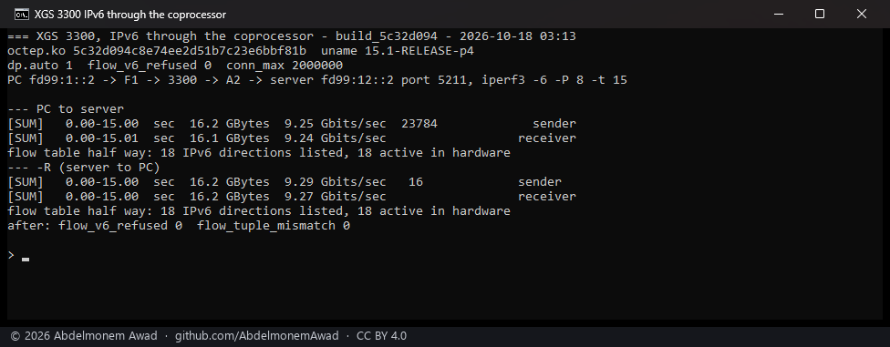
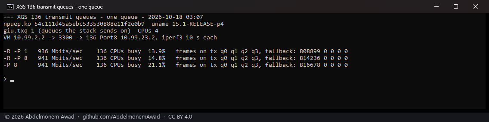
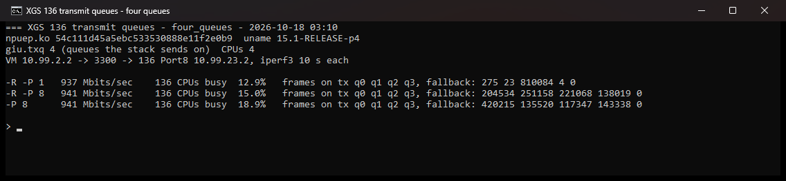

<!-- reviewed: 2026-10-18 -->
<!-- board: IPv6, flows in hardware | XGS 3300 | 9.24 &#183; 9.27 Gbit/s -->
# IPv6 through the coprocessor, and the XGS 136's transmit queues, 2026-10-18

Two measurements of the same night's driver work, each taken in a window of its own and photographed
when it finished:

- **IPv6 connections in the XGS 3300's coprocessor**, both directions, with the flow table read half way
  through each run - the first IPv6 traffic this project has measured in hardware.
- **The XGS 136 sending on four transmit queues**, against the same build sending on one.

Both builds were installed on the appliances and are in the working tree that went out with them; the
modules are named by their checksums in the photographs.

## The bench

The [three-appliance bench](bench-2026-10-17.md) of the night before, with a server behind the second
XGS 3300's module port A2 and a virtual machine behind its F2:

| link | from | to | medium |
|---|---|---|---|
| the PC | the PC's 10GBASE-T NIC | the second XGS 3300's F1 | copper, 10 Gbit/s |
| the server | a server's 10G NIC | the second XGS 3300's A2 | fibre, 10 Gbit/s |
| the VM | a virtual machine on the PC, on its own 10G port | the second XGS 3300's F2 | copper, 10 Gbit/s |
| the gigabit link | the second XGS 3300's Port8 | the XGS 136's Port8 | copper, 1 Gbit/s |

IPv6 on the links is a unique-local /64 each, set with OPNsense's own interface model; the routes are
in OPNsense's own routes model.

## IPv6 through the XGS 3300

- **Load:** iperf3 under WSL on the PC (on F1) to iperf3 on the server (on A2),
  eight TCP streams for fifteen seconds, each way. The figure is the receiver's.
- **Driver:** `octep.ko` with md5 `5c32d094`, flows made by `dp.auto`, the table sized by the board
  (2,000,000 connections, [board-limits.md](../families/board-limits.md)).
- **The flow table** is read half way through each run: every IPv6 direction it lists, and how many of
  those are active in hardware.

| direction | received | IPv6 directions listed | active in hardware | refused | tuple mismatches |
|---|---|---|---|---|---|
| PC to server | **9.24 Gbit/s** | 18 | **18** | 0 | 0 |
| server to PC | **9.27 Gbit/s** | 18 | **18** | 0 | 0 |

Eighteen directions are the eight data connections both ways and iperf3's control connection. None
was refused (`dp.flow_v6_refused` 0) and none was found with a tuple that disagreed with pf's
(`dp.flow_tuple_mismatch` 0).

**What it is not.** These connections are not translated: an IPv6 connection that pf translates, or one
an IPsec policy covers, is left with the host by design, and neither was measured here. The figure is
the bench's 10G links, not the coprocessor's limit.

## The XGS 136's four transmit queues

- **Load:** iperf3 on the bench VM against an iperf3 server on the XGS 136's Port8, across
  the second XGS 3300; ten seconds a run. `-R` is the 136 sending - its transmit
  queues; plain is the 136 receiving. The figure is the receiver's.
- **Driver:** `npuep.ko` with md5 `54c111d4`, in both photographs. The first was taken with
  `hw.npuep.giu.txq=1` for that one boot (`nextboot -e`), which sends everything on the first queue
  the way every build before it did; the second with the default, four.
- **CPU:** how busy the 136's four CPUs were over the run, from `kern.cp_time`.
- **Queues:** frames each transmit queue took over the run (`giu.tx_q0` to `giu.tx_q3` under `dev.npuep.0`), and
  frames a full queue handed back to the stack's send queue (`tx_fallback`).

| run | one queue | CPUs busy | four queues | CPUs busy | frames on q0 / q1 / q2 / q3, fallback |
|---|---|---|---|---|---|
| 136 sends, one stream | 936 Mbit/s | 13.9 % | 937 Mbit/s | 12.9 % | 275 / 23 / 810,084 / 4, 0 |
| 136 sends, eight streams | 941 Mbit/s | 14.8 % | 941 Mbit/s | 15.0 % | 204,534 / 251,158 / 221,068 / 138,019, 0 |
| 136 receives, eight streams | 941 Mbit/s | 21.1 % | 941 Mbit/s | 18.9 % | 420,215 / 135,520 / 117,347 / 143,338, 0 |

**What it shows.** The coprocessor takes frames from all four transmit queues - a connection is kept
to one queue by its flow id, so one stream's frames went to the third queue alone and arrived whole,
and eight streams spread over all four - and none fell back to the old path. **What it does not show
is a gain:** the link is a gigabit and every run fills it either way, and the CPU figures differ by
less than they differ between runs. What changed is that a frame from the stack no longer waits for
the receive poll's lock; a link that is not the limit, or a host that is busy, is where that would
show, and neither was measured.
