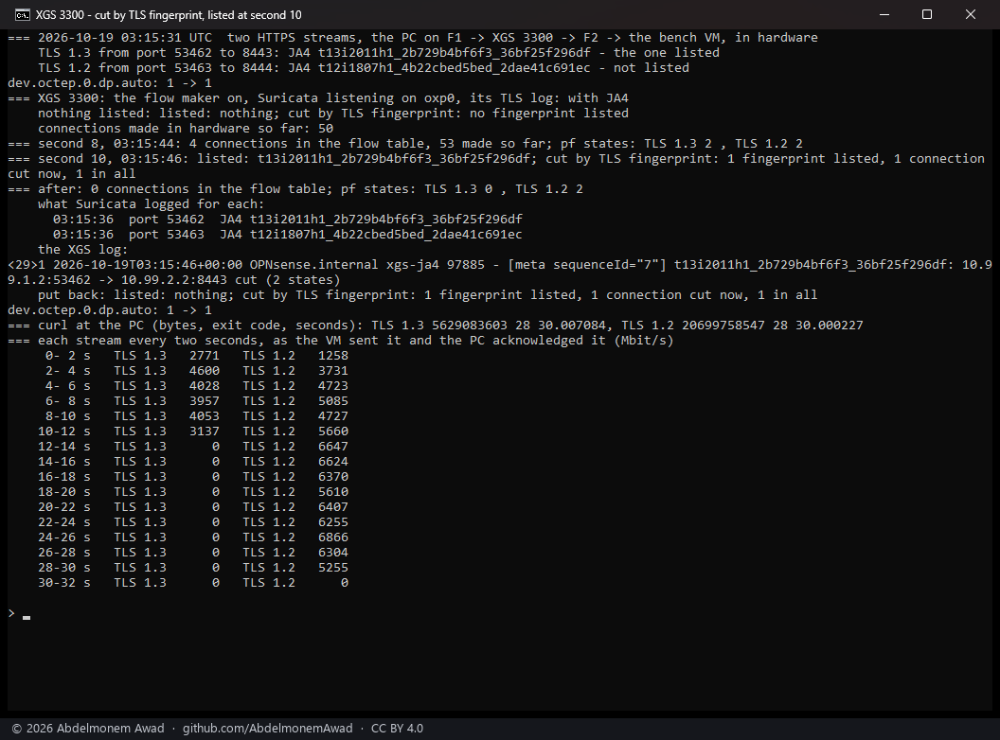
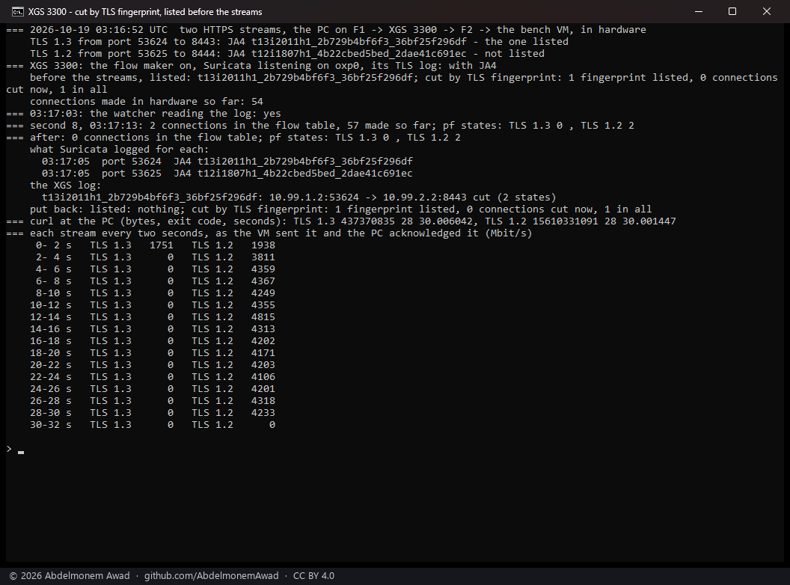
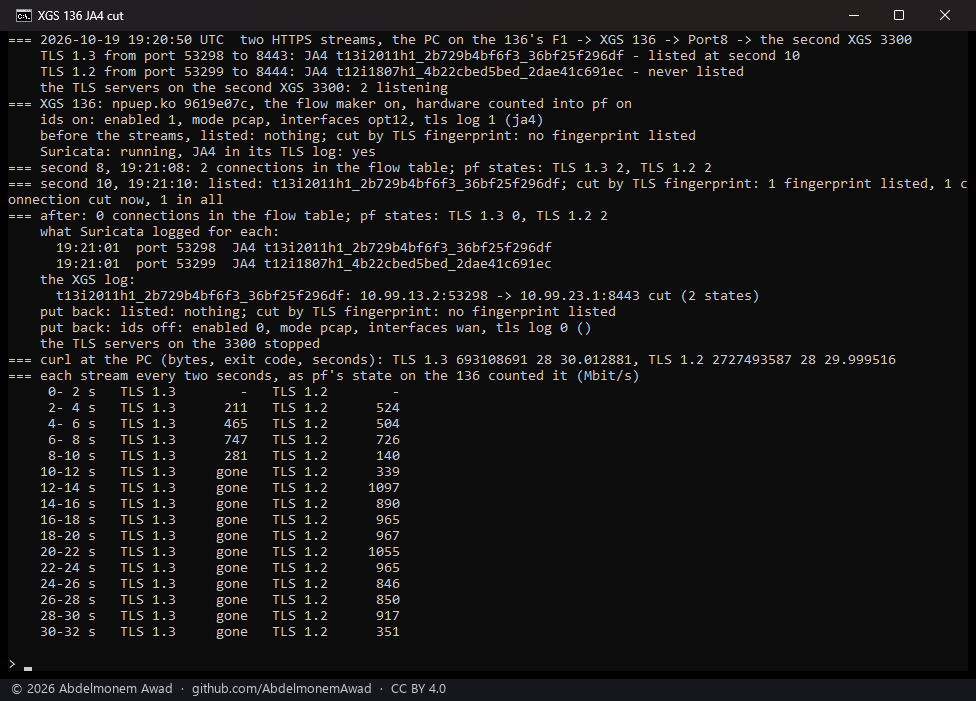

<!-- reviewed: 2026-10-19 -->
# Connections cut by their TLS fingerprint (JA4), measured, 2026-10-19

**XGS: Settings - Cut connections by TLS fingerprint.** JA4 is a fingerprint of a TLS ClientHello -
the version, ciphers, extensions and protocols a client offers - so it names the software that opened
a connection rather than the address it went to. OPNsense's Intrusion Detection (Suricata 8) writes
one for every TLS connection it sees once its TLS log carries the JA4 field. With fingerprints listed
here, `scripts/xgs/ja4_cut.py` reads that log every two seconds (started each minute by cron) and
when the settings are saved, and kills by id every pf state of a connection it shows with a listed
fingerprint; the driver then takes the connection out of hardware, as it does for a block list
([lists-cut-2026-10-19.md](lists-cut-2026-10-19.md)).

The question before any of it: with the flow maker on, does Suricata see a connection at all? It
does. The ClientHello is a connection's first data, and the flow maker puts a connection into
hardware after it, so the fingerprint is logged however fast the connection then runs - below, two
streams in the flow table at 4 Gbit/s each, both fingerprinted.

## How it was measured

On the second XGS 3300: the Intrusion Detection on, in IDS mode (listening only), on F1, with JA4 in
its TLS log (`images/deploy/ids-test.php`, put back afterwards). Two HTTPS streams from the bench PC
on F1, through the appliance and out of F2, to the bench VM, which serves `/dev/zero` over
`openssl s_server` - a stream with no end:

- **TLS 1.3**, curl on Windows: JA4 `t13i2011h1_2b729b4bf6f3_36bf25f296df` - **the one listed**;
- **TLS 1.2**, the same curl held to TLS 1.2: JA4 `t12i1807h1_4b22cbed5bed_2dae41c691ec` - not listed.

Same program, same addresses, same server: only the ClientHello differs. With **listed** the
fingerprint was listed before the streams started and the minute's watcher found it; with **now**
nothing was listed, and at second 10 the fingerprint was listed and the cut run once, as saving the
page does (`images/deploy/ja4-test.php`). Each stream was read on the VM every second, by the bytes
the PC had acknowledged. Run by `images/deploy/lab-ja4-cut.sh`, each in a window of its own,
photographed.

The driver the XGS 3300 loaded at its boot of 2026-10-18 14:53 UTC; the module file was rebuilt
since by deploys, without a reboot. os-xgs-npu at the branch of this change (`b81428a`).

## Results

| the cut | TLS 1.3, listed | TLS 1.2, not listed | in the flow table at second 8 |
|---|---|---|---|
| now, listed at second 10 | 2.8 to 4.6 Gbit/s until second 10, 3.1 in the two seconds of the cut, then **0** | 1.3 to 6.9 Gbit/s for all thirty seconds | 4 entries, both streams |
| listed before the streams | 1.75 Gbit/s in its first two seconds, then **0** | 1.9 in its first two seconds, then 3.8 to 4.8 Gbit/s to the end | 2 entries, the TLS 1.2 stream |

- **Only the listed fingerprint was cut.** In both runs the TLS 1.3 stream stopped and the TLS 1.2
  stream beside it - the same program to the same server - ran on to the end; pf kept its two states
  and dropped the listed one's.
- **Listed at second 10, cut at once**: the TLS 1.3 stream's log line was eight seconds old by then,
  and a fingerprint newly listed is looked for in the whole log, so listing one cuts what is already
  open with it. The XGS log names the connection, `cut (2 states)` - a state on each interface it
  crosses.
- **Listed before, cut within its first two seconds**: the watcher reads the log every two seconds,
  and the stream delivered 437 MB (1.75 Gbit/s over those two seconds) before it stopped.
- Both streams were fingerprinted in both runs (`what Suricata logged for each`). In the run listed
  at second 10 both were in the flow table at second 8, at 4 Gbit/s each, their fingerprints logged at
  second 0: Suricata's view of a connection in hardware ends after its ClientHello, which is all JA4
  needs.
- curl ended both streams itself after thirty seconds (exit code 28, its time limit): a cut
  connection is not reset, it stops receiving.
- ~~**Not measured**: the XGS 136. The script and its cut are the same, and a killed state is taken out
  of hardware there too ([lists-cut-2026-10-19.md](lists-cut-2026-10-19.md)); Suricata on its
  smaller processor, beside a gigabit of traffic, has not been run.~~ Measured the same evening, below.

## On the XGS 136

The same two streams, through the XGS 136 (v0.1.0-alpha.2, npuep 9619e07c;
`images/deploy/lab-136-ja4-cut.sh`). The PC's USB adapter goes into the 136's F1 and through the 136
out of its Port8, to two TLS servers on the second XGS 3300, and the 136's flow maker put both in
hardware.

- The 136's Intrusion Detection was turned on for the run - IDS mode, listening on F1, never
  dropping - with JA4 in its TLS log, and put back after.
- Nothing was listed when the streams started. At second 10 the TLS 1.3 fingerprint was listed and
  the cut run once, as saving the settings page does.
- Each stream was read on the 136 every second, by the bytes pf's state holds for it: the
  coprocessor's count, given to pf.

| | TLS 1.3, listed at second 10 | TLS 1.2, never listed |
|---|---|---|
| in hardware at second 8 | yes - 2 connections in the flow table | yes |
| Suricata's JA4 | `t13i2011h1_2b729b4bf6f3_36bf25f296df` | `t12i1807h1_4b22cbed5bed_2dae41c691ec` |
| the cut | at second 10: "1 connection cut now"; the XGS log, "cut (2 states)" | - |
| after the run | 0 states, gone from the table from second 10 on | 2 states, running |
| curl at the PC, 30 s | 693 MB, then nothing | 2,727 MB, 727 Mbit/s on average |

- The listed stream stopped receiving at the cut and curl ended it at its time limit, 30 seconds, as
  on the XGS 3300. The other took the whole link from then on.
- Two-second figures above 1,000 Mbit/s: the coprocessor's counts reach pf's state in batches, so a
  two-second slice can hold more than two seconds' bytes. curl's total, 2,727 MB in 30 s, is the
  rate.
