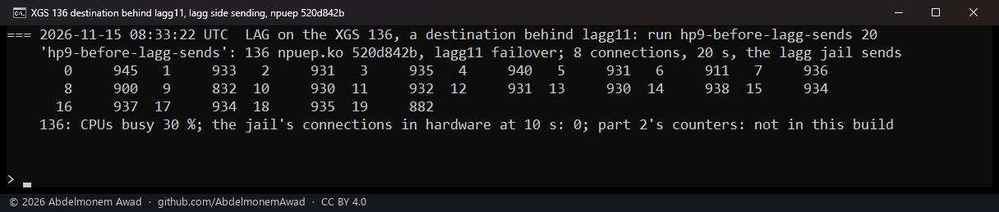
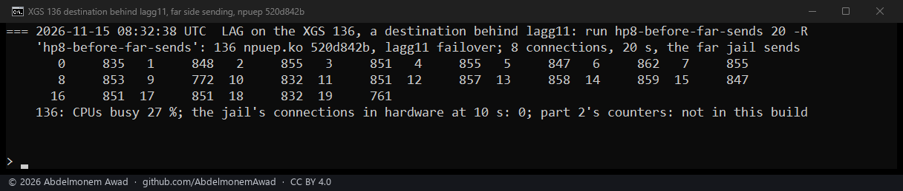
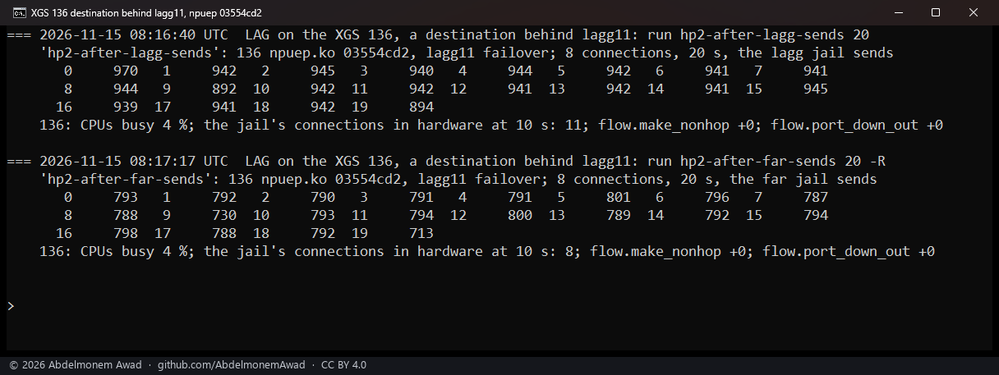
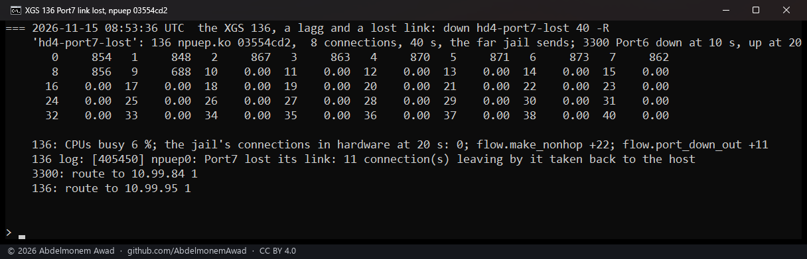

<!-- reviewed: 2026-11-15 -->
# A destination behind a lagg on the XGS 136: refused, and in hardware now; and a port's connections taken back when its link goes, 2026-11-15

The XGS 136's driver resolved a connection's original direction - toward its destination - with no port to fall
back on, so a destination whose route names a lagg was refused, and the host forwarded the whole connection; the
reply direction, to an opener behind a lagg, already took the port its own frames arrive on. Since the change the
original direction takes the port the destination's own frames arrive on, for a lagg's route only and only when
that port is one of the lagg's members (`npuep_nhop_hint_fits`), as the XGS 3300's driver does. A refused next hop
is counted (`flow.make_nonhop`) and named in `flow.accelerate`'s answer.

And as on the XGS 3300 ([a lagg member lost](lag-member-loss-3300-2026-11-15.md)), a front port that loses its link
has every connection with a direction leaving by it taken back to the host (`npuflow_port_down`, counted in
`flow.port_down_out`).

## How it was measured

2026-11-15 from 06:30 to 08:55 UTC: the XGS 136 (vendor version 21) on the path of
[the lagg measurement](lag-3300-2026-11-15.md) - a jail on the FreeBSD test machine behind the second XGS 3300 (vendor
version 22), through it to the XGS 136's Port7, and out of the XGS 136's Port11 to the far jail.

- **The lagg on the XGS 136**: lagg11 in failover with Port11 its only member and the far jail's network on it -
  the test machine has one cable to the XGS 136, so a lagg of two members of its own could not be made.
- **The traffic**: eight TCP connections for 20 seconds each way; at second 10 the jail's connections in hardware on
  the XGS 136, as XGS: Offloaded Flows reads them, and its CPUs over the run.
- **A link lost**: the XGS 3300's Port6 taken down at its switch at second 10 and up at 20, which takes the XGS
  136's Port7 down with it; the far jail sending, so the connections' data left the XGS 136 by Port7.
- **The builds**: npuep.ko `520d842b` (the module of phase 2's first part) before, `03554cd2` after, each loaded
  with reload.sh; the XGS 3300 ran octep.ko `92ee29bb` and `2cec49f9`, carrying its part in hardware either way.
- **Taken away after**: lagg11 and the jails gone, Port11 back in its bridge, `config.xml` unchanged on both.

## Results

| npuep.ko | the lagg jail sending | the far jail sending |
|---|---|---|
| `520d842b`, before | 830 to 945 Mbit/s, CPUs 30 %, **0** in hardware | 760 to 865 Mbit/s, CPUs 27 %, **0** |
| `03554cd2`, after | 890 to 970 Mbit/s, CPUs 4 %, **11** in hardware | 710 to 800 Mbit/s, CPUs 4 %, **8** |

- **Before**, in every run either way the host forwarded the connections, its CPUs 18 to 30 % busy; **after**, they
  were in hardware and the CPUs 4 to 11 % busy, no next hop refused.
- **A link lost**: "Port7 lost its link: 11 connection(s) leaving by it taken back to the host", and
  `flow.port_down_out` rose by the same; in five such runs 9 to 16 connections were taken back.
- In the photographed run the traffic did not come back before its end: when Port6's link went and came back,
  OPNsense's link hooks removed the routes the lab had added by hand, and they were put back by the script only
  after the connections had backed off. That is the lab's path, not the take-out.

### What is not measured

- **A lagg of two members on the XGS 136**, LACP or failover, and a member lost under it: one cable from the test
  machine.
- **A lagg inside a bridge**: its members' frames still count as routed ones; not changed here.
- **The test machine's USB adapter behind Port11** stopped passing frames after a run the XGS 136's host forwarded
  at full rate - four times with `520d842b`, never with `03554cd2` - and was reset at the USB level before each of
  the runs photographed. Whether the XGS 136's host path has a part in it was not found.
