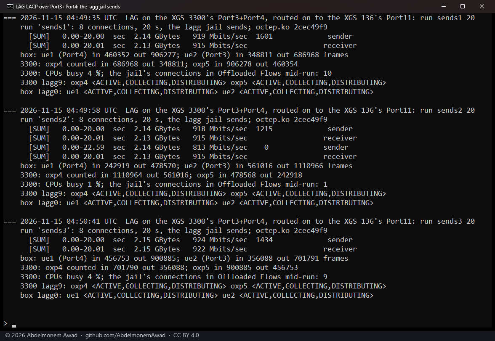
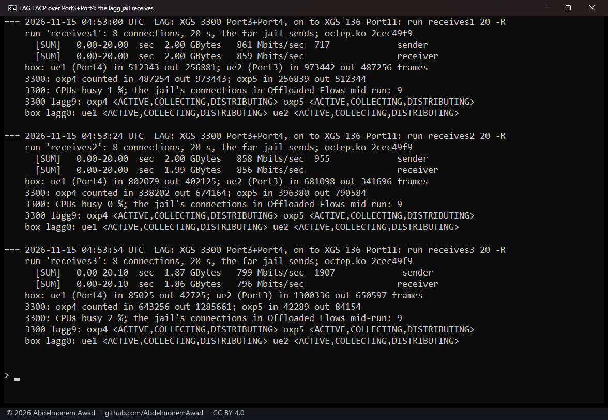
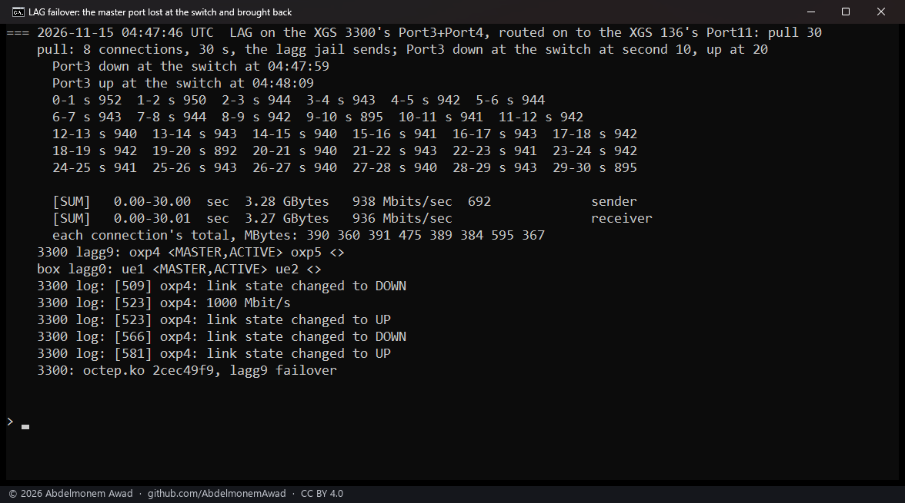

<!-- reviewed: 2026-11-15 -->
# A lagg over the second XGS 3300's front ports: no unicast at first, both members carrying traffic in hardware after the change, 2026-11-15

A lagg over two front ports was read in the drivers' code to be routed to and from, and had never been measured.
Measured first, it carried nothing.

## How it was measured

2026-11-15 from 03:47 to 05:00 UTC: the second XGS 3300 (vendor version 22) and the XGS 136 (vendor version 21).

- **The lagg**: lagg9 over the XGS 3300's Port3 and Port4, made at run time, against lagg0 over the two adapters
  of the FreeBSD test machine cabled to them, in a VNET jail; LACP, and then failover.
- **The path**: from the lagg's jail through the XGS 3300, routed out of its Port6 to the XGS 136, and out of the
  XGS 136's Port11 to a second jail on the test machine's third adapter. The link between the two appliances is
  1 Gbit/s, so it is the limit of every run.
- **Read**: iperf3, eight TCP connections for 20 seconds each way; frames on each adapter of the lagg; the XGS 3300's
  CPUs and, at second 10, the jail's connections in the list behind XGS: Offloaded Flows; the laggs' port flags.
- **A member lost**: Port3 taken down at the switch and brought back 10 seconds later - its administrative state,
  which takes both ends' link down; the test machine's own adapter taken down does not drop its link.
- **Taken away after**: the laggs and jails gone, the ports back in the bridges, `config.xml` unchanged on both.

## Before the change

- LACP formed on both members, and no unicast crossed either way: the XGS 3300 resolved the jail and no ping
  came back; 50 pings from the jail added 6 frames to the coprocessor's count from the wire, though the switch's
  Port4 took them in.
- A lagg gives its members its own address. Bring-up had told each port its own once - to the switch, whose
  per-port entry passes unicast to that address alone, and to the port's logical interface. Named the lagg's
  address by hand, the switch let the frames through and the logical interface dropped all 50
  (`FROM_WIRE_DROP_LIF_NOT_MY_MAC`); updated by hand too, 4 pings of 4 and 6 of 6.
- A member brought back logged "LACP: support 0 baudrate!" and did not rejoin: the link was announced before the
  speed. And the rotation that reads one port a second saw the loss 9 seconds late and the return 15.

## After it (octep.ko `2cec49f9`)

| LACP, eight connections | Received | XGS 3300 CPUs | In hardware at second 10 | Frames out of the lagg side's two adapters |
|---|---|---|---|---|
| the lagg side sends | 915, 915, 922 Mbit/s | 1 to 4 % | 10, 1, 9 | both in every run, 30 to 70 % on one |
| the lagg side receives (frames into it) | 859, 856, 796 Mbit/s | 0 to 2 % | 9, 9, 9 | both in every run, 6 to 94 % on one |

- **The address told again**: when a port's address is not the one it was last told, the link poll tells the
  switch and the logical interface; a member that leaves the lagg is told its own back.
- **The speed before the link**, and every lagg member's link read every tick: a member lost was seen at once,
  its return 3 seconds later, and it rejoined.
- **A port's address named again when its link comes up**: Port3 taken down and up at the switch came back
  passing broadcast and no unicast - 7.12 Mbit/s through it - until it was.
- **Failover**: the master lost at the switch and brought back, eight connections over 30 seconds: 892 to 952
  Mbit/s every second, every connection moving.

### What is not solved, or not measured

- **A member lost under LACP stalls connections for seconds**: in the first run with this build, all eight stalled
  for about 3.5 seconds and one moved 116 MB against 300 to 527 for the others; a connection whose return
  direction is in hardware on the lost member's port stays there until the hardware lets it go. Later runs left
  connections stalled after the member came back, until the laggs were made again; their figures are not given
  here, ~~and the cause is open~~. Measured since, with the far side sending: those connections were held in
  hardware out of the dead port while it was down and then waited out TCP's backed-off timer, half of them still
  for 19 to 32 seconds of 40; the driver takes them back to the host now
  ([a lagg member lost](lag-member-loss-3300-2026-11-15.md)).
- **Not measured with a cable pulled by hand**, nor on the XGS 136, whose driver re-tells a changed address
  already and ~~refuses a connection whose destination is behind a lagg~~ makes one since the same day's second part
  ([a destination behind a lagg on the XGS 136](lag-136-2026-11-15.md)).
- **Changing a live lagg's protocol** from LACP to failover left it sending nothing; made again in failover it
  worked.
