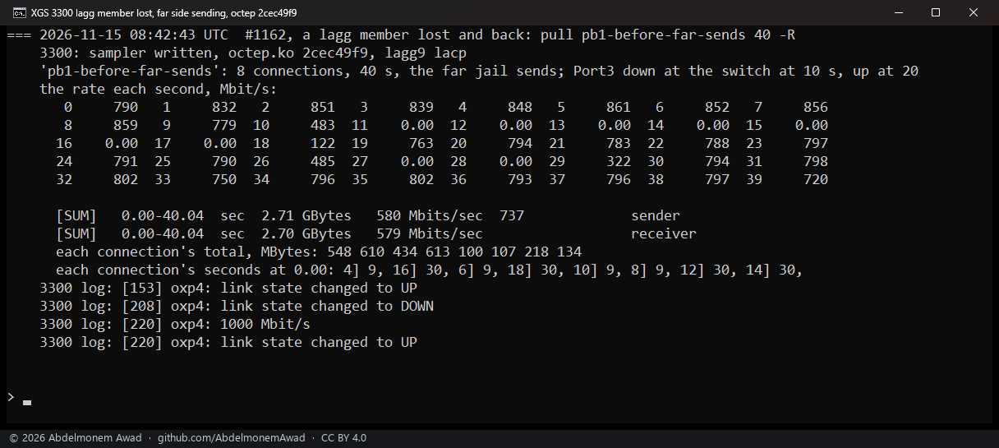
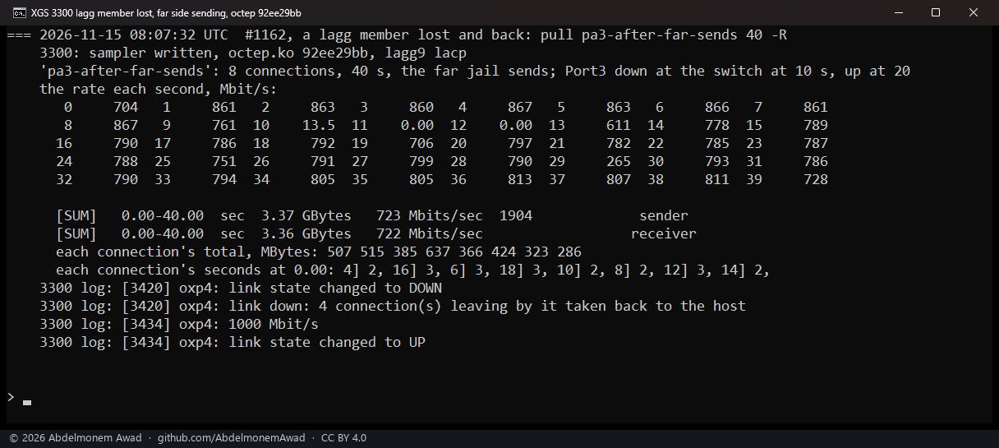

<!-- reviewed: 2026-11-15 -->
# A lagg member lost on the second XGS 3300: connections in hardware sent into the dead port for up to half a minute, and taken back to the host now, 2026-11-15

With a lagg in LACP over the XGS 3300's Port3 and Port4, losing one member stalled connections
([#1162](https://github.com/AbdelmonemAwad/os-xgs-npu/issues/1162)). A direction in hardware leaves by the port
chosen when it was made, and nothing moved it: while the member was gone, the connections with a direction
leaving by it stayed in hardware, sending into the dead port and kept alive by the far side's own retransmissions,
and after the port came back they waited out TCP's backed-off retransmission timer.

Since the change, when a front port's link goes the driver takes back to the host every connection with a
direction leaving by it (`octep_dp_port_down`, counted in `dp.flow_port_down`); the host sends their frames by
the ports that still have a link and the connections are made again from there. A route out of a front port
with no link is refused (`ENETDOWN`), and a lagg's route takes the hint of a port only when it is one of the
lagg's members (`octep_nhop_hint_fits`).

## How it was measured

2026-11-15 from 05:50 to 08:45 UTC: the second XGS 3300 (vendor version 22) and the XGS 136 (vendor version 21),
on the lab of [the lagg measurement](lag-3300-2026-11-15.md).

- **The lagg**: lagg9 over the XGS 3300's Port3 and Port4 in LACP, against lagg0 over two USB adapters of the
  FreeBSD test machine in a jail; routed out of the XGS 3300's Port6 to the XGS 136 and out of its Port11 to a
  second jail, the far one.
- **A member lost**: Port3 taken down at the switch (its administrative state) at second 10 and up at 20, by a
  sampler on the XGS 3300 that read the lagg, the driver's counters and its tables every two seconds.
- **The traffic**: eight TCP connections for 40 seconds, the far jail sending - its data leaving the XGS 3300 by
  the lagg - and the other way; the rate each second and, for each connection, the seconds it moved nothing.
- **The builds**: octep.ko `2cec49f9` before; `d00cc3cc` and `92ee29bb` after, which take the connections out the
  same way (the first told a lagg by its interface type, which is the members' and not the lagg's, so its
  membership check passed every port - `92ee29bb` tells it by the driver's name).
- **Taken away after each set**: the laggs and jails gone, the ports back in their bridges, `config.xml`
  unchanged on both appliances.

## Results

| octep.ko | the far jail sending: seconds at 0, each of the eight connections | the lagg jail sending |
|---|---|---|
| `2cec49f9`, before | 7, 8, 8, 8, 8, 9, 24, 32 · 4, 4, 5, 5, 19, 19, 19, 19 · 7, 7, 7, 20, 20, 20, 20, 21 · 9, 9, 9, 9, 30, 30, 30, 30 | 2 to 6 · 3 to 5 |
| after | 2 to 5 · 3 to 5 · 3 to 4 · 6, one 13 · 2 to 3 · 2 to 3 · 4 to 6 · 2 to 3 | 2 to 4 · 5 · 3 to 8 |

- **Before**: in every run with the far jail sending, half the connections or more moved nothing for 19 to 32
  seconds of 40: the direction carrying their data was in hardware out of Port3 all the while it was down, and
  went on after it was back only once TCP's timer had backed off and fired again.
- **After**: the driver logged the take-out at the moment it saw the link go - "oxp4: link down: 4 connection(s)
  leaving by it taken back to the host" - and the longest any connection stood still was 13 seconds, most 2 to 6.
- **The lagg jail sending**: about the same before and after, 2 to 8 seconds. Its data arrives by the lagg and
  only its acknowledgements leave by it; why the old build did not hold those connections longer was not taken
  apart.

### What is not solved, or not measured

- **What remains, 2 to 6 seconds in most runs**, was not taken apart: the test machine's own lagg in LACP stops and
  starts its members at the same moment, and TCP's retransmission timer counts too.
- **A port outside a lagg is read once a sweep**, sixteen seconds on this appliance: a shorter loss of its link is
  not seen at all, and its connections are not taken out (the XGS 3300's Port6 down for 10 seconds, not seen).
  Every lagg member is read every second.
- **Not measured with a cable pulled by hand**; the refusal of a route out of a port with no link was not reached
  by these runs - a lagg's route takes the hint, and the automatic maker waits for both directions.
- **Under congestion**, with both members carrying traffic into the 1 Gbit/s link to the XGS 136, about a tenth of
  the frames reached the host: the fast path handed connections back at its retransmission limit
  (`FROM_WIRE_TO_KN_TCP_MAX_RETRANS`) and they were made again; with one member, 0.3 %. Not changed here.
